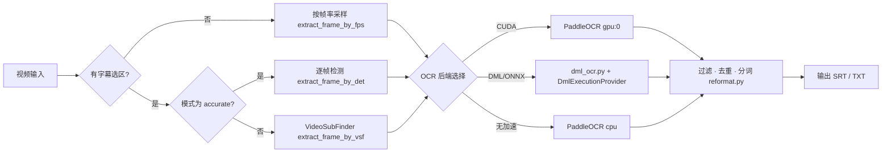
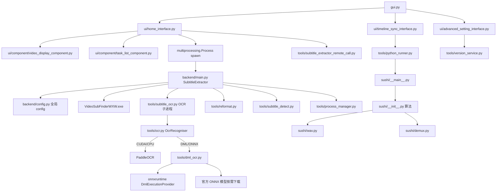

# VSE 代码库结构与维护指南

> **文档目的**：对全部代码做逐文件、逐方法的梳理，作为日后**局部维护**与**全面重构**的共同基准。
> **对应版本**：`backend/config.py` 中 `VERSION = "2.2.0"`（已完成一轮缺陷修复与 DirectML 后端接入）。
> **内容基准**：本文描述的是**当前磁盘上的最终代码状态**，不含变更历史。
> **覆盖范围**：项目内全部 **41 个 Python 文件** 及 2 个 sushi bat 脚本；配置项、语言资源、二进制依赖以清单/说明形式记录。

---

## 阅读导航

| 章节 | 内容 | 对应分片 |
|---|---|---|
| [一、入口与配置核心](#一入口与配置核心) | `gui.py`、`config.py`、`subtitle_area.py`、`constant.py` | 01 |
| [二、核心引擎 backend/main.py](#二核心引擎-backendmainpy) | `SubtitleExtractor` 全部方法逐一详解 | 02 |
| [三、后端工具模块](#三后端工具模块-backendtools) | OCR、DirectML、模型、检测、进程、格式化、更新等 14 个文件 | 03 |
| [四、并发工具框架](#四并发工具框架-backendtoolsconcurrent) | `concurrent/` 下 Future / Task / TaskManager | 04 |
| [五、sushi 时间轴同步模块](#五sushi-时间轴同步模块-backendsushi) | 时间轴平移算法与 CLI 入口，10 个 py + 2 个 bat | 05 |
| [六、UI 界面层](#六ui-界面层-ui) | 三个 Interface 与图标模块 | 06 |
| [七、UI 组件](#七ui-组件-uicomponent) | 视频框选组件、批量任务列表组件 | 07 |
| [八、汇总：已修复项与后续建议](#八汇总已修复项与后续建议) | 修复清单与后续重构方向 | 本文件 |

---

## 全局架构总览

### 分层结构

```
┌──────────────────────────────────────────────────────────────┐
│ 入口层      gui.py（FluentWindow，仅做容器与生命周期管理）      │
├──────────────────────────────────────────────────────────────┤
│ 界面层      ui/                                               │
│             HomeInterface（主工作流）                          │
│             AdvancedSettingInterface（参数/关于/更新）          │
│             TimelineSyncInterface（sushi 前端）                │
│             component/（视频框选、任务列表）                    │
├──────────────────────────────────────────────────────────────┤
│ 业务层      backend/main.py — SubtitleExtractor（1131 行）     │
│             backend/sushi/ — 独立的时间轴同步子工具             │
├──────────────────────────────────────────────────────────────┤
│ 支撑层      backend/tools/*                                   │
│             ├─ PaddleOCR 路径（ocr.py + paddle_model_config）  │
│             ├─ DirectML 路径（dml_ocr.py，ONNX Runtime）       │
│             └─ 进程/格式化/版本/远程调用等工具                  │
│             backend/config.py（全局 QConfig 单例 + 多语言 tr）  │
├──────────────────────────────────────────────────────────────┤
│ 外部依赖    PaddleOCR v5 模型 / 官方 ONNX 模型、VideoSubFinder │
│             、ffmpeg                                          │
└──────────────────────────────────────────────────────────────┘
```

### 字幕提取主数据流



**关键约定**
- 进度总量 `300` = 抽帧 `100` + OCR `100` + 后处理 `100`。
- 任务元组统一为 `(总帧数, 当前帧号, dt_box, rec_res, total_ms, subtitle_area)`；`total_ms` 非 `None` 表示帧来自 VSF。
- OCR 原始结果落盘 `output/<视频名>/subtitle/raw.txt`，格式 `帧号\t(xmin,xmax,ymin,ymax)\t文本`。
- 最终字幕默认写在**视频同目录**（GUI 可通过 `saveDirectory` 覆盖），临时文件在**项目根 `output/`**。
- DirectML 后端按需下载官方 PP-OCRv5 ONNX 模型到 `~/.paddleocr/onnx/`（可用 `VSE_ONNX_MODEL_DIR` 覆盖），不随仓库分发。

### 跨模块调用关系



---

## 代码文件总表

行数为当前最终代码的静态统计；"章节"列指向本文详细分析位置。

| 文件 | 行数 | 一句话职责 | 章节 |
|---|---:|---|---|
| `gui.py` | 173 | 程序入口、主窗口与三页容器 | 一 |
| `backend/__init__.py` | 3 | 注入 `dependencies/` 到 `sys.path` | 一 |
| `backend/config.py` | 113 | 全局 QConfig、多语言 tr、版本与路径常量 | 一 |
| `backend/bean/subtitle_area.py` | 55 | 字幕选区 dataclass 与几何/AB 区间运算 | 一 |
| `backend/tools/constant.py` | 30 | 字幕位置、VSF 解码器枚举 | 一 |
| `backend/main.py` | 1131 | **核心引擎**：抽帧、OCR 调度、去重、输出 | 二 |
| `backend/tools/__init__.py` | 0 | 空包标记 | 三 |
| `backend/tools/hardware_accelerator.py` | 94 | CUDA / ONNX provider 检测单例 | 三 |
| `backend/tools/makedist.py` | 56 | QPT 打包脚本（Debug/Release） | 三 |
| `backend/tools/ocr.py` | 150 | OCR 后端门面：PaddleOCR 与 DML 切换 | 三 |
| `backend/tools/dml_ocr.py` | 354 | **DirectML 后端**：ONNX Runtime 推理 + 前后处理 | 三 |
| `backend/tools/paddle_model_config.py` | 159 | 语言/模式 → 模型路径与 model_name | 三 |
| `backend/tools/process_manager.py` | 130 | 子进程登记与跨平台终止 | 三 |
| `backend/tools/python_runner.py` | 169 | 异步启动 Python 子进程并回调输出 | 三 |
| `backend/tools/reformat.py` | 223 | 分词、typoMap 替换、标点规范化 | 三 |
| `backend/tools/subtitle_detect.py` | 37 | 精准模式文本框检测封装 | 三 |
| `backend/tools/subtitle_extractor_remote_call.py` | 71 | 跨进程进度/日志队列协议 | 三 |
| `backend/tools/subtitle_ocr.py` | 302 | OCR 子进程：生产者/消费者、区域过滤、落盘 | 三 |
| `backend/tools/theme_listener.py` | 26 | 系统主题监听（当前未启用） | 三 |
| `backend/tools/version_service.py` | 84 | GitHub/镜像更新检查与系统代理读取 | 三 |
| `backend/tools/concurrent/__init__.py` | 1 | 空包标记 | 四 |
| `backend/tools/concurrent/future.py` | 248 | Qt 线程池 Future 实现 | 四 |
| `backend/tools/concurrent/task.py` | 48 | QRunnable 任务封装 | 四 |
| `backend/tools/concurrent/task_manager.py` | 111 | TaskExecutor 单例调度器 | 四 |
| `backend/sushi/__init__.py` | 699 | **sushi 核心算法**：分组、波形匹配、平移字幕 | 五 |
| `backend/sushi/__main__.py` | 155 | sushi CLI 参数解析与入口 | 五 |
| `backend/sushi/chapters.py` | 37 | 章节时间解析 | 五 |
| `backend/sushi/common.py` | 42 | 通用工具函数与异常类 | 五 |
| `backend/sushi/demux.py` | 358 | ffmpeg / mkvextract 等外部工具封装 | 五 |
| `backend/sushi/keyframes.py` | 16 | XviD 关键帧文件解析 | 五 |
| `backend/sushi/regression-tests.py` | 214 | 上游回归测试脚本（未接入） | 五 |
| `backend/sushi/subs.py` | 275 | SRT/ASS 字幕解析、事件与写出 | 五 |
| `backend/sushi/sushi_main.py` | 95 | 时间轴同步便捷包装层 | 五 |
| `backend/sushi/wav.py` | 190 | WAV 解码、降采样与模板匹配 | 五 |
| `ui/home_interface.py` | 630 | 主工作流：选视频、框选、批量运行、进度日志 | 六 |
| `ui/advanced_setting_interface.py` | 327 | 高级参数卡片、关于与更新 | 六 |
| `ui/setting_interface.py` | 85 | 常用设置卡片（语言/模式/加速等） | 六 |
| `ui/timeline_sync_interface.py` | 207 | sushi 的 GUI 前端 | 六 |
| `ui/icon/my_fluent_icon.py` | 11 | 跟随主题的停止图标 | 六 |
| `ui/component/task_list_component.py` | 395 | 批量任务数据模型与列表 UI | 七 |
| `ui/component/video_display_component.py` | 976 | 视频预览、鼠标框选、坐标换算、快捷键 | 七 |

**非代码但需要知道的资源**
- `backend/interface/*.ini`：8 种界面语言（ch / chinese_cht / en / ko / japan / vi / es / tr），各 11 个 section、243 个 key。
- `backend/configs/typoMap.json`：文本替换规则，key 按**正则**处理。
- `backend/subfinder/windows/`：VideoSubFinderWXW.exe + FFmpeg 4.x / OpenCV 4.3 / CUDA 11 运行库 + `settings/general.cfg`。**无 macOS/Linux 二进制**。
- `backend/tools/NotoSansCJK-Bold.otf`：打包用字体。
- `design/`：图标与演示素材，不参与运行。
- `.github/workflows/*.yml`：5 套 Windows 打包发布流程（CPU / DirectML / CUDA 10.2 / 11.8 / 12.6）。
- `requirements.txt` / `requirements_directml.txt` / `.condarc`：依赖与环境配置；DirectML 依赖见后者。

---

以下是逐目录、逐文件的详细分析。

---

## 一、入口与配置核心

这组文件构成整个 VSE 应用的"启动骨架"：`gui.py` 是唯一的进程入口与主窗口容器（当前 173 行，只负责界面装配与生命周期，不含 OCR 逻辑、不含进度轮询），`backend/__init__.py` 负责把内置依赖目录注入导入路径，`backend/config.py` 是全局唯一的 qfluentwidgets 配置中心（UI 卡片与 OCR 后端都从这里取值），`backend/bean/subtitle_area.py` 与 `backend/tools/constant.py` 提供被 UI 与后端共同引用的数据载体和枚举。它们本身不执行 OCR，但决定了程序能否启动、使用哪套语言/模型/解码器参数，以及选区坐标如何表达。任何局部改动前都应先确认这里暴露的"配置键—UI 卡片—读取方"契约。

---

### gui.py
- **路径**：`gui.py`
- **规模**：173 行（类定义 33-153，脚本入口 156-173）
- **职责**：程序入口与主窗口 `SubtitleExtractorGUI(FluentWindow)` 的唯一定义处。负责创建三个子界面（首页、时间轴同步、高级设置）、连接 `config.appRestartSig`、启动时延迟触发更新检查、保存/恢复窗口位置、退出时终止所有子进程，并在 `__main__` 中完成多进程启动方式、高 DPI 策略与淡入动画设置。当前类中的方法均为容器/生命周期管理：没有进度更新方法，也没有主题切换回调覆盖（主题相关代码整体处于注释状态）。OCR 与进度展示逻辑全部在 `ui/` 下的三个 Interface 中。
- **关键类/函数**：

| 名称 | 行号 | 说明 |
|---|---|---|
| `SubtitleExtractorGUI` | 33-153 | 主窗口类，继承 `FluentWindow`；仅承担界面容器与生命周期职责 |
| `__init__` | 34-53 | 禁用云母(37)、主题设置与系统主题色均为注释(39-40)、主题监听器创建/启动为注释(43-44)、导航展开宽度(46)、窗口图标(48)、标题(49)，调用 `_create_layout`(51)、`_connectSignalToSlot`(52)、`_lazy_check_update`(53) |
| `_lazy_check_update` | 55-62 | `config.checkUpdateOnStartup.value` 为真时，用单次 `QTimer` 延迟 2000ms 调 `advancedSettingInterface.check_update(ignore=True)`(61) |
| `_connectSignalToSlot` | 64-65 | 将 `config.appRestartSig` 连接到 `_showRestartTooltip` |
| `_showRestartTooltip` | 67-74 | 用 `InfoBar.success` 提示"配置重启后生效" |
| `_create_layout` | 76-88 | 实例化 `HomeInterface`(78)、`TimelineSyncInterface`(80)、`AdvancedSettingInterface`(82)，设 objectName，再经 `addSubInterface` 加入导航；高级设置位于 `NavigationItemPosition.BOTTOM`(88) |
| `switchTo` | 90-95 | 覆盖父类切换；切到高级设置时用 `QTimer.singleShot` 在 222ms(93)/666ms(95) 两次调用 `macos_scrollarea_issue_workaround()` |
| `closeEvent` | 97-104 | 保存窗口位置(99)、主题监听器清理为注释(101-102)、`ProcessManager().instance().terminate_all()`(103)、交父类(104) |
| `save_window_position` | 106-112 | 把 `x()/y()/width()/height()` 写回 `config.windowX/Y/W/H`(109-112) |
| `load_window_position` | 114-136 | 读四个位置配置项(117-120)；缺失(122-124)或越界(128-133)则 `center_window()`；异常兜底(134-136) |
| `center_window` | 138-144 | 基于 `frameGeometry()` 与屏幕中心点调用 `move()` |
| `keyPressEvent` | 146-153 | 捕获 Ctrl+C 调 `self.close()`(149-151)，其余交父类(153) |
| `__main__` 块 | 156-173 | `multiprocessing.set_start_method("spawn")`(157)、高 DPI 策略(158-159)、`QApplication`(160)、`AA_DontCreateNativeWidgetSiblings`(161)、窗口创建(162)、透明淡入(164-172)、`app.exec()`(173) |

- **调用关系**：
  - 导入：`backend.config` 的 `config`、`tr`、`VERSION`(25)；`backend.tools.theme_listener.SystemThemeListener`(26，当前仅出现在注释中)；`backend.tools.process_manager.ProcessManager`(27)；`ui.advanced_setting_interface.AdvancedSettingInterface`(28)；`ui.home_interface.HomeInterface`(29)；`ui.timeline_sync_interface.TimelineSyncInterface`(30)。
  - 无人 `import gui`；它只作为脚本入口被 `__main__`(156-173) 驱动。
  - 主动调用：`advancedSettingInterface.check_update(ignore=True)`(61)、`advancedSettingInterface.macos_scrollarea_issue_workaround()`(93,95)、`ProcessManager.instance().terminate_all()`(103)、`config.set(...)`(109-112)、`config.appRestartSig.connect(...)`(65)、`config.windowX/Y/W/H.value`(117-120)。
- **依赖与数据流**：所有窗口几何状态经由 `backend.config` 的四个 `ConfigItem` 持久化；`tr` 字典提供标题/导航文本(49、86-88)；`VERSION` 拼入窗口标题(49)；PySide6 的 `QTimer`/`QPropertyAnimation` 控制启动时序；`multiprocessing.set_start_method("spawn")`(157) 影响后续所有子进程的创建方式。
- **维护与重构注意点**：
  - **类职责边界**：`SubtitleExtractorGUI` 当前没有进度轮询方法，也不覆盖任何主题切换回调；进度/帧号相关状态（`self.se`、`self.frame_count`、`self.video_slider`、`processing_finished()`）本就属于 `HomeInterface`（`ui/home_interface.py`），不应在本类重新引入，否则会再次出现字段缺失。需要进度展示时应在 `HomeInterface` 内实现。
  - **主题系统未启用**：`setTheme`/`setThemeColor`(39-40)、`SystemThemeListener` 的创建/启动(43-44)与终止/回收(101-102)均被注释，当前"跟随系统主题色"不生效；重构时需决定恢复还是彻底移除相关依赖。
  - **未使用的导入**：`os`(11)、`configparser`(12)、`cv2`(13)，以及 qfluentwidgets 中的 `PushButton`、`Slider`、`ProgressBar`、`PlainTextEdit`、`setTheme`、`Theme`、`CardWidget`、`SettingCardGroup`、`ComboBoxSettingCard`、`SwitchSettingCard`、`setThemeColor`、`OptionsConfigItem`、`OptionsValidator`、`SubtitleLabel`、`HollowHandleStyle`、`qconfig`、`ConfigItem`、`QConfig`、`NavigationWidget`、`isDarkTheme`、`getSystemAccentColor`(18-24) 在本文件中无实际使用（实际使用的有 `FluentWindow`、`FluentIcon`、`NavigationItemPosition`、`InfoBar`、`QApplication`、`QWidget`）；建议清理以降低启动开销与耦合。
  - **相对路径风险**：`setWindowIcon(QtGui.QIcon("design/vse.ico"))`(48) 依赖当前工作目录，打包或从其它目录启动时图标会丢失；应改为基于 `backend.config.BASE_DIR` / `__file__` 的绝对路径。
  - **脆弱的时序/私有 API**：`navigationInterface.panel.minimumExpandWidth = 999999`(46) 依赖 qfluentwidgets 私有结构；222ms/666ms 的 macOS 滚动区 workaround(93-95) 是硬编码竞态规避，升级 qfluentwidgets 后需回归验证。
  - **窗口位置校验**：128-131 行用 `primaryScreen().availableGeometry().width()/height()` 与绝对坐标比较，未处理多显示器负坐标与任务栏偏移；`load_window_position()` 仅在 `__main__`(166) 中调用，若把窗口类作为库导入则不会恢复位置。
  - **多进程启动方式**：`set_start_method("spawn")`(157) 只在脚本入口执行，其它入口或测试直接实例化窗口时不会设置，Windows 下派生进程可能异常。
  - **Ctrl+C 处理**：`keyPressEvent`(146-153) 只在主线程生效且不主动通知子进程，子进程清理实际依赖 `closeEvent` 的 `terminate_all()`(103)。

---

### backend/__init__.py
- **路径**：`backend/__init__.py`
- **规模**：3 行
- **职责**：把 `backend` 标记为 Python 包，并在包被首次导入时把项目根目录下的 `dependencies` 文件夹插到 `sys.path[0]`，使随项目分发的第三方依赖（PaddleOCR 等）优先于系统环境中的同名包被加载。
- **关键类/函数**：

| 名称 | 行号 | 说明 |
|---|---|---|
| `sys.path.insert(0, ...)` | 3 | 用 `os.path.abspath(__file__)` 上溯两级得到项目根，拼接 `dependencies` 后插入导入路径首位 |

- **调用关系**：任何 `import backend.*`（如 `backend.config`、`backend.main`）都会先执行本文件；它不导入项目内任何模块，也不被显式 `import backend` 单独调用。
- **依赖与数据流**：仅依赖标准库 `os`、`sys`；无配置读写、无全局状态（除了对 `sys.path` 的进程级副作用）。
- **维护与重构注意点**：
  - 第 3 行是**全局副作用**：把自定义目录置于 `sys.path[0]` 会覆盖任何同名系统包，排查"为什么导入了错误版本的库"时必须先看这里。
  - 依赖目录名 `dependencies` 硬编码；目录重命名或改为虚拟环境安装后此行应删除，否则可能遮蔽正常安装的包。
  - 无文件编码声明但内容均为 ASCII，无碍；文件无 docstring，建议补一行说明其副作用。
  - Python 模块只初始化一次，正常不会重复插入；但若手动 `importlib.reload(backend)` 会再次插入重复项。

---

### backend/config.py
- **路径**：`backend/config.py`
- **规模**：113 行
- **职责**：全局配置中心。定义版本号/项目 URL/更新源/硬件加速默认值等常量，维护多语言 `tr` 字典，声明 `Config(QConfig)` 中的全部配置项，从 `config/config.json` 加载到单例 `config` 并导出，最后设置 `BASE_DIR` 与 `KMP_DUPLICATE_LIB_OK` 环境变量。UI 设置卡片与 OCR 后端都通过该单例读写配置。
- **关键类/函数/模块级对象**：

| 名称 | 行号 | 说明 |
|---|---|---|
| `VERSION` | 10 | `"2.2.0"`，`gui.py:49` 拼入窗口标题 |
| `PROJECT_HOME_URL` / `PROJECT_ISSUES_URL` / `PROJECT_RELEASES_URL` | 11-13 | 指向 YaoFANGUK 原仓库 |
| `PROJECT_UPDATE_URLS` | 14-17 | 两个更新检查 API（GitHub + 加速镜像） |
| `HARDWARD_ACCELERATION_OPTION` | 19 | `True`，`hardwareAcceleration` 的默认值（注意拼写 HARDWARD） |
| `tr`（首次初始化） | 22-25 | 读 `backend/interface/en.ini`，供第 52 行 `language` 的 validator 取得语言选项 |
| `Config(QConfig)` | 27-98 | 全部配置项的类属性定义 |
| `intefaceTexts` | 29-38 | 界面语言显示名→代码的映射字典（注意拼写 inteface） |
| `CONFIG_FILE` | 100 | `'config/config.json'`（相对当前工作目录的路径） |
| `config = Config()` | 101 | 全局单例 |
| `qconfig.load(CONFIG_FILE, config)` | 102 | 从文件加载值到单例；文件缺失时沿用代码默认值 |
| `tr`（重新初始化） | 105-108 | 按 `config.interface.value` 重新读取对应 `.ini` |
| `BASE_DIR` | 111 | `backend` 目录的绝对路径字符串 |
| `os.environ['KMP_DUPLICATE_LIB_OK']` | 113 | 设为 `'True'`，规避 OpenMP 重复加载崩溃 |

- **全部 QConfig 配置项（默认值 / 含义 / UI 暴露 / 后端是否读取）**：

| 配置项（定义行） | 组/键 | 类型与默认值 | 含义 | UI 暴露位置 | 后端是否读取 |
|---|---|---|---|---|---|
| `interface` (39) | Window/Interface | `OptionsConfigItem`，默认 `"ChineseSimplified"`，validator 取 `intefaceTexts.values()`（`ch`/`chinese_cht`/`en`/`ko`/`japan`/`vi`/`es`/`tr`），`restart=True` | 界面显示语言 | `ui/setting_interface.py:18` ComboBox（LANGUAGE） | 否（OCR 后端不读；`config.py:107` 自身用它选 ini） |
| `windowX` (42) | Window/X | `ConfigItem`，默认 `None` | 窗口左上角 X | 无设置卡片；由 `gui.py:109,117` 写/读 | 否（仅主窗口生命周期） |
| `windowY` (43) | Window/Y | `ConfigItem`，默认 `None` | 窗口左上角 Y | 无；`gui.py:110,118` | 否 |
| `windowW` (44) | Window/Width | `ConfigItem`，默认 `1200` | 窗口宽度 | 无；`gui.py:111,119` | 否 |
| `windowH` (45) | Window/Height | `ConfigItem`，默认 `1200` | 窗口高度 | 无；`gui.py:112,120` | 否 |
| `subtitleSelectionAreas` (49) | Main/SubtitleSelectionAreas | `ConfigItem`，默认 `"0.78,0.99,0.05,0.95"` | 归一化选区串 `ymin,ymax,xmin,xmax;...`，分号分隔多个 | `ui/component/video_display_component.py:729,794-805`（选区绘制/持久化，非设置卡片） | 否（选区经任务参数下发，后端不直接读此键） |
| `language` (52) | Main/Language | `OptionsConfigItem`，默认 `"ch"`，validator 取 `tr["Language"]` 的键（en.ini 中为大写 `CH`/`EN`/...） | 字幕识别语言 | `ui/setting_interface.py:29` ComboBox（FONT） | 是：`backend/main.py:116,191,1039`；`backend/tools/paddle_model_config.py:9` |
| `mode` (54) | Main/Mode | `OptionsConfigItem`，默认 `"fast"`，选项 `auto`/`fast`/`accurate` | 识别模式 | `ui/setting_interface.py:40` ComboBox（SETTING） | 是：`backend/main.py:116,143`；`paddle_model_config.py:120-121` |
| `generateTxt` (56) | Main/GenerateTxt | `ConfigItem`，默认 `False`，`BoolValidator` | 是否额外输出 TXT | `ui/setting_interface.py:66` Switch（DOCUMENT） | 是：`backend/main.py:200` |
| `recBatchNumber` (58) | Main/RecBatchNumber | `RangeConfigItem`，默认 `6`，范围 1-100 | 每张图同时识别的文本框数 | `ui/advanced_setting_interface.py:92` RangeSettingCard | 否（全仓库仅 UI 引用，未接入后端，疑似失效配置） |
| `maxBatchSize` (60) | Main/MaxBatchSize | `RangeConfigItem`，默认 `10`，范围 1-256 | DB 检测每 batch 图片数 | `ui/advanced_setting_interface.py:100` RangeSettingCard | 否（同上） |
| `subtitleArea` (62) | Main/SubtitleArea | `OptionsConfigItem`，默认 `SubtitleArea.UNKNOWN`（constant.py 枚举），`OptionsValidator` + `EnumSerializer` | 字幕大致出现区域（预设枚举） | `ui/advanced_setting_interface.py:108` ComboBox | 是：`backend/main.py:257,372,384,425,450`；`subtitle_ocr.py:289,294` |
| `extractFrequency` (64) | Main/ExtractFrequency | `RangeConfigItem`，默认 `3`，范围 1-60 | 每秒抽帧数 | `ui/advanced_setting_interface.py:117` RangeSettingCard | 是：`backend/main.py:243`（`frame_interval = fps // value`） |
| `tolerantPixelY` (66) | Main/TolerantPixelY | `RangeConfigItem`，默认 `50`，范围 1-1000 | 纵向容差像素 | `ui/advanced_setting_interface.py:125` RangeSettingCard | 是：`backend/main.py:961-962` |
| `tolerantPixelX` (67) | Main/TolerantPixelX | `RangeConfigItem`，默认 `100`，范围 1-1000 | 横向容差像素 | `ui/advanced_setting_interface.py:132` RangeSettingCard | 是：`backend/main.py:870,959-960` |
| `subtitleAreaDeviationPixel` (69) | Main/SubtitleAreaDeviationPixel | `RangeConfigItem`，默认 `50`，范围 1-1000 | 字幕区域像素偏移 | `ui/advanced_setting_interface.py:140` RangeSettingCard | 是：`backend/main.py:605-606` |
| `waterarkAreaNum` (71) | Main/WaterarkAreaNum | `RangeConfigItem`，默认 `5`，范围 1-10 | 最可能的水印区域数（名称拼写 waterark） | `ui/advanced_setting_interface.py:148` RangeSettingCard | 是：`backend/main.py:720` |
| `thresholdTextSimilarity` (76) | Main/ThresholdTextSimilarity | `RangeConfigItem`，默认 `80`，范围 0-100 | 文本相似度阈值（使用时 /100） | `ui/advanced_setting_interface.py:156` RangeSettingCard | 是：`backend/main.py:792,948` |
| `dropScore` (78) | Main/DropScore | `RangeConfigItem`，默认 `75`，范围 0-100 | 置信度阈值（/100 传入 OCR） | `ui/advanced_setting_interface.py:164` RangeSettingCard | 是：`backend/main.py:1040` |
| `subtitleAreaDeviationRate` (80) | Main/SubtitleAreaDeviationRate | `RangeConfigItem`，默认 `0`，范围 0-100 | 区域越界比例（/100） | `ui/advanced_setting_interface.py:172` RangeSettingCard | 是：`backend/main.py:1041` |
| `debugOcrLoss` (82) | Main/DebugOcrLoss | `ConfigItem`，默认 `False`，`BoolValidator` | 输出丢失字幕的调试信息 | `ui/advanced_setting_interface.py:214` Switch | 是：`backend/main.py:1042` |
| `debugNoDeleteCache` (84) | Main/DebugNoDeleteCache | `ConfigItem`，默认 `False`，`BoolValidator` | 保留缓存便于调试 | `ui/advanced_setting_interface.py:222` Switch | 是：`backend/main.py:984` |
| `deleteEmptyTimeStamp` (86) | Main/DeleteEmptyTimeStamp | `ConfigItem`，默认 `True`，`BoolValidator` | 删除空时间轴 | `ui/advanced_setting_interface.py:230` Switch | 是：`backend/main.py:676` |
| `wordSegmentation` (88) | Main/WordSegmentation | `ConfigItem`，默认 `True`，`BoolValidator` | 重新分词（处理无空格语句） | `ui/setting_interface.py:76` Switch（EDIT） | 是：`backend/main.py:190` |
| `hardwareAcceleration` (90) | Main/HardwareAcceleration | `ConfigItem`，默认 `HARDWARD_ACCELERATION_OPTION`(True)，`BoolValidator` | 硬件加速开关 | `ui/setting_interface.py:51` Switch（SPEED_HIGH）；59-62 在总开关为假时强制写回 False 并禁用 | 是：`backend/main.py:53` |
| `checkUpdateOnStartup` (92) | Main/CheckUpdateOnStartup | `ConfigItem`，默认 `True`，`BoolValidator` | 启动时检查更新 | `ui/advanced_setting_interface.py:189` Switch | 否（由 `gui.py:57` 前端消费） |
| `saveDirectory` (94) | Main/SaveDirectory | `ConfigItem`，默认 `""`，`ConfigValidator` | 输出目录，空表示视频所在目录 | `ui/advanced_setting_interface.py:179-186` PushSettingCard（`choose_save_directory` 304-313） | 否（仅前端：`ui/component/task_list_component.py:44`） |
| `videoSubFinderCpuCores` (96) | Main/VideoSubFinderCpuCores | `RangeConfigItem`，默认 `0`，范围 `0..os.cpu_count()` | VSF CPU 核心数，0 为自动 | `ui/advanced_setting_interface.py:197` RangeSettingCard | 是：`backend/main.py:484-485` |
| `videoSubFinderDecoder` (98) | Main/VideoSubFinderDecoder | `OptionsConfigItem`，默认 `VideoSubFinderDecoder.OPENCV`，`OptionsValidator` + `EnumSerializer` | VSF 视频解码组件 | `ui/advanced_setting_interface.py:205` ComboBox | 是：`backend/main.py:490,509`（取 `.value.lower()` 拼命令行） |

- **依赖与数据流**：`tr` 被初始化两次——第 22-25 行先加载 `en.ini`，目的是让第 52 行 `language` 的 validator 能枚举语言；第 102 行加载用户配置后，第 105-108 行再按 `config.interface.value` 重新加载对应语言文件，此后 `gui.py` 与各 UI 使用的 `tr` 才是最终语言。`Config` 没有自定义 `__init__`，全部是类属性，`qconfig.load` 就地修改各 `ConfigItem.value`。当前磁盘上 `config/` 目录不存在（即 `config/config.json` 尚未生成），因此 `qconfig.load`(102) 会沿用代码内的默认值。
- **维护与重构注意点**：
  - **高风险默认值**：`interface` 默认 `"ChineseSimplified"`(39) 既不在 `intefaceTexts.keys()`（中文显示名）也不在 `values()`（`ch` 等）中；而 `backend/interface/` 下实际只有 `ch/chinese_cht/en/japan/ko/tr/vi/es.ini`，无 `ChineseSimplified.ini`。在当前无 `config/config.json` 的情况下，第 107 行会指向不存在的文件，第 108 行读不到内容，后续 `tr[...]` 访问将 `KeyError`。应确认打包/首次启动流程是否生成配置文件，否则把默认值改为 `ch` 并增加"文件不存在时回退 en.ini"的保护。
  - **语言大小写不一致**：`language` 的 validator 选项来自 ini 的键（`en.ini:79-` 为大写 `CH`/`EN`/`JAPAN`/...），而默认值及 `main.py:1039` 传给 PaddleOCR 的值是小写 `ch`/`en`/`japan`。设置界面按 validator 选项写入后可能产生大写值，导致模型路径/识别参数不匹配；需核对 qfluentwidgets 的映射行为并统一大小写。
  - **死配置项**：`recBatchNumber`(58) 与 `maxBatchSize`(60) 只有设置卡片、无任何后端读取；应接入 PaddleOCR 初始化参数，或从 UI 与配置文件中移除。
  - **命名错误**：`waterarkAreaNum`(71)、`intefaceTexts`(29)、`HARDWARD_ACCELERATION_OPTION`(19) 拼写有误；重命名须同步 `config/config.json` 中的历史键与 UI 引用，否则用户旧配置失效。
  - **重启语义不一致**：仅 `interface`(39) 设置 `restart=True`；`language`/`mode`/`videoSubFinderDecoder`/`hardwareAcceleration` 等改变后会影响已初始化的模型或子进程，但可热切换，存在运行期不一致风险。
  - **更新源指向原仓**：`PROJECT_*`(11-17) 全部指向 `YaoFANGUK/video-subtitle-extractor`，本仓库是二次改写分支，更新检查可能提示版本异常或覆盖本地改动。
  - **路径与可移植性**：`CONFIG_FILE = 'config/config.json'`(100) 相对当前工作目录，与 `BASE_DIR`(111) 无关；工作目录改变会读写到错误位置。
  - **`videoSubFinderCpuCores` 上界**(96) 在导入时用 `os.cpu_count()` 求值，容器迁移/CPU 热变更后不会刷新；极端环境下上界为 0 时合法值仅 0。
  - `os.environ['KMP_DUPLICATE_LIB_OK'] = 'True'`(113) 是绕过 OpenMP 重复链接的全局开关，会掩盖真实的库冲突；重构依赖时应优先消除冲突再删除该行。
  - 第 1 行为空行、`tr` 两次赋值(22 与 105) 属历史演进痕迹，阅读时容易误判为重复代码。

---

### backend/bean/subtitle_area.py
- **路径**：`backend/bean/subtitle_area.py`
- **规模**：55 行
- **职责**：定义归一化矩形选区的数据载体 `SubtitleArea`，同时被 UI 的视频选区交互和后端 OCR 流程使用。四个坐标字段加一个可选的帧范围字段 `ab_section`，提供归一化、判空、宽高、A-B 区间判断与转 shapely 多边形的方法。
- **字段与方法**：

| 名称 | 行号 | 说明 |
|---|---|---|
| `@dataclass class SubtitleArea` | 6-7 | 数据类声明 |
| `ymin` / `ymax` / `xmin` / `xmax` | 11-14 | 四个边界，`Union[int, float]`（比例或像素） |
| `ab_section: range = None` | 16 | 可选 A-B 帧区间，默认 `None` 表示不分区 |
| `__init__(ymin, ymax, xmin, xmax, ab_section=None)` | 18-25 | 手写构造函数，覆盖 dataclass 自动生成的版本，逐个赋值五个字段 |
| `normalized()` | 27-31 | **原地**交换：若 `xmin > xmax` 交换 X；若 `ymin > ymax` 交换 Y；无返回值 |
| `is_empty()` | 33-34 | 四值全为 0 时返回 True |
| `width`（`@property`） | 36-38 | 返回 `xmax - xmin` |
| `height`（`@property`） | 40-42 | 返回 `ymax - ymin` |
| `in_ab_section(frame_idx)` | 44-52 | `ab_section is None` 时返回 `True`；否则返回 `frame_idx in self.ab_section` |
| `to_polygon()` | 54-55 | 用 `shapely.geometry.Polygon` 构造四点多边形 `[(xmin,ymin),(xmax,ymin),(xmax,ymax),(xmin,ymax)]` |

- **`in_ab_section(frame_idx)` 的最终逻辑**（44-52）：`if self.ab_section is None: return True`——未设置分区时该选区对所有帧有效（默认行为，与构造默认值 `None` 一致）；否则 `return frame_idx in self.ab_section`——仅当帧号落入该 `range` 才有效。UI 侧 `ab_section` 由 `video_display_component` 绑定为 `range(start, end)`（862、909 行）或解绑为 `None`（907、913 行），与此处的 `range` 成员判断语义一致；`range` 的 `in` 为 O(1) 成员测试。消费方 `video_display_component.py:262,267,296,435,665` 依赖该方法决定是否对当前帧应用选区，其中 300/307 行还显式判断 `rect.ab_section is not None` 以决定是否绘制分区标注。
- **调用关系**：被 `ui/component/video_display_component.py` 导入（用于 `selection_rect`(25)、`selection_rects`，并在 480、563、580、604、638、722、744、783 行构造/归一化），以及 `backend/main.py`(34 行附近) 导入用于构造字幕区域；依赖第三方库 `shapely.geometry.Polygon`(4)。
- **依赖与数据流**：UI 画选区时写入归一化比例（0~1），经 `config.subtitleSelectionAreas`(config.py:49) 以字符串持久化，再由 `video_display_component.py:726,744` 还原为 `SubtitleArea` 实例（744 行构造时不传 `ab_section`，故还原出的选区对所有帧有效）；`ab_section` 承载可选的时间分段语义，由任务选项 `TaskOptions.AB_SECTIONS` 在任务间传递（`ui/home_interface.py:158-162,179-180`）。
- **维护与重构注意点**：
  - **dataclass 形同虚设**：手写 `__init__`(18-25) 覆盖了自动生成版本，字段声明(11-16)与手写签名重复。若改为 `field(default=None)` 并删除手写构造函数，可减少同步成本。
  - **`None` 与空区间语义不同**：`ab_section is None` 表示"不分区、全帧有效"，而 `range(0, 0)` 表示"没有任何帧有效"。重构时不要把两者混为一谈，也不要把 `ab_section` 换成非 `range` 类型却保留 `in` 判断，以免帧过滤行为变化。
  - **潜在死代码**：全仓库检索未发现 `to_polygon()`(54-55) 的调用方；若确为遗留，可连带移除 `shapely` 依赖，降低安装体积。
  - **`normalized()` 是原地修改且无返回值**(27-31)：调用点（`video_display_component.py:580,604,783` 等）必须显式调用，漏调会得到负的 `width`/`height`(36-42)，且没有防御性校验。
  - **`is_empty()` 语义脆弱**(33-34)：仅在四值全 0 时为真，而归一化坐标下 0 是合法的顶边/左边值；绘制流程依赖它判断是否完成绘制，边界情况下可能误判。
  - **同名类冲突**：本文件的 `SubtitleArea`（数据类）与 `backend/tools/constant.py:5` 的 `SubtitleArea`（Enum）同名不同义。`backend/main.py` 导入 bean 版，`backend/config.py:6`、`backend/tools/subtitle_ocr.py:8` 导入 constant 版，重构时极易误改，建议重命名其一（如 `SubtitleRect` / `SubtitleRegionPreset`）。

---

### backend/tools/constant.py
- **路径**：`backend/tools/constant.py`
- **规模**：30 行
- **职责**：集中定义跨模块共享的枚举和 OpenCV BGR 颜色常量。提供字幕区域预设、字幕背景色预设、VideoSubFinder 解码器枚举，以及调试绘图用的四个 BGR 颜色元组。
- **全部枚举与取值**：

| 枚举/常量（行号） | 成员 | 取值 | 说明 | 读取方 |
|---|---|---|---|---|
| `SubtitleArea(Enum)` (5-13) | `LOWER_PART` (7) | `0` | 字幕在下半部分 | `backend/config.py:6,62`；`backend/tools/subtitle_ocr.py:8,289` |
| | `UPPER_PART` (9) | `1` | 字幕在上半部分 | `subtitle_ocr.py:294` |
| | `UNKNOWN` (11) | `2` | 未知位置（config 默认值） | `backend/config.py:62` |
| | `CUSTOM = 3` (13) | — | 整行被注释，未启用 | — |
| `BackgroundColor(Enum)` (16-20) | `WHITE` (18) | `0` | 字幕背景为白 | 全仓库无引用 |
| | `DARK` (19) | `1` | 深色背景 | 全仓库无引用 |
| | `UNKNOWN` (20) | `2` | 未知背景 | 全仓库无引用 |
| `VideoSubFinderDecoder(Enum)` (23-25) | `OPENCV` (24) | `"OpenCV"` | 用 OpenCV 解码（config 默认值） | `backend/config.py:6,98`；`ui/advanced_setting_interface.py:16,209`；`backend/main.py:490,509` |
| | `FFMPEG` (25) | `"FFmpeg"` | 用 FFmpeg 解码 | 同上 |
| `BGR_COLOR_GREEN` (27) | — | `(0, 0xff, 0)` | 调试框/标注绿色（选中） | `subtitle_ocr.py:104` |
| `BGR_COLOR_BLUE` (28) | — | `(0xff, 0, 0)` | 调试框蓝色 | `subtitle_ocr.py:101` |
| `BGR_COLOR_RED` (29) | — | `(0, 0, 0xff)` | 调试框红色（未选中） | `subtitle_ocr.py:104` |
| `BGR_COLOR_WHITE` (30) | — | `(0xff, 0xff, 0xff)` | 白色 | 全仓库无引用 |

- **调用关系**：仅依赖标准库 `enum`(1)。被 `backend/config.py:6`（`SubtitleArea`、`VideoSubFinderDecoder`）、`backend/tools/subtitle_ocr.py:8`（`SubtitleArea`，且经 `constant.BGR_COLOR_*` 使用颜色）、`ui/advanced_setting_interface.py:16`（`VideoSubFinderDecoder`）导入。`backend/main.py` 通过 `config.subtitleArea.value` / `config.videoSubFinderDecoder.value` 间接使用这些枚举。
- **依赖与数据流**：`SubtitleArea` 与 `VideoSubFinderDecoder` 的值会被 `EnumSerializer` 序列化进 `config/config.json`（前者为整数、后者为字符串）；`backend/main.py:490,509` 对 decoder 取 `.value.lower()` 拼接 `--open_video_opencv/ffmpeg` 命令行参数；`subtitle_ocr.py:289,294` 根据 `SubtitleArea` 裁剪检测区域。
- **维护与重构注意点**：
  - `BackgroundColor`(16-20) 与 `BGR_COLOR_WHITE`(30) 全仓库无引用，属于早期背景色检测逻辑的遗留，可归档或删除。
  - `SubtitleArea.CUSTOM` 被注释(13)，而 `config.subtitleSelectionAreas`(config.py:49) 已支持任意自定义选区，两者概念重叠；应明确"预设区域枚举"与"自定义选区"的边界，避免两套机制并存。
  - **与 bean 版 `SubtitleArea` 同名**（见 subtitle_area.py 的注意点），是本仓库最容易误读的命名点。
  - 枚举值类型混用：`SubtitleArea`/`BackgroundColor` 为 `int`，`VideoSubFinderDecoder` 为 `str`；处理旧版 config.json 或迁移配置格式时要分别做类型兼容。
  - 颜色常量是 **BGR 顺序**（OpenCV），但常量名只写 COLOR，容易被误当 RGB；建议在注释中强调或在新增 RGB 常量时显式区分。
  - 文件无模块 docstring 与 `__all__`；作为公共常量模块，补充导出清单有助于重构时判断哪些符号可安全删除。

## 二、核心引擎 backend/main.py

（本节概览）`backend/main.py` 是整个 VSE 硬字幕提取器的**核心编排引擎**，定义了唯一的业务类 `SubtitleExtractor`。它把"视频帧采样 → OCR 识别 → 字幕去重/过滤 → SRT 生成"整条流水线串起来：主进程负责按三种策略（fps 跳帧采样 / det 逐帧检测比对 / 调用 videoSubFinder）投喂任务，OCR 在独立子进程中通过 `multiprocessing.Queue` 异步消费，主进程再用监听器回调把三段进度（抽帧 100 + OCR 100 + 后处理 100 = 300）回传给 UI。整体是"生产者—消费者 + 多进程 + 回调通知"的异步架构。当前最终代码的特征需要接手人特别注意：`run()` 用 `try/finally` 保护锁的释放；无 stdin 的交互由 `_safe_input()` 统一兜底为返回空串；`accurate` 模式无条件走自研逐帧检测；`manage_process(self, pid)` 为实例方法但当前是空实现；坐标容差比较统一使用 `.value`；缩略图缩放使用 `Image.Resampling.LANCZOS`。全文共 1131 行，入口在 `1116-1131`。

### 模块导入与全局结构

- **导入清单**（按来源分组，行号为导入语句位置）：
  - 标准库：
    - `os` / `shutil` / `pathlib.Path` / `sys`：`os`(8)、`shutil`(11)、`Path`(16)、`sys`(22) 用于路径拼装、目录删除；第 24 行 `sys.path.insert(0, os.path.dirname(__file__))` 把 `backend/` 加入模块搜索路径；tqdm 用 `sys.__stdout__`(277) 作为输出流。
    - `re`(9)：`extract_frame_by_vsf` 中解析 videoSubFinder 输出文件名的时间戳正则（第 402 行）。
    - `random`(10)：`filter_watermark` / `filter_scene_text` 随机抽取预览帧（第 532、593 行）。
    - `traceback`(12)：`notify_progress_listeners` 捕获监听器异常并打印（第 1110 行）。
    - `from collections import Counter, namedtuple`(13)：`Counter` 统计水印/字幕区域频率（第 719、738 行），`namedtuple('RawInfo', 'no content')` 承载去重中间结构（第 768 行）。
    - `unicodedata`(14)：`_concat_content_with_same_frameno` 用 `NFKC` 归一化合并后文本（第 837 行）。
    - `from threading import Thread`(15) 与 `import threading`(35)：`threading.RLock()` 保护 `run()`（第 48 行）；`Thread` 启动 OCR 进度监听线程（第 1051 行）与 VSF 输出监听线程（第 494、515 行）。
    - `multiprocessing`(37)：入口设 `spawn` 启动方式（第 1117 行）、`cpu_count()` 计算 VSF 线程数（第 480、483 行）。
    - `platform`(36)：判定 Windows/Linux/Darwin 选择抽帧路径（第 140 行）与 VSF 可执行文件（第 463-470、486、503 行）。
    - `subprocess`(25)：`extract_frame_by_vsf` 启动外部 VideoSubFinder 进程（第 496、512 行）。
    - `time`(38)：`run()` 记录耗时（第 109、192 行），VSF 轮询 `sleep(0.2)`（第 404 行）。
    - `pysrt`(39)：读写 SRT（第 657、683、1055 行）。
  - 第三方库：
    - `cv2`(17)：所有视频帧读取/写入、画框、缩放操作（贯穿全文）。
    - `from Levenshtein import ratio`(18)：文本相似度判定，用于去重（第 792 行）和 OCR 结果比对（第 948 行）。
    - `from PIL import Image`(19)：`__get_thum` 缩略图（第 970 行，用 `Image.Resampling.LANCZOS`；注：该方法当前属于无调用路径，见风险点）。
    - `from numpy import average, dot, linalg`(20)：`_compute_image_similarity` 余弦相似度（第 894、898、902 行，同样属于无调用路径）。
    - `tqdm`(21)：抽帧进度条（第 277 行）。
  - 项目内模块（`backend.*`）：
    - `from backend.config import *`(26)：把 `config`、`tr`、`BASE_DIR` 全部注入命名空间，是全文配置与翻译字典的来源。
    - `HardwareAccelerator`(27)：硬件加速单例（第 51-53 行）。
    - `from backend.tools import reformat`(28)：分词后处理 `reformat.execute`（第 191 行）。
    - `from backend.tools.ocr import OcrRecogniser, get_coordinates`(29)：OCR 预测与检测框坐标转换（第 284、298、910 行等）。
    - `from backend.tools import subtitle_ocr`(30)：OCR 子进程入口 `async_start`（第 1045 行）。
    - `PaddleModelConfig`(31)：解析 DET/REC 模型路径（第 54 行）。
    - `ProcessManager`(32)：单例进程管理器，注册外部进程以便退出时清理（第 498、516、1046 行）。
    - `SubtitleDetect`(33)：字幕区域检测（第 56、294 行）。
    - `SubtitleArea`（`backend.bean.subtitle_area`，第 34 行）：入口处构造用户选区（第 1124 行）。

- **入口**（`if __name__ == '__main__':`，第 1116-1131 行）：
  - 第 1117 行 `multiprocessing.set_start_method("spawn")`：显式使用 spawn，避免 fork 下的 CUDA/SSL 等继承问题，配合 OCR 子进程。
  - 第 1119 行 `input(f"{tr['Main']['InputVideo']}").strip()`：CLI 提示输入视频路径（阻塞）。
  - 第 1121-1126 行：提示输入字幕区域 `ymin ymax xmin xmax`，`map(int, ...)` 解析并构造 `SubtitleArea(y_min, y_max, x_min, x_max)`；解析失败（`ValueError`）则 `subtitle_area = None`（走无选区路径）。注意参数顺序是 `ymin, ymax, xmin, xmax`，与 `SubtitleArea` 构造签名一致。
  - 第 1128-1129 行：构造 `se = SubtitleExtractor(video_path)` 并赋值 `se.sub_area = subtitle_area`。
  - 第 1131 行 `se.run()`：启动整条流水线。
  - 无 CLI 参数解析（argparse/click 均未用），纯交互式 stdin。

### SubtitleExtractor 类

- **构造参数与初始化属性**（`__init__`，第 46-102 行；唯一构造参数 `vd_path`：视频文件路径）：

| 属性名 | 行号 | 类型/默认值 | 用途 |
| --- | --- | --- | --- |
| `lock` | 48 | `threading.RLock()` | 保护 `run()` 全流程的互斥锁；`run()` 第 110 行 acquire、第 199 行 finally 中 release |
| `sub_area` | 50 | `None`，可注入 `SubtitleArea` | 用户指定的字幕区域，决定抽帧路径；`None` 表示不指定 |
| `hardware_accelerator` | 51 | `HardwareAccelerator.instance()` 单例 | 探测/配置 GPU（CUDA/DirectML 等）加速 |
| （加速开关） | 53 | `set_enabled(config.hardwareAcceleration.value)` | 按配置启用/禁用硬件加速 |
| `model_config` | 54 | `PaddleModelConfig(self.hardware_accelerator)` | 解析 DET/REC 模型路径与名称 |
| `sub_detector` | 56 | `SubtitleDetect()` | 字幕区域检测器，供 `extract_frame_by_det` 使用 |
| `video_path` | 58 | `vd_path` | 原始视频路径 |
| `video_cap` | 59 | `cv2.VideoCapture(vd_path)` | 主进程视频句柄；VSF 路径会置 `None` |
| `vd_name` | 61 | `Path(video_path).stem` | 视频文件名（不含扩展名），用于临时目录命名 |
| `temp_output_dir` | 63 | `output/{vd_name}`（基于 `BASE_DIR` 上级） | 所有中间产物根目录 |
| `frame_count` | 65 | `video_cap.get(CAP_PROP_FRAME_COUNT)`（float） | 视频总帧数 |
| `fps` | 67 | `video_cap.get(CAP_PROP_FPS)`（float） | 帧率，用于采样间隔、时间码换算 |
| `frame_height` | 69 | `int(...CAP_PROP_FRAME_HEIGHT)` | 帧高，VSF 归一化坐标用 |
| `frame_width` | 70 | `int(...CAP_PROP_FRAME_WIDTH)` | 帧宽，VSF 归一化坐标用 |
| `frame_output_dir` | 72 | `temp_output_dir/frames` | 提取帧目录（实际主路径不直接写帧，VSF 用其同级目录） |
| `subtitle_output_dir` | 74 | `temp_output_dir/subtitle` | 字幕中间文件目录 |
| `use_vsf` | 76 | `False` | 是否走了 videoSubFinder 路径，决定后续用哪种字幕生成方法 |
| `vsf_subtitle` | 78 | `subtitle_output_dir/raw_vsf.srt` | VSF 直接产出的原始 SRT |
| `raw_subtitle_path` | 80 | `subtitle_output_dir/raw.txt` | OCR 子进程产出的原始文本（帧号\t坐标\t文本） |
| `subtitle_output_path` | 82 | `os.path.splitext(video_path)[0] + '.srt'` | 最终 SRT 输出路径（与视频同名） |
| `ocr` | 84 | `None`（惰性创建 `OcrRecogniser`） | det 路径主线程内预判 OCR 用（第 284-285 行） |
| `progress_total` | 86 | `300` | 总进度基数 = 抽帧 100 + OCR 100 + 后处理 100 |
| `progress_frame_extract` | 88 | `0` | 抽帧进度（0-100） |
| `progress_ocr` | 90 | `0` | OCR 进度（0-100） |
| `progress_post` | 92 | `0` | 后处理进度（0-100） |
| `isFinished` | 94 | `False` | 完成标志；第 195 行置 True |
| `subtitle_ocr_task_queue` | 96 | `None`，运行时由 `start_subtitle_ocr_async` 赋值（第 1048 行） | 主进程 → OCR 子进程的任务队列 |
| `subtitle_ocr_progress_queue` | 98 | `None`，同上（第 1049 行） | OCR 子进程 → 主进程的进度队列 |
| `vsf_running` | 100 | `False` | VSF 子进程运行标志，控制 `count_process` 轮询循环（第 403 行） |
| `progress_listeners` | 102 | `[]` | 进度回调监听器列表 |

- **方法逐一详解**：

#### `__init__(self, vd_path)` — 第 46-102 行
- **职责**：初始化一个字幕提取任务所需的全部状态：硬件/模型、视频句柄与元数据、所有输入输出路径、三段进度计数器、跨进程队列占位与监听器列表。
- **参数/输入**：`vd_path`（视频文件路径）。
- **关键步骤**：
  1. 第 48-50 行建 `RLock`，`sub_area = None`。
  2. 第 51-53 行取硬件加速单例并按 `config.hardwareAcceleration.value` 设置开关。
  3. 第 54-56 行构造 `PaddleModelConfig` 与 `SubtitleDetect`。
  4. 第 58-70 行打开 `cv2.VideoCapture` 并读取 `frame_count` / `fps` / `frame_height` / `frame_width` 四项元数据。
  5. 第 72-82 行拼装所有目录与文件路径。
  6. 第 84-102 行初始化惰性 OCR、三段进度、完成标志、队列占位、监听器。
- **输出/副作用**：打开视频文件句柄（需在抽帧结束或 VSF 路径释放）；计算全部派生路径。
- **调用者/被调用者**：被入口第 1128 行调用；内部调用 `HardwareAccelerator.instance`、`PaddleModelConfig`、`SubtitleDetect` 的构造。
- **风险点**：第 59 行若视频打不开，`video_cap` 仍被创建但 `isOpened()` 为 False，`frame_count/fps` 可能为 0 或 NaN，导致后续除零（`frame_interval = int(self.fps // ...)`，第 243 行）；构造函数不做任何视频有效性校验。

#### `run(self)` — 第 104-201 行
- **职责**：编排整条提取流水线（加锁 → 重置进度 → 打印信息 → 清缓存建目录 → 抽帧 → 启动并等待 OCR 子进程 → 水印/场景文字过滤 → 生成 SRT → 分词 → 收尾清理 → 释放锁 → 可选导出 TXT）。
- **参数/输入**：无（依赖实例属性与全局 config/tr）。
- **关键步骤**：
  1. 第 109 行记录 `start_time`；第 110 行 `self.lock.acquire()`；第 111 行进入 `try:`。
  2. 第 113 行 `update_progress(ocr=0, frame_extract=0, post=0)` 重置进度。
  3. 第 116 行打印识别语言/模式；第 118-119 行 GPU 提示；第 122-123 行帧数/帧率；第 125 行 DET/REC 模型名。
  4. 第 130 行 `__delete_frame_cache()` 清旧缓存；第 132-135 行创建 `frame_output_dir` 与 `subtitle_output_dir`。
  5. 第 136 行 `capture_frame_with_subtitle_area()` 画选区预览图。
  6. 第 138 行 `start_subtitle_ocr_async()` 启动 OCR 子进程，返回进程对象。
  7. 第 139-150 行按条件选择抽帧路径（详见"三种抽帧路径对比表"）：`accurate` 走 `extract_frame_by_det()`（144）、其它模式走 `extract_frame_by_vsf()`（146）、非主流平台或无选区走 `extract_frame_by_fps()`（148/150）。
  8. 第 154 行向任务队列投结束标志 `(frame_count, -1, None, None, None, None)`；第 156 行 `subtitle_ocr_process.join()` 等待 OCR 进程。
  9. 第 161-169 行：`sub_area is None` 时打印水印提示（162），用 `self._safe_input(...)`（164）询问，输入 `y` 则 `filter_watermark()`（166）。
  10. 第 171-174 行：`sub_area is None` 时 `filter_scene_text()`（173）。
  11. 第 176 行 `update_progress(post=20)`。
  12. 第 181-186 行：按 `use_vsf` 选 `generate_subtitle_file_vsf()`（183）或 `generate_subtitle_file()`（186）。
  13. 第 188 行 `update_progress(post=90)`。
  14. 第 190-191 行：若 `config.wordSegmentation.value` 调 `reformat.execute(...)`。
  15. 第 192-195 行打印耗时、`update_progress(ocr=100, frame_extract=100, post=100)`（194）、`isFinished = True`（195）。
  16. 第 196-197 行注释"删除缓存"并调用 `empty_cache()`。
  17. 第 198-199 行 `finally:` 中 `self.lock.release()` —— 无论 try 块正常或异常结束都保证释放锁。
  18. 第 200-201 行：`finally` 之后，若 `config.generateTxt.value` 调 `srt2txt()`（注意此步在锁外执行）。
- **输出/副作用**：最终 SRT（及可选 TXT）；清理/重建 `temp_output_dir`；加锁/解锁；启动并等待一个 OCR 子进程。
- **调用者/被调用者**：入口第 1131 行调用；内部调用本类绝大多数其他方法（见各方法"调用者"）。
- **风险点**：`try/finally` 仅覆盖第 111-197 行，`finally` 只保证 `lock.release()`；`empty_cache()`（197）与 `isFinished=True`（195）在 try 内，异常路径仍会跳过，缓存残留且 `isFinished` 不置位；第 200-201 行在锁外，异常时同样不执行。第 125 行模型路径为 None 会抛 `TypeError`。多处以 `sub_area is None` 作为"无选区"路径的唯一判据。

#### `capture_frame_with_subtitle_area(self)` — 第 203-236 行
- **职责**：读取视频第一帧，若用户指定了 `sub_area` 则在帧上绘制绿色字幕框与 "Subtitle Area" 文字，保存为 `temp_output_dir/sub_area.jpg` 供用户核对选区。
- **参数/输入**：无（用 `self.sub_area` / `video_cap`）。
- **关键步骤**：
  1. 第 208-209 行确保 `temp_output_dir` 存在。
  2. 第 212-213 行若 `video_cap` 未打开则重新 `VideoCapture(video_path)`。
  3. 第 219 行 `read()` 第一帧（第 216 行注释掉的 `set(POS_FRAMES, 0)` 原会复位，现依赖第 236 行复位）。
  4. 第 221-229 行若 `sub_area is not None`（224），画绿色矩形（226）与文字（228-229）。
  5. 第 232-233 行 `cv2.imwrite` 保存 `sub_area.jpg`。
  6. 第 236 行把视频指针复位到第 0 帧（供后续抽帧从头开始）。
- **输出/副作用**：写出 `sub_area.jpg`；复位视频指针；可能重开 `video_cap`。
- **调用者/被调用者**：被 `run()` 第 136 行调用；内部调用 `cv2.rectangle/putText/imwrite`。
- **风险点**：第 219 行未检查 `ret`，若首帧读取失败会拿 `None` 去画框/保存而抛错；第 212-213 行重开后未校验 `isOpened()`。

#### `extract_frame_by_fps(self)` — 第 238-264 行
- **职责**：最快速但易漏字的抽帧路径——按固定帧间隔跳帧采样，把每个采样帧封装为任务投入 OCR 队列。
- **参数/输入**：无（用 `fps`、`extractFrequency`、`frame_count`）。
- **关键步骤**：
  1. 第 243 行 `frame_interval = int(self.fps // config.extractFrequency.value)`；第 244-245 行保证至少为 1。
  2. 第 247-248 行初始化 `current_frame_no = 0`、`total_frames = int(frame_count)`。
  3. 第 249-262 行循环：
     - 第 251 行 `set(CAP_PROP_POS_FRAMES, current_frame_no)` 直接跳转；第 252 行 `read()`；失败（253-254）则 break。
     - 第 255 行帧号自增；第 257 行组装 6 元组 `(frame_count, current_frame_no, None, None, None, config.subtitleArea.value)` 并入队（258）。
     - 第 260 行 `update_progress(frame_extract=(current_frame_no/frame_count)*100)`。
     - 第 262 行 `current_frame_no = current_frame_no + frame_interval - 1`（配合第 255 行 +1，等价于每次前进 `frame_interval`）。
  4. 第 264 行 `video_cap.release()`。
- **输出/副作用**：持续向 `subtitle_ocr_task_queue` 投帧任务；更新抽帧进度；最后释放视频句柄。
- **调用者/被调用者**：被 `run()` 第 148、150 行调用；下游消费者是 `subtitle_ocr.ocr_task_producer`。
- **风险点**：`dt_box/rec_res/total_ms` 均为 `None`，OCR 完全在子进程完成；跳帧可能漏掉短暂字幕；`release()` 在正常路径末尾，中途异常则不执行。

#### `extract_frame_by_det(self)` — 第 266-387 行
- **职责**：精准抽帧路径——逐帧检测字幕区域，通过 OCR 文本比对识别字幕的"头帧/尾帧"，只把字幕区间的关键帧（头、尾）投给 OCR，减少无效识别。
- **参数/输入**：无（用 `sub_detector`、惰性 `self.ocr`、`frame_count`、`sub_area`）。
- **关键步骤**：
  1. 第 271-283 行初始化状态：`frame_lru_list`（上限 2）、`ocr_args_list`、`compare_ocr_result_cache`、tqdm、`first_flag`、`is_finding_start/end_frame_no`、`start_frame_no`、`start_end_frame_no`、`start_frame`。
  2. 第 284-285 行惰性创建 `OcrRecogniser`。
  3. 第 286-375 行逐帧主循环（`while video_cap.isOpened()`）：
     - 第 292-294 行帧号自增、tqdm 推进、`sub_detector.detect_subtitle(frame)` 得到 `dt_boxes`。
     - 第 295-312 行：若有 `sub_area`（297），用 `get_coordinates(dt_boxes.tolist())` 取坐标，判断检测框是否整体落在选区内（302-304），命中则置 `has_subtitle=True` 并在 `first_flag` 时进入"找头"状态（307-309）；无 `sub_area` 时（311-312）`has_subtitle = len(dt_boxes) > 0`。
     - 第 314-346 行有字幕分支：找头（316-328）时记录 `start_frame_no`（317）、OCR 预判头帧文本（318-319）、写缓存 `compare_ocr_result_cache[current_frame_no]`（321）、存 `start_frame`（325）、转入找尾（327-328）；第 330-336 行特判末帧；第 338-346 行找尾时用 `_compare_ocr_result(compare_ocr_result_cache, None, start_frame_no, frame, current_frame_no)`（340）比较头尾文本，不一致则把 `end_frame_no = current_frame_no - 1`（343）入队并记录区间。
     - 第 348-356 行无字幕分支：若正在找尾则把前一帧作为尾帧（351）入队并复位状态。
     - 第 358-359 行 `frame_lru_list` 保持最多 2 项。
     - 第 364-375 行 `ocr_args_list` 超过 1 时 pop 一项，以 `current_frame_no` 查缓存取 `dt_box/rec_res`（366-370，未命中则 None），组装 6 元组（372）入队（374）并更新进度（375）。
  4. 第 377-386 行循环结束后把 `ocr_args_list` 剩余项全部入队（同样以 `current_frame_no` 查缓存，379-383）。
  5. 第 387 行 `video_cap.release()`。
- **输出/副作用**：把字幕头/尾帧（含预计算 OCR 结果）投给 OCR 队列；更新抽帧进度；tqdm 输出。
- **调用者/被调用者**：被 `run()` 第 144 行调用；内部调用 `SubtitleDetect.detect_subtitle`、`OcrRecogniser.predict`、`get_coordinates`、`_compare_ocr_result`、`__get_area_text`。
- **风险点**：写缓存用 `current_frame_no`（321），入队时读取也用 `current_frame_no`（366/379），但入队项的 `ocr_info_frame_no` 是头/尾帧帧号，二者通常不一致，导致 `dt_box/rec_res` 多为 None，预计算 OCR 结果形同虚设；第 340 行把 `img1=None` 传入 `_compare_ocr_result`，虽头帧时以 `start_frame_no`（== 头帧的 `current_frame_no`）写了缓存可命中，但逻辑脆弱；该路径现由 `accurate` 模式无条件启用（不再依赖硬件加速），覆盖面较此前更广，需重点关注上述两点的稳定性。

#### `extract_frame_by_vsf(self)` — 第 389-520 行
- **职责**：调用外部 videoSubFinder（VSF）在指定字幕区域内检测并导出字幕帧，同时以两种方式（轮询 RGBImages 目录 / 解析 VSF stderr）获取进度并把帧任务投给 OCR 队列，并直接产出 `raw_vsf.srt`。
- **参数/输入**：无（用 `sub_area`、帧/宽高、`hardware_accelerator`、config 的 VSF 选项）。
- **关键步骤**：
  1. 第 393-396 行置 `use_vsf=True`，释放并置空 `video_cap`。
  2. 第 397-435 行内嵌 `count_process()`：每 0.2s（404）轮询 `temp_output_dir/RGBImages`，用正则 `^\d+_\d+_\d+_\d+__`（402）匹配文件名，解析 `h_m_s_ms` 得 `total_ms`（421-422），组装 6 元组（425，`total_ms` 非 None）入队（426）；按 `total_ms/duration_ms` 更新进度（428-432）；`FileNotFoundError` 时返回（434-435）。
  3. 第 437-460 行内嵌 `vsf_output(out)`：逐行读 VSF 的 stderr，凡以 `Frame: ` 开头即解析 `h_m_s_ms`（446-447）同样入队（450-451）并更新进度（453-457），其余行 `append_output`（459），最后 `out.close()`（460）。
  4. 第 463-470 行按平台选 VSF 可执行：Windows=`subfinder/windows/VideoSubFinderWXW.exe`（464）；Darwin=`subfinder/macos/VideoSubFinderCli`（466，`chmod 775`）；Linux=`subfinder/linux/VideoSubFinderCli.run`（469，`chmod 775`）。
  5. 第 471-478 行把选区像素坐标归一化为百分比：`top_end=1-ymin/H`（472）、`bottom_end=1-ymax/H`（474）、`left_end=xmin/W`（476）、`right_end=xmax/W`（478）。
  6. 第 479-485 行决定 CPU 核心数：无 CUDA 且有 onnx provider 用满核（479-480），否则 `cpu_count()-2`（至少 1，483）；`config.videoSubFinderCpuCores.value > 0` 时覆盖（484-485）。
  7. 第 486-502 行 Windows 命令：拼 `--use_cuda -c -r -i ... -o ... -ces ... -te/-be/-le/-re ... -nthr/-nocrthr ... --open_video_{decoder}`（488-490）；`try` 内启动 `count_process` 守护线程（494）、`Popen(..., CREATE_NEW_PROCESS_GROUP)`（496-497）、注册进程（498）、`self.manage_process(p.pid)`（499）、`p.wait()`（500）；`finally` 复位 `vsf_running`（501-502）。第 495 行注释记录已知 BUG：网络盘上的 `test_chinese_cht.flv` 会导致 VSF 无法停止。
  8. 第 503-520 行非 Windows 命令：按 `has_accelerator()` 决定是否 `--use_cuda`（506-507），含 `-dsi`（508），`Popen(..., shell=True, start_new_session=True)`（512-514），启动 `vsf_output(p.stderr)` 守护线程（515），注册进程（516），`self.manage_process(p.pid)`（517），`wait()`（518），`finally` 复位（519-520）。
- **输出/副作用**：写出 `raw_vsf.srt`；持续投帧任务；更新抽帧进度。
- **调用者/被调用者**：被 `run()` 第 146 行调用；内部调用 `ProcessManager.instance().add_process`、`self.manage_process`、`subprocess.Popen`、`os.chmod`。
- **风险点**：`self.manage_process(p.pid)`（499/517）当前为空实现（见 `manage_process`），PID 上报无实际动作；命令用字符串拼接（488-490、505-509）且 POSIX 分支 `shell=True`（513），路径含空格/特殊字符有解析与注入风险；第 424/449 行 `frame_no = int(total_ms / self.fps)` 量纲不当（毫秒÷帧率≠帧号），但下游实际用 `total_ms` 定位故影响有限；`vsf_running` 由 `finally` 复位（502/520），异常路径能清标志，但 `p.wait()` 之前的异常仍可能遗留子进程（由 `ProcessManager` 兜底）。

#### `filter_watermark(self)` — 第 521-580 行
- **职责**：交互式去除 `raw.txt` 中被判定为水印（台标）区域的文本——先检测潜在水印区并在预览图上标注让用户判断，再按用户确认逐区删除。
- **参数/输入**：无（用 `video_path`、`frame_count`、`raw_subtitle_path`）。
- **关键步骤**：
  1. 第 526 行 `_detect_watermark_area()` 取候选水印区域（`Counter` 频率最高的若干坐标）。
  2. 第 529-537 行随机抽一帧（帧号在 10%-90% 间，最多试 10 次）作为预览帧，随后 `cap.release()`（537）。
  3. 第 539-541 行读帧失败则报错返回。
  4. 第 544-562 行用 `['E','D','C','B','A']` 给候选区编号，涂模糊并画红框（551-554）、标注文字（557-558），保存 `watermark_area.jpg`（560-561）并提示用户查看（562）。
  5. 第 564-576 行再次遍历候选区，用 `self._safe_input(...)`（566）询问是否删除；确认（输入 `y`，第 568 行）则打开 `raw_subtitle_path` 读写，剔除坐标匹配的行并 `truncate()`（569-575）。
  6. 第 577 行输出完成提示；第 579-580 行删除预览图。
- **输出/副作用**：原地改写 `raw_subtitle_path`；写出并删除 `watermark_area.jpg`。
- **调用者/被调用者**：被 `run()` 第 166 行调用；内部调用 `_detect_watermark_area`、`_safe_input`。
- **风险点**：第 566 行 `_safe_input` 在有 stdin 时仍会阻塞等待用户；无 stdin 时返回空串（不匹配 `'y'`），该步骤被跳过——这是设计上的退化行为，需上层知晓；第 568 行 `user_input == '\n'` 因 `_safe_input` 内 `strip()`（1078）而永不成立；`raw.txt` 行格式变化时 `str(watermark_area[0])`（573）匹配易失效。

#### `filter_scene_text(self)` — 第 582-627 行
- **职责**：交互式过滤非字幕区域（场景文字）——检测字幕 y 范围并在预览图画出，让用户确认后仅保留该 y 范围内的 `raw.txt` 行。
- **参数/输入**：无。
- **关键步骤**：
  1. 第 587 行 `_detect_subtitle_area()[0][0]` 取最常见的 y 坐标区间。
  2. 第 590-598 行随机抽预览帧（同 `filter_watermark`）。
  3. 第 600-602 行读帧失败则报错返回。
  4. 第 605-606 行按 `config.subtitleAreaDeviationPixel.value` 扩展 y 范围（`ymin = abs(y0 - dev)`，`ymax = y1 + dev`）以兼容双行字幕。
  5. 第 608-611 行画红框并保存 `subtitle_area.jpg` 提示查看。
  6. 第 613 行用 `self._safe_input(...)` 询问；确认（614，输入 `y`）则逐行解析 `raw.txt` 的坐标字段（619-620 用 `split` 链取出 ymin/ymax），仅保留落在区间内的行（621-623）。
  7. 第 626-627 行删除预览图。
- **输出/副作用**：原地改写 `raw_subtitle_path`；写出并删除 `subtitle_area.jpg`。
- **调用者/被调用者**：被 `run()` 第 173 行调用；内部调用 `_detect_subtitle_area`、`_safe_input`。
- **风险点**：第 587 行假设 `_detect_subtitle_area()` 至少有 1 个结果，空文件会 `IndexError`；第 613 行 `_safe_input` 行为同上（有 stdin 阻塞 / 无 stdin 返回空串跳过过滤）；第 619-620 行强依赖 `raw.txt` 的 6 元坐标字符串格式，解析脆弱；第 614 行 `'\n'` 判断恒假。

#### `generate_subtitle_file(self)` — 第 629-652 行
- **职责**：常规（非 VSF）路径下生成最终 SRT：去重、把持续时间 < 1 秒的字幕强制拉长到 1 秒、写出标准 SRT 格式。
- **参数/输入**：无（用 `raw_subtitle_path`、`fps`、`subtitle_output_path`）。
- **关键步骤**：
  1. 第 633 行非 VSF 才执行。
  2. 第 634 行 `_remove_duplicate_subtitle()` 得到去重列表（元素为 `(start_frame, end_frame, content)`）。
  3. 第 636 行建 `post_process_subtitle` 收集短于 1 秒的行号。
  4. 第 637-649 行逐条写出：序号（639）、时间码（640 `_frame_to_timecode(content[0])`）；若 `abs(end-start) < fps`（642）则结束时间改为 `start+fps`（643）并记录行号（644），否则用 `content[1]`（646）；正文取 `content[2]`（647）。
  5. 第 650 行输出 SRT 路径；第 652 行返回 `post_process_subtitle`。
- **输出/副作用**：写出 `subtitle_output_path`（SRT）。
- **调用者/被调用者**：被 `run()` 第 186 行调用；内部调用 `_remove_duplicate_subtitle`、`_frame_to_timecode`、`append_output`。
- **风险点**：第 652 行返回的 `post_process_subtitle` 在 `run()` 中无人接收，"拉长到 1 秒"的二次后处理实际未接入；第 642 行比较用 `fps` 为浮点，边界行为需留意。

#### `generate_subtitle_file_vsf(self)` — 第 654-684 行
- **职责**：VSF 路径下生成 SRT——以 VSF 产出的 `raw_vsf.srt` 时间轴为基准，用 OCR 识别文本替换/补全字幕，产出最终 SRT。
- **参数/输入**：无。
- **关键步骤**：
  1. 第 655-656 行非 VSF 直接返回。
  2. 第 657 行 `pysrt.open(self.vsf_subtitle)` 读 VSF 原始 SRT。
  3. 第 658-661 行给每条字幕计算 `start.no = _timestamp_to_frameno(start.ordinal)`，建 `sub_no_map`。
  4. 第 663-664 行 `_remove_duplicate_subtitle()` 并建 `subtitle_content_start_map`（按起始帧索引）。
  5. 第 666-681 行遍历 VSF 字幕：命中 OCR 起始帧则替换文本（670）、按结束帧更新 end（671-672）、重排 index（673）并加入结果（674）；未命中且 `not config.deleteEmptyTimeStamp.value`（676）则保留空文本时间轴（678-680）。
  6. 第 683 行 `pysrt.SubRipFile(final_subtitles).save(...)` 保存；第 684 行输出路径。
- **输出/副作用**：写出 `subtitle_output_path`（SRT）。
- **调用者/被调用者**：被 `run()` 第 183 行调用；内部调用 `_remove_duplicate_subtitle`、`_timestamp_to_frameno`、`pysrt`。
- **风险点**：第 672 行 `sub_no_map[end_no]` 依赖结束帧恰好也是某条字幕的起始帧，否则沿用 VSF 的 end；第 657 行 VSF 未产出文件会抛异常。

#### `_detect_watermark_area(self)` — 第 686-721 行
- **职责**：从 `raw.txt` 的坐标统计出"最可能是水印（台标）"的固定区域——假定水印坐标在水平/垂直方向都固定。
- **参数/输入**：无（读 `raw_subtitle_path`）。
- **关键步骤**：
  1. 第 693-706 行一次性解析所有行，得 `(frame_no, coordinate, content)`；坐标解析用 `split('(')[1].split(')')[0].split(', ')` 转 4 个 int（702-705）。
  2. 第 708-710 行拆出三个列表，对坐标列表调 `_unite_coordinates()`（712）做相似坐标归一。
  3. 第 715-717 行把归一后的坐标**回写** `raw.txt`。
  4. 第 719-721 行 `Counter(coordinates_list).most_common()`，取前 `min(config.waterarkAreaNum.value, len(count))`（720）个返回。
- **输出/副作用**：原地改写 `raw.txt`（坐标归一）；返回候选水印区域列表 `[(coord, count), ...]`。
- **调用者/被调用者**：被 `filter_watermark()` 第 526 行调用；内部调用 `_unite_coordinates`。
- **风险点**：第 702 行坐标解析对 `raw.txt` 格式强依赖；`_unite_coordinates` 的并查集分组逻辑需回归测试以保证归一结果稳定。

#### `_detect_subtitle_area(self)` — 第 723-738 行
- **职责**：从过滤水印后的 `raw.txt` 统计出最常见的 y 坐标区间作为字幕区域（假定字幕 y 范围出现频率高于场景文字）。
- **参数/输入**：无。
- **关键步骤**：
  1. 第 729-730 行读 `raw.txt`。
  2. 第 732-737 行逐行解析出 `(ymin, ymax)` 加入列表。
  3. 第 738 行 `Counter(y_coordinates_list).most_common(1)` 返回出现次数最多的 y 区间。
- **输出/副作用**：只读；返回 `[( (ymin,ymax), count )]` 结构。
- **调用者/被调用者**：被 `filter_scene_text()` 第 587 行调用。
- **风险点**：空 `raw.txt` 返回空列表，调用方 `[0][0]`（587）会 `IndexError`；坐标解析格式强依赖。

#### `_frame_to_timecode(self, frame_no)` — 第 740-753 行
- **职责**：纯计算，把帧号换算为 SMPTE 时间码字符串 `HH:MM:SS,mmm`（不打开视频）。
- **参数/输入**：`frame_no`（帧号）。
- **关键步骤**：
  1. 第 746 行 `total_ms = frame_no / self.fps * 1000`。
  2. 第 747-752 行拆分出 `milliseconds / seconds / minutes / hours`。
  3. 第 753 行格式化为 `%02d:%02d:%02d,%03d`。
- **输出/副作用**：纯函数，无副作用；返回时间码字符串。
- **调用者/被调用者**：被 `generate_subtitle_file()` 第 640、643、646 行调用。
- **风险点**：用浮点除法再 `int()` 截断，极长视频可能有毫秒级误差；`fps` 为 0 会除零。

#### `_timestamp_to_frameno(self, time_ms)` — 第 755-756 行
- **职责**：把毫秒时间戳换算为帧号。
- **参数/输入**：`time_ms`（毫秒）。
- **关键步骤**：第 756 行 `return int(time_ms / self.fps)`。
- **输出/副作用**：纯函数，返回 int 帧号。
- **调用者/被调用者**：被 `generate_subtitle_file_vsf()` 第 660 行调用。
- **风险点**：单位换算用 `fps` 而非 `fps/1000`，语义上毫秒÷帧率并非帧号（VSF 时间轴场景依赖此约定，需保持兼容）；`fps=0` 除零。

#### `_frameno_to_milliseconds(self, frame_no)` — 第 758-759 行
- **职责**：把帧号换算为毫秒。
- **参数/输入**：`frame_no`。
- **关键步骤**：第 759 行 `return float(int(frame_no / self.fps * 1000))`。
- **输出/副作用**：纯函数，返回 float 毫秒。
- **调用者/被调用者**：全类**无调用**（当前为无调用代码）。
- **风险点**：未被使用；`fps=0` 除零。若日后启用需先明确是否删除或接入。

#### `_remove_duplicate_subtitle(self)` — 第 761-811 行
- **职责**：去除 `raw.txt` 中的重复字幕行——按文本相似度把连续相似行合并为一条，取其中最长的文本作为代表，返回 `(起始帧, 结束帧, 文本)` 列表；同时驱动后处理进度 20→85。
- **参数/输入**：无。
- **关键步骤**：
  1. 第 765 行先 `_concat_content_with_same_frameno()` 合并同帧行。
  2. 第 766-773 行读入并用 `namedtuple('RawInfo', 'no content')` 构建 `content_list`。
  3. 第 775-811 行双指针去重：
     - 第 776-777 行设 `last_reported_idx=-1`、`report_interval=max(1, len//100)`。
     - 第 787-789 行定期 `update_progress(post=20 + int(65*idx_j/len))`（20→85）。
     - 第 792 行用 `ratio(i.content去空格, next.content去空格) < threshold/100` 判定边界（不同则结束）；阈值来自 `config.thresholdTextSimilarity.value`。
     - 第 794-798 行确定 `end_frame`；非 VSF 且单帧时（796-798）以下一帧帧号为结束帧（除非末帧）。
     - 第 800-802 行在相似区间内取**最长**文本（802 `max(..., key=len)`）作为代表，加入结果（805）。
     - 第 806 行推进 `idx_i = idx_j + 1`。
  4. 第 811 行返回去重列表。
- **输出/副作用**：更新 post 进度；返回去重后的字幕列表。
- **调用者/被调用者**：被 `generate_subtitle_file()` 第 634 行、`generate_subtitle_file_vsf()` 第 663 行调用；内部调用 `_concat_content_with_same_frameno`、`update_progress`。
- **风险点**：第 792 行相似度阈值是固定百分比；第 787 行进度更新依赖 `content_list_len`，空列表时 `max(1, 0//100)=1` 但循环不执行，post 停在 20；`ratio` 对超长文本性能敏感。

#### `_concat_content_with_same_frameno(self)` — 第 813-838 行
- **职责**：合并 `raw.txt` 中相同帧号的多行字幕为一行（用空格连接），并做 `NFKC` 归一化，保持原始帧顺序。
- **参数/输入**：无。
- **关键步骤**：
  1. 第 817-818 行读 `raw.txt`。
  2. 第 821-830 行用 `OrderedDict` 按 `frame_no` 分组，值为 `(coordinate, [contents])`。
  3. 第 832-838 行回写：每组用 `' '.join(contents)` 合并（834），补换行（835-836），`unicodedata.normalize('NFKC', ...)`（837），写回 `frame_no\tcoordinate\tmerged`（838）。
- **输出/副作用**：原地改写 `raw.txt`。
- **调用者/被调用者**：被 `_remove_duplicate_subtitle()` 第 765 行调用。
- **风险点**：第 824 行 `split('\t', 2)` 假设恰好 3 列，格式异常时跳过；`NFKC` 会改变全角字符，可能影响下游文本比对。

#### `_unite_coordinates(self, coordinates_list)` — 第 840-880 行
- **职责**：把检测出的相似坐标（同一位置文字多次检测值略有差异）统一为同一代表值，使用"按 xmin 排序 + 滑动窗口 + 并查集"实现。
- **参数/输入**：`coordinates_list`（4 元坐标列表）。
- **关键步骤**：
  1. 第 848-849 行空列表直接返回。
  2. 第 851-852 行 `indexed = sorted(enumerate(coords), key=x[1][0])` 按 xmin 排序（保留原索引）。
  3. 第 854-866 行并查集 `parent` 及 `find`（路径压缩）、`union`（保留较小索引为代表）。
  4. 第 868-875 行滑动窗口：右指针推进，左指针在 `indexed[right][1][0] - indexed[left][1][0] >= config.tolerantPixelX.value`（870）时右移；窗口内调 `__is_coordinate_similar`（874）相似则 `union`（875）。
  5. 第 877-880 行把每个坐标替换为 `coordinates_list[find(i)]`（组代表坐标）后返回。
- **输出/副作用**：纯计算，返回统一后的坐标列表。
- **调用者/被调用者**：被 `_detect_watermark_area()` 第 712 行调用；内部调用 `__is_coordinate_similar`。
- **风险点**：第 870 行比较使用 `config.tolerantPixelX.value`（已取 `.value`，类型正确）；并查集 `find(i)` 的 `i` 为原索引，逻辑成立，但分组代表的选择会影响回写坐标，建议为"相似坐标归一"补单元测试以固定行为。

#### `_compute_image_similarity(self, image1, image2)` — 第 882-903 行
- **职责**：计算两张图片的余弦相似度（先缩略图再转向量）。
- **参数/输入**：`image1`、`image2`（PIL 图像）。
- **关键步骤**：第 886-887 行 `__get_thum` 缩放；第 891-898 行逐像素 `average` 成向量并求 `linalg.norm`；第 902 行 `dot(a/a_norm, b/b_norm)` 返回余弦相似度。
- **输出/副作用**：纯函数，返回 float 相似度。
- **调用者/被调用者**：全类**无调用**（当前为无调用代码）。
- **风险点**：当前无调用方；若日后启用需确认用途，并注意全黑/零范数图片会导致除零。

#### `__get_area_text(self, ocr_result)` — 第 905-921 行
- **职责**：给定 OCR 结果 `(dt_box, rec_res)`，提取落在 `sub_area` 内的文本片段列表。
- **参数/输入**：`ocr_result = (box, text)`。
- **关键步骤**：第 910 行 `get_coordinates(box)`；第 912-920 行遍历 `(content, coordinate)`，若坐标整体在 `sub_area` 内（919）则收集 `content[0]`（920）。
- **输出/副作用**：纯函数，返回文本片段列表。
- **调用者/被调用者**：被 `extract_frame_by_det()` 第 319 行、`_compare_ocr_result()` 第 933/940 行调用；内部调用 `get_coordinates`。
- **风险点**：`sub_area is None` 时返回空列表（914-920 行仅处理有选区情况），det 路径要求 `sub_area` 非空故无碍。

#### `_compare_ocr_result(self, result_cache, img1, img1_no, img2, img2_no)` — 第 923-951 行
- **职责**：比较两帧字幕区域 OCR 文本是否相似（用于 det 路径判定字幕尾帧），带缓存与过期清理。
- **参数/输入**：`result_cache`（帧号→结果的缓存）、`img1`/`img1_no`、`img2`/`img2_no`（两帧图像与帧号）。
- **关键步骤**：
  1. 第 927-928 行惰性创建 OCR。
  2. 第 929-934 行：`img1_no` 命中缓存则取 `text`（930），否则 `ocr.predict(img1)`（932）并 `__get_area_text` 取文本（933）后写缓存（934）。
  3. 第 936-941 行对 `img2` 同理（predict 在 939）。
  4. 第 942-947 行清理 `no < min(img1_no,img2_no)-10` 的过期缓存项。
  5. 第 948-951 行 `ratio(area_text1, area_text2) > threshold/100` 返回 True/False。
- **输出/副作用**：修改 `result_cache`（写入新结果、删除过期项）。
- **调用者/被调用者**：被 `extract_frame_by_det()` 第 340 行调用；内部调用 `OcrRecogniser.predict`、`__get_area_text`。
- **风险点**：第 932/939 行当 `img1`/`img2` 为 None 且缓存未命中时会对 None 调 `predict` 崩溃；det 路径第 340 行传入 `img1=None`，依赖 `img1_no=start_frame_no` 命中头帧缓存，耦合较强——改动 det 路径缓存写入逻辑时需同步核对此处。

#### `__is_coordinate_similar(coordinate1, coordinate2)` [staticmethod] — 第 953-962 行
- **职责**：判断两个 4 元坐标是否相似——四个分量的差值分别小于 x/y 容忍像素。
- **参数/输入**：`coordinate1`、`coordinate2`（`(xmin,xmax,ymin,ymax)`）。
- **关键步骤**：第 959-962 行 `abs(c1[i]-c2[i]) < config.tolerantPixelX.value`（i=0,1）/ `config.tolerantPixelY.value`（i=2,3）。
- **输出/副作用**：纯函数，返回 bool。
- **调用者/被调用者**：被 `_unite_coordinates()` 第 874 行调用。
- **风险点**：四处比较均使用 `.value`（959-962），类型正确；阈值由 `config.tolerantPixelX/Y` 决定，配置精度变化会影响水印/字幕区域判定，调整配置后建议回归测试。

#### `__get_thum(image, size=(64,64), greyscale=False)` [staticmethod] — 第 964-974 行
- **职责**：把图片统一缩放到固定尺寸（可选灰度），用于相似度计算。
- **参数/输入**：`image`（PIL 图）、`size`、`greyscale`。
- **关键步骤**：第 970 行 `image.resize(size, Image.Resampling.LANCZOS)`（高质量重采样）；第 971-973 行灰度转换 `convert('L')`。
- **输出/副作用**：纯函数，返回变换后的 PIL 图。
- **调用者/被调用者**：仅被当前无调用的 `_compute_image_similarity()` 第 886-887 行调用。
- **风险点**：当前整体上属于无调用代码路径；`Image.Resampling.LANCZOS` 要求 Pillow ≥ 9.1，若部署环境 Pillow 版本过低会 `AttributeError`，需在依赖清单中固定 Pillow 版本。

#### `__delete_frame_cache(self)` — 第 976-978 行
- **职责**：强制删除整个 `temp_output_dir` 缓存目录（无视 debug 配置）。
- **参数/输入**：无。
- **关键步骤**：第 977-978 行存在则 `shutil.rmtree(path, True)`。
- **输出/副作用**：删除磁盘目录。
- **调用者/被调用者**：被 `run()` 第 130 行调用。
- **风险点**：无条件删除，与 `empty_cache` 的 debug 保护不一致；调试时若想保留中间产物，此步仍会清空。

#### `empty_cache(self)` — 第 980-986 行
- **职责**：在任务成功后清理缓存，但受 `config.debugNoDeleteCache.value` 保护以便调试。
- **参数/输入**：无。
- **关键步骤**：第 984 行 `if not config.debugNoDeleteCache.value`；第 985-986 行删除 `temp_output_dir`。
- **输出/副作用**：条件删除磁盘目录。
- **调用者/被调用者**：被 `run()` 第 197 行调用（位于 try 块内）。
- **风险点**：异常路径（try 块内第 197 行之前抛错）不会执行，缓存残留；与 `__delete_frame_cache` 的保护策略不一致。

#### `update_progress(self, ocr=None, frame_extract=None, post=None)` — 第 988-1002 行
- **职责**：更新三段进度（各自 clamp 到 0-100）并通知所有监听器。
- **参数/输入**：`ocr` / `frame_extract` / `post`（可选，None 表示不变）。
- **关键步骤**：
  1. 第 995-996 行 `ocr` 经 `max(0, min(100, value))` clamp 后赋值。
  2. 第 997-998 行 `frame_extract` 同理；第 999-1000 行 `post` 同理。
  3. 第 1002 行 `notify_progress_listeners()`。
- **输出/副作用**：修改三个进度属性；触发监听器回调。
- **调用者/被调用者**：被 `run()`、三个抽帧方法、`get_ocr_progress`、`_remove_duplicate_subtitle` 调用；内部调用 `notify_progress_listeners`。
- **风险点**：`progress_total=300` 写死；监听器回调异常虽被捕获（1110）但仅打印 traceback。

#### `start_subtitle_ocr_async(self)` — 第 1004-1052 行
- **职责**：启动 OCR 子进程并搭建进度回传通道：组装 options、调 `subtitle_ocr.async_start`、注册进程、建立两个队列、启动进度监听线程，返回进程对象。
- **参数/输入**：无（读全局 config、硬件加速实例）。
- **关键步骤**：
  1. 第 1005-1037 行内嵌 `get_ocr_progress()`：阻塞从 `progress_queue` 取值（1015）；首次值打印 "StartFindSub"（1016-1018）；`(-2, total_tasks)` 记录总任务数（1020-1022）；`-1`（1024-1026）或 `(-1, ...)`（1027-1029）终止并置 `ocr=100`；`(frame_no, processed_count)` 按 `processed_count/total_tasks` 算进度并封顶 99（1031-1037）。
  2. 第 1038-1044 行 `options`：`REC_CHAR_TYPE=语言`、`DROP_SCORE=dropScore/100`、`SUB_AREA_DEVIATION_RATE=subtitleAreaDeviationRate/100`、`DEBUG_OCR_LOSS`、`HARDWARD_ACCELERATOR`。
  3. 第 1045 行 `subtitle_ocr.async_start(video_path, raw_subtitle_path, sub_area, options)` 返回 `(process, task_queue, progress_queue)`。
  4. 第 1046 行注册进程；第 1047 行 `self.manage_process(process.pid)`（当前为空实现，见 `manage_process`）。
  5. 第 1048-1049 行把两个队列挂到实例属性。
  6. 第 1051 行启动 `get_ocr_progress` 守护线程；第 1052 行返回进程。
- **输出/副作用**：创建并启动一个 `multiprocessing.Process`；启动守护线程；改写两个队列属性。
- **调用者/被调用者**：被 `run()` 第 138 行调用；内部调用 `subtitle_ocr.async_start`、`ProcessManager.add_process`、`self.manage_process`、`Thread`。
- **风险点**：`get_ocr_progress` 线程 daemon 化，主进程退出时不保证消费完队列；OCR 进度封顶 99 直到收到终止信号才置 100，若子进程异常退出可能永远停在 99；`self.manage_process` 为空实现，PID 未上报到任何外部回调。

#### `srt2txt(self, srt_file)` — 第 1054-1060 行
- **职责**：把最终 SRT 转成同名 TXT（仅写入每行字幕文本）。
- **参数/输入**：`srt_file`（SRT 路径）。
- **关键步骤**：第 1055 行 `pysrt.open(srt_file, encoding='utf-8')`；第 1056 行生成同目录同 stem 的 `.txt` 路径；第 1057 行输出路径；第 1058-1060 行逐条写 `sub.text`。
- **输出/副作用**：写出 TXT 文件。
- **调用者/被调用者**：被 `run()` 第 201 行调用（受 `generateTxt` 配置控制，位于 finally 之后）。
- **风险点**：此处显式传 `encoding='utf-8'`（1055），与 `generate_subtitle_file_vsf` 第 657 行 `pysrt.open(self.vsf_subtitle)` 未传编码不一致，需确认两处编码策略统一。

#### `append_output(self, *args)` — 第 1062-1067 行
- **职责**：统一输出口——`print(*args)` 输出到控制台。
- **参数/输入**：`*args`（任意多个值，空格连接）。
- **关键步骤**：第 1067 行 `print(*args)`。
- **输出/副作用**：标准输出。
- **调用者/被调用者**：被全文各处调用（run、抽帧、过滤、生成等）。
- **风险点**：直接 `print`，GUI/API 场景无捕获机制（VSF 输出监听虽调用 `append_output`，但无法路由到 UI 控件）。

#### `_safe_input(prompt)` [staticmethod] — 第 1069-1080 行
- **职责**：交互式提问的健壮封装——捕获 `EOFError`/`OSError`，在无可用 stdin（如 GUI 独立子进程）时返回空串，使程序退化为"不执行需要人工确认的过滤步骤"，而 CLI 场景交互行为保持不变。
- **参数/输入**：`prompt`（提示文本）。
- **关键步骤**：
  1. 第 1071-1076 行文档说明设计意图（无 stdin 时 `input()` 会抛 `EOFError`，导致整个提取任务失败）。
  2. 第 1077-1078 行 `try: return input(prompt).strip()`。
  3. 第 1079-1080 行 `except (EOFError, OSError): return ''`。
- **输出/副作用**：纯函数，返回用户输入的去空白字符串，或异常时返回空串。
- **调用者/被调用者**：三处交互过滤已改用本方法——`run()` 第 164 行（水印询问）、`filter_watermark()` 第 566 行、`filter_scene_text()` 第 613 行。入口第 1119、1122 行仍使用原生 `input()`（入口在 GUI 子进程中通常不会执行，CLI 下才有 stdin）。
- **风险点**：有 stdin 时仍会阻塞等待用户；无 stdin 返回空串使水印/场景过滤被静默跳过，上层需知晓此退化行为；`strip()` 使下游 `== '\n'` 的判断（568、614）恒假；未捕获 `KeyboardInterrupt`，CLI 下用户中断仍会抛出。

#### `add_progress_listener(self, listener)` — 第 1082-1090 行
- **职责**：注册进度监听器（去重）。
- **参数/输入**：`listener`（回调，文档称接收 `(progress_ocr, progress_frame_extract, progress_total, isFinished)`，见第 1087 行）。
- **关键步骤**：第 1089-1090 行不在列表时才 append。
- **输出/副作用**：修改 `progress_listeners`。
- **调用者/被调用者**：外部 UI 层调用（典型）。
- **风险点**：第 1087 行文档只列 4 个参数，但 `notify_progress_listeners`（1108）实际传 5 个（含 `progress_post`），文档与实现不一致。

#### `remove_progress_listener(self, listener)` — 第 1092-1100 行
- **职责**：移除已注册的进度监听器。
- **参数/输入**：`listener`。
- **关键步骤**：第 1099-1100 行存在则 remove。
- **输出/副作用**：修改 `progress_listeners`。
- **调用者/被调用者**：外部 UI 层调用。
- **风险点**：无。

#### `notify_progress_listeners(self)` — 第 1102-1110 行
- **职责**：把当前进度广播给所有监听器，单个监听器异常不影响其他监听器。
- **参数/输入**：无。
- **关键步骤**：第 1106-1110 行遍历，`listener(self.progress_ocr, self.progress_frame_extract, self.progress_total, self.isFinished, self.progress_post)`（1108）；异常则 `traceback.print_exc()`（1110）。
- **输出/副作用**：触发外部回调；异常时打印 traceback。
- **调用者/被调用者**：被 `update_progress()` 第 1002 行调用。
- **风险点**：第 1108 行传 5 参，与 `add_progress_listener` 文档（4 参）矛盾；监听器若执行耗时操作会拖慢进度更新（同步调用）。

#### `manage_process(self, pid)` — 第 1112-1114 行
- **职责**：上报外部进程 PID 的挂钩点——GUI 侧可将其替换为回调以接收 PID，CLI 下保留空实现。
- **参数/输入**：`self`、`pid`（签名为实例方法，第 1112 行 `def manage_process(self, pid):`）。
- **关键步骤**：第 1113 行文档说明用途；第 1114 行 `pass`（空实现）。
- **输出/副作用**：无（CLI 下）。
- **调用者/被调用者**：被第 499、517、1047 行以 `self.manage_process(p.pid/process.pid)` 调用；真正的进程注册/清理由 `ProcessManager` 承担（第 498、516、1046 行）。
- **风险点**：方法体为空，若上层期望通过此回调获得 PID 做进程管理，当前不会生效，须依赖 GUI 侧替换该方法或依赖 `ProcessManager`；签名为 `(self, pid)`，调用处按实例方法传入，类型一致。

- **run() 主流程**（从加锁到输出，按执行顺序标注进度值）：

  1. **加锁与进入 try**（110-111）：`lock.acquire()`（110），`try:`（111）。
  2. **重置进度**（113）：`ocr=0, frame_extract=0, post=0`。
  3. **元信息输出**（116-126）：语言/模式（116）、GPU（118-119）、帧数/帧率（122-123）、DET/REC 模型名（125）。
  4. **目录准备**（130-135）：`__delete_frame_cache()`（130）清缓存，创建 `frames`/`subtitle` 目录（132-135）。
  5. **选区预览**（136）：`capture_frame_with_subtitle_area()` 写 `sub_area.jpg`。
  6. **启动 OCR 子进程**（138）：`start_subtitle_ocr_async()` —— 内部第 1047 行调用当前为空实现的 `manage_process`。
  7. **抽帧阶段**（139-150，`frame_extract: 0→100`）：
     - 有选区 + 主流平台 + `mode == 'accurate'` → `extract_frame_by_det()`（144），进度来自 `current_frame_no/frame_count`（375/385）。
     - 有选区 + 主流平台 + 其它模式（fast/auto） → `extract_frame_by_vsf()`（146），进度来自 `total_ms/duration_ms`（432/457）。
     - 非主流平台（148）或无选区（150） → `extract_frame_by_fps()`，进度来自 `current_frame_no/frame_count`（260）。
  8. **结束标志与等待**（154-156）：投 `(frame_count, -1, None, None, None, None)`（154）；`join()`（156）期间 OCR 进度由守护线程从 `progress_queue` 更新（`ocr: 0→99→100`）。
  9. **水印过滤交互**（161-169，可选）：`sub_area is None` 时用 `_safe_input()`（164）询问，输入 `y` → `filter_watermark()`（166）。
  10. **场景文字过滤**（171-174，可选）：`sub_area is None` → `filter_scene_text()`（173，内部 613 用 `_safe_input`）。
  11. **后处理进度起点**（176）：`update_progress(post=20)`。
  12. **生成字幕**（181-186）：`use_vsf` 决定 `generate_subtitle_file_vsf()`（183）或 `generate_subtitle_file()`（186）；后者内部 `_remove_duplicate_subtitle()` 把 `post: 20→85`（789）。
  13. **后处理进度终点**（188）：`update_progress(post=90)`。
  14. **分词**（190-191）：`wordSegmentation` → `reformat.execute(...)`。
  15. **收尾**（192-197）：打印耗时（192）；`update_progress(ocr=100, frame_extract=100, post=100)`（194）；`isFinished=True`（195）；`empty_cache()`（197）。
  16. **释放锁**（198-199）：`finally:` 中 `lock.release()`，保证 try 块正常或异常都解锁。
  17. **可选导出**（200-201，锁外）：`generateTxt` → `srt2txt()`。
  - 三段进度与 `progress_total=300` 对应：抽帧 100 / OCR 100 / 后处理 100；监听器收到的回调参数顺序为 `(progress_ocr, progress_frame_extract, progress_total=300, isFinished, progress_post)`（1108）。

- **任务队列协议**（主进程 → OCR 子进程，经 `subtitle_ocr_task_queue`，即 `multiprocessing.Queue`）：
  - **6 元组结构**：`(total_frame_count, current_frame_no, dt_box, rec_res, total_ms, subtitle_area)`。消费者在 `backend/tools/subtitle_ocr.py` 按此结构解包。各字段含义与来源：
    1. `total_frame_count`（总帧数）：来源 `self.frame_count`；消费者用于 tqdm 总量。
    2. `current_frame_no`（当前帧号）：来源各抽帧路径的帧号；`== -1` 为**结束标志**（主进程第 154 行投 `(frame_count, -1, None, None, None, None)`），消费者据此退出。
    3. `dt_box`（预计算检测框）：仅 `extract_frame_by_det` 在缓存命中时尝试传入（366-370、379-383），但由于以 `current_frame_no` 查缓存而入队项是头/尾帧帧号，实际多为 `None`；其余路径恒为 `None`。
    4. `rec_res`（预计算识别结果）：与 `dt_box` 配套，同上。
    5. `total_ms`（毫秒时间戳）：仅 `extract_frame_by_vsf` 传入非 None（425、450），消费者据此用 `CAP_PROP_POS_MSEC` 定位；fps/det 路径为 None 时用 `CAP_PROP_POS_FRAMES = current_frame_no - 1` 定位。
    6. `subtitle_area`（默认字幕区域）：来源 `config.subtitleArea.value`（枚举），消费者据此 `frame_preprocess` 裁剪上半/下半屏。
  - **子进程内部队列**：消费者把 6 元组转成 `ocr_queue` 的 4 元组 `(current_frame_no, frame, dt_box, rec_res)`，由 OCR 消费线程识别并写 `raw.txt`。
  - **进度回传协议**（子进程 → 主进程，经 `progress_queue`）：`(-2, total_tasks)` 告知总帧数（1020-1022）；`(frame_no, processed_count)` 每帧进度（1031-1037）；`(-1, total_tasks)`（1027-1029）或裸 `-1`（1024-1026）表示终止。主进程 `get_ocr_progress()`（1005-1037）按此换算 `ocr` 进度。
  - **三条路径的 6 元组取值对照**：fps = `(frame_count, n, None, None, None, area)`（257）；det = `(frame_count, n, dt_box, rec_res, None, area)`（372/384，dt_box/rec_res 常为 None）；vsf = `(frame_count, frame_no, None, None, total_ms, area)`（425/450）。

- **三种抽帧路径的对比表**：

| 维度 | `extract_frame_by_fps` | `extract_frame_by_det` | `extract_frame_by_vsf` |
| --- | --- | --- | --- |
| 触发条件（run 139-150） | `sub_area is None`，或平台非 Windows/Linux/Darwin | `sub_area` 非空 + 主流平台 + `config.mode.value == 'accurate'`（不判断硬件加速） | `sub_area` 非空 + 主流平台 + 模式非 accurate（fast/auto） |
| 进入行号 | 148 / 150 | 144 | 146 |
| 核心函数 | 按 `fps/extractFrequency` 跳帧采样（243） | `SubtitleDetect` + OCR 文本比对找字幕头尾（294-346） | 外部 `VideoSubFinder*.exe` 检测（496-518） |
| 是否调用外部 exe | 否 | 否 | 是（Windows WXW / macOS Cli / Linux run） |
| 输出任务 6 元组 | `(frame_count, n, None, None, None, area)`（257） | `(frame_count, n, dt_box, rec_res, None, area)`（372/384，预计算值常为 None） | `(frame_count, frame_no, None, None, total_ms, area)`（425/450） |
| 定位方式（消费端） | `CAP_PROP_POS_FRAMES = n-1` | `CAP_PROP_POS_FRAMES = n-1` | `CAP_PROP_POS_MSEC = total_ms` |
| 进度来源 | `current_frame_no/frame_count`（260） | `current_frame_no/frame_count`（375/385） | `total_ms/duration_ms`（432/457） |
| 额外产物 | 无 | 无 | `raw_vsf.srt`（`vsf_subtitle`）+ 后续走 `generate_subtitle_file_vsf` |
| 字幕完整度/速度 | 易漏字、最快 | 较精准、较慢（逐帧 OCR，README 标注 accurate「非常慢」） | 依赖 VSF、质量较好但需外部程序 |
| `use_vsf` | 保持 False | 保持 False | 置 True（393） |

- **跨进程/跨模块调用清单**：
  - **tools 模块**：
    - `backend.tools.hardware_accelerator.HardwareAccelerator`：`instance`（51）、`set_enabled`（53）、`has_accelerator`（118、506）、`has_cuda`（479）、`onnx_providers`（479）、`accelerator_name`（119）、作为 options 传入子进程（1043）。
    - `backend.tools.paddle_model_config.PaddleModelConfig`：构造（54），读 `DET_MODEL_PATH / REC_MODEL_PATH`（125）。
    - `backend.tools.subtitle_detect.SubtitleDetect.detect_subtitle`（294）。
    - `backend.tools.ocr.OcrRecogniser`：构造（284、928），`predict`（318、932、939）；`get_coordinates`（298、910）。
    - `backend.tools.subtitle_ocr.async_start`（1045）—— 内部派生 `ocr_task_producer`（生产者线程）、`ocr_task_consumer`（消费者线程）、`frame_preprocess`（裁剪）。
    - `backend.tools.process_manager.ProcessManager.instance().add_process`（498、516、1046）—— 进程注册与退出清理。
    - `backend.tools.reformat.execute`（191）—— 分词后处理。
    - `backend.bean.subtitle_area.SubtitleArea`（入口 1124）。
  - **外部 exe / 系统命令**：
    - `subfinder/windows/VideoSubFinderWXW.exe`（464，Windows）。
    - `subfinder/macos/VideoSubFinderCli`（466，macOS，`chmod 775`）。
    - `subfinder/linux/VideoSubFinderCli.run`（469，Linux，`chmod 775`）。
    - 间接：`ProcessManager` 通过 `taskkill /F /T /PID`（Windows）与 `pkill -9 -P` / `kill -9`（POSIX）终止进程（见 process_manager.py）。
  - **配置（来自 `backend/config.py`，经 `from backend.config import *`）**：
    - `config.language` / `config.mode`（116；`mode.value == 'accurate'` 判定在 143）。
    - `config.hardwareAcceleration`（53）。
    - `config.extractFrequency`（243）。
    - `config.subtitleArea`（257、372、384、425、450）。
    - `config.subtitleAreaDeviationPixel`（605-606）。
    - `config.subtitleAreaDeviationRate`（1041）。
    - `config.dropScore`（1040）。
    - `config.thresholdTextSimilarity`（792、948）。
    - `config.wordSegmentation`（190）。
    - `config.generateTxt`（200）。
    - `config.waterarkAreaNum`（720）。
    - `config.tolerantPixelX` / `config.tolerantPixelY`（870、959-962，均以 `.value` 参与比较）。
    - `config.videoSubFinderCpuCores`（484-485）/ `config.videoSubFinderDecoder`（489-490、508-509）。
    - `config.debugOcrLoss`（1042）。
    - `config.debugNoDeleteCache`（984）。
    - `config.deleteEmptyTimeStamp`（676）。
    - `BASE_DIR`（63、464-469）、`tr`（多处翻译字典，`config.py` 从 `interface/*.ini` 加载）。
  - **第三方库入口**：`cv2`（贯穿）、`pysrt`（657、683、1055）、`Levenshtein.ratio`（792、948）、`numpy`（894-902，无调用路径）、`PIL`（970，无调用路径）、`tqdm`（277）。

- **维护与重构建议**（面向日后局部维护与全面重构，具体到行号）：
  1. **`run()` 的 finally 边界（第 110-199 行）**：`try` 仅覆盖 111-197，`finally` 只保证 `lock.release()`（199）。`isFinished=True`（195）与 `empty_cache()`（197）在 try 内，异常时跳过；`srt2txt()`（200-201）在锁外。建议收窄 try 内逻辑，把"完成标志/清理/导出"统一放进 finally 或单独的收尾方法，明确异常时的期望状态，避免 UI 永久停在未完成态。
  2. **交互抽象（第 164、566、613、1119、1122 行）**：`_safe_input`（1069-1080）已解决无 stdin 崩溃，但有 stdin 时仍阻塞，且无 stdin 时静默跳过过滤（返回空串）。建议把交互进一步抽象为可注入的 `InteractivePrompt`：GUI/API 提供非阻塞实现，CLI 提供 stdin 实现，核心引擎只依赖接口。
  3. **`manage_process` 空实现（第 1112-1114 行，调用点 499/517/1047）**：当前 `pass`，PID 不上报。建议要么在 GUI 侧稳定替换该方法为回调并补充契约文档，要么删除该挂钩、统一由 `ProcessManager` 负责（避免两套进程管理机制并存造成理解成本）。
  4. **`accurate` 模式路径变重（第 143-144 行）**：`accurate` 现无条件走 `extract_frame_by_det()`（不再判断硬件加速），该路径逐帧 OCR、耗时显著。建议监控其性能与稳定性，尤其关注 det 路径缓存 key 混用（321 vs 366/379）与 `img1=None`（340）两处；必要时给 det 路径补充缓存一致性单测与超时/降级的兜底策略。
  5. **det 缓存 key 不一致（第 321 vs 366/379 行）**：写缓存与入队读取都用 `current_frame_no`，而入队项的帧号是头/尾帧号，导致 `dt_box/rec_res` 多为 None、预计算 OCR 失效。建议统一以"入队帧号"为唯一 key，并让 `_compare_ocr_result` 的 `img1_no` 取同一 key，消除第 340 行对 `img1=None` 的隐式依赖。
  6. **模型目录缺失校验（第 125 行 + `paddle_model_config.py`）**：V5 模型未下载时 `DET_MODEL_PATH/REC_MODEL_PATH` 为 None，`os.path.basename(None)` 会抛 `TypeError`。建议在构造或 `run()` 开头显式校验模型路径存在并给出可读错误/下载引导。
  7. **VSF 命令拼接与 shell（第 488-490、505-509、513 行）**：f-string 拼接路径遇空格/特殊字符会解析错误，POSIX 分支 `shell=True` 扩大注入面。建议改用参数列表 `Popen([...], shell=False)`，并对可执行路径做存在性校验。
  8. **时间戳换算单位（第 424、449、756、759 行）**：`int(total_ms / self.fps)` 等量纲不当（毫秒÷帧率≠帧号）。虽消费端多用 `total_ms`/帧号定位故影响有限，但语义与注释不符。建议统一定义"帧号↔毫秒"转换并明确单位，避免后续维护踩坑。
  9. **短字幕后处理未接入（第 636、644、652 行）**：`post_process_subtitle` 计算并返回后无人接收，"拉长到 1 秒"未作用于最终结果。建议要么删除，要么在 `run()` 中接收并二次处理。
  10. **监听器签名不一致（第 1087 vs 1108 行）**：文档写 4 参，实际传 5 参（含 `progress_post`）。建议统一文档与实现，并考虑传命名字典以提升兼容性。
  11. **无调用代码（第 758-759、882-903、964-974 行）**：`_frameno_to_milliseconds`、`_compute_image_similarity`、`__get_thum` 当前全类无调用。建议确认无历史用途后删除，减小维护面；若保留，注意 `__get_thum` 依赖 Pillow ≥ 9.1（`Image.Resampling.LANCZOS`），需在依赖清单中固定版本。
  12. **资源释放（第 264、387 行）**：`video_cap.release()` 在正常路径末尾，抽帧中途异常则不执行；VSF 路径把 `video_cap` 置 None（396）。建议用上下文管理或 finally 保证释放。
  13. **随机预览帧不可复现（第 532、593 行）**：`random.randint` 导致每次预览帧不同，问题难复现。建议固定种子或取固定帧（如 1/2 处）。
  14. **`== '\n'` 判断恒假（第 568、614 行）**：`_safe_input` 内 `strip()`（1078）后不可能等于 `'\n'`，"回车默认确认"失效。建议改为空字符串判断 `== ''`，并在确认逻辑里涵盖空串语义。
  15. **架构层面**：单类承担编排、抽帧、OCR 进程管理、文件过滤、字幕生成、进度通知等全部职责（1000+ 行），且混用 RLock/多线程/多进程/全局单例/输入交互。重构方向：拆分为 `FrameSampler`（三种策略，策略模式）、`SubtitlePostProcessor`、`SrtGenerator`、`ProgressDispatcher`；把 `input()` 交互抽象为可注入的 `InteractivePrompt`；把配置访问统一封装（统一 `.value` 读取）；用 `dataclass`/类型标注强化队列协议，减少 6 元组的隐式约定。

## 三、后端工具模块 backend/tools/

本节覆盖 `backend/tools/` 下的 14 个模块，它们是 `main.py` 与 UI 层依赖的底层设施层：硬件加速探测（`hardware_accelerator`）、PaddleOCR V5 模型路径与语言映射（`paddle_model_config`）、DirectML/ONNX 字幕 OCR 后端（`dml_ocr`，本轮新增的核心模块）、OCR 识别封装与后端路由（`ocr`）、字幕框检测（`subtitle_detect`）、字幕 OCR 多进程/多线程流水线（`subtitle_ocr`）、进程生命周期管理（`process_manager`）、异步子脚本运行器（`python_runner`）、跨进程回调桥（`subtitle_extractor_remote_call`）、字幕文本重格式化（`reformat`）、系统主题监听（`theme_listener`）、版本检查（`version_service`）、离线打包脚本（`makedist`），以及空的包标记 `__init__.py`。`main.py:27-33` 集中导入了其中 7 个模块并在 `main.py:51-56`、`main.py:1042`、`main.py:189` 等处实例化/调用；UI 层（`gui.py`、`ui/home_interface.py`、`ui/advanced_setting_interface.py`、`ui/timeline_sync_interface.py`）依赖主题监听、版本服务、回调桥、进程管理器与异步运行器。`makedist.py` 与 `__init__.py` 不参与运行时流程。`dml_ocr.py` 由 `ocr.py:100` 按需导入，是 PaddlePaddle 之外真正启用 Windows DirectML 加速的推理实现。本节所有行号均以当前磁盘源码为准。

---

### tools/__init__.py
- **路径**：`backend/tools/__init__.py`
- **规模**：0 行（空文件）
- **职责**：包标记文件，使 `backend.tools` 成为可导入的 Python 包，从而支持 `from backend.tools.xxx import ...` 与 `from backend.tools import subtitle_ocr` 等导入形式。
- **关键类/函数**：
| 名称 | 行号 | 说明 |
|---|---|---|
| （无内容） | — | 无类、无函数、无导出，`__all__` 未定义 |
- **调用关系**：被所有 `backend.tools.*` 导入语句间接使用；无显式调用方。
- **实现细节**：文件为空，不含任何可执行代码，仅起命名空间包作用。
- **维护与重构注意点**：若未来需要在包级统一导出（如 `from backend.tools import OcrRecogniser`），需在此补 `__all__`；当前各模块均使用全路径导入，改动风险低。

---

### tools/dml_ocr.py
- **路径**：`backend/tools/dml_ocr.py`
- **规模**：354 行（本轮新增，最重要的模块）
- **职责**：DirectML / ONNX Runtime 字幕 OCR 后端。绕开 PaddleOCR/PaddlePaddle 仅支持 `gpu:0`/`cpu` 的限制，直接加载官方发布的 PP-OCRv5 ONNX 模型，用 onnxruntime 的 `DmlExecutionProvider` 完成文本检测与识别，并对外提供与 `OcrRecogniser` **完全一致**的 `predict(bgr_image) -> (dt_box, rec_res)` 接口。前后处理（DBNet 检测后处理、CTC 解码）全部内联实现，不依赖 paddlex 私有 API，降低 PaddleX 升级破坏风险。已验证可正确识别中英文。
- **关键类/函数**：
| 名称 | 行号 | 说明 |
|---|---|---|
| 模块常量 `_MODEL_BASE` / `_DET_MODEL_DIR` / `_REC_MODEL_DIR` | 34-39 | 官方 ONNX 下载基址 `https://paddle-model-ecology.bj.bcebos.com/paddlex/official_inference_model/paddle3.0.0`；模型目录 `PP-OCRv5_mobile_det_onnx`、`PP-OCRv5_mobile_rec_onnx` |
| 检测/识别参数常量 | 41-49 | `_DET_THRESH=0.3`、`_DET_BOX_THRESH=0.6`、`_DET_UNCLIP_RATIO=1.5`、`_DET_MAX_CANDIDATES=1000`、`_DET_LIMIT_SIDE_LEN=960`、`_REC_IMAGE_SHAPE=(3,48,320)` |
| `_default_cache_dir()` | 52-57 | 返回 ONNX 模型缓存根目录：优先读环境变量 `VSE_ONNX_MODEL_DIR`（`expanduser`），否则 `Path.home()/'.paddleocr'/'onnx'` |
| `_download_model(model_dir_name, cache_dir)` | 60-85 | 按需下载并解压单个官方 ONNX 模型，返回 `inference.onnx` 路径 |
| `_read_char_dict(model_dir_name, cache_dir)` | 88-125 | 从随模型分发的 `inference.yml` 读取 CTC 字符字典，补 blank 与空格 |
| `_DBPostProcess` | 128-210 | 内联 DBNet 检测后处理类（移植自 PaddleX，避免私有 API 依赖） |
| `_DBPostProcess.__init__` | 131-137 | 配置 `thresh/box_thresh/unclip_ratio/max_candidates`，`min_size=3` |
| `_DBPostProcess.__call__(pred, src_h, src_w, ratio_h, ratio_w)` | 139-168 | 概率图阈值分割→`cv2.findContours`→最小框→框得分过滤→unclip 外扩→坐标缩放裁剪，返回 `(boxes, scores)` |
| `_DBPostProcess._mini_boxes` | 170-184 | `cv2.minAreaRect` 求最小外接矩形并按 y 排序得到稳定四点顺序 |
| `_DBPostProcess._box_score_fast` | 186-198 | 用多边形 mask 计算框内概率均值作为置信度 |
| `_DBPostProcess._unclip` | 200-210 | 用 `pyclipper.PyclipperOffset` 按 `area*ratio/length` 外扩框 |
| `_CTCDecode` | 213-231 | 内联 CTC 贪心解码类 |
| `_CTCDecode.__init__(char_list)` | 216-218 | 保存字符表（首位必须是 blank，索引 0） |
| `_CTCDecode.__call__(probs)` | 220-231 | 对 `(T,C)` 概率矩阵逐帧 argmax，合并连续重复、剔除 blank，返回 `(拼接文本, 平均置信度)` |
| `DmlOcrRecogniser` | 234-354 | ONNX Runtime DirectML 识别器主类，接口与 `OcrRecogniser` 对齐 |
| `DmlOcrRecogniser.__init__(providers=None, model_dir=None)` | 244-270 | 选择 provider、下载模型、建 det/rec 两个 `InferenceSession`、装配后处理器 |
| `DmlOcrRecogniser._det_predict(image)` | 272-298 | 文本检测：长边缩放→归一化→推理→DBNet 后处理，返回 `(boxes, scores)` |
| `DmlOcrRecogniser._rec_predict(image, box)` | 300-316 | 单个文本框识别：抠图→resize/pad→归一化→推理→CTC 解码 |
| `DmlOcrRecogniser._CropRotate(img, box)` | 318-336 | `@staticmethod`，四点框透视变换拉平为水平矩形文字行 |
| `DmlOcrRecogniser.predict(image)` | 338-354 | 兼容入口：检测各框后逐框识别，返回 `(dt_box, rec_res)` |
- **调用关系**：
  - 由 `ocr.py:100` 在 `init_model()` 中按需 `from backend.tools.dml_ocr import DmlOcrRecogniser` 并构造（`ocr.py:101`），成功则 `ocr.py:102` 置 `use_dml=True`，`predict()` 由 `ocr.py:31-32` 直接委托本类的 `predict(image)`。
  - 内部依赖 `onnxruntime`（运行时导入，245）、`cv2`/`numpy`、`tarfile`/`urllib.request`（模型下载）、`pyclipper`（可选，29-31）、`yaml`（PyYAML，字符字典解析）。
  - 模型来源为百度官方 PP-OCRv5 ONNX 资源（34-39），下载到用户缓存目录，不随仓库分发。
- **实现细节**：
  - **缓存目录与下载**（52-85）：`_default_cache_dir()` 支持 `VSE_ONNX_MODEL_DIR` 覆盖，默认 `~/.paddleocr/onnx`（52-57）。`_download_model()`（60-85）先用 `inference.onnx` 是否已存在做短路（63-65），否则 `urlretrieve` 下载 `<model>.tar`（69-72），解包时逐个校验成员路径必须落在 `target_dir` 内且为普通文件（76-81，防 tar 路径穿越），最后确认 `inference.onnx` 存在（83-84）。
  - **字符字典**（88-125）：优先用 PyYAML `yaml.safe_load` 读取 `config['PostProcess']['character_dict']`（95-99）。注释明确指出数字/标点在 yml 中带引号（如 `- '0'`），手工切分会把引号读入字典导致数字被误识别为 `"'2''0'"` 一类错误；无 PyYAML 时回退逐行解析并手动剥除成对引号（101-117）。最终 `char_list = ['blank'] + chars`，若字典无空格再追加 `' '`（122-124），使字典首位为 blank（索引 0）、末位为 space，长度与 PP-OCRv5 rec 模型输出类别数对齐（18385 类），与 `CTCLabelDecode(add_special_char=True, use_space_char=True)` 行为一致（120-121）。
  - **provider 选择**（244-256）：`providers is None` 时按 `('DmlExecutionProvider','CPUExecutionProvider')` 顺序取当前 `ort.get_available_providers()` 中可用者（249-253），保证 **DmlExecutionProvider 优先**；若列表不含 DML 则直接抛 `RuntimeError`（255-256），由上层 `OcrRecogniser.init_model()` 捕获并回退 PaddlePaddle/CPU。实例记录 `active_provider = det_session.get_providers()[0]`（270）供诊断。
  - **检测流程**（272-298）：`DetResizeForTest(resize_long=960)`——长边缩放到 960 并把高宽各自向上取 128 的倍数（276-280）；`NormalizeImage` 用均值 `[0.485,0.456,0.406]`、标准差 `[0.229,0.224,0.225]`（289-293）；以 `{'x': ...}` 喂入 det_session（295）；后处理得到 AABB boxes 与 scores（297-298）。
  - **识别流程**（300-316）：`_CropRotate` 拉平文字行（302）；按 `_REC_IMAGE_SHAPE=(3,48,320)` 计算缩放宽，上限 3200（303-310）；`(x-0.5)/0.5` 归一化、CHW 变换、pad 到 `target_w`（311-314）；以 `{'x': ...}` 喂入 rec_session 并 CTC 解码（315-316）。
  - **predict 组装**（338-354）：无检测框直接返回 `([],[])`（344-346）；逐框识别，空文本跳过（348-351）；`dt_box` 元素为 `[(x1,y1),(x2,y2),(x3,y3),(x4,y4)]` 四点整数坐标，`rec_res` 元素为 `(text, score)`（352-354）——与 `OcrRecogniser.predict()` 的输出结构完全一致，故上层无需区分后端即可消费。
- **维护与重构注意点**：
  - **强版本耦合**：det/rec ONNX 输入名写死为 `'x'`（295,315），输出形状假设 `outputs[0][0,0]`（296）与 `outputs[0][0]`（316），归一化参数与阈值常量（41-49,291-292,312）均与 PP-OCRv5 官方配置绑定；模型或 onnxruntime 升级需同步复核。
  - **DML 不可用即失败**：构造时只要无 DmlExecutionProvider 就抛异常（255-256），设计上依赖上层回退 CPU；若希望本机无 DML 时仍能走 ONNX CPU，需要放宽该判断并显式记录 active_provider。
  - **依赖下载与网络**：首次运行需联网从 `paddle-model-ecology.bj.bcebos.com` 下载两个 tar（34-39,69-72），无离线兜底与校验（无 hash 校验）；缓存目录权限、代理环境、tar 结构变化都会影响启动。
  - **字符字典解析**：PyYAML 是首选路径（96-99），回退解析（101-117）依赖 `character_dict:` 缩进与 `  - ` 前缀的精确格式；yml 结构变化需两处同步。字典长度必须与模型输出类别数一致，否则 CTC 索引越界，改动字典逻辑时务必核对 18385 类。
  - **pyclipper 可选**：未安装时 `_DBPostProcess.__call__` 退化为直接用 contour 点（156-158），框精度下降；`_unclip`（200-210）依赖 pyclipper，虽在 __call__ 中已判空规避，但语义差异需知悉。
  - **与 OcrRecogniser 接口同步**：`predict()` 输出格式必须与 `ocr.py` 的 `dt_box`/`rec_res` 约定及 `get_coordinates()` 的点顺序保持一致；修改其一需同时验证两条后端路径。
  - **无超时/取消**：`InferenceSession.run` 与下载均无超时或取消机制；界面层若要支持中断识别需额外设计。

---

### tools/hardware_accelerator.py
- **路径**：`backend/tools/hardware_accelerator.py`
- **规模**：94 行
- **职责**：探测并封装本机的硬件加速能力（CUDA 与 ONNX Runtime 各类 ExecutionProvider），以单例形式向 OCR/检测模块提供统一的加速能力查询接口，并允许通过开关整体禁用加速。
- **关键类/函数**：
| 名称 | 行号 | 说明 |
|---|---|---|
| `HardwareAccelerator` | 4 | 加速能力探测类 |
| `_instance` | 7 | 类变量，保存单例 |
| `instance()` | 9-15 | `@classmethod`，惰性创建单例并调用 `initialize()` |
| `__init__()` | 17-20 | 初始化 `__cuda=False`、`__onnx_providers=[]`、`__enabled=True` |
| `initialize()` | 22-24 | 依次调用 `check_paddle()`、`check_onnx()` |
| `check_paddle()` | 26-32 | 用 `paddle.is_compiled_with_cuda()` 与 `paddle.static.cuda_places()` 判断 CUDA 可用性 |
| `check_onnx()` | 34-60 | 遍历 `ort.get_available_providers()`，过滤 CPU 与不支持项，记录白名单 provider |
| `has_accelerator()` | 62-65 | 返回是否启用且有 CUDA 或 ONNX provider |
| `accelerator_name` | 67-76 | `@property`，返回 "GPU"、逗号连接的 provider 名或 "CPU" |
| `onnx_providers` | 78-82 | `@property`，返回 provider 列表（禁用时返回空） |
| `has_cuda()` | 84-87 | 方法，返回是否有 CUDA（禁用时 False） |
| `set_enabled()` | 89-90 | 设置 `__enabled` 总开关 |
- **调用关系**：
  - 被 `main.py:27` 导入，`main.py:51` 调用 `HardwareAccelerator.instance()` 创建单例，`set_enabled(config.hardwareAcceleration.value)`（`main.py:53`），`has_accelerator()`/`accelerator_name`（`main.py:117-118,141,503`），`has_cuda()`/`onnx_providers`（`main.py:476`）。
  - 被 `subtitle_detect.py:3,18` 以 `instance()` 使用；被 `ocr.py:5,13` 同样以 `HardwareAccelerator.instance()` 使用——与 `main.py` 共享同一单例，加速状态（含 `set_enabled` 开关与探测结果）不再丢失。
  - 被 `paddle_model_config.py` 经构造参数传入（由 `main.py:54`、`ocr.py:92`、`subtitle_detect.py:19` 传入）；`ocr.py:97-98` 直接读取其 `has_cuda()`/`onnx_providers` 决定是否启用 DML 后端。
  - 内部依赖 `backend.config.tr`（多语言提示）与 `paddle`、`onnxruntime`。
- **实现细节**：
  - `check_paddle()`（26-32）：先判断 `paddle.is_compiled_with_cuda()`（28），再判断 `len(paddle.static.cuda_places()) > 0`（30），两者满足才置 `__cuda=True`（32）。
  - `check_onnx()`（34-60）：仅在无 CUDA 时执行（35-36）；`CPUExecutionProvider` 被显式跳过（41-44）；白名单包括 `DmlExecutionProvider`（Windows GPU）、`ROCMExecutionProvider`、`MIGraphXExecutionProvider`、`VitisAIExecutionProvider`、`OpenVINOExecutionProvider`、`MetalExecutionProvider`、`CoreMLExecutionProvider`、`CUDAExecutionProvider`（45-54，含中文注释说明各平台/用途）；不在白名单的打印 `OnnxExectionProviderNotSupportedSkipped`（55）；识别到的打印 `OnnxExecutionProviderDetected` 并追加（57-58）；`ModuleNotFoundError` 时打印 `OnnxRuntimeNotInstall`（59-60）。
  - 所有查询接口（62-87）都先检查 `__enabled`，禁用后统一返回 False/空列表/"CPU"。
- **维护与重构注意点**：
  - 单例实现（9-15）无加锁，非线程安全；多进程首次使用时各自初始化。
  - 白名单为硬编码列表（45-54），新增 provider 需改代码；`check_onnx` 在有 CUDA 时直接 return（35-36），故不会同时记录 ONNX provider，CUDA 优先级高于 ONNX。
  - `check_onnx()` 中 `VitisAIExecutionProvider` 注释提到"实测和 DirectML 性能似乎差不多"（49），选型时可作为 Ryzen AI 平台的备选 provider。
  - 文件尾部 92-94 行为多余空白，可清理。
  - 多处 print 走 `tr` 配置（55,57,60），缺键会 KeyError，属配置耦合。
  - `set_enabled(False)` 后所有查询返回保守值（62-87），但 `paddle_model_config._resolve_models()` 会用 `has_accelerator()` 判断是否走 mobile 模型，禁用加速会间接影响模型选择（见该模块注意点）。

---

### tools/makedist.py
- **路径**：`backend/tools/makedist.py`
- **规模**：56 行
- **职责**：离线打包脚本，使用 QPT（qpt 框架）将 GUI 程序打包为 Windows 可执行发布包，并按 `--cuda` 参数选择性注入 GPU 版 PaddlePaddle 与 CUDA 运行库。不参与运行时。
- **关键类/函数**：
| 名称 | 行号 | 说明 |
|---|---|---|
| `main()` | 10-52 | 计算路径、解析参数、组装 QPT 子模块并执行打包 |
| `__main__` 入口 | 55-56 | 直接调用 `main()` |
- **调用关系**：未被任何运行时代码 import（全项目仅自身出现）；属于手工/构建时执行脚本。
- **实现细节**：
  - 路径计算（11-14）：`WORK_DIR` 为 `__file__` 连续 3 次 `dirname` 得到项目根；`LAUNCH_PATH=gui.py`；`SAVE_PATH=上级目录/vse_out`；`ICON_PATH=design/vse.ico`。
  - 参数解析器（17-26）：`--cuda` 使用 `nargs='?'`、`const="11.8"`、`default=None`（18-24）。注意第 21 行注释写"默认值是 10.2"，与 `const="11.8"` 不符。
  - CUDA 分支（30-37）：
    - `10.2`：`paddlepaddle-gpu==2.5.2.post102`（指定 paddle 官方 find_links）+ `CopyCUDAPackage(cuda_version)` + `numpy==1.26.4`（30-33）。
    - `11.8`：`paddlepaddle-gpu==3.0.0`，`opts="--index-url .../cu118/"`（34-35）。
    - `12.6`：`paddlepaddle-gpu==3.0.0`，`opts="--index-url .../cu126/"`（36-37）。
  - `QPT_Action=True` 环境变量时调用 `set_default_pip_source(PYPI_PIP_SOURCE)`（39-40）。
  - `CEM(...)` 组装（42-50）：`hidden_terminal=False`、`requirements_file="./requirements.txt"`、`sub_modules=sub_modules`；最后 `module.make()`（52）。
- **维护与重构注意点**：
  - 注释与代码不一致（第 21 行注释"10.2" vs `const="11.8"`），易误导。
  - 版本耦合严重：10.2 分支用 Paddle 2.5.2，11.8/12.6 分支用 3.0.0；与 `paddle_model_config.py` 强绑定的 PP-OCRv5/3.x API 需保持同步升级。
  - `opts` 字符串尾部带空格（35,37），find_links URL 硬编码（31,35,37），迁移镜像或版本需改源码。
  - `SAVE_PATH` 写到项目上级目录（`vse_out`），打包产物不在仓库内，清理时注意。
  - 依赖 qpt 工具链（`qpt.executor/modules.cuda/smart_opt/kernel.qinterpreter`），环境缺失时脚本无法运行。

---

### tools/ocr.py
- **路径**：`backend/tools/ocr.py`
- **规模**：150 行
- **职责**：OCR 识别封装与后端路由。统一管理两条推理路径：无 CUDA 且检测到 ONNX provider 时走 `DmlOcrRecogniser`（DirectML/ONNX）；否则走 PaddleOCR 3.x。对 PaddleOCR 结果做格式转换（4 点检测框 `dt_box` 与 `(文本,置信度)` 的 `rec_res`）、按 y 坐标行聚类与阅读顺序排序；`get_coordinates()` 从 4 点框提取 AABB 坐标。
- **关键类/函数**：
| 名称 | 行号 | 说明 |
|---|---|---|
| `OcrRecogniser` | 9 | OCR 识别封装类与后端路由 |
| `__init__()` | 10-15 | `recogniser=None`；`hardware_accelerator = HardwareAccelerator.instance()`（单例，13）；`use_dml=False`（15） |
| `y_round()` | 15-24 | `@staticmethod`，把 y 取整到最近的 10 的倍数 |
| `predict(image)` | 26-89 | 惰性初始化；`use_dml` 时委托 ONNX 后端（30-32）；否则 PaddleOCR 识别、格式转换、行聚类、排序 |
| `init_model()` | 91-128 | 先尝试 DML 后端（97-106），再按硬件构造 `PaddleOCR`（108-128） |
| `get_coordinates(dt_box)` | 131-150 | 从 4 点检测框提取 `(xmin,xmax,ymin,ymax)` |
- **调用关系**：
  - 被 `main.py:29` 导入，`main.py:282,925` 创建 `OcrRecogniser()`。
  - 被 `subtitle_ocr.py:7` 导入，`subtitle_ocr.py:136-137` 在消费者线程中创建并注入 `options.HARDWARD_ACCELERATOR`，`subtitle_ocr.py:29` 调用 `predict()`。
  - `init_model()` 中按需导入并构造 `DmlOcrRecogniser`（`ocr.py:100-101`）；构造 `PaddleModelConfig`（`ocr.py:92`）；内部调用 `HardwareAccelerator.has_cuda()`/`onnx_providers`（97-98,109）与 `PaddleOCR(**kwargs)`（128）。
- **实现细节**：
  - **单例加速器**（13）：`__init__` 用 `HardwareAccelerator.instance()` 而非直接构造，与 `main.py`、`subtitle_detect.py` 共享同一单例，确保 `set_enabled` 开关与探测结果（含 ONNX providers）可见，这是 DML 路由判断成立的前提。
  - **DML 后端路由**（30-32,97-106）：`predict()` 开篇惰性初始化 `recogniser`；若 `use_dml` 为真，直接 `return self.recogniser.predict(image)`，跳过下方全部 PaddleOCR 结果处理。`init_model()`（91-128）先建 `PaddleModelConfig`（92）；当 `not has_cuda() and onnx_providers` 时（97-98）尝试构造 `DmlOcrRecogniser()`，成功置 `use_dml=True` 并返回（99-103），任何异常都打印 `"[DirectML] 初始化失败，回退 PaddlePaddle/CPU: ..."` 并置 `use_dml=False`（104-106）。
  - **PaddleOCR 3.x 适配**（34-42）：非 DML 路径用 `list(self.recogniser.predict_iter(image))`（35）取首个结果字典，读取 `dt_polys`/`rec_texts`/`rec_scores`（40-42）；空结果返回 `([],[])`（36-37,44-45）。
  - **格式转换**（47-62）：遍历 `dt_polys` 把多边形转成整数点列表 `points`，同时算 AABB 存入 `coordinate_list`（51-59）；`rec_texts` 与 `rec_scores` 用 `zip` 组装 `rec_res`（62）。
  - **行聚类**（64-75）：对每个 AABB 的 `ymin` 调 `y_round()`，与已有行差值 `<=10` 归为同一行（65-70）；再把每个 AABB 的 `ymin` 对齐到所属行 `j`（72-75）。`y_round` 计算 `y_min=y+10-y%10`、`y_max=y-y%10`，取距离近者（18-24）。
  - **排序**（77-89）：`sorted(..., key=lambda x: (x[0][2], x[0][0]))`（79），先 ymin 后 xmin；随后重建为 4 点框 `[(xmin,ymin),(xmax,ymin),(xmax,ymax),(xmin,ymax)]`（86）。
  - **device 与 kwargs**（108-128）：`has_cuda()` 为真用 `'gpu:0'` 否则 `'cpu'`（109-112）；kwargs 含 `text_detection_model_dir`/`text_recognition_model_dir`、`use_doc_orientation_classify=False`、`use_doc_unwarping=False`、`use_textline_orientation=False`、`text_rec_score_thresh=0`、`device`，模型名非空时才加 `*_model_name`（114-126）。
  - **get_coordinates 算法**（131-150）：仅处理 list；取 4 点后按 `xmin=max(x1,x4), xmax=min(x2,x3), ymin=max(y1,y2), ymax=min(y3,y4)`（145-148）算收缩 AABB，依赖框点顺序"左上→右上→右下→左下"，与 `predict()` 重建顺序及 `DmlOcrRecogniser.predict` 输出顺序一致。
- **维护与重构注意点**：
  - **双后端一致性**：`OcrRecogniser.predict()` 与 `DmlOcrRecogniser.predict()` 输出结构必须严格一致（`dt_box` 四点顺序、`rec_res` 二元组）；`get_coordinates()` 依赖该顺序，任一侧改动都要回归验证两条路径。
  - **强版本耦合**：`predict_iter`、`dt_polys`/`rec_texts`/`rec_scores` 字段、`device` 参数均为 PaddleOCR 3.x 约定；升级/回退到 2.x 需重写（2.x 用 `ocr()` 与 `dt_boxes`/`rec_res`）。
  - `rec_texts` 与 `rec_scores` 长度不一致时 `zip`（62）会静默截断，导致与 `dt_box` 不对齐。
  - `predict()` 中 `coordinate_list` 的 AABB 与输出 `sorted_dt_box` 并非同一对象，排序后重建会丢失原始多边形细节（51-59 vs 84-87），调试时无法还原真实检测形状。
  - `get_coordinates()` 的收缩算法对非矩形/倾斜文本框可能算出负宽高；跨模块复用需谨慎。
  - DML 初始化失败仅 print 回退（105），无结构化告警；若需知晓实际生效后端，应读取 `use_dml`/`recogniser.active_provider`。

---

### tools/paddle_model_config.py
- **路径**：`backend/tools/paddle_model_config.py`
- **规模**：159 行
- **职责**：根据配置语言与运行模式（fast/auto/accurate）解析 PaddleOCR V5 的文本检测与识别模型路径及 `model_name`；集中维护多语言到识别模型的映射，并从模型目录的 `inference.yml` 读取 `Global.model_name`。
- **关键类/函数**：
| 名称 | 行号 | 说明 |
|---|---|---|
| `PaddleModelConfig` | 5 | 模型配置解析类 |
| `__init__()` | 6-54 | 读取语言/模式，构造语言组，命中多语言时调用 `_resolve_models()` |
| `_get_v5_rec_model_name(lang)` | 56-83 | 语言 → V5 识别模型目录名映射 |
| `_read_model_name_from_yaml(dir)` | 85-108 | `@staticmethod`，从 `inference.yml` 读取 `Global.model_name` |
| `_resolve_models()` | 110-159 | 解析 det/rec 模型路径与名称，含 `use_mobile` 判断与 fallback |
- **调用关系**：
  - 被 `main.py:31,54` 创建；被 `ocr.py:6,92` 与 `subtitle_detect.py:2,19` 创建。
  - 构造时接收一个 `hardware_accelerator` 实例（6），`_resolve_models()` 用其 `has_accelerator()` 判断加速可用性（118-119）。
  - 内部依赖 `backend.config` 的 `BASE_DIR`、`config`（`config.language.value`、`config.mode.value`）与 `os`。
- **实现细节**：
  - **初始化字段**（9-21）：`REC_CHAR_TYPE=config.language.value`；`MODEL_BASE=BASE_DIR/models`；`MODEL_VERSION='V5'`；`REC_IMAGE_SHAPE='3,48,320'`；`REC_MODEL_PATH`/`DET_MODEL_PATH`/`DET_MODEL_NAME`/`REC_MODEL_NAME` 初始为 `None`。语言命中 `MULTI_LANG` 才解析模型（50-54）。
  - **语言组定义**（24-47）：`LATIN_LANG`（24-30）、`ARABIC_LANG`（31）、`CYRILLIC_LANG`（32-37）、`DEVANAGARI_LANG`（38-41）、`OTHER_LANG`（42-45），`MULTI_LANG` 为五组拼接（46-47）。
  - **语言 → V5 识别模型名映射**（`_get_v5_rec_model_name`，56-83）：`ch`/`chinese_cht`/`japan`→`PP-OCRv5_server_rec_infer`（61-62）；`en`→`PP-OCRv5_server_rec_infer`（63-64）；`korean`→`korean_PP-OCRv5_mobile_rec_infer`（65-66）；`LATIN_LANG`→`latin_PP-OCRv5_mobile_rec_infer`（67-68）；`ARABIC_LANG`→`arabic_PP-OCRv5_mobile_rec_infer`（69-70）；`CYRILLIC_LANG`→`cyrillic_PP-OCRv5_mobile_rec_infer`（71-72）；`DEVANAGARI_LANG`→`devanagari_PP-OCRv5_mobile_rec_infer`（73-74）；`th`（75-76）、`el`（77-78）、`ta`（79-80）、`te`（81-82）各有专用 mobile 模型；其他返回 `None`（83）。
  - **`use_mobile` 判断**（116-122）：先算 `has_accel = hardware_accelerator is not None and has_accelerator()`（118-119）；`use_mobile = config.mode.value == 'fast' or (config.mode.value == 'auto' and not has_accel)`（120-122）——即 fast 模式恒用轻量模型，auto 模式仅在无硬件加速时用轻量模型，与 README 描述一致（auto 在 CPU 下走轻量、GPU 下走精准）。
  - **det 模型解析**（124-131）：`use_mobile` 时优先 `PP-OCRv5_mobile_det_infer`，不存在回退 `PP-OCRv5_server_det_infer`（125-127）；否则直接用 `PP-OCRv5_server_det_infer`（129）；均不存在返回 `None`（130-131）；再读 `det_model_name`（133）。
  - **rec 模型解析**（135-159）：`use_mobile` 且语言属于 `('ch','chinese_cht','en','japan')` 时共用 `PP-OCRv5_mobile_rec_infer`，存在即返回（136-140），不存在则回退按语言选择；否则按 `_get_v5_rec_model_name` 取目录名（144-146），按需拼 `_infer` 后缀（148-150），再做一次路径 fallback（152-156），最后读 `rec_model_name` 返回（158-159）。
  - `_read_model_name_from_yaml`（85-108）：逐行扫描 `inference.yml`，进入 `Global:` 段后匹配 `model_name:`，去引号返回（96-102）；遇下一个顶级 section 退出（104-105）；异常吞掉返回 `None`（106-108）。
- **维护与重构注意点**：
  - **映射死分支**：`th`、`el` 不在 `MULTI_LANG`（24-47）任一语言组中，`__init__`（50）不会为它们触发解析，因此 `_get_v5_rec_model_name` 的 `th`/`el` 分支（75-78）实际不可达；`ta`、`te` 在 `OTHER_LANG` 可触发。若需支持泰语/希腊语，须把 `th`/`el` 加入语言组。
  - **命名不一致**：`subtitle_ocr.py:96` 使用 `'korea'`、`'japan '`（带尾空格），而此处语言名为 `'korean'`、`'japan'`；`dump_debug_info` 的语言判断可能失配。
  - `use_mobile` 依赖 `hardware_accelerator.has_accelerator()`（118-119），而 `HardwareAccelerator.set_enabled(False)` 会使该方法返回 False，从而在 auto 模式下误选轻量模型；修改加速开关时需意识到会连带影响模型选择。
  - `MODEL_VERSION='V5'`（14,53）与 `REC_IMAGE_SHAPE`（16）为硬编码/未被读取字段（后者全项目无引用，属死代码），重构时可清理或真正接入。
  - 强依赖本地模型目录 `BASE_DIR/models/V5/...` 与 `inference.yml` 格式；模型升级（V6）需同时改路径、映射表与 `_read_model_name_from_yaml`。
  - resolve 失败时 4 个字段保持 `None`（18-21,50-54），下游 `ocr.init_model()` 会把 `None` 传给 `PaddleOCR`，可能在运行时才报错，缺少显式告警。

---

### tools/process_manager.py
- **路径**：`backend/tools/process_manager.py`
- **规模**：130 行
- **职责**：以单例形式集中登记子进程对象或 PID，提供并发终止、按 PID/按对象强杀能力，并通过 `atexit` 在解释器退出时兜底清理所有登记的进程；区分 Windows 与类 Unix 平台的强杀命令。
- **关键类/函数**：
| 名称 | 行号 | 说明 |
|---|---|---|
| `ProcessManager` | 14 | 进程管理器类 |
| `_instance` | 19 | 单例类变量 |
| `instance()` | 21-26 | `@classmethod`，惰性创建单例（无锁） |
| `__init__()` | 28-34 | 初始化 `processes` 字典、`logger`，注册 `atexit.register(self.terminate_all)` |
| `add_process()` | 36-50 | 登记 `Popen` 对象，默认键 `Process:{id(process)}` |
| `add_pid()` | 52-56 | 登记 PID，默认键 `Pid:{pid}` |
| `remove_process()` | 58-69 | 按 key 移除，返回是否成功 |
| `terminate_all()` | 71-85 | 用线程池并发终止所有登记项并清空字典 |
| `terminate_by_process()` | 87-116 | `terminate`→`join/wait`→按存活判断决定 `kill`/按 PID 强杀 |
| `terminate_by_pid()` | 118-130 | 平台相关的系统命令强杀（`taskkill`/`pkill`+`kill`） |
- **调用关系**：
  - `main.py:32` 导入，`main.py:495,513,1043` 调用 `add_process()`。
  - `gui.py:27,103` 调用 `terminate_all()`。
  - `ui/home_interface.py:18,295,298,431,449,462,623` 调用 `terminate_by_pid()`、`terminate_by_process()`、`terminate_all()`、`add_pid()`、`add_process()`。
  - `python_runner.py:6,120` 在 `stop()` 中调用 `terminate_by_pid()`。
- **实现细节**：
  - **单例**（19-26）：`instance()` 检查 `_instance`，为 `None` 时创建；进程内共享一份登记表。
  - **atexit 兜底**（34）：解释器退出自动调用 `terminate_all()`。
  - **登记**：`add_process`（44-50）忽略 `None` 对象，键为 `name` 或 `Process:{id(process)}`；`add_pid`（52-56）键为 `name` 或 `Pid:{pid}`。
  - **并发终止**（71-85）：`ThreadPoolExecutor`（未指定 max_workers）遍历 `list(self.processes.items())`，`int` 走 `terminate_by_pid`，对象走 `terminate_by_process`，`concurrent.futures.wait` 等全部完成后 `clear()`（85）。
  - **按对象终止**（87-116）：`poll()` 若非 `None`（进程已结束）直接返回（92-94）；否则 `terminate()`（97），`join(timeout=3)`（98-102）、`wait(timeout=3)`（103-107）均吞异常；随后**仅当 `process.poll() is None`（进程仍未退出）时**才执行 `kill()` 并调用 `terminate_by_pid(process.pid)`（108-113），避免对已退出或 PID 被复用的进程重复强杀而误伤无关进程；异常整体吞掉（114-116）。
  - **强杀逻辑/平台差异**（118-130）：Windows 执行 `taskkill /F /T /PID <pid>`（122-123，`/T` 含子进程树）；其他平台先 `pkill -9 -P <pid>` 再 `kill -9 <pid>`（125-128）；异常打印（129-130）。
- **维护与重构注意点**：
  - **存活判断是关键不变量**：`terminate_by_process()` 的两次 `poll()` 检查（92-94,110）是防止误杀的核心，重构时不可移除；`terminate()` 后必须给进程退出留出 `join/wait` 窗口，再判断是否升级为 `kill`。
  - **死代码**：`weakref`（5）、`signal`（6）、`os`（7）导入未使用；`self.logger`（31）创建后从未使用，终止过程全靠 print；类注释（15-18）声称"使用弱引用避免内存泄漏"，但 `processes`（30）实际为强引用，文档与实现不符。
  - 单例非线程安全（21-26）；`terminate_all()` 遍历快照（75），并发 `add_*` 后新增的进程可能落在 `clear()` 之后而未被清理。
  - 强杀依赖外部命令存在（Windows 的 `taskkill`、Unix 的 `pkill`/`kill`），超时分别 3s/2s+3s（122-128）；命令失败仅打印，不保证进程真死。
  - `add_process`/`add_pid` 同名键会覆盖旧条目，调用方需保证命名唯一。

---

### tools/python_runner.py
- **路径**：`backend/tools/python_runner.py`
- **规模**：169 行
- **职责**：异步启动一个 Python 子脚本，用独立线程读取其 stdout/stderr 并触发回调，用监控线程等待退出码并触发完成回调，提供运行态查询、停止与等待接口。
- **关键类/函数**：
| 名称 | 行号 | 说明 |
|---|---|---|
| `AsyncPythonRunner` | 8 | 异步 Python 子进程运行器 |
| `__init__()` | 9-17 | 初始化 process、三类线程/回调列表、returncode |
| `register_callback()` | 19-29 | 注册 stdout/stderr/complete 回调 |
| `_notify_callbacks()` | 31-40 | 按流类型分发回调 |
| `start()` | 42-89 | 组装命令、`Popen`、启动 reader 与 monitor 线程 |
| `_start_reader_thread()` | 91-105 | 逐行读取流并通知回调，结束关闭流 |
| `_monitor_process()` | 107-111 | `wait()` 获取 returncode 并触发退出回调 |
| `is_running()` | 113-115 | `returncode is None` 表示仍在运行 |
| `stop()` | 117-121 | 经 `ProcessManager.terminate_by_pid()` 停止并置 `process=None` |
| `wait()` | 123-128 | join 监控线程，返回是否结束 |
| 使用示例 | 130-169 | `if __name__ == "__main__"` 内演示回调与启停 |
- **调用关系**：
  - 被 `ui/timeline_sync_interface.py:10,26` 导入并实例化 `self.python_runner = AsyncPythonRunner()`。
  - 内部通过 `from .process_manager import ProcessManager`（6）调用 `ProcessManager.instance().terminate_by_pid()`（120）。
- **实现细节**：
  - `start()`（42-89）：已在运行则抛 `RuntimeError`（54-55）；命令为 `[sys.executable] + python_args + [script_path] + args`（57-66）；`Popen`（69-78）设 `stdout=stderr=PIPE`、`encoding='utf-8'`、`text=True`、`bufsize=1`、`universal_newlines=True`、`cwd`；随后启动 stdout/stderr 两个 reader 线程（81-82）与一个 daemon 监控线程（85-89）。
  - `_start_reader_thread()`（91-105）：闭包 `reader()` 用 `for line in iter(stream.readline, '')` 逐行通知（96-97），EOF 后 `stream.close()`（98）；线程 daemon 且加入 `_output_threads`（100-105）。
  - `_monitor_process()`（107-111）：`self.returncode = self.process.wait()` 后遍历 `_exit_callbacks` 调用。
  - `stop()`（117-121）：委托全局进程管理器强杀 PID，随后把 `self.process` 置 `None`。
- **维护与重构注意点**：
  - **状态不一致**：`stop()`（121）把 `process` 置 `None` 但不重置 `returncode`；若进程被杀后监控线程尚未写入 returncode，`is_running()`（115）仍返回 `True`。建议 stop 后显式置一个终止态 returncode。
  - `start()` 仅检查 `self.process is not None`（54），stop 后可重新启动，但旧 reader/monitor 线程与回调列表未清理，回调会累积。
  - `bufsize=1`（行缓冲）需 `text=True` 配合（已设）；reader 线程未对外提供 join，`wait()` 只等 monitor（123-128）。
  - 回调（37-40,110-111）若在 UI 线程外直接操作控件会线程不安全；回调自身抛异常会使对应 reader/monitor 线程静默退出。
  - 130-169 为 `if __name__ == "__main__"` 使用示例（含硬编码 `path/to/your_script.py`），属演示代码，可按需移除。

---

### tools/reformat.py
- **路径**：`backend/tools/reformat.py`
- **规模**：223 行
- **职责**：对 OCR 生成的 SRT 字幕做后处理——修正典型错字、把连写的英文单词切分、规范化空格与标点、按需做中英文分行，原地保存回同一文件。`__main__` 支持命令行传参，可作独立工具调用。
- **关键类/函数**：
| 名称 | 行号 | 说明 |
|---|---|---|
| `execute(path, lang='en')` | 16-214 | 主流程：加载配置→逐条格式化→保存 |
| `format_seg_list(seg_list)` | 58-65 | 把缩写片段还原为带撇号的完整形式 |
| `typo_fix(text)` | 67-73 | 按 typoMap 做正则替换 |
| `remove_invalid_segment(seg, text)` | 75-105 | 逆向过滤在文本中找不到对应位置的切分片段 |
| `__main__` 命令行入口 | 217-222 | 解析 `sys.argv`：路径必填、语言可选（默认 `'ch'`），调用 `execute()` |
- **调用关系**：
  - 被 `main.py:189` 调用 `reformat.execute(self.subtitle_output_path, config.language.value)`（在 OCR/后处理阶段）。
  - 作为脚本独立运行时由 `__main__`（217-222）从命令行接收 `(字幕文件路径, [语言])`。
  - 内部依赖 `pysrt`（读写 SRT）、`wordsegment`（英文分词）、`re`、`json`，以及配置文件 `backend/configs/typoMap.json`（46）。
- **实现细节**：
  - **前置**（20-37）：递归限制提到 100000（20-22，规避 `wordsegment.segment` 的 RecursionError）；文件存在检查（24-27）；`ws.Segmenter().load()`（29-30）；`pysrt.open(path)`（32-37）。
  - **词形表**（39-56）：`verb_forms` 列出约 50 个常见缩写（`I'm`、`can't`、`won't` 等，39-43）；构建 `verb_form_map`，key 为去撇号小写（如 `"im"→"I'm"`，55-56）。
  - **typoMap 加载**（46-53）：路径 `os.path.dirname(os.path.dirname(__file__))/configs/typoMap.json`，`json.load` 失败则置 `{}`。
  - **typo_fix 正则替换**（67-73）：遍历 `typo_map.items()`，对每项 `text = re.sub(re.compile(k, re.I), v, text)`（70），即 key 作为不区分大小写的正则匹配、value 为替换串；单条失败仅打印 Warning（71-72）。
  - **分词流程**（107-160，逐条 subtitle）：
    1. `typo_fix(sub.text)` 先修错（114）；超 1000 字符跳过分词（117-119）。
    2. `wordsegment.segment(sub.text)`（122）；若只切出 1 段，用正则 `(\ni)([^\s])` 在换行后小写 i 前补空格再切一次（123-124）。
    3. `format_seg_list`（130）：命中 `verb_form_map` 的片段变成 `[seg, 完整形式]` 二元，便于按两种形态定位。
    4. 中文前多空格压成单空格（133）；`lang in ["ch","ch_tra"]` 时把双空格替换为换行实现中英文分行（135-136）。
    5. `remove_invalid_segment`（139）逆向过滤片段；随后正向遍历片段，用 `(.*?)(s[0]|s[1])` 正则（144-146）在剩余文本中定位并逐段切行（141-160）。
    6. `ss = " ".join(lines)` 拼回（157-160）。
  - **二次规范化**（162-191）：再次 `typo_fix`（162）；大写字母前补空格（164）；删重复空格（166）；`。`→`.`（167）；标点前多空格（169）、`'` 前后空格（171）、换行后空格（173）、行首空格（175）清理；`-`/`%` 左侧空格（177,179）；`·$`→`.`（181）；`Dr. ` 空格（183）；中文引号→英文（185）、中文逗号→英文（187）；`.,!?` 后补空格（189）；双换行合并（190）；`sub.text = ss.strip()`（191）。
  - **保存**（202-209）：`subs.save(path, encoding='utf-8')`，返回成功/失败；`modified_count` 统计修改条数（107,193-194）。
  - **命令行入口**（217-222）：参数不足 2 个时打印 `"用法: python -m backend.tools.reformat <字幕文件.srt> [语言]"` 并 `sys.exit(1)`；否则 `execute(sys.argv[1], sys.argv[2] if len(sys.argv) > 2 else 'ch')`。
- **维护与重构注意点**：
  - `lang` 仅对 `"ch"`/`"ch_tra"` 生效（135），`japan`/`korean` 等其他非英文语言不做分行，行为需留意；命令行入口默认语言为 `'ch'`（222），而 `execute` 函数默认值为 `'en'`（16），两者默认值不同，调用时需显式传参避免歧义。
  - `typo_fix` 的 key 被当作正则（70），typoMap 若含 `.`/`(`/`[` 等元字符会误匹配；扩展时需转义或明确按正则设计。
  - `remove_invalid_segment`（75-105）与主循环（141-160）重复实现"按片段首字符正则定位"逻辑，且前者用 `finditer(...)[-1]` 取最后一次出现、后者用 `re.search` 取第一次，语义不同，重构时可统一。
  - 大量 `try/except` 仅打印并继续（32-37,47-53,71-72,87-90,102-105,125-128,196-200,206-209,211-214），单条失败静默保留原文本，排查困难。
  - `verb_forms`/`verb_form_map` 为模块内每次 `execute` 重建，可提升为模块常量；`format_seg_list` 依赖 `wordsegment` 输出小写以命中 `verb_form_map`（61），需关注分词库版本。

---

### tools/subtitle_detect.py
- **路径**：`backend/tools/subtitle_detect.py`
- **规模**：37 行
- **职责**：用 PaddleOCR 3.x 的 `TextDetection` 公开 API 检测单帧图像中的文本框（用于定位字幕区域），返回检测多边形与耗时占位值。
- **关键类/函数**：
| 名称 | 行号 | 说明 |
|---|---|---|
| `TextDetection` 导入 | 6-9 | `try/except ImportError`，失败置 `None` |
| `SubtitleDetect` | 12 | 文本框检测类 |
| `__init__()` | 17-24 | 取加速单例与模型配置，构造 `TextDetection` |
| `detect_subtitle(img)` | 26-37 | 调 `predict(img)`，返回 `(dt_polys, 0)` |
- **调用关系**：
  - 被 `main.py:33` 导入，`main.py:56` 创建 `self.sub_detector = SubtitleDetect()`，并在字幕区域检测流程中调用其 `detect_subtitle()`。
  - 内部调用 `HardwareAccelerator.instance()`（18）、`PaddleModelConfig(...)`（19）、`TextDetection(**kwargs)`（24）、`text_detector.predict(img)`（32）。
- **实现细节**：
  - **3.x API 适配**：用 `from paddleocr import TextDetection`（7，旧版为 `PaddleOCR.ocr` 的 det 分支）；构造参数 `model_dir=model_config.DET_MODEL_PATH`，模型名非空时加 `model_name`（21-23）。
  - `detect_subtitle()`（32-37）：`list(self.text_detector.predict(img))` 取首结果，读 `dt_polys`（36）；无结果返回 `(np.array([]), 0)`（33-34）。
  - 返回签名沿用旧接口 `(dt_boxes, elapse)`（docstring 29-31），但 `elapse` 恒为 0（34,37）。
- **维护与重构注意点**：
  - `TextDetection` 导入失败时被置为 `None`（9），`__init__` 仍会调用 `None(**kwargs)`（24）导致 `TypeError`，缺少明确错误提示；应在构造时检查并抛出可读异常。
  - `model_config.DET_MODEL_PATH` 可能为 `None`（模型未解析成功，见 paddle_model_config 注意点），传给 `TextDetection` 会在运行时失败。
  - `elapse` 恒为 0（37）属旧接口残留，若调用方依赖耗时会得到错误数据。
  - 每次 `SubtitleDetect()` 构造都重新加载检测模型（17-24），开销大；应复用实例或延迟加载（可参考 `OcrRecogniser` 的懒加载）。
  - 与 `ocr.py` 都各自维护一套 PaddleOCR 3.x 结果解析（`dt_polys`），重复逻辑可抽取公共适配层。

---

### tools/subtitle_extractor_remote_call.py
- **路径**：`backend/tools/subtitle_extractor_remote_call.py`
- **规模**：71 行
- **职责**：定义跨进程回调协议——子进程把 `(Command, args)` 放入 `multiprocessing.Queue`，父进程的守护线程取队列并按命令分发到已注册回调，实现进度、日志、进程管理、错误与结束信号的跨进程回传。守护线程的 `run()` 使用带超时的队列读取，使 `stop()` 能及时退出。
- **关键类/函数**：
| 名称 | 行号 | 说明 |
|---|---|---|
| `Command` | 5-10 | `Enum`：`FINISH=0, PROGRESS=1, LOG=2, MANAGE_PROCESS=3, ERROR=4`（均为整数 `.value`） |
| `SubtitleExtractorRemoteCall` | 12 | 回调桥类 |
| `__init__()` | 16-20 | 建 `Queue`、`callbacks`、`running`，启动守护线程 `run` |
| `run()` | 22-36 | 循环 `queue.get(block=True, timeout=0.2)`，超时捕获 `Empty` 继续，按命令分发，`FINISH` 退出 |
| `stop()` | 38-39 | 置 `running=False` |
| `register_*` | 41-51 | 分别注册 PROGRESS/LOG/MANAGE_PROCESS/ERROR 回调 |
| `remote_call_update_progress()` | 53-55 | `@staticmethod`，投递 `(PROGRESS, (ocr, frame, total, finished, post,))` |
| `remote_call_append_log()` | 57-59 | 投递 `(LOG, (*args,))` |
| `remote_call_finish()` | 61-63 | 投递 `(FINISH, (None,))` |
| `remote_call_catch_error()` | 65-67 | 投递 `(ERROR, (e,))` |
| `remote_call_manage_process()` | 69-71 | 投递 `(MANAGE_PROCESS, (pid,))` |
- **调用关系**：
  - 被 `ui/home_interface.py:17,445` 导入并实例化；`446-453` 用四个 `register_*` 分别绑定 `progress_signal.emit`、`append_log_signal.emit`、PID 登记 lambda、`task_error_signal.emit`。
  - 该实例的 `queue`（454-457）作为 `multiprocessing.Process(target=HomeInterface.extractor_process)` 的参数传入子进程。
  - 子进程侧 `extractor_process`（`home_interface.py:412-431`）在 `419-425,430` 通过静态 `remote_call_*` 投递进度/日志/进程管理/错误/结束；`finally`（426-431）确保调用 finish 与 `terminate_all()`。
- **实现细节**：
  - **枚举值**：`Command` 成员写作 `FINISH = 0`、`PROGRESS = 1` 等（5-10），无尾随逗号，`.value` 为整数 `0..4`，可直接作为字典键与队列命令载荷。
  - **队列命令协议**：队列元素统一为 `(cmd, args_tuple)`；`run()`（25-26）`cmd, args = self.queue.get(block=True, timeout=0.2)`；`FINISH` 直接 break（30-31），否则 `callback = self.callbacks.get(cmd)`（32），命中则 `callback(*args)`（33-34）。
  - **可退出循环**（26-29）：`queue.get` 带 `timeout=0.2`，捕获 `multiprocessing.queues.Empty` 后 `continue`，使 `while self.running` 能周期性重新检查 `running` 标志——`stop()`（38-39）置 `False` 后守护线程可在至多约 0.2 秒内退出，不会永久阻塞在无限期 `get` 上。`finally`（35-36）无论何种退出路径都置 `running=False`。
  - **各命令载荷**：`PROGRESS` 为 `(progress_ocr, progress_frame_extract, progress_total, isFinished, progress_post=0)` 五元组（54-55），对应 home_interface listener 签名；`LOG` 可变参数原样透传（58-59）；`FINISH` 固定 `(None,)`（62-63）忽略调用方参数；`ERROR` 为异常对象 `e`（66-67）；`MANAGE_PROCESS` 为 PID（70-71）。
- **维护与重构注意点**：
  - `stop()`（38-39）只置 `running=False`、不投递 `FINISH` 哨兵，退出依赖 `run()` 的超时轮询（26-29）；超时值 0.2 秒决定停止延迟，调整时需权衡响应性与空转开销。
  - `callbacks`（18）无锁；注册与 `run()` 分发分处不同线程，动态注册存在竞态（当前仅在启动前注册，风险低）。
  - 未注册的命令（如 `ERROR` 未 register）被静默丢弃（32-34），调试时无提示。
  - `remote_call_finish()` 忽略参数（62-63），重复投递无害；异常对象跨进程序列化要求 `e` 可 pickle。
  - 依赖 `multiprocessing.queues.Empty`（27）这一具体异常类；更换队列实现（如 `queue.Queue`）时需同步调整捕获类型。

---

### tools/subtitle_ocr.py
- **路径**：`backend/tools/subtitle_ocr.py`
- **规模**：302 行
- **职责**：实现字幕 OCR 的完整流水线——在独立进程中用"生产者/消费者"两个线程，把视频帧从任务队列取出、裁剪、OCR 识别、按字幕区域过滤、写入 raw.txt，并通过进度队列向主进程上报进度；同时提供 OCR 结果调试可视化与帧预处理。
- **关键类/函数**：
| 名称 | 行号 | 说明 |
|---|---|---|
| `extract_subtitles()` | 19-91 | 单帧 OCR 结果处理、区域过滤、写 raw 行、调试信息 |
| `dump_debug_info()` | 94-108 | 丢字幕时的调试图片落盘 |
| `FONT` / `paint_chinese_opencv()` | 111-122 | 模块级字体加载；用 PIL 在 OpenCV 帧上绘制中文文本 |
| `ocr_task_consumer()` | 125-167 | 消费者线程：取帧→OCR→写 raw→上报进度 |
| `ocr_task_producer()` | 170-217 | 生产者线程：取任务→读帧→裁剪→入 OCR 队列 |
| `subtitle_extract_handler()` | 220-249 | 进程入口：建两个线程并 join |
| `async_start()` | 252-276 | 创建多进程与两个队列，返回进程与队列 |
| `frame_preprocess()` | 279-298 | 按字幕区域裁剪帧的上/下半部分 |
- **调用关系**：
  - 被 `main.py:30` 导入；`main.py:1042` 调用 `subtitle_ocr.async_start(...)` 得到 `(process, task_queue, progress_queue)`，`ProcessManager.instance().add_process(process)`（1043），并向 `task_queue` 投放任务（`main.py:152,255,371,383,423,448`），主线程线程 `get_ocr_progress`（`main.py:1002-1048`）消费 `progress_queue`。
  - 内部调用 `OcrRecogniser`/`get_coordinates`（`subtitle_ocr.py:7,29,32,136`）、`backend.tools.constant.SubtitleArea`（8-9,289,294）与 `backend.config.tr`（16,76-84）。
  - `ocr_task_consumer` 注入加速单例（`137`）后，`OcrRecogniser.predict()` 会按 `use_dml` 自动走 DML 或 PaddleOCR 后端（见 ocr.py）。
- **实现细节**：
  - **生产者/消费者线程模型**（核心）：
    - `async_start()`（252-276）：校验 `options` 必含 `REC_CHAR_TYPE`/`DROP_SCORE`/`SUB_AREA_DEVIATION_RATE`/`DEBUG_OCR_LOSS`/`HARDWARD_ACCELERATOR`（261-265）；建多进程 `Queue` 作 `task_queue`、`progress_queue`（268-270）；以 `Process(target=subtitle_extract_handler, args=(..., SimpleNamespace(**options)))` 启动独立进程（272-275），返回三元组（276）。
    - `subtitle_extract_handler()`（220-249）：在子进程内删除旧 raw 文件（231-232）；建**有界** `ocr_queue = queue.Queue(20)`（234，容量 20 提供背压）；创建生产者线程（236-238）与消费者线程（240-242），两者均 daemon；`start`（244-246）后主线程 `join` 两线程（248-249）。
    - `ocr_task_producer()`（170-217）：用 `cv2.VideoCapture` 打开视频（179）；循环从 `task_queue.get(block=True)` 取 6 元组 `(total_frame_count, current_frame_no, dt_box, rec_res, total_ms, default_subtitle_area)`（185）；首次建 `tqdm`（186-187）；`current_frame_no == -1` 时向 `ocr_queue` 投哨兵 `(-1, frame_count, None, None)`（191）、向 `progress_queue` 投 `(-2, frame_count)`（193）、补齐进度条并 break（195-196）；否则按 `total_ms`（`CAP_PROP_POS_MSEC`）或 `current_frame_no-1`（`CAP_PROP_POS_FRAMES`）定位（200-203），`cap.read()`（205），成功则 `frame_count++`（208）、按需 `frame_preprocess` 裁剪（210-211）、把 `(current_frame_no, frame, dt_box, rec_res)` 放入 `ocr_queue`（213）；异常 break（214-216），`cap.release()`（217）。
    - `ocr_task_consumer()`（125-167）：创建并注入 `OcrRecogniser`（136-137）；清理旧的 `loss` 调试目录（139-142）；循环 `ocr_queue.get(block=True)` 取 4 元组（149）；`frame_no == -1` 视为哨兵，向 `progress_queue` 投 `(-1, total_tasks)` 并 return（150-154）；否则调 `extract_subtitles(...)`（156-157）、`processed_count++`、投 `(frame_no, processed_count)`（158-159）；异常投标量 `-1` 并 break（160-163）；`finally` 把累积的 `raw_subtitles` 一次性写入 `raw_subtitle_path`（164-167）。
  - **raw.txt 行格式**（72-73,89）：`f'{str(data["i"]).zfill(8)}\t{coordinate}\t{text}\n'`——8 位零填充帧号 + `\t` + 坐标元组字符串（由 `get_coordinates` 生成的 `(xmin, xmax, ymin, ymax)`）+ `\t` + 识别文本 + 换行。
  - **区域过滤算法**（41-87，仅当 `sub_area` 非空）：
    - 英文语言时先用 `re.sub('[\u4e00-\u9fa5]', '', ...)` 去除中文（34-36）。
    - 用 AABB 交集（非 Shapely，注释强调更快）：`inter_* = max/min(...)`（49-54），`has_intersection = inter_xmin<inter_xmax and inter_ymin<inter_ymax`（55）。
    - 越界率（65）：`overflow_area_rate = ((sub_area_size + coord_area - inter_area) / sub_area_size) - 1`。
    - 双重准入（67-71）：`overflow_area_rate <= options.SUB_AREA_DEVIATION_RATE` **且** `prob > options.DROP_SCORE` 才保留，并写 line 与 `raw_subtitles`。
    - 丢弃原因（75-80）：越界超限→`OcrDropOutOfBoxRate`、置信度低→`OcrDropConfidentLow`、无交集→`OcrDropNoIntercetion`（源码拼写）；经 `tqdm.write` 输出（82-84）；每条构造 `loss_info(text, prob, overflow_area_rate, coordinate, selected)` 具名元组供调试（86-87）。
    - 无 `sub_area` 时直接追加 raw 行（88-89）。
  - **进度协议**（消费者 153/159/162，生产者 193；主进程消费见 `main.py:1002-1048`）：`(-2, frame_count)` 提前告知总帧数；`(frame_no, processed_count)` 每帧上报；`(-1, total_tasks)` 识别完成；标量 `-1` 为异常分支。
  - **调试可视化**（94-108,111-122）：仅当 `DEBUG_OCR_LOSS` 且语言属于 `('ch','japan ','korea','ch_tra')`（96，注意 `japan ` 带尾空格、`korea` 拼写）且该行有内容却无中文字符时触发（97）；画字幕区域蓝框（101），按 `selected` 用绿/红标注每个候选（103-107），写 `{帧号:08d}.png`（108）；字体 `NotoSansCJK-Bold.otf`（111-112）在模块导入时加载。
  - **帧预处理**（279-298）：`LOWER_PART` 取下半帧 `frame[cropped:]`（289-292），`UPPER_PART` 取上半帧 `frame[:cropped]`（294-297）；更高分辨率缩放逻辑被注释（283-287），属死代码。
- **维护与重构注意点**：
  - **模块导入期风险**：`FONT = ImageFont.truetype(FONT_PATH, 20)`（112）在 import 时执行，字体文件 `backend/tools/NotoSansCJK-Bold.otf` 缺失会直接导致整个模块导入失败。
  - **语言拼写错误**：`dump_debug_info` 的 `('ch','japan ','korea','ch_tra')`（96）中 `'japan '` 带尾空格、`'korea'` 非标准（应为 `japan`/`korean`），导致日文/韩文调试分支可能永不触发；与主配置语言值（见 paddle_model_config）不一致。
  - **进度竞态**：生产者先投哨兵 `(-1, frame_count, None, None)`（191）再投 `(-2, frame_count)`（193），消费者可能先处理完帧并投 `(-1, total)`；主进程收到任一 `-1` 即 return，边界情况下 `total_tasks` 可能未被设置。
  - 消费者异常时投标量 `-1`（162）会被主进程当作"正常完成"置 100%，错误被掩盖。
  - `frame_count`（生产者实际成功读取帧数，208）可能与 `current_frame_no` 不一致（VSF 跳帧/定位失败），行首帧号用 `data['i']=frame_no`（155），切勿当作连续帧序号。
  - `options.HARDWARD_ACCELERATOR`（259-265,137）为历史拼写（Hardware→Hardward），与配置字段保持一致，重构需全链路同步。
  - `extract_subtitles` 同时把行写入局部 `line`（72）与 `raw_subtitles`（73），`line` 仅用于调试判定（97）；`raw_subtitles` 全量驻留内存，超长视频内存压力较大。
  - 生产者/消费者的异常分支仅 `print(e)`（161,215）并 break/return，缺少结构化日志与错误回传通道（与 `subtitle_extractor_remote_call` 的 ERROR 命令未打通）。

---

### tools/theme_listener.py
- **路径**：`backend/tools/theme_listener.py`
- **规模**：26 行
- **职责**：在后台线程监听操作系统明暗主题变化，自动切换 qfluentwidgets 主题并发出 `systemThemeChanged` 信号，使界面跟随系统主题。
- **关键类/函数**：
| 名称 | 行号 | 说明 |
|---|---|---|
| `SystemThemeListener` | 7 | 继承 `QtCore.QThread` 的主题监听线程 |
| `systemThemeChanged` | 10 | `QtCore.Signal()`，主题变化信号 |
| `__init__(parent=None)` | 12-13 | 调用父类构造 |
| `run()` | 15-16 | 调 `darkdetect.listener(self._onThemeChanged)` 进入阻塞监听 |
| `_onThemeChanged(theme)` | 18-26 | 映射 dark/light 到 `Theme`，`setTheme`，更新 `qconfig` 并发信号 |
- **调用关系**：
  - 被 `gui.py:26` 导入；`gui.py:43` 处 `self.themeListener = SystemThemeListener(self)` 被注释，当前未启用。
  - 内部依赖 `qfluentwidgets`（`setTheme`/`qconfig`/`Theme`）、`darkdetect`、`PySide6`。
- **实现细节**：
  - `run()`（15-16）用 `darkdetect.listener(...)` 注册回调，该调用为阻塞式；`_onThemeChanged`（18-26）先把 `"dark"`（忽略大小写）映射为 `Theme.DARK`，否则 `Theme.LIGHT`（19），调 `setTheme(theme)`（20）；若 `qconfig.themeMode != Theme.AUTO` 或主题未变则提前 return（21-22）；否则设 `qconfig.theme = Theme.AUTO`（24）、触发 `_cfg.themeChanged.emit(Theme.AUTO)`（25）、再发自定义信号 `systemThemeChanged`（26）。
- **维护与重构注意点**：
  - `gui.py:43` 实例化被注释，功能当前未启用；若要启用需确认 `darkdetect.listener` 在各平台的可用性与生命周期。
  - `run()` 内无异常处理（15-16），`darkdetect.listener` 抛异常会导致线程静默终止且无通知。
  - 无停止机制：`darkdetect.listener` 为阻塞监听，没有对应的取消接口，`QThread` 退出时可能残留监听线程。
  - 主题判断为二元（非 dark 即 light，19），`darkdetect` 返回其他值会被当作 light。

---

### tools/version_service.py
- **路径**：`backend/tools/version_service.py`
- **规模**：84 行
- **职责**：请求更新接口获取最新版本号，与当前版本比较判断是否有新版本，并探测系统 HTTP 代理以支持代理网络环境。
- **关键类/函数**：
| 名称 | 行号 | 说明 |
|---|---|---|
| `VersionService` | 12 | 版本服务类 |
| `__init__()` | 15-19 | 初始化当前/最新版本、版本正则、API 端点列表 |
| `get_latest_version()` | 21-53 | 依次请求端点，解析 `tag_name`，返回最新版本号 |
| `has_new_version()` | 55-59 | 用 `QVersionNumber` 比较版本大小 |
| `get_system_proxy()` | 61-84 | 按平台读取系统代理设置 |
- **调用关系**：
  - 被 `ui/advanced_setting_interface.py:14,24` 导入并实例化 `self.version_manager = VersionService()`；后续调用 `get_latest_version()`/`has_new_version()`。
  - 内部依赖 `backend.config` 的 `VERSION`（`config.py:10`）、`PROJECT_UPDATE_URLS`（`config.py:14-17`，GitHub API 与加速镜像两个端点）、`tr`；以及 `requests`、`PySide6.QtCore.QVersionNumber`。
- **实现细节**：
  - `__init__()`（15-19）：`current_version = lastest_version = VERSION`；`version_pattern = re.compile(r'v*((\d+)\.(\d+)\.(\d+))')`（18，匹配可选 `v` 前缀 + 三段数字）；`api_endpoints = PROJECT_UPDATE_URLS`。
  - `get_latest_version()`（21-53）：构造伪装 Chrome 的 `User-Agent`（23-25）；通过 `get_system_proxy()` 取代理并组装 `proxies`（27-31）；遍历端点（34），每次 `requests.get(url, headers, timeout=5, allow_redirects=True, proxies=proxies)` + `raise_for_status()`（36-37）；解析 `response.json()['tag_name']`（40），正则 `search`（41），不匹配则继续下一个端点（42-43）；命中取 `match.group(1)`（纯数字版本，45），打印 `VersionInfo`（46）并返回；异常打印 `RequestError` 并继续（48-50）；全部失败返回 `VERSION`（53）。
  - `has_new_version()`（55-59）：`QVersionNumber.fromString(get_latest_version()) > QVersionNumber.fromString(current_version)`。
  - `get_system_proxy()`（61-84）：Windows 读注册表 `HKCU\...\Internet Settings`（67），`ProxyEnable` 为真则取 `ProxyServer`（68-72）；macOS 用 `scutil --proxy` 解析，支持 HTTP 代理与 PAC 自动配置（75-82）；其他平台回退环境变量 `http_proxy`（84）。Windows 分支用 `enabled, _ = winreg.QueryValueEx(key, 'ProxyEnable')`（68）与 `proxy_server, _ = winreg.QueryValueEx(key, 'ProxyServer')`（71）正确解包 `(value, type)` 二元祖，仅取 value 使用（72），避免把元组拼进 URL。
- **维护与重构注意点**：
  - 拼写：`lastest_version`（17,45,47）应为 `latest_version`，属遗留命名。
  - `v*` 正则贪婪匹配（18）对 `vv1.2.3` 等异常 tag 容错一般；`match.group(1)` 取纯数字版本，符合 `QVersionNumber` 要求。
  - 版本端点硬编码于 `config.py`（两个），单点失败会顺序重试（34-50），但无缓存，每次 `has_new_version` 都发网络请求。
  - `get_system_proxy` 的 macOS 分支用 `os.popen`（76），存在命令注入面（参数固定，风险低）；PAC 场景直接把 PAC URL 当代理地址（81-82），可能导致 `requests` 代理配置异常。
  - `get_system_proxy` 的 Windows 分支全程包在裸 `except`（73-74）中，注册表键缺失或取值失败都静默回退到环境变量，排查代理问题时缺乏日志。
  - 网络异常、JSON 结构变化（`tag_name` 缺失）仅靠 print（49），UI 层无法区分"无新版本"与"检查失败"。

## 四、并发工具框架 backend/tools/concurrent/

本节分析的是一套基于 Qt（PySide6）的**轻量级线程级异步任务框架**：用 `QThreadPool` + `QRunnable` 执行耗时函数，用 `Future` 对象承载结果/异常，并通过 Qt 信号槽把结果安全回传主线程，API 风格刻意模仿 `concurrent.futures.Future` / `asyncio.Future`（`then` / `gather` / `setResult` / `setFailed` / `wait`）。**它并不服务于字幕提取主流程**：全项目对它的唯一生产调用点是设置界面的"检查新版本"网络请求（`ui/advanced_setting_interface.py:15`、`:285`），主流程（`backend/main.py`）的并发全部走 `multiprocessing` 多进程 + `subprocess` 外部命令 + 标准库 `concurrent.futures.ThreadPoolExecutor`，与本框架是两套彼此独立的机制。因此本框架可视为一个"边角工具/遗留实验"，整体耦合度低、可独立重构或替换。需要特别留意：`task_manager.py:12` 的 `cpu_count()` 硬编码返回 8，以及多处自述"不能正常工作"的取消逻辑。

### concurrent/__init__.py
- **路径**：`D:/VSCode/video-subtitle-extractor-main/backend/tools/concurrent/__init__.py`
- **规模**：1 行（仅 1 条导入语句，无类/函数定义）。
- **职责**：包级出口，对外只暴露 `TaskExecutor` 与 `Future` 两个符号，使调用方可以写 `from backend.tools.concurrent import TaskExecutor`。注意 `Future` 的真实定义在 `future.py:51`，此处是经 `task_manager.py:8`（`from .future import Future, FutureCancelled`）二次中转导出，路径较绕但结果等价。
- **关键类/函数**：

  | 名称 | 行号 | 说明 |
  |---|---|---|
  | `from .task_manager import TaskExecutor, Future` | 1 | 唯一语句；导出 `TaskExecutor`（`task_manager.py:86`）与 `Future`（实体在 `future.py:51`） |

- **调用关系**：谁调用它——`ui/advanced_setting_interface.py:15`（`from backend.tools.concurrent import TaskExecutor`），这是全项目唯一导入该包的位置。它调用谁——导入并再导出 `task_manager` 模块的两个符号；由此间接拉起 `future.py`、`task.py`、`task_manager.py` 三个模块。
- **实现细节**：无独立实现。该行决定了包的公开 API 面：外部只能拿到 `TaskExecutor` 和 `Future`，`BaseTaskExecutor`、`BaseTask`、`Task`、`FutureFailed` 等均不在包级别导出（但仍可通过 `backend.tools.concurrent.task_manager` 等子模块直接导入）。
- **维护与重构注意点**：① 导出路径存在"绕行"——`Future` 从 `future.py` 经 `task_manager.py` 再导出，若把 `task_manager.py:8` 的 `Future` 导入删掉会导致本行 `ImportError`，这种隐式依赖不直观，建议直接从 `.future` 导出。② 若要废弃整套框架，只需保证 `advanced_setting_interface.py:15` 与 `:285` 同步改写即可，无其他生产依赖。③ 该文件为唯一对外入口，新增/删除公开符号应集中在此处管控。

### concurrent/future.py
- **路径**：`D:/VSCode/video-subtitle-extractor-main/backend/tools/concurrent/future.py`
- **规模**：248 行（4 个异常类 + 1 个 `QObject` 子类 `Future`）。
- **职责**：定义异步结果的载体 `Future` 及其状态机与信号体系，并提供"聚合多个 Future"的 `gather` 能力。它负责：记录结果/异常（`setResult`/`setFailed`）、完成回调（`then`、`setCallback`）、子任务聚合（`gather`/`__onChildDone`）、阻塞等待（`wait`/`synchronize`）、以及任务 ID 与附加数据（`_taskID`、`_extra`）的存取。
- **关键类/函数**：

  | 名称 | 行号 | 说明 |
  |---|---|---|
  | `FutureError(BaseException)` | 6-7 | 全部 Future 异常的基类；注意继承的是 `BaseException` 而非 `Exception` |
  | `FutureFailed(FutureError)` | 10-19 | 包装单个异常，存于 `.exception`；`__repr__`/`__str__` |
  | `GatheredFutureFailed(FutureError)` | 22-37 | 聚合失败，存 `List[(Future, BaseException)]`；实现 `__iter__`/`__len__` 可迭代 |
  | `FutureCancelled(FutureError)` | 40-48 | 取消标记异常；注意字符串写成 "FutureCanceled"（少一个 l） |
  | `Future(QObject)` | 51-248 | 核心类，见下方信号/方法 |
  | 信号 `result/done/failed/partialDone/childrenDone` | 52-56 | 均为 `Signal(object)`；注释写 "# self"，但实际发射内容不完全是 self，见实现细节 |
  | `__init__(semaphore=0)` | 58-72 | 初始化 `_done/_failed/_result/_exception`、`_children/_counter/_parent`、`_mutex(QMutex)`、`_extra`、`_semaphore(QSemaphore)` |
  | `__onChildDone(childFuture)` | 74-99 | 子任务完成回调：计数、写入 `_result[idx]`、触发 `partialDone`；全部完成时 `setResult` 或 `setFailed(GatheredFutureFailed)` |
  | `__setChildren(children)` | 101-112 | 私有：绑定子 Future（写 `_idx`、连 `childrenDone`、设 `_parent`），并补处理已完成的子任务 |
  | `setResult(result)` | 114-135 | 置结果并发射 `result`/`done`；docstring 强调只能主线程调用 |
  | `setFailed(exception)` | 137-156 | 置异常（包装成 `FutureFailed`）并发射 `failed`/`done` |
  | `setCallback` / `setFailedCallback` | 158-162 | 成功/失败回调；`setFailedCallback` 用 `lambda e: callback(self)` 丢弃参数 |
  | `hasException` / `hasChildren` / `getException` | 164-174 | 状态查询；`hasException` 对有子任务者递归 `any()` |
  | `setTaskID` / `getTaskID` / `getChildren` | 176-183 | 任务 ID 与子任务存取 |
  | `gather(futures)` (staticmethod) | 185-193 | 工厂：新建 `Future` 并调用 `__setChildren`，返回聚合 Future |
  | `semaphore` (property) | 195-197 | 返回底层 `QSemaphore` |
  | `wait` / `synchronize` | 199-207 | 有子任务则递归等待；否则 `semaphore.acquire(1)` 阻塞 |
  | `isDone` / `isFailed` / `getResult` | 209-216 | 状态与结果读取 |
  | `setExtra/getExtra/hasExtra` | 218-225 | 附加键值存储（任务结果/异常即通过它注入） |
  | `then(onSuccess, onFailed, onFinished)` | 227-236 | 链式注册回调，返回 self 支持 `.then(...)` 链 |
  | `__getattr__` | 238-239 | 把任意缺失属性转发为 `getExtra(item)`（重点隐患见下） |
  | `__repr__` / `__str__` / `__eq__` | 241-248 | 字符串表示与按 `_result` 判等 |

- **调用关系**：
  - 谁调用它：`task_manager.py:8` 导入 `Future`/`FutureCancelled`；`task_manager.py:91`（`asyncRun` 中 `future = Future()`）、`:63`（取消时 `setFailed(FutureCancelled())`）、`:51-54`（`_taskDone` 调 `setFailed`/`setResult`）；`task.py:6` 导入 `Future`，`:20` 取 `future.semaphore`、`:32` 调 `future.setExtra`；`__init__.py:1` 再导出；上层仅 `ui/advanced_setting_interface.py:285` 通过 `TaskExecutor.runTask(...).then(...)` 间接用到。
  - 它调用谁：仅依赖 PySide6（`QObject/Signal/QMutex/QSemaphore`，`future.py:3`）与 Python 标准库 `typing`；`gather` 内部调用自身 `__setChildren` 与各子 Future 的 `isDone/childrenDone`。它不调用 `task.py` 或 `task_manager.py`。
- **实现细节**：
  - 信号语义与注释不一致：`setResult` 发射 `result.emit(result)`（`:134`，发的是结果**值**而非 self）、`done.emit(self)`（`:135`）；`setFailed` 发射 `failed.emit(self._exception)`（`:155`，发的是 `FutureFailed` 对象）、`done.emit(self)`（`:156`）。因此 `then()` 中 `onSuccess` 收到的是结果值、`onFailed` 收到的是异常对象——`ui/advanced_setting_interface.py:286` 的 `lambda success: ...` 正是依赖这一行为。
  - 聚合机制：`gather`（`:185-193`）→ `__setChildren`（`:101-112`）为每个子 Future 写入 `_idx`、连接 `childrenDone` 到 `__onChildDone`（`:107`）、设置 `_parent`（`:108`）；子任务完成经 `__onChildDone`（`:74-99`）在 `_mutex` 保护下计数并按 `_idx` 回填 `_result`（`:81-83`）；全部完成后若有失败则收集为 `GatheredFutureFailed`（`:90-97`），否则 `setResult(_result)`（`:99`），结果顺序与子 Future 顺序一致。
  - 线程安全约定：docstring `:119-120` 明确禁止在工作线程直接 `setResult`/`setFailed`，要求在主线程或经信号槽完成——实际由 `task_manager.py:42` 的 `QueuedConnection` 保证 `_taskDone` 在主线程执行。
  - 阻塞等待：`wait()`（`:199-204`）对聚合 Future 递归等待所有子任务，对叶子 Future 用 `QSemaphore.acquire(1)`；信号量由 `BaseTask._taskDone`（`task.py:34`）`release(1)` 配对。
  - `__getattr__`（`:238-239`）把属性访问兜底到 `_extra`，使 `future.some_key` 等价于 `future.getExtra("some_key")`——这是"附加数据"的便捷语法糖，但也带来下面列出的隐患。
- **维护与重构注意点**：
  1. **`__getattr__` 使 `__onChildDone` 的防御失效**：`:81` 用 `getattr(childFuture, "_idx")` 期望缺失时抛 `AttributeError` 并在 `:84-87` 报友好错误；但因 `__getattr__`（`:238-239`）会把缺失的 `_idx` 兜底成 `getExtra("_idx")` → `None`，实际不会抛 `AttributeError`，而是在 `:82` 执行 `self._result[None] = ...` 抛 `TypeError`。即"非法子 Future"的校验形同虚设，错误信息误导。重构时应改为显式判断 `_idx`/`_parent` 是否存在。
  2. **`__eq__` 的副作用**：`:247-248` 定义 `__eq__` 但未定义 `__hash__`，Python 3 中该类实例变为不可哈希；且 `other._result` 未做类型检查，与非 Future 比较会抛 `AttributeError`。
  3. **`gather` 的类型注解非法**：`:186` 的 `{Iterable, Sized}` 是 set 字面量而非类型，应为 `Union[Iterable, Sized]` 之类，静态检查会报错。
  4. **异常基类选择**：`FutureError` 继承 `BaseException`（`:6`），不会被常规 `except Exception` 捕获；而 `task_manager.py:51` 恰用 `isinstance(e, Exception)` 判断失败，二者不一致，若把 `FutureError` 子类塞进 `setFailed` 再走 `_taskDone` 会被误判为成功。
  5. **`setResult`/`setFailed` 重复调用会抛异常**（`:122-123`、`:142-143`），聚合路径 `__onChildDone` 可能被多次触发（同一 child 重复完成），需保证幂等。
  6. `wait()` 会阻塞调用线程，若在主线程直接调用会冻结 UI；应文档化仅在工作线程/异步上下文使用。
  7. `FutureCancelled` 的 `__repr__`/`__str__` 拼写为 "Canceled"（`:45`、`:48`），与类名 `Cancelled` 不一致，日志排查时易混淆。

### concurrent/task.py
- **路径**：`D:/VSCode/video-subtitle-extractor-main/backend/tools/concurrent/task.py`
- **规模**：48 行（1 个信号类 + 2 个任务类）。
- **职责**：把待执行函数包装成 `QRunnable` 任务，在 `QThreadPool` 中运行；负责捕获函数返回值或异常，写入关联 `Future` 的 `_extra`，发出 `finished` 信号，并释放 Future 的信号量以唤醒阻塞等待者。
- **关键类/函数**：

  | 名称 | 行号 | 说明 |
  |---|---|---|
  | `WorkerSignal(QObject)` | 9-10 | 仅含 `finished = Signal(object)`，作为 QRunnable 的信号载体（QRunnable 本身不是 QObject，不能自带信号） |
  | `BaseTask(QRunnable)` | 13-34 | 任务基类，持有 `Future`、ID、信号量与信号对象 |
  | `BaseTask.__init__` | 14-20 | 建 `WorkerSignal`；持 `_future`/`_id`/`_exception`；`_semaphore = future.semaphore`（`:20`） |
  | `finished` (property) | 22-24 | 返回 `self._signal.finished` |
  | `signal` (property) | 26-28 | 返回 `self._signal` |
  | `_taskDone(**data)` | 30-34 | 把每个 `key=value` 写入 `future.setExtra`（`:31-32`）；`finished.emit(future)`（`:33`）；`semaphore.release(1)`（`:34`） |
  | `Task(BaseTask)` | 37-48 | 具体任务：执行 `functools.partial` 目标函数 |
  | `Task.__init__` | 38-42 | 接收 `_id/future/target/args/kwargs`，`target` 约定为 `functools.partial` |
  | `Task.run()` | 44-48 | `QRunnable` 入口：成功则 `_taskDone(result=...)`（`:46`）；`except Exception` 则 `_taskDone(exception=...)`（`:47-48`） |

- **调用关系**：
  - 谁调用它：`task_manager.py:9` 导入 `BaseTask`/`Task`；`task_manager.py:92-98`（`asyncRun`）构造 `Task`；`task_manager.py:39-44`（`_taskRun`）持有 `BaseTask` 类型并调用 `threadPool.start(task)`（`:43`）；`task_manager.py:69` 经 `self.tasks[_id]` 取出 `BaseTask` 做取消。
  - 它调用谁：`task.py:6` 导入 `Future`，`:20/32-34` 调用 `Future.semaphore`、`Future.setExtra` 及信号 `emit`；`:44-46` 调用目标函数 `self._target(*args, **kwargs)`。不调用 `task_manager.py`/`future.py` 的其它接口。
- **实现细节**：
  - **QThreadPool/QRunnable 机制**：`Task` 继承 `QRunnable`（`:13`、`:37`），由 `task_manager.py:43` 的 `threadPool.start(task)` 投递到线程池执行，框架不手动创建线程。`QRunnable` 不是 `QObject`，故用独立的 `WorkerSignal(QObject)`（`:9`）承载 `finished` 信号，通过 `signal`/`finished` property（`:22-28`）暴露。
  - **结果回传链路**：`run()`（`:44-48`）→ `_taskDone`（`:30-34`）把结果或异常放进 `Future._extra`（键 `result` 或 `exception`），再 `finished.emit(future)`；该信号在 `task_manager.py:42` 以 `Qt.ConnectionType.QueuedConnection` 连接到 `_taskDone`，从而把状态落定（`setResult`/`setFailed`）切换到主线程，符合 `future.py:119-120` 的线程约定。
  - **信号量唤醒**：`_taskDone` 最后 `self._semaphore.release(1)`（`:34`），与 `Future.wait()` 的 `semaphore.acquire(1)`（`future.py:204`）配对，实现"任务完成 → 唤醒等待方"。
  - **异常捕获**：`run()` 只捕获 `Exception`（`:47`），不含 `BaseException` 子类（如 `KeyboardInterrupt`/`SystemExit`/`FutureError`）——这类异常会逃出 `run()`，导致 Future 永不完成、等待方永久阻塞。
  - **`functools.partial` 约定**：`Task.__init__`（`:38`）要求 target 已是 `partial`；实际由 `task_manager.py:95` 负责包装（普通 callable 才转 `partial`），如果有人直接 `Task(...)` 传普通函数且带参数，行为仍可运行（因为 `run` 直接 `*args/**kwargs` 调用），约定并非强约束。
- **维护与重构注意点**：
  1. `run()` 的 `except Exception`（`:47`）覆盖面不足，建议改为 `except BaseException`（至少显式处理 `FutureError`），避免未落定的 Future 造成死锁。
  2. `_exception` 实例字段（`:19`）声明后从未使用，异常实际存在 Future 的 `_extra` 中，属冗余状态，可删除。
  3. `_taskDone` 用 `data.items()` 遍历写入（`:31-32`），依赖调用方传关键字参数；若同名键重复写入会覆盖，无冲突检测。
  4. `signal`/`finished` 两个 property 同时暴露同一信号对象，API 略重复；`task_manager.py` 用 `task.signal.finished`（`:42`），外部也可用 `task.finished`，建议统一。
  5. 若任务函数极快完成，`finished` 信号在 `QueuedConnection` 下仍会入队到主线程事件循环；若主线程事件循环未运行（如脚本环境），Future 永远不会被 `setResult`，需注意使用前提（必须在有事件循环的 Qt GUI 线程中）。

### concurrent/task_manager.py
- **路径**：`D:/VSCode/video-subtitle-extractor-main/backend/tools/concurrent/task_manager.py`
- **规模**：111 行（1 个函数 + 2 个类）。
- **职责**：提供线程池执行器的封装与全局单例入口。管理任务到 Future 的映射与 ID 分配、把任务投递线程池、在主线程落定 Future 状态、取消任务，并以 `runTask`/`asyncRun` 提供"提交即返回 Future"的异步 API。
- **关键类/函数**：

  | 名称 | 行号 | 说明 |
  |---|---|---|
  | `cpu_count()` | 12-13 | **硬编码 `return 8`**，未使用 `os.cpu_count()`/`multiprocessing.cpu_count()` |
  | `BaseTaskExecutor(QObject)` | 16-83 | 执行器基类：线程池、任务表、取消逻辑 |
  | `__init__(useGlobalThreadPool=True)` | 17-29 | 全局池模式用 `QThreadPool.globalInstance()`（`:22`）；否则新建池并 `setMaxThreadCount(2*cpu_count())`（`:24-25`，即 16）；初始化 `taskMap/tasks/taskCounter` |
  | `deleteLater()` | 31-37 | 非全局池时 `clear`/`waitForDone`/`deleteLater`（`:33-35`） |
  | `_taskRun(task, future, **kwargs)` | 39-44 | 登记任务、设 Future ID、以 `QueuedConnection` 连接完成信号（`:42`）、`start(task)`（`:43`）、计数递增 |
  | `_taskDone(fut)` | 46-54 | 从 `tasks` 移除；依 `_extra["exception"]` 是否 `Exception` 决定 `setFailed`/`setResult`（`:51-54`） |
  | `_taskCancel(fut)` | 56-65 | 深度遍历 Future 树，对未完成的叶子执行取消并 `setFailed(FutureCancelled())` |
  | `_taskSingleCancel(fut)` | 67-79 | `setAutoDelete(False)` → `threadPool.cancel(...)` → `setAutoDelete(True)`（`:73-75`）；捕获 `RuntimeError`（`:76-77`） |
  | `cancelTask(fut)` | 81-83 | 带 `DeprecationWarning` 自述"目前好像不能正常工作"，转调 `_taskCancel` |
  | `TaskExecutor(BaseTaskExecutor)` | 86-111 | 具体实现 + 单例/类方法入口 |
  | `globalInstance` | 88 | 单例持有者 |
  | `asyncRun(target, *args, **kwargs)` | 90-100 | 建 Future 与 Task（target 用 `functools.partial` 包装，`:95`），`_taskRun`，返回 Future |
  | `instance()` (classmethod) | 102-107 | 单例获取，无锁 |
  | `runTask(task, *args, **kwargs)` | 110-111 | 类方法：`cls.instance().asyncRun(...)` |

- **调用关系**：
  - 谁调用它：`__init__.py:1` 导入并导出 `TaskExecutor`、`Future`；`ui/advanced_setting_interface.py:15` 导入，`:285` 调用 `TaskExecutor.runTask(self.version_manager.has_new_version).then(...)`（唯一生产使用点）；`task_manager.py:102-111` 内部自调用 `instance()`/`asyncRun()`。
  - 它调用谁：`task_manager.py:5-9` 依赖 PySide6（`QThreadPool/QObject/QRunnable/QtCore`）与本地 `future.py`/`task.py`；`:22/24` 创建线程池，`:43` `threadPool.start(task)`；`:52/54` 调 `Future.setFailed`/`setResult`；`:63` 调 `setFailed(FutureCancelled())`；`:74` 调 `threadPool.cancel(...)`。
- **实现细节**：
  - **线程池策略**：默认 `useGlobalThreadPool=True`（`:17`）使用 `QThreadPool.globalInstance()`（`:22`），其最大线程数由 Qt 全局配置决定（通常等于 CPU 核数），因此**当前唯一生产调用点实际并未用到 `cpu_count()`**；只有显式 `useGlobalThreadPool=False` 才会走 `:24-25` 自建池并设 `2 * cpu_count() = 16` 线程。注释 `:25` 写"IO-Bound = 2*N, CPU-Bound = N + 1"，表明设计者按 IO 密集场景选了 2 倍核数。
  - **任务登记与调度**：`_taskRun`（`:39-44`）用递增的 `taskCounter` 作 ID，写入 `self.tasks[id]` 并 `future.setTaskID(id)`；完成信号用 `QueuedConnection`（`:42`）连接，保证 `_taskDone` 在主线程执行；`threadPool.start(task)`（`:43`）投递任务。
  - **结果落定**：`_taskDone`（`:46-54`）先 `tasks.pop(fut.getTaskID())`，再读 `fut.getExtra("exception")`——若 `isinstance(e, Exception)`（`:51`）则 `setFailed(e)`，否则 `setResult(fut.getExtra("result"))`（`:54`）。这要求 `task.py:_taskDone` 写入的异常必须是 `Exception` 子类才能被识别。
  - **取消逻辑**：`_taskCancel`（`:56-65`）用显式栈遍历 Future 树，对"无子任务且未完成"的叶子调用 `_taskSingleCancel` 并 `setFailed(FutureCancelled())`；`_taskSingleCancel`（`:67-79`）通过临时 `setAutoDelete(False)` 保护 QRunnable 后调用 `threadPool.cancel`，再恢复，并捕获 `RuntimeError`。`cancelTask`（`:81-83`）主动发 `DeprecationWarning`，作者自述"目前好像不能正常工作"——Qt 的 `QThreadPool.cancel()` 仅对**尚未开始**的任务有效，已在运行的任务无法取消，这是其不可靠的根本原因。
  - **生命周期**：`deleteLater()`（`:31-37`）在非全局池模式下清理池；全局单例 `TaskExecutor.instance()`（`:102-107`）首次调用时创建默认实例（即使用全局线程池）。
  - **参数包装**：`asyncRun`（`:90-100`）中 `target if target is functools.partial else functools.partial(target)`（`:95`），把普通 callable 统一为 `partial`，与 `Task` 的约定对齐。
- **维护与重构注意点**：
  1. **`cpu_count()` 硬编码 8（`:12-13`）**：在自建池模式下线程数恒为 16，与真实 CPU 核数无关；机器核数 >16 时无法充分利用，<16 时过度并发。虽当前生产代码全走全局池而未触发，但属明确的待修缺陷——应改为 `os.cpu_count()` 或复用 `multiprocessing.cpu_count()`，并与 `backend/config.py:96` 的 `videoSubFinderCpuCores` 配置思路保持一致。
  2. **单例非线程安全**：`instance()`（`:102-107`）的 `if cls.globalInstance is None` 无锁，多线程首次并发调用可能创建多个实例（一般因主线程先用而无碍，但应加 `QMutex` 或用模块级懒加载）。
  3. **取消功能不可靠**：`cancelTask` 已带弃用警告（`:82`）；`QThreadPool.cancel()` 只能取消排队未启动的任务，无法中断运行中的函数。若需可靠取消，应在目标函数内部轮询取消标志，或改用可中断的进程方案（`multiprocessing.Process.terminate()`）。`_taskSingleCancel` 的 `RuntimeError` 提示文本写"FetchImageTask has been deleted"（`:77`），与实际类名不符，是历史遗留拷贝。
  4. **`taskMap`（`:27`）声明后从未使用**，属死字段，可删除。
  5. **`_taskDone` 的 `pop` 无保护**（`:50`）：若 Future 被取消导致任务Record已移除，或 `setResult` 被重复触发，`self.tasks.pop(id)` 会抛 `KeyError`。
  6. **异常判定不一致**（`:51` 用 `Exception`）：与 `future.py:6` 的 `FutureError(BaseException)` 及 `task.py:47` 的 `except Exception` 需协同审视，否则非 `Exception` 的异常会走"成功"分支。
  7. **与 `process_manager.py` 的区别**：`backend/tools/process_manager.py:12` 导入的是**标准库** `concurrent.futures`，在 `:73-82` 用 `ThreadPoolExecutor` + `submit` + `wait` 批量终止子进程。它与本包同名但毫无关系、互不调用：标准库方案适合一次性批处理、无 Qt 信号槽与 GUI 主线程回传需求；本框架则专为 Qt GUI 的异步回调设计。命名相近易造成误解，维护时应明确区分"`backend.tools.concurrent`（自研 Qt 框架）"与"`concurrent.futures`（标准库）"。
  8. **与主线 `multiprocessing` 的区别**：主流程 `backend/main.py:37/477/480/1100` 及 `backend/tools/subtitle_ocr.py:3`、`subtitle_extractor_remote_call.py:1` 使用多进程：进程间内存隔离、绕过 GIL、适合 CPU 密集的视频分析/OCR，通过 `Queue` 通信，且 `gui.py:174`/`main.py:1100` 设 `spawn` 启动方式；本框架是线程级、共享内存、受 GIL 限制、适合 IO 密集（如版本检查的网络请求），用 Qt 信号槽通信。二者定位互补而非替代。

### 总体结论（面向维护与重构）
- **与主线的关系**：这套框架不在字幕提取主链路上。主链路并发由 `multiprocessing` + `subprocess`（VideoSubFinder 命令行，`backend/main.py:485-486`）+ 标准库 `concurrent.futures` 构成。本框架唯一生产用途是 `ui/advanced_setting_interface.py:285` 的"检查新版本"异步网络请求——一个 IO 密集、非关键的辅助功能。
- **设计意图**：提供一套 Qt 原生、API 类似 `concurrent.futures.Future` 的轻量异步封装，让 GUI 代码能用 `TaskExecutor.runTask(fn).then(callback)` 把耗时任务移出主线程、用信号槽安全回传结果，避免界面卡顿；`Future.gather` 支持聚合并发任务。
- **可维护性评价**：代码量小（合计 408 行）、耦合低、可独立替换。但存在明确缺陷：`cpu_count()` 硬编码 8、`__getattr__` 破坏子任务校验、取消机制自认不可用且 Qt 层面本就不可靠、异常基类体系不一致、单例无锁、多处死代码/拼写问题。若日后要做 GUI 异步改造，建议优先评估用 `QThreadPool` + `QPromise`/标准库 `concurrent.futures` + `QTimer` 轮询，或 `QFuture`/`QtConcurrent`，以替代表面相似但实现粗糙的自研 `Future`。

## 五、sushi 时间轴同步模块 backend/sushi/

（本节概览）本目录是从开源项目 **sushi（Automatic Subtitle Shifter，版本 0.6.0，`__init__.py:26`）** 移植而来的「音频指纹/模板匹配式字幕时间轴校正」模块：对源视频（HD）与目标视频（BD）各自抽出的单声道降采样 WAV，用 `cv2.matchTemplate` 在目标音频中查找源音频片段，从而逐条计算字幕应移动的时间差（shift），再经分组、平滑、边界修复与可选的关键帧吸附后写回 SRT/ASS。它与 VSE 主转码流程相互独立，不参与 `backend/main.py` 的压制流水线，而是作为一个独立子进程工具存在。GUI 入口位于 `ui/timeline_sync_interface.py:167`，通过 `AsyncPythonRunner.start("sushi", cwd="./backend/", args=[--src,--dst,--script,--output])` 以 `python -u sushi ...` 方式执行包目录（等价于 `python -m sushi`），最终落到 `__main__.py:parse_args_and_run` → `__init__.py:run`。包内另有一个便捷 Python 包装 `sushi_main.py`（已重写为独立 API，但 GUI 仍不走它）和两个遗留 bat 脚本（仍失效）（详见对应小节）。

依赖：numpy、opencv-python（cv2）、chardet、`chunk`（标准库，Py3.13 起移除）、imageio_ffmpeg（提供内置 ffmpeg）、可选 matplotlib（绘图）、外部工具 mkvextract（MkvToolnix）与 SCXvid（仅 Windows，制作关键帧）。

---

### sushi/__init__.py
- **路径**：`D:/VSCode/video-subtitle-extractor-main/backend/sushi/__init__.py`
- **规模**：699 行（wc -l=699；末行无换行，编辑器显示至 700 行）
- **职责**：模块核心。既是对外 API（`from sushi import run, VERSION`），也是完整算法实现：工具函数 → 分组/平滑/边界修复 → 关键帧吸附 → 音频匹配求位移 → `run` 端到端流水线。
- **关键类/函数**：

| 名称 | 行号 | 说明 |
|---|---|---|
| `ALLOWED_ERROR` / `MAX_GROUP_STD` / `VERSION` | 24 / 25 / 26 | 常量：shift 一致阈值 0.01s、章节组内 shift 标准差上限 0.025s、版本 0.6.0 |
| `plot_enabled` | 17-21 | 可选导入 matplotlib 的开关；导入失败则禁用绘图 |
| `abs_diff(a,b)` | 29 | 绝对差，分组/一致性判断基础 |
| `interpolate_nones(data, points)` | 33 | 用 `np.interp` 按时间点线性插值填补数据中的 `None`；用于关键帧 shift 缺口 |
| `running_median(values, window_size)` | 59 | 边界收缩的滑动中值（注释 `todo: implement this as a running median`，当前为 O(n·w) 朴素实现） |
| `smooth_events(events, radius)` | 72 | 对事件 shift 做中值滤波（窗口 `radius*2+1`） |
| `detect_groups(events_iter)` | 82 | 按相邻事件 shift 差 > `ALLOWED_ERROR` 自动切分分组 |
| `groups_from_chapters(events, times)` | 92 | 按章节时间点分组；末尾补 `36000000000` 作哨兵；修正「整组都是 linked 」的坏组并重排 |
| `split_broken_groups(groups)` | 126 | 章节组 shift 标准差 > `MAX_GROUP_STD` 时判定章节不可信，退回自动分组并做相邻组合并 |
| `fix_near_borders(events)` | 152 | 修复首尾「diff 异常」事件：diff 超出中值 0.2~5 倍区间者链接到首个正常事件 |
| `get_distance_to_closest_kf(timestamp, keyframes)` | 180 | `bisect` 找最近关键帧，返回 `kf - timestamp` |
| `find_keyframe_shift(...)` | 193 | 整组起止点关键帧位移（返回 start/end 两个候选 shift，超出帧距离阈值记 `None`） |
| `find_keyframes_distances(event, ...)` | 213 | 单事件起止点分别求关键帧距离并吸附（差值不满足阈值返回 0） |
| `snap_groups_to_keyframes(...)` | 228 | 关键帧校正总控：`kf_mode` ∈ shift/snap/all，两步处理 |
| `average_shifts(events)` | 271 | 仅非 linked 事件，按 `1 - diff` 加权平均 shift 并写回 |
| `merge_short_lines_into_groups(...)` | 281 | 把短行/打字机特效行按空间距离合并为搜索组（受章节边界约束） |
| `prepare_search_groups(...)` | 314 | 过滤注释、越界、零时长、重复行，合并嵌套组，产出最终用于音频搜索的组 |
| `calculate_shifts(...)` | 363 | **核心**：音频模板匹配逐组求 shift，含快路径、双半区一致性校验、错误回退与大窗口恢复 |
| `check_file_exists / format_full_path / create_directory_if_not_exists` | 474 / 479 / 486 | 路径校验与临时目录工具 |
| `run(args)` | 491 | 端到端流水线：校验→demux→选轨→加载字幕/WAV→分组→匹配→平滑/吸附→写回→清理 |

- **实现细节**：

  **1) `calculate_shifts`（363-471）——求位移主循环。**
  - 状态机：`committed_states` / `uncommitted_states` 两个列表，`window` 从 `normal_window`（默认 10s）起，`small_window = 1.5`（373）。
  - 每组取源子音频 `src_stream.get_substream(group.start, group.end)`（380）。
  - **快路径**（386-406）：无未提交状态且未越界时，先用 1.5s 小窗口 `dst_stream.find_substream(...)`（395）；若结果与上次已提交 shift 之差 ≤ `ALLOWED_ERROR`（397），立即提交该组、恢复常规窗口、`idx+=1`。
  - **双半区一致性校验**（408-418）：把匹配音频对半 `np.split`（408），左右半各自独立 find（414-415，`right_half_offset` 用于还原右半时间轴）；仅当 `left ≈ right` 且 `new ≈ left`（416）才判定 `terminate`。
  - **备用起点**（420-428）：若首次未通过，再用上一条未提交 shift 作起点重复匹配与校验。
  - **错误恢复/回退**（430-442）：仍不 `terminate` 则把组放入 `uncommitted`；当未提交数达到 `rewind_thresh`（默认 5）且窗口未达 `max_window`（默认 30）时，扩大窗口到 `max_window`、`idx` 回退到已提交数、`uncommitted` 清空重算（436-441）。
  - **回正提交**（444-456）：`terminate` 后对全部未提交状态统一写入当前 shift/diff 并提交（若存在未提交段会打印「很可能已损坏」警告 446）。
  - **落盘**（461-471）：把状态按序对齐回 `groups_list`；`shift is None` 的组链接到最近未链接的前序事件（462-468），否则 `e.set_shift(shift, diff)`（471）。

  **2) 分组链路。** `prepare_search_groups`（314-360）先处理注释/越界/零时长/同起止重复行（链接到前一个未链接事件），再 `merge_short_lines_into_groups`（281-311）按 `max_ts_duration` / `max_ts_distance`（均约 10 帧 @23.976，见 `__main__.py:67-73`）合并短行，最后把被大组包含的组链到大组首事件（349-360）。`calculate_shifts` 之后：`detect_groups`（82-89）按 shift 跳变自动分组；有章节时用 `groups_from_chapters`（92-123）并按 `fix_near_borders` + `smooth_events` 处理，再 `split_broken_groups`（126-149）校验章节可靠性。`average_shifts`（271-278）以 `1-diff` 为权重（匹配度越高权重越大）求组平均值。

  **3) `fix_near_borders`（152-178）。** 对首尾各扫描一次：以全体 diff 中值为基准，取最后/最前 10 条 diff 中值较小者作 `diff_limit`，`diff/diff_limit` 不在 `(0.2,5)` 的事件视为 broken，链接到区间内首个正常事件。

  **4) `snap_groups_to_keyframes`（228-268）。** `max_kf_distance` 为 0 直接返回（230）。step1（235-259，`shift`/`all` 模式）：整组起止关键帧位移 `find_keyframe_shift` → `interpolate_nones` 补缺 → 若起止位移不一致且组内多行，退化为按平均位移 `adjust_shift`（251-255），否则 `adjust_additional_shifts`。step2（260-268，`snap`/`all` 模式）：对单行组用 `find_keyframes_distances` 分别吸附起止时间（位移 >0.01s 才记录日志并 adjustment）。注意 262-264 的 `if len(group)>1: pass  # we don't snap typesetting` **并非 continue**，多行组仍会走到 265-268 吸附其首事件（见「注意点」）。

  **5) `run(args)`（491-700）流水线。**
  - 校验阶段（492-514）：`chapters_file='none'` 视为忽略章节；逐个 `check_file_exists`；fps 与时间码文件互斥检查（513）。
  - 构建两个 `Demuxer`（516-517）；源为 wav 时必须提供 `--script`（519）。
  - 选源/目标音频（527-539）、源字幕（541-551，仅 `.ass/.srt`）、输出字幕路径与类型一致性（553-561）、章节来源（563-577，XML/OGM 文件或 demux 或空）。
  - 关键帧/时间码选择闭包 `select_keyframes` / `select_timecodes`（580-608）：`auto/make` 时尝试生成，缺视频则报错；用 fps 时构造 `Timecodes.cfr`。
  - demux 执行（612-613）后进入 `try`（615）——加载关键帧时间（616-621）、字幕（623-624）、两条 `WavStream`（626-627）。
  - `prepare_search_groups` → `calculate_shifts`（629-638）；分组处理（645-684）：有 chapters 时按章分组逐组 `fix_near_borders`/`smooth_events`/`split_broken_groups`，否则全局 fix/smooth/detect；关键帧模式下先 `resolve_link` 再 `snap_groups_to_keyframes`。
  - `event.apply_shift()`（686-687）真正改写时间，`script.save_to_file`（689），可选绘图（691-694）。
  - `finally`（696-699）：`args.cleanup` 时清理两个 demuxer 生成的临时文件。

- **调用关系**：
  - 上游：`__main__.py` 的 `parse_args_and_run(args)` → `run(args)`；`sushi_main.py` 的 `subtitle_sync` 也经 `parse_args_and_run` 间接调用；GUI `timeline_sync_interface.py:167` 以子进程 `python -u sushi ...` 触发。
  - 下游依赖：`.chapters`、`.common`、`.demux`（`Timecodes`/`Demuxer`）、`.keyframes`、`.subs`（`AssScript`/`SrtScript`）、`.wav`（`WavStream`）；均使用相对导入。
  - 被调函数内部回调：`ScriptEventBase.set_shift / link_event / resolve_link / adjust_additional_shifts / apply_shift`（见 `subs.py`）。

- **维护与重构注意点**：
  - **行 503 bug**：`check_file_exists(args.dst_timecodes, 'Source timecodes')` 复制粘贴错误，标题应为 'Destination timecodes'（误导日志而非功能失效）。
  - **行 262-264 bug**：`if len(group)>1: pass  # we don't snap typesetting` 意图跳过打字机组，但实际不会跳过，导致多行组首行仍被关键帧吸附；若要跳过应改为 `continue`。
  - **行 95 / 283 硬编码哨兵**：章节分组尾哨兵 `36000000000`（约 10000 小时）与 `merge_short_lines_into_groups` 的 `100000000`，数值不一致且为魔数；`chapter_times[1:]+[...]` 要求入参为 list（目前 `chapters.parse_times` 返回 list，安全，但 fragile）。
  - **行 157 / 169 `np.median(..., overwrite_input=True)`**：会原地修改传入数组，复用同一列表时需注意副作用。
  - **朴素中值滤波**（59-69）：`todo` 未实现 O(n) 运行中位数；事件量大时可优化。
  - ** matplotlib 可选依赖**：绘图失败被静默吞掉（17-21），排障时 plot 缺失无提示。
  - **阈值均为秒制**：`ALLOWED_ERROR=0.01`、`MAX_GROUP_STD=0.025`、diff 倍数 0.2~5、关键帧吸附 0.01，调参需配套回归测试（`regression-tests.py`）。
  - 与 `demux.py`/`wav.py` 强耦合（sample_rate 默认 12000 需三方一致）；重构接口时须保持 `WavStream.find_substream/get_substream` 与 `Demuxer.set_*/demux/cleanup` 契约。

---

### sushi/__main__.py
- **路径**：`D:/VSCode/video-subtitle-extractor-main/backend/sushi/__main__.py`
- **规模**：154 行（wc -l=154；编辑器显示至 155 行）
- **职责**：CLI 入口。定义 `argparse` 参数、彩色日志、调用 `run(args)`。GUI 以 `python -u sushi ...` 执行包目录时，正是本文件被 Python 作为包 `__main__` 运行。
- **关键类/函数**：

| 名称 | 行号 | 说明 |
|---|---|---|
| `sys.path.insert(...)` | 9 | 将 backend 目录插入 sys.path，兼容 PyInstaller 打包时的绝对导入 |
| `from sushi import run, VERSION` | 10 | 绝对导入核心 API |
| `console_colors_supported` | 13-21 | Win32 尝试 `colorama.init()`，失败则关闭彩色日志 |
| `ColoredLogFormatter` | 24-44 | 按日志级别套用 ANSI 颜色（DEBUG 灰、WARN/ERROR 粗体） |
| `create_arg_parser()` | 47-123 | 定义全部 CLI 参数（见下表） |
| `parse_args_and_run(cmd_keys)` | 126-143 | 解析参数、配置 logging、记录耗时并调用 `run(args)` |
| `main()` | 146-151 | 捕获 `SushiError` 输出 critical 并 `sys.exit(2)` |

  **CLI 参数（`create_arg_parser`，47-123）**：
  | 参数 | 默认值 | 行号 | 说明 |
  |---|---|---|---|
  | `--window` | 10 | 50 | 常规搜索窗口 |
  | `--max-window` | 30 | 52 | 错误恢复时的最大搜索窗口 |
  | `--rewind-thresh` | 5 | 54 | 连续错误达此数扩大窗口；0 禁用 |
  | `--no-grouping` | (store_false→grouping=True) | 57 | 禁用分组与错误恢复 |
  | `--max-kf-distance` | 2.0 帧 | 59 | 关键帧吸附最大距离 |
  | `--kf-mode` | `all` | 61 | `shift`/`snap`/`all` |
  | `--smooth-radius` | 3 | 63 | 中值滤波半径 |
  | `--max-ts-duration` | 1001/24000*10 ≈0.417s | 67 | 判定打字机行的最大时长 |
  | `--max-ts-distance` | 同上 | 71 | 打字机行合并最大间距 |
  | `--test-shift-plot` | None | 76 | **已废弃**，`argparse.SUPPRESS` 隐藏；GUI/regression 仍传 |
  | `--sample-type` | `uint8` | 77 | **已废弃/测试用**，SUPPRESS 隐藏 |
  | `--sample-rate` | 12000 | 80 | 音频降采样率 |
  | `--src-audio/--src-script/--dst-audio` | None | 83/85/87 | 流索引 |
  | `--no-cleanup` | (store_false→cleanup=True) | 90 | 保留 demux 临时文件 |
  | `--temp-dir` | None | 92 | 临时目录 |
  | `--chapters` | None | 94 | XML/OGM 章节，`none` 禁用 |
  | `--script` | None | 96 | 外部字幕文件 |
  | `--dst-keyframes/--src-keyframes` | None | 99/101 | 关键帧文件 |
  | `--dst-fps/--src-fps` | None | 103/105 | 使用关键帧时必须提供 |
  | `--dst-timecodes/--src-timecodes` | None | 107/109 | 时间码文件 |
  | `--src` / `--dst` | **必填** | 112/114 | 源/目标音视频 |
  | `-o/--output` | None | 116 | 输出字幕 |
  | `-v/--verbose` | False | 119 | DEBUG 日志 |
  | `--version` | — | 121 | 打印 VERSION |

- **实现细节**：`parse_args_and_run`（126-143）解析后，若支持彩色且 `sys.stderr.isatty()` 为真则装 `ColoredLogFormatter`，否则用纯文本 formatter（132-136）；记录完整命令行（140）与耗时（141/143）。`main`（146-151）只捕获 `SushiError`，其他异常直接冒泡。`__name__=='__main__'` 直接启动（154-155）。
- **调用关系**：`run(args)` 来自 `__init__.py`；`SushiError` 来自 `.common`。上游消费者：GUI `python_runner`（子进程）、`sushi_main.py:13`（导入 `parse_args_and_run`）、`regression-tests.py`（以 `"sushi"` 命令间接使用）。
- **维护与重构注意点**：
  - **行 127-128 `format_arg`**：仅按空格加引号，不处理引号内引号，Windows 特殊路径仍可能出错。
  - **行 150 `logging.critical(e.message)`**：Python 3 的异常没有 `.message` 属性，捕获 `SushiError` 时会再次抛 `AttributeError`（Python 2 遗留）。同类问题见 `subs.py:242`、`regression-tests.py:127`。
  - `--test-shift-plot` / `--sample-type` 虽被隐藏但仍是 `args` 属性，被 `__init__.py:493/626` 引用，删参数前需同步清理。
  - 参数默认值分散在 CLI 与算法常量两处（如 `smooth_radius=3`、`max_kf_distance=2`），变更需同步回归基线。

---

### sushi/chapters.py
- **路径**：`D:/VSCode/video-subtitle-extractor-main/backend/sushi/chapters.py`
- **规模**：36 行（wc -l=36；编辑器显示至 37 行）
- **职责**：解析/生成章节时间点（秒）。供 `__init__.py` 分组、`demux.py` 写章节使用。
- **关键类/函数**：

| 名称 | 行号 | 说明 |
|---|---|---|
| `parse_times(times)` | 5 | `H:M:S.f` 字符串列表→秒浮点、排序，并保证首点为 0 |
| `parse_xml_start_times(text)` | 17 | 正则抓 `<ChapterTimeStart>` 标签 |
| `get_xml_start_times(path)` | 22 | 读文件→解析 XML 章节 |
| `parse_ogm_start_times(text)` | 26 | 正则抓 `CHAPTERn=H:M:S.f`（忽略大小写） |
| `get_ogm_start_times(path)` | 31 | 读文件→解析 OGM 章节 |
| `format_ogm_chapters(start_times)` | 35 | 生成 OGM 章节文本（`CHAPTERnn=...` + 空 NAME） |

- **实现细节**：`parse_times` 用 `list(map(float, t.split(':')))` 解 3 段（5-9），排序后若首项非 0 则插入 0（11-13）。`format_ogm_chapters` 借 `common.format_srt_time` 并把逗号换点（36）。
- **调用关系**：`__init__.py:567/569`（`get_xml/get_ogm_start_times`）、`demux.py:285`（`format_ogm_chapters`）；`common.read_all_text/format_srt_time` 提供 IO/格式化。
- **维护与重构注意点**：
  - `parse_times` 对空列表会 `result[0]` 抛 `IndexError`（11-12）；章节文件为空时缺保护。
  - 正则只接受固定 `H:M:S.fff` 三段格式，且 `format_ogm_chapters` 每章都带空 NAME，非通用 OGM 生成。

---

### sushi/common.py
- **路径**：`D:/VSCode/video-subtitle-extractor-main/backend/sushi/common.py`
- **规模**：41 行（wc -l=41；编辑器显示至 42 行）
- **职责**：全包共享的异常类型与小工具。
- **关键类/函数**：

| 名称 | 行号 | 说明 |
|---|---|---|
| `SushiError(Exception)` | 4 | 全模块统一业务异常 |
| `get_extension(path)` | 8 | 小写扩展名 |
| `read_all_text(path)` | 12 | 文本读取（无显式编码，依赖系统默认） |
| `ensure_static_collection(value)` | 17 | set/list/tuple 直通，其余转 list（用于安全多次迭代） |
| `format_srt_time(seconds)` | 23 | 秒→`HH:MM:SS,mmm` |
| `format_time(seconds)` | 32 | 秒→`H:MM:SS.cc`（日志用，百分秒） |
| `clip(value, minimum, maximum)` | 41 | 限幅 |

- **实现细节**：纯函数，无状态。`format_srt_time` 先 `round(seconds*1000)`（24）；`format_time` 先 `round(seconds*100)`（33）。
- **调用关系**：被 `__init__.py`、`__main__.py`、`chapters.py`、`demux.py`、`keyframes.py`、`subs.py`、`wav.py` 广泛引用。
- **维护与重构注意点**：
  - `read_all_text` 用 `open(path)` 默认编码（12-14），非 UTF-8 环境读章节/关键帧可能解码失败；`subs.py` 另用 chardet，处理不一致。
  - `SushiError` 无自定义属性；调用方多处误用 Python 2 的 `e.message`（见 `__main__.py:150` 等），重构异常处理时应统一为 `str(e)`。

---

### sushi/demux.py
- **路径**：`D:/VSCode/video-subtitle-extractor-main/backend/sushi/demux.py`
- **规模**：357 行（wc -l=357；编辑器显示至 358 行）
- **职责**：封装 ffmpeg 与外部工具的媒体探测/解复用，提供 `Demuxer`（按需抽取音频、字幕、章节、时间码、关键帧）与 `Timecodes`（v1/v2/cfr 时间码解析）。
- **关键类/函数**：

| 名称 | 行号 | 说明 |
|---|---|---|
| `MediaStreamInfo/SubtitlesStreamInfo/MediaInfo` | 12-14 | 流信息 namedtuple |
| `ffmpeg_path = imageio_ffmpeg.get_ffmpeg_exe()` | 15 | 使用随包自带 ffmpeg，非系统 PATH |
| `FFmpeg.get_info(path)` | 19 | `ffmpeg -i`（stderr）取媒体信息文本 |
| `FFmpeg.demux_file(input_path, **kwargs)` | 32 | 按 audio/script/timecodes 参数拼 `-map` 一次性解复用；音频统一 `-ac 1 -acodec pcm_s16le` |
| `FFmpeg._get_audio_streams / _get_video_streams / _get_subtitles_streams / _get_chapters_times` | 63 / 71 / 83 / 79 | 正则解析 ffmpeg 信息文本 |
| `FFmpeg.get_media_info(path)` | 97 | 汇总为 `MediaInfo` |
| `MkvToolnix.extract_timecodes(...)` | 108 | `mkvextract timecodes_v2` 抽 MKV 时间码 |
| `SCXviD.make_keyframes(video_path, log_path)` | 115 | ffmpeg 转 yuv4mpegpipe 管道给 `SCXvid` 生成关键帧（Windows 工具） |
| `Timecodes.__init__/get_frame_time/get_frame_number/get_frame_size` | 139/144/155/160 | 时间码双向查询与帧时长 |
| `Timecodes._convert_v1_to_v2` | 176 | v1（assume+override）→v2 累积时间序列 |
| `Timecodes.parse` / `from_file` / `cfr` | 192 / 208 / 213 | 解析 v1/v2、读文件、构造 CFR（`CfrTimecodes` 214-227） |
| `Demuxer` 及其 `set_* / demux / cleanup / _select_stream` | 230-358 | 解复用门面 |

- **实现细节**：
  - `demux_file`（32-60）：args 累积 `-map 0:<id>`；音频带 `-ar <rate>`、`-ac 1`、`-acodec pcm_s16le`；字幕直接输出；时间码用 `-f mkvtimestamp_v2`（51-52）；`subprocess.call` 执行（56），OSError errno=2 转为友好 `SushiError`。
  - 流选择 `_select_stream`（338-358）：`chosen_idx is None` 时多流优先 default 并告警，否则报错列出候选；指定 idx 时按 `id` 匹配。
  - `Demuxer.demux`（282-318）：写 OGM 章节 → SCXviD 关键帧 → 组装 ffargs；时间码：MKV 优先 `mkvextract`，失败（OSError errno=2）回退 ffmpeg `mkvtimestamp_v2`（304-315）。
  - `Timecodes.parse`（192-205）：识别 `# timecode format v2/timestamp format v2`（毫秒÷1000）与 `v1`（`assume` 默认 fps + override 区间）；其余抛 `SushiError`。
  - `cleanup`（320-328）：仅删除本实例 `set_*` 期间标记生成的文件。

- **调用关系**：`__init__.py:516/517` 构造 `Demuxer`，`set_audio/set_script/set_chapters/set_keyframes/set_timecodes/demux/cleanup` 贯穿 `run`；`__init__.py:617-621` 用 `Timecodes.cfr/from_file` 与 `keyframes.parse_keyframes` 生成关键帧时间；`chapters.format_ogm_chapters` 由 demux 写章节。
- **维护与重构注意点**：
  - **外部工具依赖**：ffmpeg 由 imageio_ffmpeg 提供（15），但 `mkvextract`、`SCXvid` 依赖系统安装；SCXvid 为 Windows 专用，非 Windows 环境 `make` 关键帧会失败。错误分支仅处理 errno=2，其它 OSError 直接抛出。
  - `get_frame_number`（155-158）：`times` 为空且无 `default_fps` 时 `bisect_left([], ts)` 返回 0；`sum(self.times)` 每次调用重算，长列表性能差。
  - `get_frame_size`（160-173）用 `try/except Exception` 包住 `bisect`（过宽）；`demux_file` 时间码分支用 `video_stream` 但条件是 `timecodes_path is not None`（51），video_stream 为 None 时会生成 `0:None`。
  - `_get_*_streams` 的正则强依赖 ffmpeg 输出格式（含 `(default)`、`(forced)`、Metadata title），ffmpeg 版本升级易失效，需回归验证。
  - `SubtitlesStreamInfo.type` 映射覆盖 ssa/ass/subrip（84-88），其它 codec 原样返回扩展名，可能得到无点字符串导致 `get_extension` 判断异常。

---

### sushi/keyframes.py
- **路径**：`D:/VSCode/video-subtitle-extractor-main/backend/sushi/keyframes.py`
- **规模**：15 行（wc -l=15；编辑器显示至 16 行）
- **职责**：解析 SCXvid 生成的 XviD 2pass 统计文件，返回关键帧帧号列表。
- **关键类/函数**：

| 名称 | 行号 | 说明 |
|---|---|---|
| `parse_scxvid_keyframes(text)` | 4 | 以行首字符 `i` 判定关键帧，帧号 `i-3` 修正偏移 |
| `parse_keyframes(path)` | 8 | 识别 `# XviD 2pass stat file`，否则抛错；保证帧 0 存在 |

- **实现细节**：`parse_scxvid_keyframes` 用 `enumerate` 对每行判断 `line[0]=='i'`（4-5）；`parse_keyframes` 读到头标识才解析，否则 `SushiError('Unsupported keyframes type')`（10-13），无帧 0 则插入（14-15）。
- **调用关系**：`__init__.py:618/621` 在 `run` 中把帧号经 `Timecodes.get_frame_time` 转成关键帧时间 `src_keytimes`/`dst_keytimes`。
- **维护与重构注意点**：仅支持 SCXvid 一种格式；`i-3` 的魔数偏移与 SCXvid 输出强绑定，更换关键帧来源（如 ffmpeg `-skip_frame nokey`）需扩展解析。

---

### sushi/regression-tests.py
- **路径**：`D:/VSCode/video-subtitle-extractor-main/backend/sushi/regression-tests.py`
- **规模**：213 行（wc -l=213；编辑器显示至 214 行）
- **职责**：回归测试工具。对照「理想字幕」与 sushi 输出，按帧号比较起止时间是否匹配预期错误数；另测 WavStream 加载耗时/内存。依赖 Linux 特性（`resource` 模块）。
- **关键类/函数**：

| 名称 | 行号 | 说明 |
|---|---|---|
| `strip_tags(text)` | 21 | 去 ASS `{}` 覆盖标签 |
| `set_file_logger(path)` | 25 | 上下文管理器：临时把 DEBUG 日志写文件 |
| `compare_scripts(...)` | 37 | 逐行按帧号比较起止时间，统计 failed 并与 `expected_errors` 比对 |
| `run_test(base_path, plots_path, test_name, params)` | 87 | 组装 `sushi` 命令、子进程执行、比对结果 |
| `run_wav_test(...)` | 140 | 用 `resource.getrusage` 测 WavStream 加载时间/内存 |
| `create_arg_parser()` | 161 | `--only`、`-c/--conf`（默认 `tests.json`） |
| `run()` | 172 | 读 JSON 配置遍历测试并汇总 |

- **实现细节**：`compare_scripts`（37-84）先校验事件数一致，排序后 zip；起止帧均不符记一次 failed（56-60），仅起/止不符各记一次（61-72）；failed 必须**恰好等于** `expected_errors`（76-84）。`run_test`（87-137）用 `safe_add_path/key` 拼参数，调用 `subprocess.call(["sushi", ...])`；`set_file_logger` 包裹比对以把详情写日志。`run_wav_test`（140-158）用 `gc.collect(2)` 与 `getrusage` 前后差值测时间/内存上限。
- **调用关系**：依赖本包 `.common`/`.demux`/`.subs`/`.wav`；外部调用 `sushi` 命令（即 `__main__.py` CLI）；配置来自 `tests.json`（不在本目录）。
- **维护与重构注意点**：
  - **平台限制**：`import resource`（7）仅 Unix 可用，Windows 直接导入失败；文件名带连字符（`regression-tests.py`）无法作为模块 import，只能脚本运行。
  - **行 127 `e.message`**：同 Python 2 遗留 bug，异常时抛 `AttributeError`。
  - **行 134 `except KeyError`**：`config.get` 缺 key 不会抛 KeyError，且访问 `params['dst-timecodes']` 缺 key 会抛 KeyError 但此处捕获位置在 `Timecodes.from_file` 之外，逻辑脆弱。
  - 依赖 `tests.json` 与测试素材目录（`basepath/plots`），本仓库未附带时脚本不可用；`sushi` 命令需在 PATH。
  - 断言式「必须恰好等于预期错误数」对算法微调敏感，改核心阈值后需同步更新基线。

---

### sushi/subs.py
- **路径**：`D:/VSCode/video-subtitle-extractor-main/backend/sushi/subs.py`
- **规模**：274 行（wc -l=274；编辑器显示至 275 行）
- **职责**：SRT/ASS 的读、写与事件模型。核心 `ScriptEventBase` 封装 shift/diff/link 语义，是 `__init__.py` 算法操作的数据对象。
- **关键类/函数**：

| 名称 | 行号 | 说明 |
|---|---|---|
| `_parse_ass_time(string)` | 10 | `H:M:S.f`→秒 |
| `ScriptEventBase` | 15-81 | 事件基类：shift/diff/link/附加位移的存取与链接链 |
| `ScriptBase` | 84-89 | 脚本基类，`sort_by_time` |
| `SrtEvent` | 92-123 | SRT 事件（`EVENT_REGEX` 96-104、`from_string` 106、`__str__` 113） |
| `SrtScript` | 126-145 | SRT 读（`from_file` 128，utf-8-sig）写（`save_to_file` 142，utf-8） |
| `AssEvent` | 148-180 | ASS 事件（按逗号切 10 段，`is_comment` 判定 160） |
| `AssScript` | 183-275 | ASS 读（`from_file` 190，chardet 检测编码）写（`save_to_file` 247，utf-8-sig） |

- **实现细节**：
  - **事件模型**：`shift/diff` 属性（28-34）在 linked 时 Delegates 到 `_linked_event`；`shifted_start/end`（41-46）= 原时间 + `shift` + 附加位移；`apply_shift`（48-50）把结果写回 `start/end`。`set_shift`（52-55）、`adjust_additional_shifts`（57-60）、`adjust_shift`（79-81）均断言非 linked。`link_event`（65-67）带循环链检测（`get_link_chain_end` 62-63），`resolve_link`（69-73）固化父 shift/diff 后断链。
  - **SRT**：`EVENT_REGEX`（96-104）用 lookahead 分隔块；`from_file` 用 `finditer` 批量构造（132-137），缺文件抛 `SushiError`。
  - **ASS**：`from_file`（190-245）按 `[Script Info]`/`[V4+ Styles]`/`[Events]` 分派解析（228-233），其它 section 用 `create_generic_parse` 收集（210-214）；用 `chardet.detect` 猜编码（219-222）。`save_to_file`（247-275）按固定 `Format:` 行重建脚本，事件按 `source_index` 排序（263），`utf-8-sig` 输出（274）。

- **调用关系**：`__init__.py:623/686/689` 用 `from_file`/`events`/`save_to_file`；算法函数直接读写 `ScriptEventBase` 的 shift/diff/link 接口（`set_shift`、`link_event`、`resolve_link`、`adjust_*`、`apply_shift`）。
- **维护与重构注意点**：
  - **行 221 `print(result)`**：把 chardet 检测结果直接打印到 stdout，调试残留，污染 GUI 子进程日志。
  - **行 242 `e.message`**：Python 3 无此属性，ASS 解析异常时抛 `AttributeError` 掩盖原始错误；应改为 `str(e)`。
  - **行 106-111 `SrtEvent.from_string`**：使用 `EVENT_REGEX.match`（单条），与 `from_file` 的 `finditer` 路径重复，疑似未使用的死代码。
  - **ASS 解析脆弱**：`AssEvent.__init__`（149-167）按 `split(',', 9)` 固定 10 段，若 `Format:` 列数/顺序不同或含逗号转义会错位；`[Events]` 之外未识别段一律当 generic，重复段抛错（211-212）。
  - **编码不一致**：SRT 读 utf-8-sig / 写 utf-8；ASS 读 chardet 猜 / 写 utf-8-sig；与 `common.read_all_text` 的默认编码也不一致，跨语言字幕易踩坑。
  - `sort_by_time`（88-89）只按 start 排；`AssScript.save_to_file` 又按 `source_index` 排回（263），时间调整后顺序以原始源文件为准，可能保留原始乱序。

---

### sushi/wav.py
- **路径**：`D:/VSCode/video-subtitle-extractor-main/backend/sushi/wav.py`
- **规模**：190 行
- **职责**：WAV 音频读取与匹配。底层 `DownmixedWavFile` 解析 WAV 并把多声道降混为单声道 float32；高层 `WavStream` 完成加载、降采样、归一化/量化与两端 padding，并向上提供「取子音频」与「模板匹配求时间差」两个核心操作，是 `calculate_shifts` 的数据源。
- **关键类/函数**：

| 名称 | 行号 | 说明 |
|---|---|---|
| `WAVE_FORMAT_PCM / WAVE_FORMAT_EXTENSIBLE` | 13 / 14 | 支持的 WAVE 格式标签（0x0001 / 0xFFFE） |
| `DownmixedWavFile` | 17-103 | 底层读取器：`__init__`(20-56)、`__del__`(58-59)、`close`(61-64)、`readframes`(66-93)、`_read_fmt_chunk`(95-103) |
| `DownmixedWavFile.__init__` | 20-56 | 打开并校验 RIFF/WAVE，遍历 chunk 定位 fmt/data，计算 `frames_count` |
| `DownmixedWavFile.readframes` | 66-93 | 读帧并按样本宽度解包（2/3 字节），多声道取平均降混为 float32 |
| `DownmixedWavFile._read_fmt_chunk` | 95-103 | 解析 wFormatTag/声道数/采样率/样本宽度，算 `frame_size` |
| `WavStream` | 106-190 | 高层流：加载/降采样/填充/归一化，提供子音频提取与模板匹配 |
| `WavStream.__init__` | 110-164 | 校验 sample_type→加载 WAV→降采样→两端 padding→归一化/量化→日志 |
| `WavStream.duration_seconds` | 166-168 | 时长 = `sample_count / sample_rate` |
| `WavStream.get_substream` | 170-173 | 按时间区间切出数据（内部经 `_get_sample_for_time` 加 padding 偏移） |
| `WavStream._get_sample_for_time` | 175-177 | 时间→样本下标，叠加 `padding_size` |
| `WavStream.find_substream` | 179-190 | `cv2.matchTemplate(TM_SQDIFF_NORMED)` 在窗口内匹配，返回 `(diff, time)` |

- **实现细节**：

  **1) `DownmixedWavFile`（17-103）。**
  - `__init__`（20-56）：`open(path,'rb')`，`Chunk` 读 RIFF 并校验 `b'RIFF'`/`b'WAVE'`（24-28）；循环读 chunk（34-51），遇 `fmt ` 调 `_read_fmt_chunk`（40-42），遇 `data` 算 `frames_count`（43-50，文件 >0xFFFFFFFF 时按 `file_size - tell()` 推算以兼容损坏大 WAV，44-48）；缺 fmt/data 抛 `SushiError`（52-53）；异常时 `close()` 后重抛（54-56）。
  - `readframes`（66-93）：`count` 为 0 返回 `''`（67-68）；读 `count*frame_size` 字节（69）；`sample_width==2` 用 `np.frombuffer(int16)`（70-71），`==3` 手工拼接高低字节（72-76）；统一转 float32（80）；单声道直接返回（82-83），多声道按 `unpacked[i::channels_count]` 切片后 `reduce` 相加并除以声道数降混（85-93）。
  - `_read_fmt_chunk`（95-103）：`struct.unpack('<HHLLH')` 解 wFormatTag/声道/framerate/平均字节率/blockAlign（96-97）；仅接受 PCM 与 EXTENSIBLE，否则 `SushiError('unknown format')`（98-102）；`frame_size = channels_count * sample_width`（103）。

  **2) `WavStream`（106-190）。**
  - 常量：`READ_CHUNK_SIZE = 1`（107，注释「one second, seems to be the fastest」）、`PADDING_SECONDS = 10`（108）。
  - `__init__`（110-164）：校验 `sample_type ∈ {'float32','uint8'}`（111-112）；用 `DownmixedWavFile` 打开并算 `total_seconds` 与 `downsample_rate`（114-116）；预分配 `data` 数组（形状 `1 × (2*10*framerate + sample_count)`，`np.float32`，121）与 `padding_size = 10*framerate`（122）；按秒循环 `readframes`→`cv2.resize(INTER_NEAREST)` 降采样→`np.copyto`（127-139）；两端用边界值填充 padding（142-143）；归一化：以 `3×正/负中值` 裁剪并拉伸到 [0,1]（147-153）；`uint8` 时乘 255、加 0.5 后 `astype`（155-158）；异常包装为 `SushiError`（160-161），`finally` 中 `stream.close()`（162-163）；记录耗时日志（164）。
  - `duration_seconds`（166-168）、`get_substream`（170-173）、`_get_sample_for_time`（175-177）：样本下标 = `int(sample_rate*timestamp) + padding_size`。
  - `find_substream`（179-190）：搜索区间 `clip` 到 `[-PADDING_SECONDS, duration+PADDING_SECONDS]`（180-181）；转样本下标，末端再叠加 `len(pattern[0])` 以覆盖整个模板（183-184）；`cv2.matchTemplate(..., TM_SQDIFF_NORMED)`（187）→ `argmin` 取差异最小位置（188）；返回 `(差异值, start_time + min_idx/sample_rate)`（190）。

- **调用关系**：
  - 上游：`__init__.py:626-627` 构造 `src_stream`/`dst_stream` 两条 `WavStream`；`calculate_shifts` 经 `get_substream`（`__init__.py:380`）与 `find_substream`（`__init__.py:395/413-415/423-425`）调用；`regression-tests.py:144` 的 `run_wav_test` 构造 `WavStream` 测加载性能。
  - 下游依赖：`.common`（`SushiError`、`clip`）、`cv2`（`resize`/`matchTemplate`）、`chunk.Chunk`、`numpy`、`struct`。
  - 与 `demux.py` 协作：demux 抽出的 `.sushi.wav` 由本模块读取；`sample_rate` 默认 12000 需与 `__main__.py:80`、`__init__.py:626-627` 保持一致。

- **维护与重构注意点**：
  - **`from chunk import Chunk`（4）**：`chunk` 自 Python 3.13 起从标准库移除，高版本环境导入失败；需内置实现或改用第三方 `chunk` 包。
  - **`readframes` 返回类型不一致**（68 vs 80/93）：`count=0` 返回空字符串 `''`，其余返回 ndarray，调用方需留意。
  - **行 74 `np.zeros(len(data) / 3, np.int16)`**：Python 3 中 `/` 返回 float，作为 `np.zeros` 的 shape 参数会抛 `TypeError`，24bit（sample_width==3）路径实际不可用。
  - **归一化副作用**（147-153）：`np.median(..., overwrite_input=True)` 原地修改数据；静音或近静音音频可能因中值为 0 出现除零/异常放大。
  - **padding 耦合**（121 vs 122）：预分配按 `2*PADDING_SECONDS*framerate`、填充按 `10*framerate`，二者都写死 10，改动 `PADDING_SECONDS` 需同步 `padding_size`。
  - **diff 语义**：`find_substream` 返回归一化差异值，被 `__init__.py` 当作权重 `1-diff` 使用，与秒制阈值 `ALLOWED_ERROR` 语义不同，调参须配合回归测试。
  - 强依赖 opencv：`cv2.resize` 降采样与 `cv2.matchTemplate` 匹配行为随版本可能变化，升级 opencv 后需回归验证。

---

### sushi/sushi_main.py
- **路径**：`D:/VSCode/video-subtitle-extractor-main/backend/sushi/sushi_main.py`
- **规模**：95 行
- **职责**：面向 VSE 的便捷包装层/独立 API。接受「两个视频 + 一个字幕文件」的简单参数形式，按文件大小猜 BD/HD，用 ffmpeg 把两个视频转为 WAV，再调用 `parse_args_and_run` 完成时间轴同步，最后清理临时 WAV。模块 docstring（2-7）明确 **GUI 实际不走本模块**（GUI 直接以 `python -u sushi` 调用 `sushi/__main__.py`），此处仅保留为独立 API。
- **关键类/函数**：

| 名称 | 行号 | 说明 |
|---|---|---|
| 模块 docstring | 2-7 | 说明用途：两视频+一字幕 → 转 WAV → 调 CLI；声明 GUI 不走本模块 |
| `from .__main__ import parse_args_and_run` | 13 | 以相对导入取得 CLI 入口 |
| `_find_ffmpeg()` | 16-22 | 优先 `imageio_ffmpeg.get_ffmpeg_exe()`，异常回退 PATH 的 `'ffmpeg'` |
| `subtitle_sync(argv, opts=None)` | 25-91 | 主入口：参数解析/校验、按大小排序视频、转 WAV、调同步、清理 |
| `if __name__ == '__main__'` | 94-95 | 自启动入口，传 `sys.argv[1:]`、`opts=None` |

- **实现细节**：

  **1) `_find_ffmpeg()`（16-22）。** `try` 内 `import imageio_ffmpeg` 并返回 `imageio_ffmpeg.get_ffmpeg_exe()`（19-20）；任何异常（如未安装 imageio_ffmpeg）都回退字符串 `'ffmpeg'`（21-22），后者依赖系统 PATH。

  **2) `subtitle_sync(argv, opts=None)`（25-91）。**
  - 初始化 `videos = []`、`subtitle = None`、`isAss = False`（26-28）：`subtitle` 预先置 `None`，使后续「无字幕」判断可靠可达。
  - 参数不足 `len(argv) < 3`：`print("参数不足, 程序退出")` 后 `return`（30-32），不再 `exit()`。
  - 遍历 argv（34-41）：忽略大小写匹配 `\.ass$` 记 `subtitle` 并置 `isAss = True`（35-37），匹配 `\.srt$` 记 `subtitle`（38-39），其余一律视作视频加入 `videos`（40-41）。
  - 无字幕 `subtitle is None`：`print("未找到字幕文件, 程序退出")` 后 `return`（43-45）。
  - 视频数 ≠ 2：以 f-string 打印实际数量 `"需要恰好两个视频文件, 实际找到 N 个, 程序退出"` 后 `return`（46-48）。
  - 视频按文件大小排序（50-53）：较大者为 `bdVideo`、较小者为 `hdVideo`（启发式）；随后 `print("HD:", hdVideo)` / `print("BD:", bdVideo)`（54-55），均为多参数打印而非元组。
  - 临时目录（57-59）：仅当 `opts is not None` 且含 `"temp"` 键时取 `temp_dir = opts["temp"]`。
  - WAV 路径（61-67）：有 `temp_dir` 时用 `os.path.join(temp_dir, basename+'.wav')` 并 `Path(temp_dir).mkdir(parents=True, exist_ok=True)`（62-64）；否则用 `视频 + '.wav'`（66-67）。
  - 转 WAV（69-74）：`ffmpeg = _find_ffmpeg()`；遍历 `((hdVideo, hdWav), (bdVideo, bdWav))`，`os.system(f'"{ffmpeg}" -y -i "{video}" "{wav}"')`（71，路径已用引号包裹），检查返回码 `ret != 0` 则打印「ffmpeg 转换失败」并 `return`（72-74）。
  - 输出名（76-78）：取 BD 视频后缀 `Path(bdVideo).suffix.lstrip('.')`（76），用 `re.escape` 转义后以 `re.sub` 替换为 `.ass`/`.srt`（77-78），避免后缀含正则元字符时出错。
  - 同步与清理（80-90）：把 `parse_args_and_run(["--src", hdWav, "--dst", bdWav, "--script", subtitle, "--output", output])`（81-86，HD 作源、BD 作目标）置于 `try` 中；`finally` 对两个 WAV 先 `os.path.exists` 判断再 `os.remove`（88-90），确保同步成功或异常时都清理临时 WAV。
  - `print("finish", output)`（91）。

- **调用关系**：
  - 上游：无其它模块引用；由 `if __name__ == '__main__'`（94-95）自启动。
  - 下游：`from .__main__ import parse_args_and_run`（13）→ `__main__.py:parse_args_and_run` → `__init__.py:run`；`_find_ffmpeg`（16-22）依赖 imageio_ffmpeg 或 PATH；转 WAV 用 `os.system` 调用 ffmpeg。
  - 相对导入注意：行 13 为相对导入，直接 `python sushi_main.py` 会失败，须作为包运行（`python -m sushi.sushi_main`）。

- **维护与重构注意点**：
  - 遗留独立入口，GUI 未使用：GUI 走 `python -u sushi ...` → `__main__.py`；本模块 docstring 明确其为保留的独立 API（2-7）。
  - **行 13 相对导入 vs 行 94-95 自启动**：二者矛盾——作为脚本直接执行会因相对导入报错，只有 `python -m sushi.sushi_main` 才能同时满足导入与自启动。
  - **BD/HD 靠文件大小启发式**（50-53）：大文件当 BD（目标）、小文件当 HD（源）；非同源视频或码率差异导致体积反转时会判错。
  - **行 71 仍用 `os.system` 拼命令字符串**：虽已用引号包裹路径并检查返回码（较裸调用健壮），但路径含引号等特殊字符时仍可能出错；建议改 `subprocess.run([...], check=True)` 传递参数列表。
  - **行 21-22 回退 `'ffmpeg'` 依赖 PATH**：与 `demux.py:15` 强绑定 imageio_ffmpeg 的策略不完全一致；PATH 无 ffmpeg 时转 WAV 失败（但返回码检查能捕获并 `return`）。
  - **stdout 污染**：行 54-55、31/44/47/73、91 的 `print` 作为库函数被导入调用时会污染调用方日志，宜改用 `logging`。
  - **`finally` 只清理 WAV**（87-90）：若 `parse_args_and_run` 抛异常，异常在清理后继续向上传播，`print("finish")` 不执行——调用方需自行捕获。
  - `opts` 仅支持 `"temp"` 一个键（58-59），接口较窄；扩展临时目录/采样率等参数时需同步改造。

---

### sushi/run.bat
- **路径**：`D:/VSCode/video-subtitle-extractor-main/backend/sushi/run.bat`
- **规模**：3 行（wc -l=3；编辑器显示 4 行）
- **职责/内容**：
  ```
  cd /d %~dp0
  CALL conda activate Sushi
  python run.py %*
  pause
  ```
- **遗留/失效状态与 bug 行号**：
  - **第 3 行 `python run.py %*` 失效**：本目录**不存在 `run.py`**（CLI 在 `__main__.py`，需 `python -m sushi` 或 `python sushi`）。直接运行必然报「can't open file 'run.py'」。
  - **第 2 行 `conda activate Sushi`**：依赖名为 `Sushi` 的 conda 环境，VSE 部署环境通常不存在，会激活失败。
  - 与 VSE GUI 无关（GUI 用 `AsyncPythonRunner` 直接起 `python`，不经过 bat）。
- **维护与重构注意点**：若保留，应改为 `python -m sushi %*`（前提 cwd 为 backend 的父级或将包路径加入 PYTHONPATH）或 `python . %*`；移除 conda 硬编码，改用运行环境自带解释器。

---

### sushi/sushi.bat
- **路径**：`D:/VSCode/video-subtitle-extractor-main/backend/sushi/sushi.bat`
- **规模**：7 行
- **职责/内容**：
  ```
  cd /d %~dp0
  CALL conda activate Sushi
  ffmpeg -i %1 %1.wav
  ffmpeg -i %2 %2.wav
  python sushi.py --src %1.wav --dst %2.wav --script %3
  del /Q /F %1.wav
  del /Q /F %2.wav
  rem pause
  ```
- **遗留/失效状态与 bug 行号**：
  - **第 5 行 `python sushi.py ...` 失效**：本目录**不存在 `sushi.py`**（正确入口为 `python -m sushi`，或 `python .` 执行包 `__main__.py`）。
  - **第 3、4 行**：裸 `ffmpeg`，依赖系统 PATH；且 `%1.wav` 在参数带引号时会拼成 `"C:\path\video.mp4".wav` 这类错误路径，应写成 `%~1.wav` 或整体加引号。
  - **第 2 行**：同样硬编码 conda 环境 `Sushi`。
  - **第 6、7 行**：`del /Q /F` 无条件删除 WAV，若第 5 行同步失败仍会删除中间产物（无错误判断）；且未 `output` 参数，输出走 `__main__.py` 默认值（None → 写到 temp 同目录 `.sushi<ext>`）。
  - 这是 `sushi_main.py` 的 bat 版本旧入口，与 GUI 无关。
- **维护与重构注意点**：与 `sushi_main.py` 一并废弃或重写；统一用 `python -m sushi --src ... --dst ... --script ... --output ...`，ffmpeg 用 imageio_ffmpeg 或明确路径，参数用 `%~1` 去引号处理。

## 六、UI 界面层 ui/

本节覆盖 `ui/` 根目录下（不含 `component/` 子目录）的 5 个文件。整个界面是"三页"结构：`gui.py:78-88` 用 `addSubInterface` 依次挂载 `HomeInterface`（主页，图标 HOME）、`TimelineSyncInterface`（时间轴同步，图标 FONT）、`AdvancedSettingInterface`（高级设置，图标 SETTING，置于 `NavigationItemPosition.BOTTOM`）；其中 `SettingInterface` 不是独立页面，而是作为 `QVBoxLayout` 嵌入主页（`home_interface.py:94-96`），承载六个常用设置。三页职责：主页负责"打开视频→框选字幕区→设置参数→批量提取→进度/日志→输出"，高级设置页集中暴露所有高级/开发/关于配置项并提供版本更新检查，时间轴同步页通过 `sushi` 外部命令把源字幕同步到目标视频。`gui.py:61` 的定时器连接 `advancedSettingInterface.check_update(ignore=True)`，即启动时的静默更新检查也由高级设置页负责。

---

### ui/home_interface.py

- **路径**：`D:/VSCode/video-subtitle-extractor-main/ui/home_interface.py`
- **规模**：630 行
- **职责**：应用主页面。左侧为视频预览组件 + 输出日志框，右侧为常用设置布局 + 任务列表 + 操作按钮（打开/运行/停止）。负责把用户框选、任务参数组装成 `options`，以**独立子进程**方式调用 `backend.main.SubtitleExtractor`，并通过 `multiprocessing.Queue` + `Signal` 把子进程进度、日志、错误回传主线程更新 UI。

- **关键类/函数**：

| 名称 | 行号 | 说明 |
|---|---|---|
| `HomeInterface` | 20 | 主页类，继承 `QWidget` |
| `progress_signal` | 21 | `Signal(int, int, int, bool, int)`，跨线程回传进度（OCR/帧提取/总数/完成标志/后处理） |
| `append_log_signal` | 22 | `Signal(list)`，回传日志（可变参数被打包成 list） |
| `task_error_signal` | 23 | `Signal(object)`，回传子进程异常对象 |
| `__init__` | 24-49 | 初始化视频状态变量（28-34）、滚动/运行标志（37-40）、当前任务索引（43），构建 UI（45）并连接 3 个自定义信号（46-48），打印加速器警告（49） |
| `__init_widgets` | 51-136 | 主布局：左侧视频组件（62-65）+ 输出框（73-85）；右侧设置容器（94-96）+ 任务列表容器（99-108）+ 三按钮容器（111-134） |
| `on_scroll_change` | 138-146 | 监控日志滚动条：滚到底部开自动滚动，向上滚动则关闭 |
| `slider_changed` | 149-156 | 滑块变化→`cv2.CAP_PROP_POS_FRAMES` 定位帧→`update_preview` |
| `ab_sections_changed` | 158-162 | 视频组件 AB 分区变化→写回当前任务的 `TaskOptions.AB_SECTIONS` |
| `selections_changed` | 164-168 | 视频组件选区变化→写回当前任务的 `TaskOptions.SUB_AREAS` |
| `on_task_selected` | 170-181 | 选中任务：加载视频、恢复 AB 分区、`apply_task_selection` |
| `apply_task_selection` | 183-205 | 选区三级回退：任务自带→其他任务已设选区（192-198）→配置文件 `load_selections_from_config`（200-201）；最终 `set_selection_rects` 并写回（203-204） |
| `on_task_deleted` | 208-221 | 删除正在处理的任务则重置 `current_processing_task_index`（215-216），并选中第一个任务（218-221） |
| `update_preview` | 223-238 | 缩放帧、把视频参数（宽高/边框/fps）下发给显示组件、刷新画面 |
| `_img_resize` | 240-289 | 等比缩放 + 黑边填充，并按比例保存 `border_*`/`scaled_*` 用于选区坐标反算（279-287） |
| `stop_button_clicked` | 291-306 | 置 `running_task=False`，按 PID/进程对象终止子进程（294-298），当前任务回退 `PENDING`（300-301），恢复按钮（305-306） |
| `run_button_clicked` | 308-401 | 批量运行主入口：校验待办任务（309-311）、切换按钮（319-320）、启动后台 `threading.Thread`（322、395 启动）逐任务处理 |
| `extractor_process` | 403-432 | **静态方法，子进程入口**。创建 `SubtitleExtractor`，动态注入 options，monkey-patch 三个回调，运行，异常回传，finally 收尾 |
| `run_subtitle_extractor_process` | 436-469 | 注册 4 类回调→建 `multiprocessing.Process`→start/add_process/join→finally stop caller |
| `processing_finished` | 471-484 | `@Slot()`；无待办时恢复界面、`se=None`、滑块归 1、索引重置 |
| `update_progress` | 486-513 | `@Slot(int, bool)`；按进度定位视频帧、计算加权任务进度、防回退、`isFinished` 触发收尾 |
| `append_log` | 515-517 | `@Slot(list)`；解包后转调 `append_output` |
| `append_output` | 519-550 | 按关键字给日志上色（526-540）、插入文本（543-545）、按 `auto_scroll` 自动滚动（548-550） |
| `on_task_error` | 552-556 | `@Slot(object)`；输出错误日志并把当前任务标记 `FAILED` |
| `load_video` | 558-582 | `cv2.VideoCapture` 打开、读帧率/帧数/尺寸、刷新预览、设置滑块上限、启用拖拽 |
| `open_file` | 585-608 | 多选文件对话框→倒序加载→正序加入任务列表→`files_loaded` 为空守卫→选中最后一项 |
| `closeEvent` | 610-629 | 断开所有信号、释放视频资源、`ProcessManager.terminate_all()` |

- **信号与槽**（逐条，含行号）：

自定义 Signal 定义与连接：
- `progress_signal = Signal(int, int, int, bool, int)`（21）→ `connect(self.update_progress)`（46）；发射点：`run_subtitle_extractor_process` 注册为回调（447）、完成处（370）
- `append_log_signal = Signal(list)`（22）→ `connect(self.append_log)`（47）；发射点：注册回调（448）
- `task_error_signal = Signal(object)`（23）→ `connect(self.on_task_error)`（48）；发射点：注册回调（454）

组件/控件信号连接：
- `video_display_component.ab_sections_changed` → `self.ab_sections_changed`（63）
- `video_display_component.selections_changed` → `self.selections_changed`（64）
- `video_slider.valueChanged` → `self.slider_changed`（70）
- `output_text.verticalScrollBar().valueChanged` → `self.on_scroll_change`（78）
- `task_list_component.task_selected` → `self.on_task_selected`（104）
- `task_list_component.task_deleted` → `self.on_task_deleted`（105）
- `file_button.clicked` → `self.open_file`（118）
- `run_button.clicked` → `self.run_button_clicked`（123）
- `stop_button.clicked` → `self.stop_button_clicked`（129）

关闭时断开（614-619）：`progress_signal`/`append_log_signal`/`task_error_signal` 三个 disconnect（614-616），`video_slider.valueChanged`、`ab_sections_changed`、`selections_changed` 三个 disconnect（617-619）。

Slot 装饰器：`processing_finished`（471，无参数）、`update_progress`（486，标注 `@Slot(int, bool)`）、`append_log`（515，`@Slot(list)`）、`on_task_error`（552，`@Slot(object)`）。

- **实现细节**（用户主路径，逐步）：

1. **打开视频**（`open_file` 585-608）：`QFileDialog.getOpenFileNames` 过滤 mp4/flv/wmv/avi（586-591）；**倒序**逐个 `load_video`（595）以便第一个视频画面最终显示在屏幕；成功者收集到 `files_loaded`（598），再**正序** `task_list_component.add_task`（602-604）保证列表与加载顺序一致；随后 `if not files_loaded: return`（605-606）——当没有任何文件成功加载时直接返回，避免用未成功加载的路径继续执行；最后按 `path` 找到索引并 `select_task`（607-608）。`load_video`（558-582）用 `cv2.VideoCapture` 打开（563），读取 FPS/帧数/宽高（569-572），`update_preview(574)`，`video_slider.setMaximum(frame_count)` 并置 1（575-576），启用拖拽（577）。

2. **框选字幕区**：`VideoDisplayComponent` 的 AB 分区/选区变化信号（63-64）经 `ab_sections_changed`（158-162）/`selections_changed`（164-168）写回当前任务的 `TaskOptions.AB_SECTIONS`/`SUB_AREAS`。选中任务时 `on_task_selected`（170-181）加载视频并恢复 AB 分区。`apply_task_selection`（183-205）按"任务自带选区 → 遍历其他任务复用已设选区（192-198）→ 从配置文件 `load_selections_from_config`（201）"三级回退，最后 `set_selection_rects` 并写回任务（203-204）。

3. **参数**：右侧 `settings_container.setLayout(SettingInterface(...))`（94-96）嵌入六个常用设置；每帧任务的 `options` 来自 `task_list_component`（355-361），其中 `SUB_AREAS` 必须经 `preview_coordinates_to_video_coordinates` 把预览坐标反算为视频原始坐标，并只取第一个区域（359-360）；提取前 `save_selections_to_config()`（346）持久化。

4. **批量运行**（`run_button_clicked` 308-401）：先校验 `get_pending_tasks()`（309、315），隐藏运行/显示停止按钮（319-320），起 daemon 线程执行闭包 `task()`（322，395 启动）。线程内 `while self.running_task` 循环（325）：取 `pending_tasks[0]`（331）→ 设 `current_processing_task_index`（333）→ `load_video` 失败则 `FAILED` 并 `continue`（334-337）→ `apply_task_selection` 无选区则 `FAILED` 并 `continue`（340-344）→ 保存选区（346）、进度归零（349）、选中任务（352）、置 `PROCESSING`（354）→ 组装 options（355-361）→ 调用 `run_subtitle_extractor_process`（365）→ 依据 `process.exitcode == 0` 且状态仍为 `PROCESSING` 判定 `COMPLETED`（369-373），否则 `FAILED`（375）。`except`（377-384）打印异常、输出 `Error: ...`、把当前任务标记 `FAILED` 后**`continue`**，跳过该任务继续处理队列（与 334-344 的显式失败分支行为一致）；`finally`（385-389）释放 `video_cap` 并 `time.sleep(1)`；外层 `finally`（390-393）置 `running_task=False` 并恢复按钮。最外层 `try/except`（313-401）兜底异常时打印 `traceback.format_exc()` 并恢复按钮（396-401）。

5. **进度与日志**：子进程在 `extractor_process`（403-432）中运行；父进程 `run_subtitle_extractor_process`（436-469）创建 `SubtitleExtractorRemoteCall`（446），注册进度/日志/进程管理/错误四类回调（447-454）——其中管理回调把 PID 同时加入 `ProcessManager` 与 `running_sub_process_pids`（449-453）；随后 `multiprocessing.Process(target=HomeInterface.extractor_process, args=(queue, ...))`（455-458），`start()`（462）、`add_process`（463）、`join()` 阻塞等待（465）、`finally` 调 `stop()`（468）。子进程通过 `queue.put((Command, args))` 把消息推回，caller 的守护线程 `run()` 分发到已注册回调（`subtitle_extractor_remote_call.py:22-32`），最终触发 Qt 信号回到主线程：`update_progress`（486-513）用进度反算滑块帧位（489-491），按"帧提取 5% + OCR 90% + 后处理 5%"计算展示进度（494-495），用 `_last_task_progress` 字典防回退（497-506），`isFinished` 触发 `processing_finished`（509-510）；`append_log`（515）→`append_output`（519-550）按关键字给日志上色并自动滚动；`on_task_error`（552-556）输出错误并标记失败。

6. **输出与停止**：输出统一走 `append_output`（519-550），颜色映射见 526-540（完成/结束绿、处理中蓝、警告橙、错误红等）；完成判定与按钮恢复在 `processing_finished`（471-484）。停止时 `stop_button_clicked`（291-306）置 `running_task=False`、按 PID 与进程对象双重终止（294-298）、当前任务回退 `PENDING`（300-301）。

**子进程 `extractor_process` 的 monkey-patch 细节**（403-432）：
- 延迟导入 `from backend.main import SubtitleExtractor` 并实例化（415-416），设置 `subtitle_output_path`（417）。
- 用 `setattr(sr, key, options[key])` 把界面选项**动态注入**为实例属性（418-419），不经过显式参数列表——后端新增选项无需改这里，但拼错 key 不会报错。
- 替换三个方法为队列转发 lambda：`sr.add_progress_listener(...)` 把进度监听 redirect 到 `remote_call_update_progress`（420）；`sr.append_output = lambda *args: ...remote_call_append_log(queue, args)`（421）；`sr.manage_process = lambda pid: ...remote_call_manage_process(queue, pid)`（422）。随后 `sr.run()`（423）。
- `except` 里 `traceback.print_exc()` 并 `remote_call_catch_error(queue, e)`（424-426）；`finally` 把 `sr.isFinished=True`、`sr.vsf_running=False`（428-430），`remote_call_finish(queue)` 投递 `FINISH` 结束 caller 线程（431），并调用 `ProcessManager.instance().terminate_all()`（432）。

- **调用关系**：
  - backend 模块：`backend.config`（`config`, `tr`，16）；`backend.tools.subtitle_extractor_remote_call.SubtitleExtractorRemoteCall`（17）；`backend.tools.process_manager.ProcessManager`（18）；`backend.main.SubtitleExtractor`（子进程内延迟导入，415）。
  - component 组件：`ui.component.video_display_component.VideoDisplayComponent`（13，信号见 63-64；方法 `set_ab_sections`/`set_selection_rects`/`load_selections_from_config`/`save_selections_to_config`/`preview_coordinates_to_video_coordinates`/`set_dragger_enabled`/`set_video_parameters`/`update_video_display`）；`ui.component.task_list_component.TaskListComponent`、`TaskStatus`、`TaskOptions`（14）。
  - 其他 UI：`ui.setting_interface.SettingInterface`（12，94-96 嵌入）；`ui.icon.my_fluent_icon.MyFluentIcon`（15，停止按钮图标 127）。
  - 第三方/标准库：`cv2`（视频读取与缩放）、`threading`（后台任务线程）、`multiprocessing`（提取子进程）、`time`、`traceback`、`PySide6`/`qfluentwidgets`（控件）。

- **维护与重构注意点**：
  - `load_video` 中 `return True`（578）之后 579-582 是**不可达死代码**（重复的 `setMaximum`/`setValue`/`set_dragger_enabled`/`return`），可删除。
  - `@Slot(int, bool)`（486）与 `update_progress` 实际 5 个形参（487）不匹配；同样 `progress_signal` 声明为 5 参数（21）。签名不一致可能导致槽调用被 Qt 截断/类型错误，重构时应统一。
  - `update_progress` 参数命名混乱：`progress_remover`/`progress_finder` 实际分别对应 OCR 与帧提取进度（489、494），`progress_total` 未被使用；用 OCR 进度 `progress_remover` 反算视频帧定位（489）语义存疑，应改用帧提取进度。
  - `run_button_clicked` 中 `task.output_path = None` 紧接着 `output_path = task.output_path`（363-364），注释"清理缓存, 使用动态路径"与实际不符——`output_path` 恒为 `None`，输出路径实际由 `SubtitleExtractor` 内部决定；需确认是否为有意设计。
  - 异常分支（377-384）仅 `print(e)` 与输出 `Error: ...`，未像最外层（397）那样记录 `traceback`，排障信息有限；其 `continue` 行为与显式失败分支（334-344）一致，单个任务异常不会中断批量队列——这是有意的容错设计，重构时需保持。
  - `open_file` 的 `files_loaded` 守卫（605-606）在全失败时静默返回（前面已逐条输出失败日志），没有汇总提示；如需用户感知可补 InfoBar。
  - `finally` 中 `time.sleep(1)`（389）阻塞后台线程，停止响应会有最长约 1 秒延迟。
  - `extractor_process` 的 `finally` 在每个**子进程内部**调用 `ProcessManager.instance().terminate_all()`（432）——子进程持有独立的单例，可能误杀子进程自己派生的进程；与设计意图（父进程统一管理）需核对。
  - monkey-patch 的 `sr.manage_process`（422）依赖后端确实在提取过程中调用该方法来注册子进程 PID；后端若改名或去掉调用，UI 将无法追踪/终止 VSF 子进程。
  - `running_sub_process_pids`（40、451）只在停止时清空（303），正常完成路径未清空，多次批量运行可能残留旧 PID。
  - `closeEvent` 的 `disconnect` 整体包在 `try/except` 中且打印语焉不详（627-628），若某信号已断开会跳过后续 disconnect 与资源释放，应将各步拆开或逐个 try。
  - `append_output` 的颜色靠中文/英文关键字硬编码匹配（526-540），新增日志文案若不命中则无色，维护成本高；建议改为结构化日志级别。

---

### ui/advanced_setting_interface.py

- **路径**：`D:/VSCode/video-subtitle-extractor-main/ui/advanced_setting_interface.py`
- **规模**：327 行
- **职责**：高级设置页（继承 `ScrollArea`）。用四个 `SettingCardGroup` 分组承载全部高级、VideoSubFinder、开发、关于类设置卡片，并提供版本更新检查（手动 + 启动静默）、保存目录选择、反馈/版权/项目链接跳转，以及 macOS 滚动区样式修正。

- **关键类/函数**：

| 名称 | 行号 | 说明 |
|---|---|---|
| `AdvancedSettingInterface` | 18 | 高级设置类，继承 `ScrollArea` |
| `__init__` | 21-25 | 创建 `VersionService`（24）、构建 UI（25） |
| `__initWidget` | 27-44 | 滚动区容器/透明背景/滚动条策略（29-40），调用 `setup_ui`（43）与 `setup_layout`（44） |
| `setup_layout` | 46-77 | 把 19 张卡片按 4 组加入 `expandLayout`，设置间距/边距（76-77） |
| `setup_ui` | 79-264 | 创建 4 个分组与全部设置卡片、连接点击信号 |
| `show_message_box` | 266-275 | 封装 `MessageBox`，可选"是"按钮及回调 |
| `check_update` | 277-286 | `TaskExecutor.runTask(has_new_version).then(...)` 异步检查更新 |
| `on_version_info_fetched` | 288-302 | 按检查结果弹出"有新版本/无更新"提示 |
| `choose_save_directory` | 304-313 | 目录对话框→`config.set(config.saveDirectory, folder)`→刷新卡片内容 |
| `macos_scrollarea_issue_workaround` | 315-321 | 仅 macOS：复位滚动条并强制布局 update/activate |
| `resizeEvent` | 323-327 | macOS 下复位滚动条到 0 后调用父类 |

**设置卡片 → 配置项 → 更新检查机制（全部列全）**：

`advanced_group`（`tr["Setting"]["AdvancedSetting"]`，82 行）——13 张卡片：
| 卡片 | 行号 | 配置项 | 类型 / 说明 |
|---|---|---|---|
| `rec_batch_number` | 91-97 | `config.recBatchNumber` | `RangeSettingCard`，每图同时识别文本框数 |
| `max_batch_size` | 99-105 | `config.maxBatchSize` | `RangeSettingCard`，DB 算法每 batch 识别张数 |
| `subtitle_area` | 107-114 | `config.subtitleArea` | `ComboBoxSettingCard`，`texts=tr['SubtitleArea'].values()` |
| `extract_frequency` | 116-122 | `config.extractFrequency` | `RangeSettingCard`，每秒抓取帧数 |
| `tolerant_pixel_y` | 124-130 | `config.tolerantPixelY` | `RangeSettingCard`，纵向容忍像素偏差 |
| `tolerant_pixel_x` | 131-137 | `config.tolerantPixelX` | `RangeSettingCard`，横向容忍像素偏差 |
| `subtitle_area_deviation_pixel` | 139-145 | `config.subtitleAreaDeviationPixel` | `RangeSettingCard`，字幕区偏移像素 |
| `waterark_area_num` | 147-153 | `config.waterarkAreaNum` | `RangeSettingCard`，最可能出现的水印区域数（变量名拼写为 waterark） |
| `threshold_text_similarity` | 155-161 | `config.thresholdTextSimilarity` | `RangeSettingCard`，文本相似度阈值 |
| `drop_score` | 163-169 | `config.dropScore` | `RangeSettingCard`，置信度低于阈值的丢弃 |
| `subtitle_area_deviation_rate` | 171-177 | `config.subtitleAreaDeviationRate` | `RangeSettingCard`，字幕区允许偏差率 |
| `save_directory` | 179-186 | `config.saveDirectory` | `PushSettingCard`，点击→`choose_save_directory`（186）；展示值/默认值见 183 |
| `check_update_on_startup` | 188-194 | `config.checkUpdateOnStartup` | `SwitchSettingCard`，启动时检查更新开关（UI 仅呈现，实际读取由 `VersionService` 负责） |

`video_sub_finder_group`（`tr["Setting"]["VideoSubFinderSetting"]`，84 行）——2 张卡片：
| 卡片 | 行号 | 配置项 | 类型 / 说明 |
|---|---|---|---|
| `video_sub_finder_cpu_cores` | 196-202 | `config.videoSubFinderCpuCores` | `RangeSettingCard`，VSF CPU 核心数 |
| `video_sub_finder_decoder` | 204-211 | `config.videoSubFinderDecoder` | `ComboBoxSettingCard`，`texts=[item.value for item in VideoSubFinderDecoder]`（209） |

`dev_group`（`tr["Setting"]["DevSetting"]`，86 行）——3 张卡片：
| 卡片 | 行号 | 配置项 | 类型 / 说明 |
|---|---|---|---|
| `debug_ocr_loss` | 213-219 | `config.debugOcrLoss` | `SwitchSettingCard`，输出丢失的字幕帧 |
| `debug_no_delete_cache` | 221-227 | `config.debugNoDeleteCache` | `SwitchSettingCard`，不删除缓存数据 |
| `delete_empty_time_stamp` | 229-235 | `config.deleteEmptyTimeStamp` | `SwitchSettingCard`，删除空时间轴 |

`about_group`（`tr["Setting"]["AboutSetting"]`，88 行）——3 张卡片：
| 卡片 | 行号 | 配置/目标 | 类型 / 说明 |
|---|---|---|---|
| `feedback` | 237-246 | `PROJECT_ISSUES_URL` | `PrimaryPushSettingCard`，点击→`QDesktopServices.openUrl(PROJECT_ISSUES_URL)`（244-246） |
| `copyright` | 248-255 | `VERSION` | `PrimaryPushSettingCard`，content 格式化 VERSION（252），点击→`check_update()`（255） |
| `project_link` | 257-264 | `PROJECT_HOME_URL` | `HyperlinkCard`，直接打开项目主页 |

**更新检查机制**：
- 入口一（手动）：`copyright` 卡片点击（255）调用 `check_update()`，此时 `ignore=False`。
- 入口二（启动静默）：`gui.py:61` 定时器 `timeout.connect(lambda: self.advancedSettingInterface.check_update(ignore=True))`。
- 核心流程（277-286）：`TaskExecutor.runTask(self.version_manager.has_new_version).then(lambda success: self.on_version_info_fetched(success, ignore))`——异步执行 `VersionService.has_new_version`，结果回调 `on_version_info_fetched`。
- 结果处理（288-302）：`success=True` → `show_message_box(UpdatesAvailableTitle, UpdatesAvailableDesc.format(lastest_version), True, 打开 PROJECT_RELEASES_URL 的 lambda)`（290-297）；`success=False 且 not ignore` → 弹出"NoUpdatesAvailable"（298-302）。`show_message_box`（266-275）在 `showYesButton=False` 时隐藏"是"按钮并把"取消"文案改为 Close。

- **信号与槽**：
  - `save_directory.clicked` → `self.choose_save_directory`（186）
  - `feedback.clicked` → `lambda: openUrl(PROJECT_ISSUES_URL)`（244-246）
  - `copyright.clicked` → `lambda: self.check_update()`（255）
  - （`gui.py:61`）定时器 `timeout` → `lambda: check_update(ignore=True)`（启动检查）
  - `project_link` 为 `HyperlinkCard`（257），由 qfluentwidgets 内部处理点击，无显式 connect。

- **实现细节**：见上"设置卡片"与"更新检查机制"两表；`setup_layout`（46-77）决定卡片显示顺序与分组归属，新增设置卡片必须同时在 `setup_ui` 创建并在 `setup_layout` 的 `addSettingCard` 列表里登记，否则不会显示。`choose_save_directory`（304-313）用 `QFileDialog.getExistingDirectory`，空选择被规整为 `""`（309-310），并通过 `config.set` 写回配置（312）后刷新卡片展示（313）。macOS 修正（315-321、323-327）通过 `sys.platform == "darwin"` 判断，复位滚动条并强制布局重算，规避 ScrollArea 尺寸问题。

- **调用关系**：
  - backend：`backend.config`（`config`, `tr`, `VERSION`, `PROJECT_HOME_URL`, `PROJECT_ISSUES_URL`, `PROJECT_RELEASES_URL`，13）；`backend.tools.version_service.VersionService`（14）；`backend.tools.concurrent.TaskExecutor`（15）；`backend.tools.constant.VideoSubFinderDecoder`（16）。
  - 第三方：`qfluentwidgets`（ScrollArea/ExpandLayout/各种 SettingCard/MessageBox 等，8-12）、`PySide6`（QtWidgets/QtCore/QtGui，6-7）。
  - 被 `gui.py` 引用：`gui.py:28` 导入，`gui.py:82-83` 实例化，`gui.py:61` 定时器调用其 `check_update`，`gui.py:92-95` 切换页时调用 `macos_scrollarea_issue_workaround`。

- **维护与重构注意点**：
  - 新增配置项需两处同步改动（`setup_ui` 创建 + `setup_layout` 的 `addSettingCard`），容易遗漏；可考虑用配置清单驱动。
  - 变量名拼写错误：`waterark_area_num`（147、54）与 `config.waterarkAreaNum` 一致但疑似应为 `watermark`；修改需同步 config 与翻译键。
  - `check_update_on_startup` 开关（188-194）在此页只是绑定到 config，真正的"启动时是否检查"判断在 `VersionService` 内部；而 `gui.py:61` 无条件建立定时器，需确认定时器回调或 `VersionService` 是否读取了该开关，否则开关可能无效。
  - `on_version_info_fetched` 使用 `self.version_manager.lastest_version`（292，拼写 lastest），依赖 `VersionService` 同名属性，重构时注意。
  - `check_update` 无失败回调：`TaskExecutor.runTask(...).then(...)` 只在成功时回调（285-286），网络异常/请求失败的提示缺失。
  - `resizeEvent`（323-327）每次 resize 都复位滚动条到 0，可能造成用户滚动位置跳动；macOS workaround 应更精确。
  - `macos_scrollarea_issue_workaround`（315-321）与 `resizeEvent`（323-327）内联的 macOS 逻辑重复（均复位滚动条），但前者还调用 `adjustSize`/`update`/`activate`，两者语义不完全一致，重构时应统一。
  - `show_message_box`（266-275）的 `yesSlot` 在 `w.exec()` 返回真时执行，但"取消"按钮与关闭窗口的返回值语义依赖 qfluentwidgets，需回归测试。
  - 大量卡片直接绑定 `config.xxx`，若配置项在 `backend/config.py` 中改名，此处会静默失效（AttributeError 可能在运行时才暴露）。

---

### ui/setting_interface.py

- **路径**：`D:/VSCode/video-subtitle-extractor-main/ui/setting_interface.py`
- **规模**：85 行
- **职责**：六个"常用设置"的 `QVBoxLayout`（非独立窗口/页面）。被 `home_interface.py:94-96` 作为布局装入主页右侧的 `settings_container`，直接绑定 `config` 配置项，改动即时生效。

- **关键类/函数**：

| 名称 | 行号 | 说明 |
|---|---|---|
| `SettingInterface` | 10 | 继承 `QtWidgets.QVBoxLayout` |
| `__init__` | 12-85 | 设置边距（14）、创建 6 个设置卡片并逐个 `addWidget`、`addStretch(1)`（85） |

**六个常用设置（全部列全）**：

| # | 属性名 | 行号 | 配置项 | 控件类型 | 选项来源 / 说明 |
|---|---|---|---|---|---|
| 1 | `interface_combo` | 17-25 | `config.interface` | `ComboBoxSettingCard`（LANGUAGE） | `texts=config.intefaceTexts.keys()`——界面语言 |
| 2 | `language_combo` | 28-36 | `config.language` | `ComboBoxSettingCard`（FONT） | `texts=[tr['Language'][i] for i in config.language.validator.options]`——字幕语言 |
| 3 | `mode_combo` | 39-47 | `config.mode` | `ComboBoxSettingCard`（SETTING） | `texts=[tr['Mode'][i] for i in config.mode.validator.options]`——识别模式 |
| 4 | `hardware_acceleration` | 50-57 | `config.hardwareAcceleration` | `SwitchSettingCard`（SPEED_HIGH） | 是否启用硬件加速；59-62 若 `HARDWARD_ACCELERATION_OPTION` 为假，强制勾选 False、禁用开关并写回 config |
| 5 | `generate_txt_switch` | 65-72 | `config.generateTxt` | `SwitchSettingCard`（DOCUMENT） | 是否生成 TXT 文本字幕，content 为空 |
| 6 | `word_segmentation` | 75-82 | `config.wordSegmentation` | `SwitchSettingCard`（EDIT） | 是否重新分词 |

- **信号与槽**：本文件没有显式 `connect`；卡片由 qfluentwidgets 的 `SettingCard` 内部直接读写绑定的 `ConfigItem`（即声明式绑定，无自定义槽函数）。

- **实现细节**：构造时先设置四边 16px 边距（14），随后按上表顺序创建六个卡片并 `addWidget`（25/36/47/57/72/82），最后 `addStretch(1)`（85）把剩余空间推到底部。硬件加速的特殊处理（58-62）：以全局常量 `HARDWARD_ACCELERATION_OPTION`（注意拼写 HARDWARD）判定硬件是否支持，不支持时把开关设为 False、`setEnabled(False)`，并通过 `config.set` 写回，避免界面显示与实际能力不一致。文件当前止于 85 行的 `addStretch(1)`，类内不含其他方法。

- **调用关系**：`backend.config`（`config`, `tr`, `HARDWARD_ACCELERATION_OPTION`，8）；`qfluentwidgets`（2-7 行大量导入）；被 `ui/home_interface.py:12` 导入并在 94-96 作为布局嵌入主页。

- **维护与重构注意点**：
  - 第 2-7 行从 `qfluentwidgets` 导入了大量未使用的类（如 `FluentWindow`, `Slider`, `ProgressBar`, `SettingCardGroup`, `PushSettingCard`, `PrimaryPushSettingCard`, `OptionsSettingCard`, `FolderListSettingCard`, `HyperlinkCard`, `ColorSettingCard`, `CustomColorSettingCard`, `setTheme`, `Theme` 等），实际只用到 `ComboBoxSettingCard`/`SwitchSettingCard`/`FluentIcon`；可清理以减少耦合。
  - `config.intefaceTexts`（23，拼写 inteface）与 `HARDWARD_ACCELERATION_OPTION`（8、59）均为历史拼写，重构需同步上游定义。
  - 三个 ComboBox 的选项分别来自 `config.intefaceTexts.keys()` 与 `config.language.validator.options` / `config.mode.validator.options`（23、34、45），翻译键为 `tr['Language']` / `tr['Mode']`；新增语言/模式时须同时更新 validator.options 与翻译表，否则下拉项缺失或显示原始键。
  - 作为 `QVBoxLayout` 而非 `QWidget`，不能再通过 `addSubInterface` 独立挂载；若未来需要单独页面需重构。

---

### ui/timeline_sync_interface.py

- **路径**：`D:/VSCode/video-subtitle-extractor-main/ui/timeline_sync_interface.py`
- **规模**：207 行
- **职责**：时间轴同步页。让用户选择源视频、源字幕、目标视频，调用外部 `sushi` 命令（`sushi --src ... --dst ... --script ... --output ...`）把源字幕的时间轴适配到目标视频，并把 stdout/stderr 实时显示到日志框；进程结束后按退出码给出成功日志或失败日志 + `InfoBar.warning` 提示。

- **关键类/函数**：

| 名称 | 行号 | 说明 |
|---|---|---|
| `Option` | 13-17 | 三个本地 `ConfigItem`（group=`TimelineSync`）：`SushiSourceVideo`/`SushiSourceSubtitle`/`SushiDestinationVideo` |
| `TimelineSyncInterface` | 19 | 页面类，继承 `QWidget` |
| `append_log_signal` | 21 | `Signal(str)`，回传 sushi 输出 |
| `__init__` | 22-115 | 创建 `AsyncPythonRunner`（26）并注册回调（27-31），构建三组选择卡片、按钮、日志框并连线 |
| `choose_path` | 117-126 | 文件对话框→写 `option.value`→刷新卡片 content |
| `on_scroll_change` | 128-136 | 日志自动滚动开关（同主页逻辑） |
| `append_output` | 138-149 | 追加一行日志并按需自动滚动 |
| `stop_button_clicked` | 151-154 | `python_runner.stop()` 并切换按钮 |
| `run_button_clicked` | 156-174 | 校验文件存在→组装参数→启动 sushi→切换按钮 |
| `is_selected_file_exists` | 176-185 | `os.path.exists` 校验，失败弹 `InfoBar.error` |
| `output_path` | 187-189 | `@property`：目标视频同目录、同名、扩展名取源字幕扩展 |
| `on_complete` | 191-207 | sushi 结束回调：恢复按钮；成功输出成功信息，失败输出错误日志并弹 `InfoBar.warning` |

- **信号与槽**：
  - `python_runner.register_callback(stdout=append_log_signal.emit, stderr=append_log_signal.emit, complete=on_complete)`（27-31）——stdout 与 stderr **合并到同一信号**。
  - `source_video.clicked` → `lambda: choose_path(...)`（48）
  - `source_subtitle.clicked` → `lambda: choose_path(..., "Subtitle File(*.srt, *.ass);;SRT File (*.srt);;ASS File (*.ass)")`（58）
  - `destination_video.clicked` → `lambda: choose_path(...)`（68）
  - `run_button.clicked` → `self.run_button_clicked`（89）
  - `stop_button.clicked` → `self.stop_button_clicked`（95）
  - `output_text.verticalScrollBar().valueChanged` → `self.on_scroll_change`（107）
  - `append_log_signal` → `self.append_output`（115）

- **实现细节 / sushi 调用链**：

1. 用户在三张 `PushSettingCard`（41-69）分别选择源视频、源字幕、目标视频，路径存入本地 `Option`（15-17）并显示在卡片 content（126）。
2. `run_button_clicked`（156-174）先 `python_runner.stop()`（158，清理上次进程），再依次用 `is_selected_file_exists` 校验三个路径（160-165），任一不存在则弹 `InfoBar.error`（176-185）并中止。
3. 调用 `self.python_runner.start("sushi", cwd="./backend/", args=['--src', 源视频, '--dst', 目标视频, '--script', 源字幕, '--output', self.output_path], python_args=["-u"])`（167-172）。
4. `AsyncPythonRunner.start`（`python_runner.py:42-89`）：用 `sys.executable` 拼命令（57-66）→ `subprocess.Popen(cmd, stdout=PIPE, stderr=PIPE, encoding='utf-8', text=True, bufsize=1, cwd='./backend/')`（69-78）→ 启动 stdout/stderr 两个 reader 线程（81-82）与一个 monitor 线程（85-89）。
5. reader 线程逐行读取（`python_runner.py:95-105`）并触发 stdout/stderr 回调 → `append_log_signal.emit` → 主线程 `append_output`（138-149）显示。
6. monitor 线程 `process.wait()` 后触发 complete 回调（`python_runner.py:107-111`）→ `on_complete`（191-207）恢复按钮、按 code 处理。
7. `output_path`（187-189）计算为 `目标视频目录下 / 目标视频名(去扩展) + 源字幕扩展名`（如 `film.mp4` + `sub.srt` → `film.srt`）。

**完成回调 `on_complete`（191-207，成功/失败两支齐全）**：
- 先恢复按钮：`stop_button` 隐藏、`run_button` 显示（192-193）。
- 成功分支：`return_code == 0` 时 emit `Synced subtitle: {self.output_path}` 并 `return`（194-196）。
- 失败分支：`return_code != 0` 时 emit `字幕同步失败，退出码: {return_code}`（197），并在 `try` 内局部导入 `InfoBar, InfoBarIcon`（199）后调用 `InfoBar.warning(title=self.tr('同步失败'), content=self.tr('字幕同步进程异常退出，请查看输出日志。'), duration=5000, parent=self)`（200-205）；`except Exception: pass`（206-207）兜底，避免弹窗异常影响回调。用户据此既能从日志看到退出码，也能通过 InfoBar 得知同步失败。

- **调用关系**：
  - backend：`backend.config.tr`（9）；`backend.tools.python_runner.AsyncPythonRunner`（10）。
  - UI：`ui.icon.my_fluent_icon.MyFluentIcon`（11，停止按钮图标 93）。
  - 外部命令：`sushi`（通过 `AsyncPythonRunner` 以 `sys.executable` 启动 `sushi` 脚本，`cwd=./backend/`）。
  - 间接：`AsyncPythonRunner` 依赖 `backend.tools.process_manager.ProcessManager`（`python_runner.py:6、120`）。
  - 被 `gui.py:29、80-81、87` 导入/实例化/挂载为第二页。

- **维护与重构注意点**：
  - `on_complete` 失败分支的 `InfoBar` 在第 8 行已从 `qfluentwidgets` 顶层导入，199 行又局部 `from qfluentwidgets import InfoBar, InfoBarIcon` 属重复导入（且 `InfoBarIcon` 未被使用），可清理；`except Exception: pass`（206-207）会静默吞掉弹窗异常，排障时建议记日志。
  - stdout 与 stderr 被合并到同一 `append_log_signal`（28-29）且 `append_output`（138-149）不做区分/着色，无法从视觉上区分正常输出与错误输出（对比主页 `append_output` 的关键字着色）。
  - `python_runner.start` 在进程已存在时会 `raise RuntimeError`（`python_runner.py:54-55`），`run_button_clicked` 未用 try/except 包裹（167-172）；虽先调用了 `stop()`（158）缓解，但 stop 之后若回调尚未清理 `self.process` 仍可能触发。
  - `AsyncPythonRunner.stop()`（`python_runner.py:117-121`）只把 `self.process=None`，**不更新 `returncode`**，因此 `is_running()` 仍返回 True、monitor 线程的 complete 回调不会因 stop 而触发；UI 只能靠 `stop_button_clicked`（151-154）手动切按钮，状态管理与 runner 内部不一致。
  - `is_selected_file_exists`（176-185）仅做 `os.path.exists`，不校验文件是否可读、是否真的是视频/字幕格式，也不校验三个路径是否指向同一文件等语义。
  - `output_path`（189）在目标视频路径异常时（如根目录/空串）可能拼出不合法路径；前置 exists 校验降低了概率但未根除。
  - `choose_path`（117-126）无异常保护，且 `QFileDialog.getOpenFileName` 的 `filters` 对源视频/目标视频传 `None`（48、68），未限制视频格式。
  - `button_container` 使用**硬编码浅色样式**（76-80：`#fcfdfe`/`#eeeff0`），不随应用深色主题变化，与其他 qfluentwidgets 卡片风格不一致。
  - `Option`（13-17）不使用全局 `config`，而是自建 `ConfigItem`（group="TimelineSync"）；需确认这些值是否随应用配置持久化（取决于 `ConfigItem` 实现），重启后是否保留。
  - sushi 参数名 `--src/--dst/--script/--output`（168-171）必须与 `backend/` 下 `sushi` 脚本的参数定义一致，升级 sushi 时需同步核对。

---

### ui/icon/my_fluent_icon.py

- **路径**：`D:/VSCode/video-subtitle-extractor-main/ui/icon/my_fluent_icon.py`
- **规模**：11 行
- **职责**：定义一个自定义 Fluent 图标枚举 `MyFluentIcon`，目前仅提供停止按钮图标 `Stop`，并按当前主题自动选择白色/黑色 SVG。

- **关键类/函数**：

| 名称 | 行号 | 说明 |
|---|---|---|
| `MyFluentIcon` | 6 | 继承 `FluentIconBase, Enum` |
| `Stop` | 7 | 枚举成员，值 `"stop"` |
| `path` | 9-11 | 返回与主题匹配的图标路径 |

**主题适配说明**：
- `path(self, theme=Theme.AUTO)`（9）调用 `getIconColor(theme)`（10 注释），该函数按当前主题返回 `"white"` 或 `"black"`；据此拼接路径 `f'./ui/icon/{self.value}_{getIconColor(theme)}.svg'`（11），即 `Stop` 在亮色主题下解析为 `./ui/icon/stop_black.svg`、暗色主题下为 `./ui/icon/stop_white.svg`。
- 因 `FluentIconBase` 的图标加载会在主题切换时以新 theme 重新调用 `path()`，该图标可随应用明暗主题自动切换颜色，无需手动刷新。
- 使用方：`ui/home_interface.py:15` 导入、`127` 用于停止按钮 `setIcon(MyFluentIcon.Stop)`；`ui/timeline_sync_interface.py:11` 导入、`93` 用于停止按钮。

- **信号与槽**：无（纯图标定义类）。

- **实现细节**：见"主题适配说明"。`Enum` 成员值 `"stop"`（7）直接作为文件名前缀，新增图标只需在枚举中加成员并放置同名 `_{white|black}.svg` 文件即可复用同一适配逻辑。

- **调用关系**：`qfluentwidgets`（`getIconColor`, `Theme`, `FluentIconBase`，3）；被 `ui/home_interface.py`（15、127）与 `ui/timeline_sync_interface.py`（11、93）引用。

- **维护与重构注意点**：
  - 路径是**运行时相对路径** `./ui/icon/...`（11），依赖进程工作目录为项目根；若从其他目录启动或打包后路径变化，图标会加载失败——建议改用基于 `__file__` 的绝对/资源路径。
  - 必须保证 `ui/icon/stop_white.svg` 与 `stop_black.svg` 两个文件同时存在，否则某一主题下图标缺失。
  - `theme` 参数默认 `Theme.AUTO`（9），跟随系统/应用主题；若需强制某主题可在调用处传入，但目前使用方直接传枚举成员、未显式指定。
  - 新增图标成员时应同步补充对应两个颜色的 SVG，并确认 `getIconColor` 的返回值与文件命名严格一致。

## 七、UI 组件 ui/component/

本节分析 GUI 层的两个功能组件。`task_list_component.py` 提供"任务队列"表格视图，负责视频字幕提取任务的增删改查、状态/进度展示、右键菜单与输出路径计算，是主流程的任务调度入口。`video_display_component.py` 提供"视频画面预览 + 字幕区域框选"视图，承载视频帧渲染、鼠标框选/缩放/移动、选区坐标在"预览比例坐标↔原始视频像素坐标"之间的换算、选区与 AB 分区的持久化，以及大量键盘快捷键。二者均基于 PySide6 + qfluentwidgets，通过自定义 Signal 与上层主窗口解耦。下文按功能块标注当前代码行号，给出维护与重构建议；选区字段 `selection_rect` 在最终代码中保持统一的 `SubtitleArea` 类型，AB 分区过滤在数据层已生效，但仍有选区加载不生效、AB 操作无 UI 入口等遗留问题。

### component/task_list_component.py

- **路径**：`D:/VSCode/video-subtitle-extractor-main/ui/component/task_list_component.py`
- **规模**：395 行
- **职责**：维护字幕提取任务列表（数据模型 `Task` + 表格视图 `TableWidget`），对外暴露任务增删改查、状态/进度更新、选项读写、视频加载信号与删除信号；处理右键菜单（打开视频/字幕位置、重置状态、删除任务）；计算每个任务默认的 `.srt` 输出路径。
- **关键类/函数**：

| 名称 | 行号 | 说明 |
|---|---|---|
| `TaskStatus` (Enum) | 15-20 | 任务状态枚举，值取自 `tr['TaskList']` 的本地化文案：`PENDING/PROCESSING/COMPLETED/FAILED`。`@unique` 修饰。注意值是翻译后的显示字符串而非稳定标识。 |
| `TaskOptions` (Enum) | 23-27 | 任务选项键枚举：`AB_SECTIONS="ab_sections"`、`SUB_AREAS="sub_area"`（注释注明目前只支持单选）。用于 `Task.options` 字典的键。 |
| `Task` (dataclass) | 29-55 | 单个任务的数据模型（见"数据模型"）。 |
| `Task.output_path` (property) | 39-46 | 计算输出 `.srt` 路径：若 `_output_path` 已设置则直接返回；否则取 `config.saveDirectory.value`（未设置则用视频所在目录），拼 `{stem}.srt` 并 `abspath`。 |
| `Task.output_path` (setter) | 48-50 | 设置只读输出路径 `_output_path`（任务完成后写入）。 |
| `Task.is_image` (cached_property) | 52-55 | 恒返回 `False`；预留字段，当前无实际判定逻辑。 |
| `TaskListComponent` (QWidget) | 57 | 组件主体。 |
| `task_selected` / `task_deleted` (Signal) | 61-62 | `task_selected(int,str)`：选中任务（索引, 视频路径）；`task_deleted(int)`：删除任务（索引）。 |
| `__init__` | 64-73 | 初始化 `tasks=[]`、`current_task_index=-1`，调用 `__init_widgets`。 |
| `__init_widgets` | 75-105 | 构建 3 列表格（名称/进度/状态，表头见 84 行）；配置拉伸/自适应列宽（92-94）、行选择+单选+禁编辑（96-98）、右键菜单与点击事件连接（101-103）。 |
| `add_task` | 107-155 | 添加任务：先删除同路径旧任务（114-117），构造 `Task`（123-129），插入表格行，设置省略模式/工具提示/对齐（141-147），滚动到底部（154）。 |
| `update_task_progress` | 157-174 | 更新进度数据与单元格文本，当前任务自动滚入视野。 |
| `update_task_status` | 176-202 | 更新状态文案并按状态着色（完成绿 `#2ecc71`、处理蓝 `#3498db`、失败红 `#e74c3c`，190-195），当前任务滚动+选中行（198-202）。 |
| `get_pending_tasks` | 204-210 | 返回 `[(索引, Task), ...]`，仅 `PENDING` 状态。 |
| `get_all_tasks` / `get_task` / `find_task_index_by_path` | 212-238 | 查询接口：全部任务 / 按索引取任务（越界返回 `None`）/ 按路径查索引（未找到返回 `-1`）。 |
| `show_context_menu` | 240-286 | 右键菜单；见"实现细节"。 |
| `delete_task` | 288-306 | 删除任务与表格行，重置 `current_task_index`，发 `task_deleted`。 |
| `on_task_clicked` | 308-318 | 点击任务时设当前索引并发 `task_selected`。 |
| `set_current_task` / `get_current_task_index` / `select_task` | 320-347 | 选中/查询当前处理任务；`select_task` 兼具"设当前 + 发信号"（339-347）。 |
| `open_file_location` | 349-366 | 校验路径存在后在文件管理器中定位（`show_in_file_manager`），否则弹 `InfoBar.warning`。 |
| `get_root_parent` | 368-372 | 向上遍历找到顶层父控件，用作 `InfoBar` 的 parent。 |
| `update_task_option` / `get_task_option` | 374-395 | 读写 `Task.options[task_option.value]`，带索引越界保护与默认值。 |

- **数据模型**：
  - `Task`（dataclass，29-55）：字段 `path: str`（视频源路径）、`name: str`（文件名）、`progress: int`（0-100）、`status: TaskStatus`、`options: dict`、`_output_path: str = None`（只读输出路径，内部字段）。`output_path` 通过 `@property` + setter 暴露（39-50）；`is_image` 为 `cached_property`（52-55）。
  - `TaskStatus`（Enum，15-20）：`PENDING / PROCESSING / COMPLETED / FAILED`，值来自 `tr['TaskList']` 的本地化文案。
  - `TaskOptions`（Enum，23-27）：`AB_SECTIONS = "ab_sections"`、`SUB_AREAS = "sub_area"`（注释：目前只支持单选）。作为 `options` 字典的键，写入时统一用 `task_option.value`（383、394 行）。

- **信号与槽**：
  - 对外信号：`task_selected(int,str)`（61）、`task_deleted(int)`（62）；发射点分别为 318、347 行与 306 行。组件内部未连接这两个信号，由上层主窗口订阅。
  - 内部连接：`table.customContextMenuRequested → show_context_menu`（102）、`table.clicked → on_task_clicked`（103）。
  - 右键菜单动作连接（252、269、273-277、282）：打开视频位置、打开字幕位置、重置状态（lambda 一次性调用 `update_task_status(PENDING)` + `update_task_progress(0)`）、删除任务。

- **实现细节**：
  - **增删改查**：添加去重靠遍历 `self.tasks[:]` 副本并对同路径项 `delete_task(row)`（114-117）——删除会改变列表长度，但用的是副本且仅按原索引删除，仍可能出现删除偏移的潜在问题；`delete_task` 直接 `del self.tasks[row]` + `removeRow(row)`（296-299）。所有 `update_*`/`get_*` 均带 `0 <= index < len(self.tasks)` 边界检查。
  - **右键菜单**（`show_context_menu`, 240-286）：先 `indexAt(pos)` 判定有效性（246-247）；"打开目标文件位置"动作要求 `task.status == COMPLETED` 才定位，否则弹"目标文件不存在"警告（256-270）；菜单通过 `mapToGlobal(pos)` 弹出（286）。
  - **输出路径计算**（`Task.output_path`, 39-46）：`save_directory = dirname(self.path) if not config.saveDirectory.value else config.saveDirectory.value`；`abspath(join(save_directory, f'{stem}.srt'))`。即优先用户配置的输出目录，未配置则与视频同目录。
  - **状态着色与滚动**（176-202、157-174）：状态变化用 `QBrush(QColor(...))` 上色；当前任务变化时用 `scrollTo(model().index(index,0))` 保持可见。
  - **文本省略**：`setTextElideMode(Qt.ElideMiddle)` + 文件名单元格工具提示设为完整路径（142-144）。

- **维护与重构注意点**：
  - `TaskStatus` 用本地化文案作枚举值（17-20），一旦语言切换或文案变更，状态值即改变，建议改用稳定字符串 ID、显示文案另设映射。`update_task_status` 的颜色判断依赖枚举身份而非值，尚不受影响。
  - `add_task` 的同路径去重（114-117）在循环中删项，存在索引错位风险；建议先收集待删索引再倒序删除。
  - `current_task_index` 在删除时只在"删的正好是当前项"才重置（302-303），删其它行后索引未做偏移修正，可能导致当前任务指向错位——建议插入/删除后统一校正索引。
  - `Task.is_image` 恒为 `False` 且用 `cached_property`，是未完成的预留接口，重构时可明确实现或移除。
  - `open_file_location` 的 docstring 参数写的是 `row`（353 行），实际参数是 `path`，文档错误需修正。
  - `find_task_index_by_path`、`get_pending_tasks` 返回结构（`-1` / 元组列表）与其它 getter 风格不统一，建议统一约定。
  - `show_context_menu` 用闭包捕获循环/临时 `index`、`self.tasks[index.row()]`（252、257、282），菜单弹出时若任务被删可能取到错误行；建议菜单构造时把目标行/路径固化为参数。

---

### component/video_display_component.py

- **路径**：`D:/VSCode/video-subtitle-extractor-main/ui/component/video_display_component.py`
- **规模**：976 行
- **职责**：视频画面预览与字幕区域框选的核心视图组件。负责：把 OpenCV 帧渲染成带圆角的 QPixmap 并叠加选区/AB 分区标记；处理鼠标按下/移动/释放实现"框选新建、边缘缩放、整体移动"；维护 `SubtitleArea` 选区列表并提供与原始视频像素坐标的换算；通过 config 持久化选区；提供删除选区、帧步进快捷键与 AB 分区相关处理。依赖 `SubtitleArea`（`backend/bean/subtitle_area.py`）作为选区数据结构。
- **关键类/函数**（按功能块分组）：

  **① 类定义与信号（12-17）**

| 名称 | 行号 | 说明 |
|---|---|---|
| `VideoDisplayComponent` (QWidget) | 12 | 组件主体。 |
| `selections_changed` (Signal) | 16 | 选区变化信号，参数 `list`（`selection_rects`）。发射点：635、647、817、836。 |
| `ab_sections_changed` (Signal) | 17 | AB 分区变化信号，参数 `list`（`ab_sections`）。发射点：864、887。 |

  **② 初始化块**

| 名称 | 行号 | 说明 |
|---|---|---|
| `__init__` | 19-62 | 初始化交互状态（`is_drawing`、`selection_rect=SubtitleArea(0,0,0,0)`、`selection_rects=[]`、`active_selection_index=-1`、`drag_start_pos=None`、`resize_edge=None`、`edge_size=10`、`enable_mouse_events=True`，24-31）；AB 分区状态（`ab_sections=[]`、`current_ab_start=-1`，33-35）；建右键菜单（38）；读取屏幕尺寸并动态决定预览分辨率 `960×(960*9/16)` 或小屏 `640×...`（41-50）；视频参数初值 `frame_width/height/scaled_width/height=None`、`border_left/top=0`、`fps=30`（52-59）；调用 `__init_widgets`（61）、`__init_shotcuts`（62）。 |
| `__init_widgets` | 64-166 | 搭建嵌套容器：`video_container → black_container → ratio_container → video_display(QLabel)` + `video_slider(QSlider)`。`video_display` 设 `MouseTracking/ScaledContents` 并把三个鼠标事件重定向到 `selection_*`（103-108）。滑块 `HollowHandleStyle`（116-121）。用内部 `RatioEventFilter`（140-147）在 Resize 时强制 16:9。 |
| `__init_shotcuts`（拼写为 shotcuts） | 168-204 | 注册 7 组快捷键，详见"快捷键"块。全部 `ApplicationShortcut` 全局上下文。 |
| `__init_context_menu` | 944-951 | 右键菜单只建一个动作：`DeleteSelection`（DELETE）→ `__handle_delete_selection`（948-951）。见"右键菜单"块。 |

  **③ 视频渲染 / 选区绘制块**

| 名称 | 行号 | 说明 |
|---|---|---|
| `update_video_display(frame, draw_selection=True)` | 206-255 | 主渲染入口：`cv2.resize` 到预览尺寸（212）→ BGR→RGB→`QImage/QPixmap`（214-218）→ 用 `QPainterPath` 手工裁出"仅上方两角圆角"的透明圆角图（220-245）→ 存 `self.current_pixmap`（248）并 `setPixmap`（250）→ `auto_active_selection`（253）→ `update_preview_with_rect`（255）。 |
| `auto_active_selection` | 257-270 | 滑动时自动激活当前帧所在选区：先检查现有活动选区是否仍在 AB 段内（260-263），否则**倒序**遍历所有选区找匹配并设为活动（265-270）。依赖 `SubtitleArea.in_ab_section`，绑定 AB 段的选区只在对应帧范围被激活。 |
| `update_preview_with_rect` | 272-413 | 核心绘制方法，见"选区绘制"详解。先在副本上画所有选区框（286-342），再画三层 AB 标记（344-408），最后 `setPixmap`（413）。 |

  **④ 鼠标框选交互块**

| 名称 | 行号 | 说明 |
|---|---|---|
| `selection_mouse_press` | 415-483 | 鼠标按下：忽略双击（424）；计算比例坐标 `x_ratio/y_ratio`（429-430）；遍历选区判定命中边缘/内部（434-468）；右键直接弹菜单（471-473）；左键空白处开始新建选区并清空旧选区（476-483，"VSE只保留一个选区"）。详见"鼠标交互流程"。 |
| `is_on_rect_edge` | 485-513 | 判断点是否落在矩形 8 个边缘/角落区域（容差 `edge_size`）。 |
| `get_resize_edge` | 515-541 | 返回被点中的边缘类型字符串：`bottomright/topright/bottomleft/topleft/left/right/top/bottom`。 |
| `selection_mouse_move` | 543-611 | 鼠标移动：比例坐标 clamp 到 [0,1]（555-557）；`is_drawing` 分支重建 `selection_rect`（560-564）；`resize_edge=="move"` 分支做整体平移并 clamp（569-583）；否则按边缘缩放、最小尺寸 0.01（584-606）；无操作时更新光标（609-611）。 |
| `selection_mouse_release` | 613-649 | 鼠标释放：`is_drawing` 结束 → `normalized` → 像素宽高均 >5 才加入 `selection_rects` 并发信号（619-637），**638 行将 `selection_rect` 重置为 `SubtitleArea(0,0,0,0)`**；缩放结束分支标准化并发信号（639-649）。 |
| `update_cursor_shape` | 651-700 | 根据鼠标是否命中选区边缘/内部设置 8 种光标形状；活动选区优先检测（656-662）；未命中恢复箭头（699-700）。 |

  **⑤ 选区数据 / 坐标变换块**

| 名称 | 行号 | 说明 |
|---|---|---|
| `set_video_parameters` | 702-713 | 由外部注入 `frame_width/height`、`scaled_width/height`、`border_left/top`、`fps`，供坐标换算使用。 |
| `get_selection_coordinates` | 715-717 | 返回**单个** `self.selection_rect`（注意命名易误解，不是返回 `selection_rects`）。因 `selection_rect` 始终为 `SubtitleArea`，返回值类型确定。 |
| `set_selection_rects` | 719-724 | 批量替换选区；722 行 `selection_rect = rects[-1] if rects else SubtitleArea(0,0,0,0)`，取最后一个选区或空 `SubtitleArea`，类型统一。 |
| `load_selections_from_config` | 726-751 | 从 `config.subtitleSelectionAreas.value` 解析分号分隔的比例坐标。存在**赋值缺失 bug**（见"选区持久化"）。 |
| `preview_coordinates_to_video_coordinates` | 753-786 | 预览比例坐标 → 原始视频像素坐标，详见专节。 |
| `set_dragger_enabled` | 788-792 | 启用/禁用鼠标事件与 `MouseTracking`，并复位光标。 |
| `save_selections_to_config` | 794-806 | 把选区按 `ymin,ymax,xmin,xmax` 顺序 round 4 位小数写回 config 并 `qconfig.save()`。 |
| `get_selection_rects` | 808-810 | 返回 `selection_rects` 列表。 |
| `clear_selections` | 812-817 | 清空选区、重置索引、刷新绘制并发信号。 |

  **⑥ 快捷键 / 事件处理块**

| 名称 | 行号 | 说明 |
|---|---|---|
| `__handle_delete_selection` | 819-843 | 删除活动选区并刷新、发信号；`finally` 中根据当前鼠标位置更新光标（840-843）。注意用 `try/finally` 而非 `try/except`。 |
| `__adjust_slider_value` | 919-932 | 把 delta 加到滑块值并 clamp 在 [minimum, maximum]。 |
| `eventFilter` | 934-942 | 处理 `KeyPress` 的 Backspace/Delete 删除选区。**但本组件的 `eventFilter` 从未被 `installEventFilter` 安装**（代码里只给 `ratio_container` 装了内层 `RatioEventFilter`），故为死代码。 |

  **⑦ AB 分区块**

| 名称 | 行号 | 说明 |
|---|---|---|
| `__handle_mark_for_ab_start` | 845-854 | 把当前帧记为 `current_ab_start`。 |
| `__handle_mark_for_ab_end` | 856-869 | 用 `range(start, current_frame+1)` 追加到 `ab_sections`，重置起点并发信号。 |
| `__handle_delete_ab_section` | 871-892 | 倒序查找当前帧所在段并删除，必要时重置起点，发信号。 |
| `__handle_bind_selection_to_ab_section` | 894-916 | 把活动选区绑定到当前帧所在 AB 段；再次绑定同段则解绑（906-909）；未命中则设为全局（912-913）。 |
| `get_ab_sections` / `set_ab_sections` / `clear_ab_sections` | 953-966 | AB 分区的读/写/清空，`set`/`clear` 后刷新绘制。 |

  **⑧ 生命周期块**

| 名称 | 行号 | 说明 |
|---|---|---|
| `closeEvent` | 968-976 | 关闭时断开 delete 快捷键与 delete 菜单动作的信号连接，`try/except` 打印异常后调用父类。 |

- **数据模型**：本文件不使用自定义 dataclass，核心选区结构是外部依赖 `SubtitleArea`（`backend/bean/subtitle_area.py:6-55`），其接口直接决定本文件行为：
  - 构造签名 `SubtitleArea(ymin, ymax, xmin, xmax, ab_section=None)`（注意字段顺序是 **ymin,ymax,xmin,xmax**，不是 x,y,x,y）；本文件所有构造均遵循此顺序（如 480、563、638、722、744、783）。
  - `normalized()`（subtitle_area.py:27-31）：原地交换使 `xmin<=xmax`、`ymin<=ymax`，返回 `None`（因此本文件 581/605/622/644/784 行调用后不接返回值）。
  - `is_empty()`（subtitle_area.py:33-34）：四坐标全为 0 才为真（本文件 328 行使用）。
  - `width = xmax-xmin`、`height = ymax-ymin`（subtitle_area.py:36-42）。
  - `in_ab_section(frame_idx)`（subtitle_area.py:44-52）：`ab_section is None` 时返回 `True`（全局选区对所有帧有效），否则返回 `frame_idx in self.ab_section`。即 AB 段过滤在数据层真实生效——本文件 262、267、296、435、665 行的过滤会据此隐藏/跳过不在当前帧段的选区。
  - `ab_section: range`（subtitle_area.py:16）：绑定 AB 段用，默认 `None`。

- **信号与槽**：
  - `selections_changed`（16）：在新建有效选区（635）、缩放结束（647）、清空（817）、删除（836）时发射；由上层订阅。
  - `ab_sections_changed`（17）：在标记 AB 终点（864）、删除 AB 段（887）时发射；但因 AB 操作无 UI 入口，实际几乎不触发。
  - QShortcut → 私有槽（168-204）：delete/backspace→`__handle_delete_selection`；方向键→`__adjust_slider_value(±fps / ±5fps / ±1)`。
  - QAction → 槽（950）：delete 菜单动作→`__handle_delete_selection`。
  - QLabel 鼠标事件重定向（106-108）：`mousePressEvent→selection_mouse_press` 等。
  - `table`/主窗口侧的连接不在本文件，需结合上层 UI 代码确认 `selections_changed/ab_sections_changed` 的实际消费者。

- **实现细节**：

  **鼠标交互流程**（415-649）
  - 新建选区：左键点空白处 → `is_drawing=True`、清空 `selection_rects`、以 `SubtitleArea(y_ratio,y_ratio,x_ratio,x_ratio)` 建 `selection_rect`（476-483）→ 移动时不断用 `SubtitleArea(rect.ymin, y_ratio, rect.xmin, x_ratio, rect.ab_section)` 重建（563，保留 AB 绑定）→ 释放时标准化，像素宽高 >5 才加入列表并发信号（619-635）→ 638 行把 `selection_rect` 重置为 `SubtitleArea(0,0,0,0)`。
  - 缩放/移动：命中已有选区边缘/内部时，左键设 `resize_edge` 为边缘类型或 `"move"` 并记录 `drag_start_pos`（450-452、462-464）；右键命中则**不**设 `resize_edge`，只激活并弹菜单（454、466、471-473）。
  - 坐标转换在 press/move 里用的是"相对 video_display 的比例"（`(pos - border)/display_size`），drawRect 时反乘回去（318-321、335-340）。

  **选区绘制**（`update_preview_with_rect`, 272-413）
  - 比例→像素：`scale_x = pixmap_size.width()/display_size.width()`（290-291），再 `int(rect.xmin*scale_x*video_display.width())`（318-322）得到绘制矩形。
  - 颜色语义（299-313）：活动选区纯绿 `(0,255,0)`、非活动黄色 `(255,255,0)`；若选区绑定了 `ab_section`，活动用深绿 `(0x38,0x8e,0x3c)`、非活动用亮芥末黄 `(0xFF,0xD5,0x4f)`。
  - 只绘制 `in_ab_section(current_frame)` 为真的选区（296）；绑定 AB 段的选区仅在对应帧范围绘制，未绑定（`ab_section is None`）的全局选区恒绘制。
  - 正在绘制的新选区若为非空（`not selection_rect.is_empty()`，328）也以绿色描边（327-342）——此处可安全调用 `SubtitleArea.is_empty()`，因为 `selection_rect` 始终为 `SubtitleArea`。
  - 三层 AB 标记绘制：① `ab_sections` 全局段在画面底部 5px 半透明白条（344-366）；② 各选区自身 `ab_section` 在底部 2px 半透明蓝条（注：源码 378 行注释写"黄色"但颜色值是蓝色 `(100,180,255,180)`，368-388）；③ `current_ab_start` 对应的白色竖线（390-408）。层②的除零风险：369 起的选区段绘制未被 `if total_frames>0`（345）包裹，384/385 行 `section_range.start / total_frames` 在滑块最大值为 0 且选区绑定了 AB 段时会触发 `ZeroDivisionError`；层①、③分别由 345、391 行的 `>0` 条件保护。

  **`preview_coordinates_to_video_coordinates` 数学换算逻辑**（753-786，专节）
  - 输入 `preview_selection_rects`：比例坐标 `SubtitleArea` 列表（各字段 0~1）。输出：原始视频像素坐标的 `SubtitleArea` 列表。
  - 逐步：
    1. 取 QLabel 显示像素尺寸 `video_display_width/height`（756-757）。
    2. 黑边修正：`x_adjusted = max(0, rect.xmin - border_left)`、`y_adjusted = max(0, rect.ymin - border_top)`（761-762）。
    3. 尺寸裁剪：`w_adjusted = min(rect.width, scaled_width - x_adjusted)`、`h_adjusted = min(rect.height, scaled_height - y_adjusted)`（765-766）。
    4. 比例因子：`scale_x = frame_width / (scaled_width * video_display_width)`、`scale_y = frame_height / (scaled_height * video_display_height)`（768-769）。
    5. 换算并取整：`xmin = round(x_adjusted * scale_x * video_display_width)`、`xmax = round((x_adjusted+w_adjusted)*scale_x*video_display_width)`，y 同理（771-775）。
    6. 夹取到 `[0, frame_width/height]`（778-781）。
    7. 构造 `SubtitleArea(ymin,ymax,xmin,xmax,rect.ab_section)` 并 `normalized`（783-785）。
  - **代数本质**：把 5 式代入 5 步，`x_adjusted * scale_x * video_display_width = x_adjusted * frame_width / scaled_width`。即 `video_display_width/height` 在乘法中相互抵消，真正有效的公式是 `原始像素 = 比例坐标 × (原始帧尺寸 / 缩放后尺寸)`。QLabel 显示尺寸出现两次属冗余写法（数学上自洽，但会让人误以为结果依赖当前窗口大小）。
  - **精度**：用 `round` 而非 `int`（771 行注释明确），避免截断误差。
  - **缺陷（单位混淆）**：① `x_adjusted` 是比例(0~1)却减 `border_left`（像素，默认 0）——而 press/move 计算比例时已在 429-430、552-553 减过一次 `border_left/top`，此处再减语义重复/混乱。② `w_adjusted = min(rect.width /*比例*/, scaled_width /*像素*/ - x_adjusted)` 把比例与像素做 `min`，`scaled_width` 通常远大于 1，结果恒取 `rect.width`，裁剪形同虚设。③ 强依赖 `scaled_width/height` 与 `frame_width/height` 已由 `set_video_parameters` 注入；若为 `None`，765/768 行会 `TypeError`。④ `rect.ab_section` 被保留传递（783），使换算后的选区仍保留 AB 绑定。

  **选区持久化**（726-751、794-806）
  - 保存（`save_selections_to_config`, 794-806）：遍历 `selection_rects`→按 `round(ymin,4),round(ymax,4),round(xmin,4),round(xmax,4)` 拼串→`";".join` 写入 `config.subtitleSelectionAreas.value`；空则回退 `defaultValue`（804-805）；`qconfig.save()`（806）。保存的是比例坐标，与 `preview_coordinates_to_video_coordinates` 输入格式对应，形成"预览比例持久化"闭环。
  - 加载（`load_selections_from_config`, 726-751）：空配置返回 `False`（732-733）；按 `";"` 分段、每段 `split(",")` 后 `map(float)` 解出 4 值并 `SubtitleArea(...)`（739-746，`ValueError` 跳过）；**关键 BUG：解析结果存入局部 `selection_rects`，却从未赋给 `self.selection_rects`**（736 建局部列表，748-749 仅调用 `update_preview_with_rect()` 刷新旧的 `self.selection_rects`，751 返回局部列表）——即加载配置完全不生效，需补 `self.selection_rects = selection_rects` 并同步 `selection_rect/active_selection_index`。另：返回类型不一致（空时 `False`，正常时 `list`）；无 0~1 clamp 与 `normalized()` 校验。

  **`selection_rect` 类型一致性**（25、480、563、638、715-717、719-724）
  - 最终代码中 `selection_rect` 的每一个赋值点都产生 `SubtitleArea`，字段在整个生命周期内类型统一：
    - 25 行初始化：`SubtitleArea(0, 0, 0, 0)`。
    - 480 行新建选区：`SubtitleArea(y_ratio, y_ratio, x_ratio, x_ratio)`。
    - 563 行绘制中重建：`SubtitleArea(rect.ymin, y_ratio, rect.xmin, x_ratio, rect.ab_section)`。
    - 638 行释放重置：`SubtitleArea(0, 0, 0, 0)`。
    - 722 行批量设置：`rects[-1] if rects else SubtitleArea(0, 0, 0, 0)`，有选区取最后一个（本身即 `SubtitleArea`），无选区返回空 `SubtitleArea`。
  - 因此 `get_selection_coordinates()`（715-717）的返回值类型确定，`update_preview_with_rect` 第 328 行 `self.selection_rect.is_empty()` 以及对 `selection_rect` 调用 `SubtitleArea` 专属接口（`.normalized()`、`.xmin`、`.width` 等）均类型安全，不依赖"恰好在绘制态才被重建"的隐式约定。维护时应保持这一不变式：新增赋值点时继续构造 `SubtitleArea`，勿写入 tuple/`QRect` 等其它类型。

  **AB 分区**（845-916、944-951、subtitle_area.py:44-52）
  - 数据过滤已生效：`SubtitleArea.in_ab_section()`（subtitle_area.py:44-52）在 `ab_section is None` 时返回 `True`（全局选区），否则返回 `frame_idx in self.ab_section`。因此本文件 262、267、296、435、665 行的"当前帧是否在选区 AB 段内"过滤是真实有效的，绑定 AB 段的选区只在对应帧范围可见/可交互。
  - UI 入口缺失：AB 相关 5 个方法（845-916）全是私有且**没有任何菜单项/快捷键调用**——右键菜单只注册了"删除选区"（944-951），快捷键表（168-204）也无 AB 项。因此 `ab_sections_changed` 信号（17）几乎不会发出，`__handle_bind_selection_to_ab_section` 等需由上层代码显式调用这些私有方法才能触发。
  - 渲染与数据：`update_preview_with_rect` 已实现三层 AB 可视化（344-408），但产生数据的入口（标记起止/绑定）未在 UI 接通，形成"能画但无入口创建"的状态。
  - `__handle_bind_selection_to_ab_section`（906-909）用 `==` 比较 `range` 对象判重，可行；再次绑定同段则解绑（907/913 置 `None`）。`__handle_mark_for_ab_end`（862）用 `range(start, frame+1)` 含端点，与 `in`（878、904）配合正确。
  - `current_ab_start` 初值 -1（35），`>=0` 才视为有效（391、859）。

  **快捷键**（`__init_shotcuts`, 168-204，注意方法名拼写 shotcuts）
  - `Delete`/`Backspace`（macOS 用 Backspace，171-175）→ `__handle_delete_selection`。
  - `Right`→`+fps`，`Left`→`-fps`（180-186）。
  - `Ctrl+Right`→`+5fps`，`Ctrl+Left`→`-5fps`（189-195）。
  - `Shift+Right`→`+1`，`Shift+Left`→`-1`（198-204）。
  - 全部 `setContext(Qt.ApplicationShortcut)`（176、182、186、191、195、200、204），即全局作用域，可能与其它组件/主窗口快捷键冲突；且 delete 快捷键与 `eventFilter`（934-942）、右键菜单动作（949）三处都能删选区，重复触发源需留意。

  **右键菜单**（`__init_context_menu`, 944-951）
  - 仅一个 `DeleteSelection` 动作（948-950），带 "DELETE" 快捷键字符串（949，与 QShortcut 重复）。
  - 弹出点在 `selection_mouse_press` 右键分支（471-473）用 `QCursor.pos()` 全局坐标。

- **维护与重构注意点**：
  - **最高优先级**：`load_selections_from_config` 的 736-751 局部列表未回填 `self.selection_rects`，选区加载功能完全不生效。
  - AB 分区数据过滤已正确实现（`in_ab_section`，subtitle_area.py:44-52），但 5 个 AB 操作方法（845-916）均为私有且无菜单/快捷键入口，需接通 UI 入口才能让 `ab_sections_changed` 真正可用。
  - `selection_rect` 当前在所有赋值点统一为 `SubtitleArea`（25、480、563、638、722），重构时须维持这一类型不变式，避免引入 tuple/`QRect` 等其它类型破坏 `.is_empty()` 等调用。
  - 坐标换算 `preview_coordinates_to_video_coordinates` 单位混淆（比例与像素混减/混比）与 `video_display` 尺寸的冗余抵消，建议重写为单一的"比例→原始像素"纯函数并补充单元测试；同时明确 `border_left/top` 的单位与减一次的位置。
  - `update_preview_with_rect` 中选区 AB 条绘制（369-388）未做 `total_frames>0` 保护，存在除零风险。
  - `__init_shotcuts` 全部用 `ApplicationShortcut` 全局上下文，应改为 `WidgetShortcut`/`WindowShortcut` 避免冲突；delete 功能有三处入口（快捷键/菜单/eventFilter），而 `eventFilter` 又是死代码，建议统一收口。
  - `eventFilter`（934-942）未被安装，属死代码；若需要键盘删除请正确 `installEventFilter`，否则删除。
  - `__handle_delete_selection` 用 `try/finally`（819-843），异常会被吞掉且 `finally` 仍刷新光标；若要暴露错误应改 `try/except` 记录日志。
  - `update_video_display` 的 `QPainterPath` 硬编码 `radius=8` 与 QSS 圆角 10px 不统一（232-241 vs 81-100）；`rounded_pix` 每帧重建，高频渲染有性能开销，可缓存路径/画笔。
  - `load_selections_from_config` 返回类型不一致（`False` vs `list`），调用方若期望布尔会误判；建议统一返回布尔或列表。
  - 渲染层大量魔法数字（15px 边距、5px/2px 条高、`edge_size=10`、最小选区 0.01/5px、颜色值）建议提取为类常量或配置项。
  - 注释与实现不符：378 行注释"半透明黄色"实为蓝色；多处 docstring 参数名错误（如 task_list 的 `open_file_location`），重构时一并校对。

---

## 八、汇总：已修复项与后续建议

> 以下汇总当前代码中已经处理的确定性缺陷，以及仍建议后续推进的方向。描述以最终代码为准。

### 已修复的确定性缺陷

| 类别 | 修复内容 | 位置 |
|---|---|---|
| 崩溃 | `manage_process` 补 `self`，CLI 直跑不再因方法签名报错 | `backend/main.py` |
| 崩溃 | `tolerantPixelX/Y` 比较补 `.value` | `backend/main.py` |
| 崩溃 | `Image.ANTIALIAS` 改为 `Image.Resampling.LANCZOS` | `backend/main.py` |
| 健壮性 | `run()` 加 try/finally，异常时仍释放锁 | `backend/main.py` |
| 健壮性 | 无 stdin 时的交互过滤改用 `_safe_input`，返回空串而非抛 EOFError | `backend/main.py` |
| 行为对齐 | `accurate` 模式无条件走自研逐帧检测，与 README 一致 | `backend/main.py` |
| 行为对齐 | `auto` 模式无加速时用轻量模型 | `backend/tools/paddle_model_config.py` |
| 行为对齐 | `OcrRecogniser` 改用硬件加速单例，避免加速状态丢失 | `backend/tools/ocr.py` |
| DirectML | 新增 ONNX Runtime + `DmlExecutionProvider` 后端，官方 PP-OCRv5 ONNX 模型按需下载，`dml_ocr.py` 内联 DBNet 后处理与 CTC 解码；已在本机验证中英文识别 | `backend/tools/dml_ocr.py` |
| 依赖 | DirectML 依赖改为 `onnxruntime-directml>=1.24.4` + `onnx` + `PyYAML`，移除无效 paddle2onnx；中英文 README 同步 | `requirements_directml.txt`、`README*.md` |
| 交互 | 批量任务单个失败由 `break` 改 `continue`，不再放弃整个队列 | `ui/home_interface.py` |
| 交互 | `open_file` 增加 `files_loaded` 为空的防护 | `ui/home_interface.py` |
| 交互 | 时间轴同步失败补充日志与 InfoBar 提示 | `ui/timeline_sync_interface.py` |
| 数据 | `selection_rect` 统一为 `SubtitleArea` 类型，消除类型污染 | `ui/component/video_display_component.py` |
| 逻辑 | `in_ab_section()` 按 `ab_section` 范围判断，不再恒 True | `backend/bean/subtitle_area.py` |
| 进程 | 仅对仍存活的进程执行 kill/taskkill，避免误杀复用 PID | `backend/tools/process_manager.py` |
| 遗留 | `sushi_main.py` 修复 `subtitle` 未定义、日志元组、ffmpeg 路径、参数校验与临时文件清理 | `backend/sushi/sushi_main.py` |
| 遗留 | 远程调用枚举尾逗号移除；`queue.get` 加超时使 `stop()` 可退出 | `backend/tools/subtitle_extractor_remote_call.py` |
| 遗留 | Windows 系统代理读取修复元组解包 TypeError | `backend/tools/version_service.py` |
| 清理 | `reformat.py` 的 `__main__` 调试硬编码改命令行参数 | `backend/tools/reformat.py` |
| 清理 | 删除 `gui.py` 死方法与 `setting_interface.py` 空方法 | `gui.py`、`ui/setting_interface.py` |
| 工程 | 仓库纳入 Git；修正 `.gitignore` 误忽略 `requirements.txt`；模型目录排除 | `.gitignore` |

### 仍建议后续推进的方向

- **平台二进制**：仓库只有 Windows 版 VideoSubFinder，macOS/Linux 分支引用的二进制缺失；如需跨平台，应补充对应构建或改用纯 ONNX 检测路径。
- **构建一致性**：5 个 workflow 均发布同一 tag 的 prerelease，且 paddle 版本在 requirements / README / workflow / makedist 间仍有漂移，建议合并为 matrix 并统一版本。
- **第三方许可**：sushi 上游为 MIT，仓库根目录为 Apache-2.0，缺少第三方声明文件。
- **多选区落地**：后端 `sub_area` 仍是单值，GUI 只取第一个选区；`subtitleSelectionAreas` 的多段能力未贯通。
- **断点续传**：`run()` 开头无条件删除缓存目录，尚无中断续跑能力。
- **死配置/死代码**：`recBatchNumber`、`maxBatchSize` 仍未被后端读取；主题监听相关代码未启用。
- **测试覆盖**：目前验证以静态阅读与关键路径验证为主，建议为三种模式、批量任务、时间轴同步补自动化用例。

---

## 本文档的维护方式

- 各章原始分片保存在 `.workbuddy/analysis/00-header.md`、`01…07-*.md`、`08-footer.md`；源码变化后重新精读对应分片并按序拼接即可。
- 文中所有行号对应当前最终代码；源码改动后需同步修订受影响分片的行号与说明。
- 这是静态分析文档，不替代运行验证。
