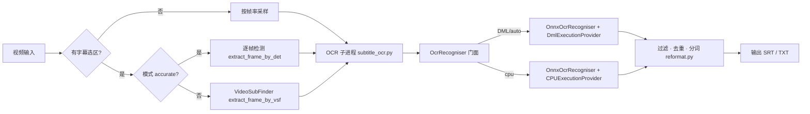
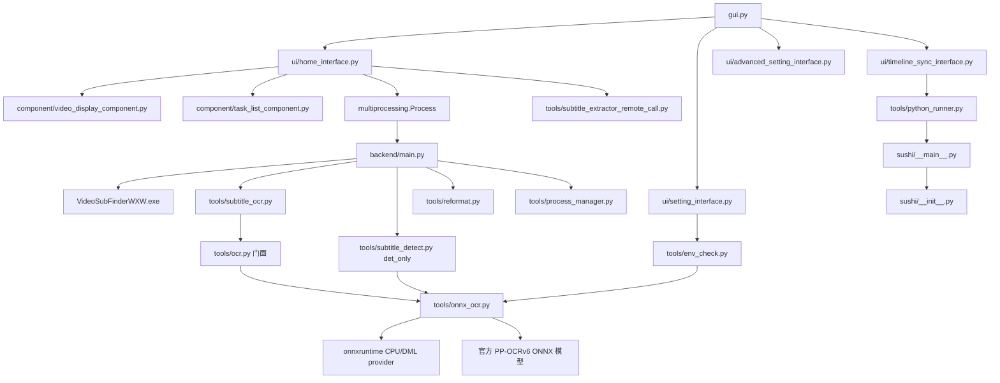

# VSE 代码库结构与维护指南

> **文档目的**：对全部代码做逐文件、逐方法的梳理，作为日后**局部维护**与**全面重构**的共同基准。
> **对应版本**：`backend/config.py` 中 `VERSION = "3.0.0"`（已完成缺陷修复、DirectML 接入与 PP-OCRv6 升级重构）。
> **内容基准**：本文描述**当前磁盘上的最终代码状态**，不含变更历史。
> **覆盖范围**：项目内全部 **41 个 Python 文件** 及 2 个 sushi bat 脚本。

---

## 阅读导航

| 章节 | 内容 | 分片 |
|---|---|---|
| [一、入口与配置核心](#一入口与配置核心) | `gui.py`、`config.py`、`subtitle_area.py`、`constant.py` | 01 |
| [二、核心引擎 backend/main.py](#二核心引擎-backendmainpy) | `SubtitleExtractor` 全部方法详解 | 02 |
| [三、后端工具模块](#三后端工具模块-backendtools) | onnx_ocr、ocr、env_check 等 15 个文件 | 03 |
| [四、并发工具框架](#四并发工具框架-backendtoolsconcurrent) | `concurrent/` 下 Future / Task / TaskManager | 04 |
| [五、sushi 时间轴同步模块](#五sushi-时间轴同步模块-backendsushi) | 时间轴平移算法与 CLI 入口 | 05 |
| [六、UI 界面层](#六ui-界面层-ui) | 三个 Interface 与图标模块 | 06 |
| [七、UI 组件](#七ui-组件-uicomponent) | 视频框选、批量任务列表组件 | 07 |
| [八、修复与优化汇总](#八修复与优化汇总) | 已处理项与后续建议 | 本文件 |

---

## 全局架构总览

### 分层结构

```
┌──────────────────────────────────────────────────────────────┐
│ 入口层      gui.py（FluentWindow，容器与生命周期管理）         │
├──────────────────────────────────────────────────────────────┤
│ 界面层      ui/  HomeInterface / AdvancedSetting / TimelineSync│
│             component/（视频框选、任务列表）                   │
│             setting_interface：后端/档位/设备/模型检测          │
├──────────────────────────────────────────────────────────────┤
│ 业务层      backend/main.py — SubtitleExtractor（1073 行）    │
│             backend/sushi/ — 独立时间轴同步子工具              │
├──────────────────────────────────────────────────────────────┤
│ 支撑层      backend/tools/                                   │
│   ocr.py（门面）→ onnx_ocr.py（ONNX Runtime 推理，唯一 OCR 后端）│
│   env_check.py（启动检测）/ hardware_accelerator.py（设备枚举） │
│   subtitle_ocr.py / reformat.py / process_manager.py 等        │
├──────────────────────────────────────────────────────────────┤
│ 外部依赖    onnxruntime(CPU/DML)、官方 PP-OCRv6 ONNX 模型、   │
│             VideoSubFinder.exe、ffmpeg                        │
└──────────────────────────────────────────────────────────────┘
```

> **重要变更**：本项目现在**仅支持 Windows**，且**只有 CPU 与 DirectML 两种后端**。
> 已彻底移除 PaddlePaddle / PaddleOCR 依赖与 CUDA 分支，OCR 统一走 ONNX Runtime。

### 字幕提取主数据流



**关键约定**
- 进度总量 `300` = 抽帧 `100` + OCR `100` + 后处理 `100`。
- 任务元组：`(总帧数, 当前帧号, dt_box, rec_res, total_ms, subtitle_area)`。
- OCR 原始结果落盘 `output/<视频名>/subtitle/raw.txt`；最终字幕在视频同目录（可由 `saveDirectory` 覆盖）。
- **模型档位**（与 mode 正交）：det 与 rec 各有 `tiny`/`small`/`medium` 三档，分别由 `detModelTier` 与 `modelTier` 选择，可自由混搭；6 个模型随包分发。
- **后端**：`auto`（有 DML 设备则用 DML）、`cpu`、`dml`；总开关 `hardwareAcceleration` 关闭时强制 CPU。
- ONNX 模型下载到程序目录下的 `models/`（绿色版便携，不写 C 盘；`VSE_ONNX_MODEL_DIR` 可覆盖），不入库。

### 跨模块调用关系



---

## 代码文件总表

行数为当前最终代码统计。

| 文件 | 行数 | 一句话职责 | 章节 |
|---|---:|---|---|
| `gui.py` | 173 | 程序入口、主窗口与三页容器 | 一 |
| `backend/__init__.py` | 3 | 注入 `dependencies/` 到 `sys.path` | 一 |
| `backend/config.py` | 120 | 全局 QConfig（32 项，全部生效）、多语言 tr | 一 |
| `backend/bean/subtitle_area.py` | 55 | 字幕选区 dataclass 与几何/AB 区间运算 | 一 |
| `backend/tools/constant.py` | 30 | 字幕位置、VSF 解码器枚举 | 一 |
| `backend/main.py` | 1073 | **核心引擎**：抽帧、OCR 调度、去重、输出 | 二 |
| `backend/tools/__init__.py` | 0 | 空包标记 | 三 |
| `backend/tools/onnx_ocr.py` | 461 | **统一 OCR 后端**：ONNX Runtime CPU/DML + PP-OCRv6 + 前后处理 | 三 |
| `backend/tools/ocr.py` | 117 | OCR 门面：后端/档位/设备配置解析与结果排序 | 三 |
| `backend/tools/env_check.py` | 81 | 启动检测：DML 设备、模型齐全性、一键下载 | 三 |
| `backend/tools/hardware_accelerator.py` | 59 | DML 设备枚举单例（已移除 CUDA） | 三 |
| `backend/tools/makedist.py` | 34 | QPT 打包（CPU/DML，无 CUDA） | 三 |
| `backend/tools/process_manager.py` | 130 | 子进程登记与跨平台终止 | 三 |
| `backend/tools/python_runner.py` | 169 | 异步启动 Python 子进程并回调输出 | 三 |
| `backend/tools/reformat.py` | 223 | 分词、typoMap 替换、标点规范化 | 三 |
| `backend/tools/subtitle_detect.py` | 35 | 精准模式文本框检测（ONNX det_only） | 三 |
| `backend/tools/subtitle_extractor_remote_call.py` | 71 | 跨进程进度/日志队列协议 | 三 |
| `backend/tools/subtitle_ocr.py` | 303 | OCR 子进程：生产者/消费者、区域过滤、落盘 | 三 |
| `backend/tools/theme_listener.py` | 26 | 系统主题监听（未启用） | 三 |
| `backend/tools/version_service.py` | 84 | 更新检查与系统代理读取 | 三 |
| `backend/tools/concurrent/__init__.py` | 1 | 空包标记 | 四 |
| `backend/tools/concurrent/future.py` | 248 | Qt 线程池 Future 实现 | 四 |
| `backend/tools/concurrent/task.py` | 48 | QRunnable 任务封装 | 四 |
| `backend/tools/concurrent/task_manager.py` | 111 | TaskExecutor 单例调度器 | 四 |
| `backend/sushi/__init__.py` | 699 | sushi 核心算法：分组、波形匹配、平移字幕 | 五 |
| `backend/sushi/__main__.py` | 155 | sushi CLI 参数解析与入口 | 五 |
| `backend/sushi/chapters.py` | 37 | 章节时间解析 | 五 |
| `backend/sushi/common.py` | 42 | 通用工具函数与异常类 | 五 |
| `backend/sushi/demux.py` | 358 | ffmpeg / mkvextract 等外部工具封装 | 五 |
| `backend/sushi/keyframes.py` | 16 | XviD 关键帧文件解析 | 五 |
| `backend/sushi/regression-tests.py` | 214 | 上游回归测试脚本（未接入） | 五 |
| `backend/sushi/subs.py` | 275 | SRT/ASS 字幕解析、事件与写出 | 五 |
| `backend/sushi/sushi_main.py` | 95 | 时间轴同步便捷包装层 | 五 |
| `backend/sushi/wav.py` | 190 | WAV 解码、降采样与模板匹配 | 五 |
| `ui/home_interface.py` | 630 | 主工作流：选视频、框选、批量运行、进度日志 | 六 |
| `ui/advanced_setting_interface.py` | 327 | 高级参数卡片、关于与更新 | 六 |
| `ui/setting_interface.py` | 130 | 常用设置：后端/档位/设备/模型检测 | 六 |
| `ui/timeline_sync_interface.py` | 207 | sushi 的 GUI 前端 | 六 |
| `ui/icon/my_fluent_icon.py` | 11 | 跟随主题的停止图标 | 六 |
| `ui/component/task_list_component.py` | 395 | 批量任务数据模型与列表 UI | 七 |
| `ui/component/video_display_component.py` | 976 | 视频预览、鼠标框选、坐标换算、快捷键 | 七 |

**非代码资源**
- `backend/interface/*.ini`：8 种界面语言（各含后端/档位/设备/模型检测文案）。
- `backend/configs/typoMap.json`：文本替换规则（key 为正则）。
- `backend/subfinder/windows/`：VideoSubFinder.exe + FFmpeg/OpenCV/CUDA 运行库；**无 macOS/Linux 二进制**。
- `.github/workflows/`：唯一 `build-windows.yml`（CPU + DirectML 单一安装包，不再区分 CPU/DML 构建变体）。
- `requirements.txt`：唯一依赖文件，使用 `onnxruntime-directml>=1.24.4`（自带 CPU + DML 双 provider，装一次即可两种模式切换）。

---

以下是逐目录、逐文件的详细分析。

---

## 一、入口与配置核心

本分片覆盖应用的启动入口与全局配置核心，共五个文件：`gui.py`（应用主窗口与进程入口）、`backend/__init__.py`（依赖路径注入）、`backend/config.py`（QConfig 配置中心与全局常量）、`backend/bean/subtitle_area.py`（字幕选区数据类）、`backend/tools/constant.py`（核心枚举与颜色常量）。

整体定位如下：

- `gui.py` 是基于 PySide6 + qfluentwidgets 的程序入口，构建三标签主窗口（主页 / 时间轴同步 / 高级设置），负责窗口生命周期、更新提醒、窗口位置持久化与子进程清理。
- `backend/config.py` 是唯一的配置中心，以 `QConfig` 子类 `Config` 集中声明 **32 项配置**，通过 `qconfig.load` 从 `config/config.json` 载入，并按界面语言动态加载 `interface/*.ini` 翻译。
- 当前项目**仅支持 Windows 平台、单一安装包同时支持 CPU 与 DML 两种 OCR 推理模式**；OCR 统一走 `onnxruntime-directml`（自带 CPUExecutionProvider + DmlExecutionProvider）+ 官方 **PP-OCRv6 ONNX 模型**；不含 PaddlePaddle / PaddleOCR。2026 年假定所有 GPU 支持 DX12，故不再提供 CPU-only 版本，唯一依赖文件为 `requirements.txt`。
- `config.py` 中新增的 `ocrBackend`（auto/cpu/dml）、`modelTier`（light/precise）、`dmlDeviceId`（'' + '0'..'7'）三项，配合保留的 `hardwareAcceleration` 总开关（关闭时强制 CPU），共同构成后端选择链路。
- `config.py` 顶部常量 `HARDWARD_ACCELERATION_OPTION`（**拼写保留**）仍存在，作为 `hardwareAcceleration` 的默认值来源，并在 UI 层被读取用于强制关闭开关。

以下各文件行号均基于当前磁盘文件重新核对。

### gui.py

- **路径**：`D:/VSCode/video-subtitle-extractor-main/gui.py`
- **规模**：173 行
- **职责**：程序入口与主窗口。继承 `FluentWindow`，创建三个子界面（Home / TimelineSync / AdvancedSetting），管理窗口图标与标题、主题与云母效果、启动更新检查、配置重启提示、窗口位置持久化、Ctrl+C 退出，并在 `if __name__ == '__main__'` 中完成多进程与高 DPI 初始化及事件循环。

- **关键类/函数**：

| 名称 | 行号 | 说明 |
|------|------|------|
| `SubtitleExtractorGUI` | 33-153 | 主窗口类，继承 `FluentWindow` |
| `__init__` | 34-53 | 禁用云母效果、设置图标/标题（`tr[...] + VERSION`）、调用布局/信号/更新检查初始化 |
| `_lazy_check_update` | 55-62 | 依据 `config.checkUpdateOnStartup` 延迟 2s 触发 `advancedSettingInterface.check_update(ignore=True)` |
| `_connectSignalToSlot` | 64-65 | 将 `config.appRestartSig` 连接到 `_showRestartTooltip` |
| `_showRestartTooltip` | 67-74 | `InfoBar.success` 提示"配置重启生效" |
| `_create_layout` | 76-88 | 创建三个 Interface 并用 `addSubInterface` 注册，设置页位于 `NavigationItemPosition.BOTTOM` |
| `switchTo` | 90-95 | 切换界面；进入设置页时用 222ms / 666ms 两次延时做 macOS 滚动区 workaround |
| `closeEvent` | 97-104 | 保存窗口位置、`ProcessManager().instance().terminate_all()`、再交给父类 |
| `save_window_position` | 106-112 | `config.set` 写回 `windowX/windowY/windowW/windowH` |
| `load_window_position` | 114-136 | 读取窗口坐标并校验是否落在主屏可用区内，否则居中 |
| `center_window` | 138-144 | 窗口居中 |
| `keyPressEvent` | 146-153 | 捕获 Ctrl+C 关闭程序 |
| `__main__` 入口块 | 156-173 | `multiprocessing` 设 `spawn`、高 DPI 舍入策略、`QApplication`、渐显动画、`app.exec()` |

- **调用关系**：作为脚本被直接启动（`python gui.py`）。导入 `backend.config` 的 `config / tr / VERSION`（25）、`ProcessManager`（27）、系统主题监听器（26，实例已注释）、`AdvancedSettingInterface / HomeInterface / TimelineSyncInterface`（28-30）以及大量 qfluentwidgets 组件（18-22）。

- **依赖与数据流**：
  - 从 `config` 读取 `checkUpdateOnStartup`（57）与 `windowX/Y/W/H`（117-120）；向 `config` 写回窗口坐标（109-112）。
  - 通过 `config.appRestartSig` 接收配置变更后的重启通知（65）。
  - 退出时经 `ProcessManager` 终止所有子进程（103）。
  - 窗口标题依赖 `tr` 与 `VERSION`（49）；窗口图标为相对路径 `design/vse.ico`（48）。

- **维护与重构注意点**：
  - 主题跟随相关代码已整体注释：`setTheme/setThemeColor`（39-40）、`SystemThemeListener` 初始化与启动（43-44）、退出清理（101-102）；云母效果以 `setMicaEffectEnabled(False)` 强制关闭（37）。当前主题逻辑实际未启用，勿误以为在运行。
  - `navigationInterface.panel.minimumExpandWidth = 999999`（46）用于"任何尺寸下悬浮展开、防止窗口撑大"，改动导航行为时需保留该约束。
  - `switchTo` 中的 222ms / 666ms 硬编码延时是针对 macOS 滚动区问题的两次补偿（93-95），调整界面加载流程时需回归验证。
  - 多进程使用 `spawn` 启动方式（157），与 Windows 平台一致；若改为 `fork` 会破坏 Windows 兼容与子进程资源隔离。
  - `windowX/Y/W/H` 默认宽高均为 1200（config.py:44-45），`load_window_position` 以 `not x or not y` 判断首次启动（122），坐标为 0 时会被视为无效并居中。
  - 图标 `design/vse.ico` 为相对路径，依赖启动时的工作目录为项目根。

### backend/__init__.py

- **路径**：`D:/VSCode/video-subtitle-extractor-main/backend/__init__.py`
- **规模**：3 行
- **职责**：包初始化副作用模块。将项目根目录下的 `dependencies` 目录插入 `sys.path[0]`，使捆绑依赖优先于系统同名包被导入。

- **关键类/函数**：

| 名称 | 行号 | 说明 |
|------|------|------|
| （无类/函数） | 1-3 | `import os, sys`；`sys.path.insert(0, os.path.join(os.path.dirname(os.path.dirname(os.path.abspath(__file__))), 'dependencies'))` |

- **调用关系**：作为 `backend` 包初始化的一部分自动执行；`gui.py` 导入 `backend.config` 时先触发本模块。

- **依赖与数据流**：以 `__file__` 为基准向上两级定位项目根目录（`backend/` 的父目录），拼接子目录名 `dependencies`；无参数、无返回值，纯 `sys.path` 副作用。

- **维护与重构注意点**：
  - 插入到 `sys.path[0]` 会**遮蔽**系统同名包，`dependencies` 内容变更将影响全局导入解析，排查导入异常时需首先确认此处。
  - 路径计算依赖固定的目录层级（`backend/` 直接位于项目根下）；移动该文件位置必须同步调整向上级数。
  - 不应在本模块加入业务逻辑或重依赖导入，以免放大所有 `backend.*` 导入的副作用与循环依赖风险。

### backend/config.py

- **路径**：`D:/VSCode/video-subtitle-extractor-main/backend/config.py`
- **规模**：120 行
- **职责**：全局配置与元信息中心。定义版本/项目 URL/更新源、全局翻译对象 `tr`、`QConfig` 子类 `Config`（32 项配置）、配置文件加载、`BASE_DIR` 与 `KMP_DUPLICATE_LIB_OK` 环境变量。

- **关键类/函数**：

| 名称 | 行号 | 说明 |
|------|------|------|
| `VERSION` | 10 | 版本号 `"3.0.0"`，用于窗口标题与更新比对 |
| `PROJECT_HOME_URL` / `PROJECT_ISSUES_URL` / `PROJECT_RELEASES_URL` | 11-13 | 项目主页、Issues、Releases 地址 |
| `PROJECT_UPDATE_URLS` | 14-17 | 两个更新源（GitHub API + 加速镜像） |
| `HARDWARD_ACCELERATION_OPTION` | 19 | 硬件加速总开关常量 `True`，**拼写保留**；作为 `hardwareAcceleration` 默认值，并被 UI 层读取 |
| `tr`（首次初始化） | 22-25 | 读取 `interface/en.ini`，为语言选项构建提供默认翻译 |
| `Config` | 27-105 | `QConfig` 子类，集中声明 32 项配置 |
| `intefaceTexts` | 29-38 | 界面语言显示名→代码映射（**拼写保留**：`intefaceTexts`） |
| `CONFIG_FILE` | 107 | 配置文件路径 `"config/config.json"` |
| `config` | 108 | `Config()` 单例 |
| `qconfig.load(...)` | 109 | 从 `config.json` 载入已保存配置（缺失键回退默认值） |
| `tr`（重载） | 112-115 | 按 `config.interface.value` 加载对应 `interface/{value}.ini` |
| `BASE_DIR` | 118 | `backend` 目录绝对路径字符串 |
| `KMP_DUPLICATE_LIB_OK` | 120 | 设为 `'True'`，规避 OpenMP 运行库重复加载冲突 |

- **QConfig 全量项（32 项，全部被读取）**：

  "UI 暴露"列依据 `ui/setting_interface.py` 与 `ui/advanced_setting_interface.py` 中的 `configItem=` 引用核对；窗口坐标四项无独立设置卡片，由 `gui.py` 内部读写；`subtitleSelectionAreas` 由 `ui/component/video_display_component.py` 的选区绘制间接写入。"后端读取"列：32 项均被项目代码读取。

| # | 配置项 | 类型 | 默认值 | 含义 | UI 暴露 | 后端读取 |
|---|--------|------|--------|------|---------|----------|
| 1 | `interface` | OptionsConfigItem | `"ChineseSimplified"` | 界面语言，`restart=True`；validator 选项为 `intefaceTexts.values()`（ch/chinese_cht/en/ko/japan/vi/es/tr） | 是（setting_interface.py:18 `interface_combo`） | 是（config.py:114 自身用于选择 ini） |
| 2 | `windowX` | ConfigItem | `None` | 窗口 X 坐标（持久化内部状态） | 否（gui.py 内部） | 是（gui.py:117/109） |
| 3 | `windowY` | ConfigItem | `None` | 窗口 Y 坐标 | 否（gui.py 内部） | 是（gui.py:118/110） |
| 4 | `windowW` | ConfigItem | `1200` | 窗口宽度 | 否（gui.py 内部） | 是（gui.py:119/111） |
| 5 | `windowH` | ConfigItem | `1200` | 窗口高度 | 否（gui.py 内部） | 是（gui.py:120/112） |
| 6 | `subtitleSelectionAreas` | ConfigItem | `"0.78,0.99,0.05,0.95"` | 选区集合字符串，格式 `ymin,ymax,xmin,xmax;...`，分号分隔 | 间接（video_display_component.py:729/803-806 绘制写入） | 是 |
| 7 | `language` | OptionsConfigItem | `"ch"` | 字幕识别语言，选项取自 `tr["Language"]` | 是（setting_interface.py:25 `language_combo`） | 是 |
| 8 | `mode` | OptionsConfigItem | `"fast"` | 抽帧/识别模式 `auto/fast/accurate` | 是（setting_interface.py:33 `mode_combo`） | 是 |
| 9 | `generateTxt` | ConfigItem(Bool) | `False` | 是否生成 TXT 文本字幕 | 是（setting_interface.py:82） | 是 |
| 10 | `recBatchNumber` | RangeConfigItem | `6` | 单张图同时识别的文本框数，范围 1-100 | 是（advanced_setting_interface.py:92） | 是 |
| 11 | `maxBatchSize` | RangeConfigItem | `10` | DB 检测每个 batch 的图片数，范围 1-256 | 是（advanced_setting_interface.py:100） | 是 |
| 12 | `subtitleArea` | OptionsConfigItem(Enum) | `SubtitleArea.UNKNOWN` | 字幕大致区域枚举，Enum 序列化 | 是（advanced_setting_interface.py:108） | 是 |
| 13 | `extractFrequency` | RangeConfigItem | `3` | 每秒抽帧进行 OCR 的帧数，范围 1-60 | 是（advanced_setting_interface.py:117） | 是 |
| 14 | `tolerantPixelY` | RangeConfigItem | `50` | 容忍的 Y 像素偏差，范围 1-1000 | 是（advanced_setting_interface.py:125） | 是 |
| 15 | `tolerantPixelX` | RangeConfigItem | `100` | 容忍的 X 像素偏差，范围 1-1000 | 是（advanced_setting_interface.py:132） | 是 |
| 16 | `subtitleAreaDeviationPixel` | RangeConfigItem | `50` | 字幕区域偏移量（像素），范围 1-1000 | 是（advanced_setting_interface.py:140） | 是 |
| 17 | `waterarkAreaNum` | RangeConfigItem | `5` | 最可能出现的水印区域数量，范围 1-10（拼写 `waterark` 保留） | 是（advanced_setting_interface.py:148） | 是 |
| 18 | `thresholdTextSimilarity` | RangeConfigItem | `80` | 文本相似度阈值 0-100，值越高越严格（动态算法：短文本低阈值、长文本高阈值） | 是（advanced_setting_interface.py:156） | 是 |
| 19 | `dropScore` | RangeConfigItem | `75` | 置信度阈值 0-100，低于该值（75→0.75）的字幕丢弃 | 是（advanced_setting_interface.py:164） | 是 |
| 20 | `subtitleAreaDeviationRate` | RangeConfigItem | `0` | 字幕区域允许越界比例 0-100，0 表示不允许越界 | 是（advanced_setting_interface.py:172） | 是 |
| 21 | `debugOcrLoss` | ConfigItem(Bool) | `False` | 输出丢失的字幕帧调试信息（仅简/繁中、日、韩有效，输出到 `视频路径/loss`） | 是（advanced_setting_interface.py:214） | 是 |
| 22 | `debugNoDeleteCache` | ConfigItem(Bool) | `False` | 不删除缓存数据以便调试 | 是（advanced_setting_interface.py:222） | 是 |
| 23 | `deleteEmptyTimeStamp` | ConfigItem(Bool) | `True` | 是否删除空时间轴 | 是（advanced_setting_interface.py:230） | 是 |
| 24 | `wordSegmentation` | ConfigItem(Bool) | `True` | 是否重新分词，用于解决语句无空格 | 是（setting_interface.py:88） | 是 |
| 25 | `ocrBackend` | OptionsConfigItem | `"auto"` | OCR 执行后端：`auto`（DML 优先）/ `cpu` / `dml` | 是（setting_interface.py:40 `backend_combo`） | 是 |
| 26 | `modelTier` | OptionsConfigItem | `"precise"` | OCR 模型档位：`light`（tiny rec）/ `precise`（small rec） | 是（setting_interface.py:48 `tier_combo`） | 是 |
| 27 | `dmlDeviceId` | OptionsConfigItem | `""` | 指定 DML 设备索引；`''` 表示自动选择，预置 `'0'`..`'7'` 覆盖多 GPU | 是（setting_interface.py:63 `device_combo`） | 是 |
| 28 | `hardwareAcceleration` | ConfigItem(Bool) | `HARDWARD_ACCELERATION_OPTION`（`True`） | 硬件加速总开关；关闭时强制走 CPU | 是（setting_interface.py:71） | 是 |
| 29 | `checkUpdateOnStartup` | ConfigItem(Bool) | `True` | 启动时检查应用更新 | 是（advanced_setting_interface.py:189） | 是（gui.py:57） |
| 30 | `saveDirectory` | ConfigItem | `""` | 视频保存目录，`ConfigValidator` | 是（advanced_setting_interface.py:183/306-313） | 是 |
| 31 | `videoSubFinderCpuCores` | RangeConfigItem | `0` | VideoSubFinder CPU 核心数，范围 0-`os.cpu_count()` | 是（advanced_setting_interface.py:197） | 是 |
| 32 | `videoSubFinderDecoder` | OptionsConfigItem(Enum) | `VideoSubFinderDecoder.OPENCV` | VideoSubFinder 视频解码组件枚举（OpenCV/FFmpeg），Enum 序列化 | 是（advanced_setting_interface.py:205） | 是 |

- **调用关系**：被全项目广泛导入。`gui.py` 使用 `config / tr / VERSION`；`ui/setting_interface.py` 使用 `config / tr / HARDWARD_ACCELERATION_OPTION` 并绑定新增三项后端配置；`ui/advanced_setting_interface.py` 与 `ui/component/*` 读取/写入各项配置；后端 OCR 与预处理逻辑读取 `.value` 决定行为。

- **依赖与数据流**：
  - qfluentwidgets 提供 `QConfig / ConfigItem / OptionsConfigItem / RangeConfigItem / BoolValidator / OptionsValidator / RangeValidator / EnumSerializer / ConfigValidator / qconfig`。
  - `backend.tools.constant` 提供 `SubtitleArea`、`VideoSubFinderDecoder` 两个枚举，用于 validator 与序列化（6）。
  - `tr` 经历"两次加载"：先在 22-25 行读入 `interface/en.ini` 以构建语言 validator 选项，再在 108 行 `config` 实例化并 `qconfig.load` 后，于 112-115 行按 `config.interface.value` 重载对应语言 ini。
  - `HARDWARD_ACCELERATION_OPTION` 同时作为 `hardwareAcceleration` 默认值（97）与 UI 强制关闭依据（setting_interface.py:75-78，当其为假时禁用开关并 `config.set(..., False)`）。
  - `BASE_DIR` 供资源定位；`KMP_DUPLICATE_LIB_OK` 规避 OpenMP 冲突。

- **维护与重构注意点**：
  - 新增/删除配置项必须在此类中声明，并保持 `qconfig.load` 对旧 `config.json` 的兼容（缺失键回退默认值）；32 项当前全部被读取，删除任一项前需确认无引用。
  - `HARDWARD_ACCELERATION_OPTION`（19）、`intefaceTexts`（29）、`waterarkAreaNum`（71）三处拼写为历史遗留且被外部引用（前者被 UI 导入），重命名会破坏兼容，应保留。
  - `interface` 默认值 `"ChineseSimplified"`（39）与 validator 选项 `intefaceTexts.values()`（ch/chinese_cht/en/...）不一致，排查语言选择异常时需关注此处；`tr` 的两次加载顺序决定了 validator 选项内容，调整顺序会影响语言下拉项。
  - 新增的 `ocrBackend / modelTier / dmlDeviceId` 三项的 validator 选项必须与 UI 展示文本（setting_interface.py:40-67）及后端分支处理保持同步：`dmlDeviceId` 选项固定为 `['', '0'..'7']`，UI 侧用 `env_check.list_dml_devices()` 动态生成设备名，但索引选项仍需与 validator 对齐；`modelTier` 默认 `precise`。
  - `hardwareAcceleration` 是后端选择的**总开关**：关闭时无论 `ocrBackend` 为何值都强制 CPU，UI 层通过 `HARDWARD_ACCELERATION_OPTION` 还可整体禁用该开关。
  - 当前仅 Windows + CPU/DML 两后端、OCR 走 onnxruntime + PP-OCRv6 ONNX：引入新后端或替换推理引擎时，需同步维护本处配置项、UI 选项、依赖文件（`requirements*.txt`）与后端分支。
  - `tr` 是模块级可变全局对象，重复 `read` 会合并/覆盖内容；`Config` 实例 `config` 为进程内单例，配置变更需经 `config.set` / `qconfig.save` 才会持久化。

### backend/bean/subtitle_area.py

- **路径**：`D:/VSCode/video-subtitle-extractor-main/backend/bean/subtitle_area.py`
- **规模**：55 行
- **职责**：定义字幕选区数据类 `SubtitleArea`，承载归一化/绝对坐标、A-B 帧区间、尺寸计算与几何（Polygon）转换。

- **关键类/函数**：

| 名称 | 行号 | 说明 |
|------|------|------|
| `SubtitleArea` | 6-55 | `@dataclass`，字段 `ymin/ymax/xmin/xmax`（Union[int,float]）与 `ab_section: range = None` |
| `__init__` | 18-25 | 显式构造，赋值五个字段；`ab_section` 默认 `None` |
| `normalized` | 27-31 | 交换坐标使 `xmin<=xmax`、`ymin<=ymax` |
| `is_empty` | 33-34 | 四坐标全为 0 时返回 `True` |
| `width` | 36-38 | `@property`，返回 `xmax - xmin` |
| `height` | 40-42 | `@property`，返回 `ymax - ymin` |
| `in_ab_section` | 44-52 | `ab_section is None` 时恒为 `True`（全帧有效）；否则判断 `frame_idx in ab_section` |
| `to_polygon` | 54-55 | 返回由四点构成的 `shapely.geometry.Polygon` |

- **调用关系**：供字幕区域处理与 UI 视频显示组件使用（构造选区实例并调用 `normalized / is_empty / in_ab_section / to_polygon`）；依赖外部库 `shapely.geometry.Polygon`（4）。注意与 `backend/tools/constant.py` 中的同名 `SubtitleArea` **枚举**是完全不同的两个类型，导入时需区分。

- **依赖与数据流**：`typing.Union`、`dataclasses.dataclass`、`shapely.geometry.Polygon`。实例通常由 `config.subtitleSelectionAreas` 的字符串（`"ymin,ymax,xmin,xmax;..."`，见 config.py:49）解析构造；`ab_section`（range）用于限定选区生效的帧范围。

- **维护与重构注意点**：
  - 字段顺序 `ymin,ymax,xmin,xmax` 与 `config.subtitleSelectionAreas` 的字符串顺序一致，解析时必须保持，否则坐标语义错位。
  - `ab_section=None` 表示选区对所有帧有效（44-52 文档已明确），`range` 才做区间过滤；新增分区语义时必须同步更新 `in_ab_section`。
  - 类标注为 `@dataclass` 但同时手写 `__init__`（18-25），dataclass 不会覆盖手写构造；新增字段需同时修改类注解与 `__init__`，否则默认值/赋值不一致。
  - `to_polygon` 依赖 shapely，部署环境必须包含该依赖；坐标为绝对值还是归一化比例由调用方决定，本类不做判定，跨模块传递时需统一语义。
  - `normalized`（27-31）原地修改实例而非返回新对象，调用前需注意副作用。

### backend/tools/constant.py

- **路径**：`D:/VSCode/video-subtitle-extractor-main/backend/tools/constant.py`
- **规模**：30 行
- **职责**：定义核心枚举与 BGR 颜色常量，供配置校验/序列化及图像绘制使用。

- **关键类/函数**：

| 名称 | 行号 | 说明 |
|------|------|------|
| `SubtitleArea` | 5-11 | Enum：`LOWER_PART=0` / `UPPER_PART=1` / `UNKNOWN=2`（`CUSTOM=3` 已注释，13） |
| `BackgroundColor` | 16-20 | Enum：`WHITE=0` / `DARK=1` / `UNKNOWN=2` |
| `VideoSubFinderDecoder` | 23-25 | Enum：`OPENCV="OpenCV"` / `FFMPEG="FFmpeg"` |
| `BGR_COLOR_GREEN` | 27 | `(0, 0xff, 0)` |
| `BGR_COLOR_BLUE` | 28 | `(0xff, 0, 0)` |
| `BGR_COLOR_RED` | 29 | `(0, 0, 0xff)` |
| `BGR_COLOR_WHITE` | 30 | `(0xff, 0xff, 0xff)` |

- **调用关系**：被 `backend/config.py:6` 导入 `SubtitleArea`、`VideoSubFinderDecoder`，用于 `OptionsValidator` 与 `EnumSerializer`（config.py:62/105）；颜色常量供图像标注/绘制模块使用。

- **依赖与数据流**：仅依赖标准库 `enum.Enum`；无 I/O、无外部服务；全部为模块级不可变定义。

- **维护与重构注意点**：
  - 本模块的 `SubtitleArea` 是枚举，与 `backend/bean/subtitle_area.py` 的数据类同名不同类型，导入路径不同，重构时切勿混用。
  - 两个用于配置的枚举经 `EnumSerializer` 按**成员名**持久化到 `config.json`（`subtitleArea` 默认 `UNKNOWN`、`videoSubFinderDecoder` 默认 `OPENCV`）；重命名成员会使旧配置失效，新增成员需同步 UI 选项文本。
  - `VideoSubFinderDecoder` 的成员值为字符串（`"OpenCV"`/`"FFmpeg"`），与界面展示文本对应；调整值需同步 `ui/advanced_setting_interface.py:205` 的卡片文本来源。
  - 颜色常量为 **BGR** 顺序（OpenCV 约定），非 RGB；绘制或转换色彩空间时勿颠倒通道。
  - `CUSTOM=3` 目前被注释（13），若后续启用需同步 `config.py`、`setting_interface.py` / `advanced_setting_interface.py` 的选项与序列化处理。

## 二、核心引擎 backend/main.py

（概览）`backend/main.py` 是 VSE 硬字幕提取器的**核心编排引擎**（当前磁盘最终代码共 **1073 行**），只定义唯一业务类 `SubtitleExtractor`。它把「视频帧采样 → OCR 识别 → 字幕去重/过滤 → SRT 生成」整条流水线串起来：主进程按三种策略之一（fps 跳帧采样 / det 逐帧检测比对 / 调用 Windows 版 videoSubFinder）向任务队列投喂帧，OCR 在独立子进程中经 `multiprocessing.Queue` 异步消费，主进程再通过监听器回调把三段进度（抽帧 100 + OCR 100 + 后处理 100 = 300）回传给 UI，整体是「生产者—消费者 + 多进程 + 回调通知」的异步架构。

接手人需特别注意当前最终状态：`run()` 用 `try/finally` 保证锁释放；无 stdin 的交互统一由 `_safe_input()` 兜底为返回空串；`accurate` 模式始终走 VSE 自研逐帧检测，其余模式与有选区场景走 VideoSubFinder；`manage_process(self, pid)` 是实例方法但为**空实现**（GUI 侧用猴子补丁替换）；坐标容差统一使用 `config.tolerantPixelX/Y.value`；缩略图缩放使用 `Image.Resampling.LANCZOS`；OCR 后端的模型解析已完全交给 daemon/ocr 子进程，**本文件不再持有任何模型配置对象**（无 `paddle_model_config` 导入、无 `self.model_config` 属性）。运行环境与抽帧路径**仅支持 Windows**：VSF 可执行文件固定为 `VideoSubFinderWXW.exe`，命令行无 `--use_cuda`，进度由单线程 `count_process()` 扫描 RGBImages 文件名推进。

### 模块导入与全局结构

- **导入清单**（按来源分组，括号为导入语句所在行号）：
  - 标准库：
    - `os`(8)、`shutil`(11)、`pathlib.Path`(16)、`sys`(22)：路径拼装、目录删除；第 24 行 `sys.path.insert(0, os.path.dirname(__file__))` 把 `backend/` 加入模块搜索路径供子进程导入；`tqdm` 以 `sys.__stdout__`(272) 为输出流。
    - `re`(9)：`extract_frame_by_vsf` 内 `count_process()` 用正则 `^\d+_\d+_\d+_\d+__`(397) 解析 VSF 输出帧文件名的时间戳。
    - `random`(10)：`filter_watermark` / `filter_scene_text` 随机抽取预览帧（第 472、533 行）。
    - `traceback`(12)：`notify_progress_listeners` 捕获监听器异常并打印堆栈（第 1052 行）。
    - `from collections import Counter, namedtuple`(13)：`Counter` 统计水印/字幕区域频率（第 659、678 行），`namedtuple('RawInfo', 'no content')`(708) 承载去重中间结构；`OrderedDict` 在 `_concat_content_with_same_frameno` 内局部导入（第 761 行）。
    - `unicodedata`(14)：`_concat_content_with_same_frameno` 用 `NFKC` 归一化合并后文本（第 777 行）。
    - `from threading import Thread`(15) 与 `import threading`(35)：`threading.RLock()`(47) 保护 `run()`；`Thread` 启动 VSF 的 `count_process` 进度线程(452) 与 OCR 进度监听线程(993)。
    - `multiprocessing`(37)：入口设 `spawn` 启动方式(1059)、`cpu_count()` 计算 VSF 线程数(442)。
    - `subprocess`(25)：`extract_frame_by_vsf` 启动外部 VSF 进程(453)，使用 `creationflags=subprocess.CREATE_NEW_PROCESS_GROUP`(455)。
    - `time`(37)：`time.time()` 记录耗时(107、187)，`time.sleep(0.2)` 用于 VSF 轮询(399)。
    - `pysrt`(38)：VSF 字幕生成与 srt→txt 导出（第 597、623、997 行）。
    - `platform`(35)：**当前为遗留死导入**——全文仅此一处出现，抽帧分支与 VSF 路径均已不再调用 `platform.system()`，仅 Windows 路径存活，可安全删除（见「维护与重构建议」）。
  - 第三方库：
    - `cv2`(17)：所有视频帧读取/写入、画框、缩放操作（贯穿全文）。
    - `from Levenshtein import ratio`(18)：文本相似度判定，用于去重阈值(732) 与 OCR 结果比对(888)。
    - `from PIL import Image`(19)：`__get_thum` 缩略图(910)，使用 `Image.Resampling.LANCZOS`；该方法当前无调用路径。
    - `from numpy import average, dot, linalg`(20)：`_compute_image_similarity` 余弦相似度(834、838、842)；该方法当前无调用路径。
    - `tqdm`(21)：det 抽帧进度条(272)。
  - 项目内模块（`backend.*`）：
    - `from backend.config import *`(26)：把 `config`、`tr`、`BASE_DIR` 注入命名空间，是全文配置与翻译字典的唯一来源。
    - `HardwareAccelerator`(27)：硬件加速单例(50-52)。
    - `from backend.tools import reformat`(28)：分词后处理 `reformat.execute`(186)。
    - `from backend.tools.ocr import OcrRecogniser, get_coordinates`(29)：本地 OCR 预测与检测框坐标转换（第 280、293、850、868、872、879 行等）。
    - `from backend.tools import subtitle_ocr`(30)：OCR 子进程入口 `async_start`(987)。
    - `ProcessManager`(31)：单例进程管理器，注册外部进程以便退出时统一清理(456、988)。
    - `SubtitleDetect`(32)：字幕区域检测器，供 `extract_frame_by_det` 使用(54、289)。
    - `SubtitleArea`（`backend.bean.subtitle_area`，第 33 行）：入口处构造用户选区(1066)。

  > 注：当前版本**没有** `paddle_model_config` / `PaddleModelConfig` 导入，也没有 `self.model_config` 属性；模型档位信息只用于 `run()` 的日志打印（第 123 行），实际模型选择由 OCR 子进程依据 `config` 自行完成。

- **入口**（`if __name__ == '__main__':`，第 1058-1073 行）：
  - 第 1059 行 `multiprocessing.set_start_method("spawn")`：显式使用 spawn，避免 fork 下 CUDA/SSL 等资源继承问题，配合 OCR 子进程。
  - 第 1061 行 `input(f"{tr['Main']['InputVideo']}").strip()`：CLI 提示输入视频路径（阻塞）。
  - 第 1063-1068 行：提示输入字幕区域 `ymin ymax xmin xmax`，`map(int, ...)` 解析并构造 `SubtitleArea(y_min, y_max, x_min, x_max)`；`ValueError` 时 `subtitle_area = None`（走无选区 / fps 抽帧路径）。参数顺序与 `SubtitleArea` 构造签名一致。
  - 第 1070-1071 行：构造 `se = SubtitleExtractor(video_path)` 并赋值 `se.sub_area = subtitle_area`。
  - 第 1073 行 `se.run()`：启动整条流水线。
  - 无 argparse/click，纯交互式 stdin；GUI 侧不通过此入口，而是导入类后手动注入 `sub_area` 与 `manage_process` 回调。

### SubtitleExtractor 类

- **构造参数与初始化属性**（`__init__`，第 45-100 行；唯一构造参数 `vd_path`：视频文件路径）：

| 属性名 | 行号 | 类型 / 默认值 | 用途 |
| --- | --- | --- | --- |
| `lock` | 47 | `threading.RLock()` | 保护 `run()` 全流程的互斥锁；`run()` 第 108 行 acquire、第 194 行 finally 中 release |
| `sub_area` | 49 | `None`，可注入 `SubtitleArea` | 用户指定字幕区域，决定抽帧路径；`None` 表示不指定（走 fps 采样） |
| `hardware_accelerator` | 50 | `HardwareAccelerator.instance()` 单例 | 探测/配置 GPU 加速 |
| （加速开关） | 52 | `set_enabled(config.hardwareAcceleration.value)` | 按配置启用/禁用硬件加速，无独立属性名 |
| `sub_detector` | 54 | `SubtitleDetect()` | 字幕区域检测器，供 `extract_frame_by_det` 使用 |
| `video_path` | 56 | `vd_path` | 原始视频路径 |
| `video_cap` | 57 | `cv2.VideoCapture(vd_path)` | 主进程视频句柄；VSF 路径会被置 `None`(391) |
| `vd_name` | 59 | `Path(video_path).stem` | 视频文件名（不含扩展名），用于临时目录命名 |
| `temp_output_dir` | 61 | `output/{vd_name}`（基于 `BASE_DIR` 上级） | 所有中间产物根目录 |
| `frame_count` | 63 | `video_cap.get(CAP_PROP_FRAME_COUNT)`（float） | 视频总帧数 |
| `fps` | 65 | `video_cap.get(CAP_PROP_FPS)`（float） | 帧率，用于采样间隔与时间码换算 |
| `frame_height` | 67 | `int(...CAP_PROP_FRAME_HEIGHT)` | 帧高，VSF 归一化坐标用 |
| `frame_width` | 68 | `int(...CAP_PROP_FRAME_WIDTH)` | 帧宽，VSF 归一化坐标用 |
| `frame_output_dir` | 70 | `temp_output_dir/frames` | 提取帧目录占位（主路径不直接写帧；VSF 产物在其同级目录） |
| `subtitle_output_dir` | 72 | `temp_output_dir/subtitle` | 字幕中间文件目录 |
| `use_vsf` | 74 | `False` | 是否走了 videoSubFinder 路径，决定后续用哪种字幕生成方法 |
| `vsf_subtitle` | 76 | `subtitle_output_dir/raw_vsf.srt` | VSF 直接产出的原始 SRT |
| `raw_subtitle_path` | 78 | `subtitle_output_dir/raw.txt` | OCR 子进程产出的原始文本（帧号\t坐标\t文本） |
| `subtitle_output_path` | 80 | `os.path.splitext(video_path)[0] + '.srt'` | 最终 SRT 输出路径（与视频同名同目录） |
| `ocr` | 82 | `None` | det 路径本地 OCR 识别器，懒加载为 `OcrRecogniser()`(280、868) |
| `progress_total` | 84 | `300` | 总进度基数（抽帧100+OCR100+后处理100） |
| `progress_frame_extract` | 86 | `0` | 抽帧进度（0-100） |
| `progress_ocr` | 88 | `0` | OCR 识别进度（0-100），由进度监听线程推进 |
| `progress_post` | 90 | `0` | 后处理进度（0-100） |
| `isFinished` | 92 | `False` | 完成标志，VSF 轮询线程据此退出(398) |
| `subtitle_ocr_task_queue` | 94 | `None`，由 `start_subtitle_ocr_async` 赋值(990) | OCR 任务队列（主 → 子进程） |
| `subtitle_ocr_progress_queue` | 96 | `None`，由 `start_subtitle_ocr_async` 赋值(991) | OCR 进度队列（子进程 → 主） |
| `vsf_running` | 98 | `False` | VSF 运行标志，控制 `count_process` 循环(398、451、460) |
| `progress_listeners` | 100 | `[]` | 进度回调监听器列表，由 add/remove 方法维护 |

- **方法逐一详解**：

#### `__init__(vd_path)` — 行号 45-100
- **职责**：初始化锁、视频句柄、所有路径、进度状态与队列占位。
- **参数**：`vd_path`（视频文件路径）。
- **关键步骤**：47 建 RLock；50-52 配置硬件加速；57 打开 `VideoCapture`；63-68 读取帧数/帧率/尺寸；70-80 拼装各路径；84-100 初始化进度与队列字段。
- **输出副作用**：打开视频文件句柄；无打印、无写盘。
- **调用者 / 被调用者**：被入口(1070) 或 GUI 调用；内部无其他方法调用。
- **风险点**：`vd_path` 无效时 `VideoCapture` 静默失败，`frame_count`/`fps` 为 0 或 NaN，后续除零（如 `extract_frame_by_fps` 第 238 行 `self.fps // ...`、第 419 行 `total_ms / self.fps`）需在入口校验；`frame_output_dir` 实际不存帧，命名易误导。

#### `run()` — 行号 102-196
- **职责**：编排整条提取流水线（详见下文「run() 主流程」）。
- **参数**：无（使用实例属性与全局 `config`）。
- **关键步骤**：见「run() 主流程」编号 1-12。
- **输出副作用**：大量 `append_output` 日志；创建/删除临时目录；写 raw.txt/SRT；清空缓存；置 `isFinished=True`(190)。
- **调用者 / 被调用者**：入口(1073) 与 GUI 调用；调用 `__delete_frame_cache`、`capture_frame_with_subtitle_area`、`start_subtitle_ocr_async`、三条抽帧路径之一、`filter_watermark`、`filter_scene_text`、`generate_subtitle_file(_vsf)`、`reformat.execute`、`empty_cache`、`srt2txt` 等。
- **风险点**：异常在 finally 释放锁后仍向上抛出，无统一错误日志/回调，GUI 需自行捕获；抽帧分支**不再有 `platform.system()` 判断**，若在非 Windows 环境运行且走 vsf 会触发 `FileNotFoundError`(435)。

#### `capture_frame_with_subtitle_area()` — 行号 198-231
- **职责**：读取一帧，若存在 `sub_area` 则画绿色矩形并标注 "Subtitle Area"，保存为 `temp_output_dir/sub_area.jpg` 供 GUI 预览选区。
- **参数**：无。
- **关键步骤**：203-204 确保临时目录存在；207-208 视频未打开则重开；214 读首帧；219-224 画框与文字；227-228 写 `sub_area.jpg`；231 复位指针到首帧。
- **输出副作用**：写 `sub_area.jpg`；复位视频指针（供后续抽帧从头开始）。
- **调用者 / 被调用者**：`run()`(134) 调用；无内部被调用方法。
- **风险点**：`ret=False`（视频为空）时静默跳过，不会报错；`sub_area.jpg` 会被后续 `filter_scene_text` 用同名文件覆盖（第 549 行），但二者均会被 `empty_cache` 清理。

#### `extract_frame_by_fps()` — 行号 233-259
- **职责**：按帧率定时跳帧采样，速度最快但易丢字幕；把采样帧作为任务投入 OCR 队列。
- **参数**：无；依赖 `config.extractFrequency.value`（每秒抽取帧数）。
- **关键步骤**：238 `frame_interval = int(fps // extractFrequency)` 且下限 1(239-240)；244 循环至 `total_frames`；246 直接 `CAP_PROP_POS_FRAMES` 跳转；252 构造 6 元组任务 `(frame_count, current_frame_no, None, None, None, config.subtitleArea.value)` 入队；255 更新抽帧进度；257 推进到下一个采样点；259 释放 `video_cap`。
- **输出副作用**：向 `subtitle_ocr_task_queue` 写入任务；更新 `progress_frame_extract`；释放视频句柄。
- **调用者 / 被调用者**：`run()` 在 `sub_area is None` 时调用(145)。
- **风险点**：`fps=0` 会导致除零(238)；`sub_area=None` 时仍把 `config.subtitleArea.value`（可能也为 None）作为第 6 元素，下游需容忍；进度基于帧号比例，跳帧采样时进度跳变。

#### `extract_frame_by_det()` — 行号 261-382
- **职责**：VSE 自研逐帧检测（accurate 模式），通过字幕区域检测 + OCR 文本比对识别字幕头尾帧，只把有效字幕帧投喂 OCR；README 标注「非常慢」。
- **参数**：无；依赖 `sub_detector`、`self.ocr`、`config.subtitleArea.value`。
- **关键步骤**：268-280 初始化 LRU 缓存（容量 2）、OCR 参数列表、比对结果缓存、`tqdm`(272) 与懒加载 OCR(279-280)；281 逐帧读取；289 `detect_subtitle` 得检测框；292-305 若限定选区，用 `get_coordinates` 判断框是否落在 `sub_area` 内；309-341 字幕头/尾状态机：头帧 OCR 文本入缓存(313-320)、尾帧判定（末帧 325-331 或文本不一致 333-341）；343-351 无字幕且处于找尾状态时收尾；353-354 维持 LRU 容量；359-370、372-381 把 `ocr_args_list` 中的帧打包成任务入队并更新进度；382 释放视频句柄。
- **输出副作用**：入队任务；更新抽帧进度；`tqdm` 输出到 stdout；写 `compare_ocr_result_cache`。
- **调用者 / 被调用者**：`run()` 在 `config.mode.value == 'accurate'` 时调用(141)；内部调用 `SubtitleDetect.detect_subtitle`、`OcrRecogniser.predict`、`get_coordinates`、`__get_area_text`、`_compare_ocr_result`、`update_progress`。
- **风险点**：`compare_ocr_result_cache` 用帧号作键、缓存过期清理在 `_compare_ocr_result` 内(883-887)，此处又以 `current_frame_no`（而非头帧号）读取缓存(361、374)，键不一致会使 dt_box/rec_res 常为 None，退化为子进程重新 OCR；状态机分支多、边界（首帧即字幕、末帧无字幕）易错；整段同步串行，性能差。

#### `extract_frame_by_vsf()` — 行号 384-460
- **职责**：调用 Windows 版 VideoSubFinder 检测字幕帧并直接产出原始 SRT（`raw_vsf.srt`），同时由后台线程扫描 RGBImages 推进抽帧进度并入队 OCR 任务。**仅支持 Windows**。
- **参数**：无；依赖 `sub_area`、`config.videoSubFinderCpuCores`、`config.videoSubFinderDecoder`。
- **关键步骤**：
  - 388 置 `use_vsf=True`；389-391 释放并置空 `video_cap`。
  - 392-430 内嵌 `count_process()`：393 由 `frame_count/fps` 算总时长；395 `processed_image` 去重集合；396 RGBImages 路径；397 时间正则；398 循环条件 `self.vsf_running and not self.isFinished`；399 每 0.2s 轮询；401-403 目录不存在则等待；406-407 列目录并排序；409-412 过滤已处理/格式不符文件；416-417 解析 `h_m_s_ms` 为毫秒；418-427 时间前进则构造任务 `(frame_count, frame_no, None, None, total_ms, config.subtitleArea.value)` 入队并按 `total_ms/duration_ms` 更新进度，达 100% 即 `return`；429-430 `FileNotFoundError` 时退出。
  - 432-435 固定 Windows 可执行文件 `subfinder/windows/VideoSubFinderWXW.exe`，不存在则抛 `FileNotFoundError`。
  - 437-440 字幕像素坐标换算为 VSF 百分比（top/bottom/left/right）。
  - 442-444 线程数默认 `cpu_count-2`（下限 1），可由 `videoSubFinderCpuCores` 覆盖。
  - 445-449 拼装命令：`-c -r -i ... -o ... -ces ... -te/-be/-le/-re ... -nthr/-nocrthr ... --open_video_{decoder}`；**无 `--use_cuda` 参数**。
  - 450-460 `try`：451 置 `vsf_running=True`、452 启动 `count_process` 守护线程、453-455 `Popen`（`shell=False`、`CREATE_NEW_PROCESS_GROUP`）、456 注册进程、457 `manage_process(p.pid)`、458 `wait()`；459-460 `finally` 复位 `vsf_running=False`。
- **输出副作用**：写 `raw_vsf.srt` 与 RGBImages（VSF 进程产出）；入队 OCR 任务；更新抽帧进度；注册子进程。
- **调用者 / 被调用者**：`run()` 在有选区且非 accurate 模式时调用(143)；内嵌线程调用 `update_progress`、`subtitle_ocr_task_queue.put`。
- **风险点**：Windows-only，硬编码 exe 路径，跨平台直接失败；进度完全依赖 RGBImages 文件名落盘顺序，VSF 未产出/产出慢时进度停滞；`count_process` 是唯一进度线程（无 vsf_output 相关线程），`self.vsf_running` 为实例级共享标志，与 `manage_process` 外部替换需协同；`total_ms/self.fps`(419) 在 fps 为 0 时除零（换算用 ms 除以 fps 得帧号，量纲存疑但沿用现状）；`p.wait()` 阻塞，异常处理仅复位标志不重抛。

#### `filter_watermark()` — 行号 461-520
- **职责**：检测潜在水印（台标）区域，生成标注图让用户确认，并按确认结果从 raw.txt 删除对应文本行。
- **参数**：无；依赖 `config.waterarkAreaNum.value`。
- **关键步骤**：466 `_detect_watermark_area` 得候选；469-477 随机抽帧；479-481 读帧失败则报错返回；483-502 用 `area_num=['E','D','C','B','A']` 给区域编号、画红色框、写 `watermark_area.jpg` 并提示用户看图；504-517 逐区域 `_safe_input` 询问，输入 `y`/`\n` 则读 raw.txt，删除包含该坐标字符串的行并 `truncate`(509-515)；519-520 删除预览图。
- **输出副作用**：写/删 `watermark_area.jpg`；原地改写 raw.txt；打印提示。
- **调用者 / 被调用者**：`run()` 在 `sub_area is None` 且用户水印提问回答 `y` 时调用(161)；调用 `_detect_watermark_area`、`_safe_input`。
- **风险点**：GUI 无 stdin 时 `_safe_input` 返回 `''`，不会误删水印；`area_num` 最多 5 个，候选超过 5 个会 `IndexError`(497/506)；按字符串 `find` 匹配坐标脆弱（坐标归一化后格式变化可能漏删）。

#### `filter_scene_text()` — 行号 522-567
- **职责**：识别字幕区域 y 范围，生成标注图让用户确认，仅保留该范围内的 raw.txt 文本行（过滤场景文字）。
- **参数**：无；依赖 `config.subtitleAreaDeviationPixel.value`。
- **关键步骤**：527 `_detect_subtitle_area()[0][0]` 取最常见 y 区间；530-538 随机抽帧；540-542 读帧失败报错返回；545-546 按容差扩展 ymin/ymax（ymin 用 `abs`）；548-551 画框写 `subtitle_area.jpg` 并提示；553 用 `_safe_input` 询问；554-564 输入 `y`/`\n` 则读 raw.txt，解析每行坐标 y 值(559-560)，仅保留落在 `[ymin,ymax]` 的行；566-567 删除预览图。
- **输出副作用**：写/删 `subtitle_area.jpg`；原地改写 raw.txt；打印提示。
- **调用者 / 被调用者**：`run()` 在 `sub_area is None` 时无条件调用(168)；调用 `_detect_subtitle_area`、`_safe_input`。
- **风险点**：`_detect_subtitle_area` 无结果时 `[0][0]` 会 `IndexError`(527)；`config.subtitleAreaDeviationPixel.value` 容差以像素为单位（区别于百分比配置）；GUI 下 `_safe_input` 返回 `''` 则不过滤，场景文字残留。

#### `generate_subtitle_file()` — 行号 569-592
- **职责**：常规路径（非 VSF）下生成 SRT，对持续时间不足 1 秒的字幕把结束时间延长到 1 秒。
- **参数**：无；依赖 `self.use_vsf`（为 False 才执行）。
- **关键步骤**：573 守卫；574 `_remove_duplicate_subtitle` 得去重列表；577-589 逐条：580 `_frame_to_timecode` 算起始；582 若 `abs(结束帧-起始帧) < fps` 则用 `起始帧+fps` 作结束并记录 `line_code` 到 `post_process_subtitle`(583-584)，否则用真实结束帧(586)；588 拼 SRT 行写入；590 打印输出路径。
- **输出副作用**：写 `subtitle_output_path`（SRT 文件）；打印字幕位置。
- **调用者 / 被调用者**：`run()` 在 `not use_vsf` 时调用(181)；调用 `_remove_duplicate_subtitle`、`_frame_to_timecode`。
- **风险点**：`post_process_subtitle` 返回值当前**无人接收**（run() 第 181 行忽略），“延长到 1 秒”的后续后处理形同虚设；`use_vsf=True` 时函数静默返回 None。

#### `generate_subtitle_file_vsf()` — 行号 594-624
- **职责**：VSF 路径下，把 OCR 文本填充进 VSF 产出的时间轴，生成最终 SRT。
- **参数**：无；依赖 `config.deleteEmptyTimeStamp.value`。
- **关键步骤**：595-596 守卫；597 `pysrt.open(vsf_subtitle)`；599-601 为每条 VSF 字幕计算起始帧号并建 `sub_no_map`；603 `_remove_duplicate_subtitle`；604 建起始帧→内容的映射；606-621 遍历 VSF 字幕：命中映射则替换 `sub.text`、按 OCR 结束帧修正 `sub.end`(610-613)，未命中且 `deleteEmptyTimeStamp=False` 则保留空文本时间轴(616-621)；623 `pysrt.SubRipFile(...).save`；624 打印路径。
- **输出副作用**：写 `subtitle_output_path`；打印字幕位置。
- **调用者 / 被调用者**：`run()` 在 `use_vsf` 时调用(178)；调用 `_remove_duplicate_subtitle`、`_timestamp_to_frameno`。
- **风险点**：`sub_no_map` 以起始帧为键，`_timestamp_to_frameno` 由 ms 换算帧，与 OCR 帧号体系可能对不上导致大量未命中；空时间轴保留策略依赖配置项；无 `encoding` 显式处理读 VSF SRT（pysrt 默认编码）。

#### `_detect_watermark_area()` — 行号 626-661
- **职责**：统计 raw.txt 中坐标频率，找出固定出现的区域（水印/台标），并把坐标归一后写回 raw.txt。
- **参数**：无；依赖 `config.waterarkAreaNum.value`。
- **关键步骤**：633-634 读 raw.txt；637-646 解析每行（帧号、坐标四元组、内容）为 `parsed`；648-652 拆三列并 `_unite_coordinates` 统一相似坐标；655-657 写回归一化坐标；659-661 `Counter(...).most_common()` 取前 `min(waterarkAreaNum, len)` 个返回。
- **输出副作用**：原地改写 raw.txt（坐标归一化）。
- **调用者 / 被调用者**：`filter_watermark`(466) 调用；调用 `_unite_coordinates`。
- **风险点**：解析依赖 `\t` 与 `'(' ')'` 的严格格式，畸形行 `split('\t')<3` 被跳过(639)；归一化写回会丢失原始坐标；返回列表元素为 `(coordinate, count)`，`filter_watermark` 用 `watermark_area[0]` 取坐标，耦合较强。

#### `_detect_subtitle_area()` — 行号 663-678
- **职责**：从过滤水印后的 raw.txt 统计出现频率最高的 y 坐标区间作为字幕区域。
- **参数**：无。
- **关键步骤**：669-670 读 raw.txt；672-677 解析每行 ymin/ymax 入列表；678 `Counter(y_coordinates_list).most_common(1)` 返回。
- **输出副作用**：无（只读）。
- **调用者 / 被调用者**：`filter_scene_text`(527) 调用。
- **风险点**：raw.txt 为空时返回 `[]`，调用方 `[0][0]` 越界（见 filter_scene_text 风险点）；只取 top1，双行字幕区域可能被低估。

#### `_frame_to_timecode(frame_no)` — 行号 680-693
- **职责**：帧号 → SMPTE 时间码字符串（纯计算，不打开视频）。
- **参数**：`frame_no`（帧号）。
- **关键步骤**：686 `frame_no/fps*1000` 得毫秒；688-692 拆分毫秒/秒/分/时；693 格式化 `'%02d:%02d:%02d,%03d'`。
- **输出副作用**：无。
- **调用者 / 被调用者**：`generate_subtitle_file`(580、583、586) 调用。
- **风险点**：`fps` 为 0 时除零；浮点取整误差在长视频累积。

#### `_timestamp_to_frameno(time_ms)` — 行号 695-696
- **职责**：毫秒时间戳 → 帧号。
- **参数**：`time_ms`。
- **关键步骤**：696 `int(time_ms / self.fps)`。
- **输出副作用**：无。
- **调用者 / 被调用者**：`generate_subtitle_file_vsf`(600) 调用。
- **风险点**：`fps=0` 除零；截断取整丢失亚帧精度。

#### `_frameno_to_milliseconds(frame_no)` — 行号 698-699
- **职责**：帧号 → 毫秒（浮点取整）。
- **参数**：`frame_no`。
- **关键步骤**：699 `float(int(frame_no / self.fps * 1000))`。
- **输出副作用**：无。
- **调用者 / 被调用者**：当前**无调用路径**（遗留工具方法）。
- **风险点**：`fps=0` 除零；与 `_frame_to_timecode` 逻辑重复。

#### `_remove_duplicate_subtitle()` — 行号 701-751
- **职责**：读取 raw.txt，按文本相似度合并连续重复字幕，返回去重后的 `(start_frame, end_frame, content)` 列表，并在循环内推进后处理进度。
- **参数**：无；依赖 `config.thresholdTextSimilarity.value`、`self.use_vsf`。
- **关键步骤**：705 `_concat_content_with_same_frameno`；706-713 读 raw.txt 构造 `RawInfo(no, content)` 列表；714-720 初始化去重列表与进度节流（`report_interval = max(1, len//100)`）；721-751 双层循环：内层用 `Levenshtein.ratio` 与下一行相似度比较(732)，低于阈值即确定结束帧；735-738 非 VSF 且单帧时以下一帧开始时间为准；740-745 取最长文本作代表；727-729 定期 `update_progress(post=20 + 65*idx_j/len)`（post 20→85）。
- **输出副作用**：更新 `progress_post`；不改文件（前序 `_concat...` 已改 raw.txt）。
- **调用者 / 被调用者**：`generate_subtitle_file`(574)、`generate_subtitle_file_vsf`(603) 调用；调用 `_concat_content_with_same_frameno`、`update_progress`。
- **风险点**：`content_list_len=0` 时 `report_interval` 计算与循环安全（while 不进），但调用方后续可能拿到空列表；去重用 `replace(' ','')`，空格差异被忽略；O(n²) 双层循环，长视频后处理慢；`post` 进度只在此处推进到 85，随后 run() 直接跳到 90(183)。

#### `_concat_content_with_same_frameno()` — 行号 753-778
- **职责**：把 raw.txt 中相同帧号的多行文本合并为一行（用空格连接）并做 NFKC 归一化，写回文件。
- **参数**：无。
- **关键步骤**：757-758 读 raw.txt；761 局部 `from collections import OrderedDict`；762-770 按帧号分组（保留顺序、保留首个坐标）；772-778 写回，`' '.join(contents)`、补 `\n`、`unicodedata.normalize('NFKC', ...)`。
- **输出副作用**：原地改写 raw.txt（破坏性，去重前置步骤）。
- **调用者 / 被调用者**：`_remove_duplicate_subtitle`(705) 调用。
- **风险点**：直接覆写 raw.txt，调试时需开启 `debugNoDeleteCache` 才能留存；坐标取同帧第一行，其余行坐标丢弃；畸形行（少于 3 列）跳过。

#### `_unite_coordinates(coordinates_list)` — 行号 780-820
- **职责**：把相似坐标统一为同一代表值（基于 xmin 排序 + 滑动窗口 + 并查集）。
- **参数**：`coordinates_list`（坐标四元组列表）。
- **关键步骤**：788-789 空列表直接返回；792 按 xmin 排序并保留原索引；794-806 并查集 `find`/`union`；807-815 滑动窗口（xmin 差值超过 `config.tolerantPixelX.value` 则移动左边界），窗口内 `__is_coordinate_similar` 为真则 union；816-820 用组代表坐标替换原值。
- **输出副作用**：无（返回新列表）。
- **调用者 / 被调用者**：`_detect_watermark_area`(652) 调用；调用 `__is_coordinate_similar`。
- **风险点**：仅用 xmin 排序做滑动窗口，y 差异大而 x 相近的坐标也会被纳入窗口比较（由 `__is_coordinate_similar` 兜底）；并查集代表取较小原始索引，可能非“最标准”坐标；复杂度 O(n·窗口)。

#### `_compute_image_similarity(image1, image2)` — 行号 822-843
- **职责**：计算两张图片的余弦相似度（缩略图灰度向量）。
- **参数**：`image1`、`image2`（PIL Image）。
- **关键步骤**：826-827 `__get_thum` 得缩略图；831-838 逐像素取 `average` 组成向量并算 `linalg.norm`；842 `dot(a/a_norm, b/b_norm)` 返回余弦值。
- **输出副作用**：无。
- **调用者 / 被调用者**：当前**无调用路径**（遗留方法）。
- **风险点**：`__get_thum` 默认 `greyscale=False`，返回 RGB，`average` 对三通道取均值，语义模糊；纯色图范数为 0 会除零。

#### `__get_area_text(ocr_result)` — 行号 845-861（私有）
- **职责**：从 OCR 结果中筛出落在 `sub_area` 内的文本并拼接为字符列表。
- **参数**：`ocr_result` = `(box, text)`。
- **关键步骤**：850 `get_coordinates(box)`；852-860 遍历 `(content, coordinate)`，若四坐标完全落在 `sub_area` 内则 `append(content[0])`。
- **输出副作用**：无。
- **调用者 / 被调用者**：`extract_frame_by_det`(314)、`_compare_ocr_result`(873、880) 调用。
- **风险点**：依赖 `sub_area` 非 None（det 路径保证）；`content[0]` 假定每项为可索引文本项，格式变化会异常。

#### `_compare_ocr_result(result_cache, img1, img1_no, img2, img2_no)` — 行号 863-891
- **职责**：比较两帧 OCR 出的字幕区域文本是否相同（供 det 状态机判断字幕尾）。
- **参数**：`result_cache`（帧号→OCR 结果缓存）、`img1`/`img1_no`、`img2`/`img2_no`（两帧图像与帧号）。
- **关键步骤**：867-868 懒加载 OCR；869-881 若帧号不在缓存则 `predict` 并把 `text/dt_box/rec_res` 入缓存；882-887 清理帧号 `< min(img1_no,img2_no)-10` 的旧缓存；888-891 `ratio(area_text1, area_text2) > config.thresholdTextSimilarity.value/100.0` 返回布尔。
- **输出副作用**：写/清理 `result_cache`。
- **调用者 / 被调用者**：`extract_frame_by_det`(335) 调用；调用 `OcrRecogniser.predict`、`__get_area_text`。
- **风险点**：缓存清理阈值硬编码 10；判定与去重共用同一相似度配置但语义不同；传入 `img1=None` 时若帧号未缓存会 `predict(None)` 崩溃（依赖调用方先缓存头帧）。

#### `__is_coordinate_similar(coordinate1, coordinate2)` — 行号 893-902（静态私有）
- **职责**：判断两坐标四差值是否都在容差内。
- **参数**：两个坐标四元组。
- **关键步骤**：899-902 分别用 `config.tolerantPixelX.value`（xmin/xmax）与 `config.tolerantPixelY.value`（ymin/ymax）比较。
- **输出副作用**：无。
- **调用者 / 被调用者**：`_unite_coordinates`(814) 调用。
- **风险点**：容差严格 `<`，边界相等视为不相似；`.value` 使用正确（反映最终修复状态）。

#### `__get_thum(image, size=(64,64), greyscale=False)` — 行号 904-914（静态私有）
- **职责**：统一图像尺寸（可选灰度），用于相似度计算。
- **参数**：`image`、`size`、`greyscale`。
- **关键步骤**：910 `image.resize(size, Image.Resampling.LANCZOS)`（高质量重采样，反映最终修复状态）；911-913 灰度时 `convert('L')`。
- **输出副作用**：无。
- **调用者 / 被调用者**：`_compute_image_similarity`(826-827) 调用（该方法无调用路径）。
- **风险点**：`Image.Resampling.LANCZOS` 需 Pillow ≥ 9.1，旧环境会 `AttributeError`；默认不转灰度。

#### `__delete_frame_cache()` — 行号 916-918（私有）
- **职责**：无条件删除整个 `temp_output_dir`（run() 开始前的缓存清理）。
- **参数**：无。
- **关键步骤**：917-918 `os.path.exists` 则 `shutil.rmtree(path, True)`。
- **输出副作用**：删除磁盘目录（含此前预览图、raw.txt 等）。
- **调用者 / 被调用者**：`run()`(128) 调用。
- **风险点**：`rmtree(..., True)` 忽略错误；若 temp 目录被其他任务共用会误删（目录名基于视频名，冲突概率低）。

#### `empty_cache()` — 行号 920-926
- **职责**：run() 成功后按配置清理临时缓存。
- **参数**：无；依赖 `config.debugNoDeleteCache.value`。
- **关键步骤**：924 若 `not debugNoDeleteCache` 且目录存在(925) 则 `rmtree`(926)。
- **输出副作用**：删除 `temp_output_dir`（调试开启时保留）。
- **调用者 / 被调用者**：`run()`(192) 调用。
- **风险点**：与 `__delete_frame_cache` 逻辑重复，仅 debug 判断不同；异常路径（run() 中途抛错）不会清理缓存。

#### `update_progress(ocr=None, frame_extract=None, post=None)` — 行号 928-942
- **职责**：更新三段进度（各自 clamp 0-100）并通知监听器。
- **参数**：三个可选进度值。
- **关键步骤**：935-940 对每个非 None 值 `max(0, min(100, value))`；942 `notify_progress_listeners()`。
- **输出副作用**：改写三个进度属性；触发所有监听器回调。
- **调用者 / 被调用者**：run()、三条抽帧路径、`_remove_duplicate_subtitle`、`start_subtitle_ocr_async` 内进度线程等广泛调用；调用 `notify_progress_listeners`。
- **风险点**：每次更新都遍历全部监听器，高频抽帧时回调密集；监听器异常由 `notify_progress_listeners` 内部吞掉，不影响主流程。

#### `start_subtitle_ocr_async()` — 行号 944-994
- **职责**：启动 OCR 子进程，建立双向队列，启动进度监听线程，返回进程对象。**`options` 含 `MAX_BATCH_SIZE`。**
- **参数**：无；依赖 `self.video_path`、`raw_subtitle_path`、`sub_area`、多项 `config`。
- **关键步骤**：
  - 945-977 内嵌 `get_ocr_progress()`：955 阻塞取进度消息；956-958 首次打印 `StartFindSub`；960-962 处理 `(-2, total_tasks)` 记录总帧数；964-969 处理 `-1`/`(-1, ...)` 终止信号并置 `ocr=100` 返回；971-977 处理 `(frame_no, processed_count)`，按 `processed_count/total_tasks` 算 `ocr_pct`（封顶 99）。
  - 978-986 `options` 字典：`REC_CHAR_TYPE`(979)、`DROP_SCORE`(980)、`SUB_AREA_DEVIATION_RATE`(981)、`DEBUG_OCR_LOSS`(982)、`HARDWARD_ACCELERATOR`(983)、**`MAX_BATCH_SIZE: config.maxBatchSize.value`(985，帧预取队列容量 / DB 每批图片数)**。
  - 987 `subtitle_ocr.async_start(...)` 返回 `(process, task_queue, progress_queue)`；988 注册进程；989 `manage_process(process.pid)`；990-991 保存两个队列；993 启动进度线程；994 返回 process。
- **输出副作用**：创建子进程与两个 `multiprocessing.Queue`；注册进程；启动守护线程；打印 `StartFindSub`。
- **调用者 / 被调用者**：`run()`(136) 调用；调用 `subtitle_ocr.async_start`、`ProcessManager.add_process`、`manage_process`。
- **风险点**：`manage_process(self, pid)` 是空实现（GUI 猴子补丁注入）；`options` 键名 `HARDWARD_ACCELERATOR` 拼写错误但子进程沿用，不可随意改；`MAX_BATCH_SIZE` 需与 `config.maxBatchSize`（范围 1-256）匹配；进度线程 `get(block=True)` 无超时，子进程异常退出不自动结束线程。

#### `srt2txt(srt_file)` — 行号 996-1002
- **职责**：把 SRT 导出为纯文本（每行字幕文本）。
- **参数**：`srt_file`（SRT 路径）。
- **关键步骤**：997 `pysrt.open(encoding='utf-8')`；998 生成同名 `.txt` 路径；999 打印路径；1000-1002 写文本。
- **输出副作用**：写 `.txt` 文件；打印输出路径。
- **调用者 / 被调用者**：`run()` 在 `config.generateTxt.value` 为真时调用(196，位于 finally 之后)。
- **风险点**：位于 `run()` 的 try/finally **之后**，若 try 内异常，此段不会执行（不会导出 txt）。

#### `append_output(*args)` — 行号 1004-1009
- **职责**：统一控制台输出（多参数空格连接）。
- **参数**：可变参数。
- **关键步骤**：1009 `print(*args)`。
- **输出副作用**：stdout 打印。
- **调用者 / 被调用者**：全文广泛使用。
- **风险点**：CLI 与 GUI（子进程 stdout 重定向）行为一致；无日志分级。

#### `_safe_input(prompt)` — 行号 1011-1022（静态）
- **职责**：交互式提问的健壮封装；捕获 `EOFError/OSError` 返回空串，使无 stdin 的 GUI 任务退化为「不执行需人工确认的过滤步骤」。
- **参数**：`prompt`。
- **关键步骤**：1019-1020 `input(prompt).strip()`；1021-1022 捕获 `(EOFError, OSError)` 返回 `''`。
- **输出副作用**：打印提示（input 自带）。
- **调用者 / 被调用者**：`run()`(159)、`filter_watermark`(506)、`filter_scene_text`(553) 调用。
- **风险点**：返回 `''` 使 `filter_*` 不执行过滤（设计如此）；仅捕获两类异常，其他输入异常仍会抛出。

#### `add_progress_listener(listener)` — 行号 1024-1032
- **职责**：注册进度回调（去重）。
- **参数**：`listener`（回调，签名见 notify）。
- **关键步骤**：1031-1032 不在列表则追加。
- **输出副作用**：修改 `progress_listeners`。
- **调用者 / 被调用者**：GUI/外部调用。
- **风险点**：无锁保护，与 notify 并发时 List 迭代可能被修改（CPython 下通常安全）。

#### `remove_progress_listener(listener)` — 行号 1034-1042
- **职责**：移除进度回调。
- **参数**：`listener`。
- **关键步骤**：1041-1042 存在则移除。
- **输出副作用**：修改 `progress_listeners`。
- **调用者 / 被调用者**：GUI/外部调用。
- **风险点**：同上无锁。

#### `notify_progress_listeners()` — 行号 1044-1052
- **职责**：逐个调用监听器，传入当前进度。
- **参数**：无。
- **关键步骤**：1048 遍历；1050 调用 `listener(progress_ocr, progress_frame_extract, progress_total, isFinished, progress_post)`（**注意：共 5 个参数，含 `progress_post`**）；1049-1052 异常则 `traceback.print_exc()`，不影响其他监听器。
- **输出副作用**：触发回调；异常时打印堆栈。
- **调用者 / 被调用者**：`update_progress`(942) 调用。
- **风险点**：签名与 `add_progress_listener` 文档字符串(1029，仅列 4 个参数)不一致，文档已过时；单监听器异常被吞，问题隐蔽。

#### `manage_process(pid)` — 行号 1054-1056
- **职责**：上报外部进程 PID 的钩子；CLI 下为空实现，GUI 侧替换为回调以纳入进程管理。
- **参数**：`pid`（子进程 PID）。
- **关键步骤**：1056 `pass`。
- **输出副作用**：无（CLI 下）。
- **调用者 / 被调用者**：`start_subtitle_ocr_async`(989)、`extract_frame_by_vsf`(457) 调用。
- **风险点**：空实现意味着 CLI 下 PID 不注册到 GUI 进程树；必须由 GUI 注入，否则外部进程生命周期不受控。

- **run() 主流程**（`第 102-196 行`，按执行顺序编号）：
  1. **计时与加锁**（107-109）：`start_time=time.time()`；`self.lock.acquire()`；进入 `try`（109）。
  2. **重置进度与日志头**（111-124）：`update_progress(ocr=0, frame_extract=0, post=0)`(111)；打印分隔线、识别语言/模式(114)、加速状态(116-117)、帧数/帧率(120-121)、**`OCR 后端: {config.ocrBackend.value} | 模型档位: {config.modelTier.value} (PP-OCRv6 ONNX)`**(123) 与分隔线(124)。
  3. **抽帧前提示与目录准备**（126-133）：`StartProcessFrame`；`__delete_frame_cache()`(128)；创建 `frame_output_dir`、`subtitle_output_dir`(130-133)。
  4. **预览帧绘制**（134）：`capture_frame_with_subtitle_area()`。
  5. **启动 OCR 子进程**（136）：`subtitle_ocr_process = start_subtitle_ocr_async()`。
  6. **执行抽帧**（137-145）：有 `sub_area` 时，`mode=='accurate'` → `extract_frame_by_det()`(141)，否则 → `extract_frame_by_vsf()`(143)；无 `sub_area` → `extract_frame_by_fps()`(145)。**此分支无 `platform.system()` 判断**。
  7. **结束标志与等待**（147-154）：向任务队列投 `(frame_count, -1, None, None, None, None)`(149)；`subtitle_ocr_process.join()`(151)；打印帧处理与查找完成提示(153-154)。
  8. **水印过滤（无选区时）**（156-164）：提示 `StartDetectWaterMark`；`_safe_input` 询问，回答 `y` → `filter_watermark()`(161)，否则仅打印分隔线。
  9. **场景文字过滤（无选区时）**（166-169）：提示后无条件 `filter_scene_text()`(168)；随后 `update_progress(post=20)`(171)。
  10. **生成字幕**（173-183）：提示 `StartGenerateSub`；`use_vsf` → `generate_subtitle_file_vsf()`(178)，否则 `generate_subtitle_file()`(181)；`update_progress(post=90)`(183)。
  11. **分词后处理与收尾**（185-192）：`config.wordSegmentation.value` 为真时 `reformat.execute(...)`(186)；打印完成与耗时(187)；`update_progress(ocr=100, frame_extract=100, post=100)`(189)；`isFinished=True`(190)；`empty_cache()`(192)。
  12. **finally 与 txt 导出**（193-196）：`finally` 中 `self.lock.release()`(194)；**锁释放后**若 `config.generateTxt.value` 则 `srt2txt(...)`(195-196)。

- **任务队列协议**：
  - **任务队列 `subtitle_ocr_task_queue`（主 → OCR 子进程）**：元素为 6 元组
    `(total_frame_count, current_frame_no, dt_box, rec_res, frame_time, subtitle_area)`。
    - `total_frame_count`：总帧数；`current_frame_no`：当前帧号；`dt_box`/`rec_res`：det 路径可复用的检测框/识别结果，其余路径为 `None`；`frame_time`：VSF 路径的毫秒时间，其余为 `None`；`subtitle_area`：字幕区域（取 `config.subtitleArea.value`）。
    - **结束哨兵**：`(frame_count, -1, None, None, None, None)`（第 149 行），由 run() 在所有抽帧任务入队后发送。
    - 生产者：`extract_frame_by_fps`(253)、`extract_frame_by_det`(369、381)、`extract_frame_by_vsf` 的 `count_process`(421)；消费者：OCR 子进程（`subtitle_ocr.async_start` 内部）。
  - **进度队列 `subtitle_ocr_progress_queue`（OCR 子进程 → 主）**：
    - `(-2, total_tasks)`：生产者告知总帧数（约定见 948 行注释）。
    - `(frame_no, processed_count)`：消费者每处理一帧上报。
    - `-1` 或 `(-1, ...)`：处理完成终止信号（964-969 行兼容两种形式）。
    - 消费者：`get_ocr_progress` 线程(955-977)。

- **三种抽帧路径对比表**：

| 维度 | `extract_frame_by_fps()` (233-259) | `extract_frame_by_det()` (261-382) | `extract_frame_by_vsf()` (384-460) |
| --- | --- | --- | --- |
| 触发条件 | `sub_area is None` | 有 `sub_area` 且 `mode=='accurate'` | 有 `sub_area` 且 `mode∈{fast,auto}` |
| 核心手段 | 按 `fps/extractFrequency` 跳帧采样 | `SubtitleDetect` + OCR 文本比对定头尾 | 外部 `VideoSubFinderWXW.exe` |
| 平台 | 跨平台（仅用 cv2） | 跨平台（仅用 cv2 + OCR） | **仅 Windows**（硬编码 exe，432-435） |
| `use_vsf` | False | False | **True**(388) |
| 帧来源 | 主进程 `video_cap` 逐帧跳读 | 主进程 `video_cap` 顺序读 | VSF 产出 RGBImages + raw_vsf.srt |
| 任务入队 | 每采样帧入队(253) | 字幕头/尾帧入队(369、381) | `count_process` 扫文件名入队(421) |
| `dt_box/rec_res` | None | 部分复用 det 结果 | None |
| 进度来源 | 帧号比例(255) | 帧号比例(370) | RGBImages 文件名时间比例(427) |
| 进度线程 | 无 | 无（tqdm 在抽帧线程） | 有（`count_process` 守护线程，452） |
| 子进程注册 | 无 | 无 | `ProcessManager` + `manage_process`(456-457) |
| 速度/准确度 | 最快、易丢字幕 | 最慢（README「非常慢」）、较准 | 快、依赖 VSF 检测质量 |
| 字幕生成 | `generate_subtitle_file()` | `generate_subtitle_file()` | `generate_subtitle_file_vsf()` |
| 关键风险 | `fps=0` 除零 | 状态机复杂、缓存键不一致 | Windows-only、进度依赖文件名落盘 |

- **跨进程/跨模块调用清单**：

| 目标 | 位置 | 方式 | 说明 |
| --- | --- | --- | --- |
| `subtitle_ocr.async_start` | 987 | 函数调用（内部起子进程） | 启动 OCR 生产者/消费者进程，返回进程与两队列 |
| OCR 子进程 | 通过 `subtitle_ocr_task_queue` / `progress_queue` | `multiprocessing.Queue`（spawn） | 6 元组任务入、进度消息出 |
| `VideoSubFinderWXW.exe` | 433-458 | `subprocess.Popen` | VSF 外部进程，`CREATE_NEW_PROCESS_GROUP`，注册到 `ProcessManager` |
| `ProcessManager.instance().add_process` | 456、988 | 单例方法 | 注册外部进程供退出清理 |
| `manage_process(pid)` | 457、989 | 实例方法（空实现，GUI 注入） | 上报 PID |
| `HardwareAccelerator.instance()` | 50 | 单例 | 配置/探测硬件加速，传入 OCR `options`(983) |
| `SubtitleDetect.detect_subtitle` | 289 | 对象方法 | det 路径逐帧检测字幕框 |
| `OcrRecogniser.predict` | 280、313、868、872、879 | 对象方法（懒加载） | det 路径本地 OCR 比对 |
| `get_coordinates` | 293、850 | 函数 | 检测框 → 坐标四元组 |
| `reformat.execute` | 186 | 模块函数 | 分词后处理（条件开启） |
| `pysrt.open` / `SubRipFile.save` | 597、623、997 | 库调用 | VSF 字幕读取、最终 SRT 写出、srt→txt |
| 进度监听器回调 | 1050 | 回调（5 参数） | 回传 ocr/frame_extract/total/isFinished/post |
| `Image.Resampling.LANCZOS` | 910 | 库常量 | 缩略图高质量重采样 |

- **维护与重构建议**：
  1. **清理死导入**：`platform`(35) 全文未使用（抽帧已仅 Windows），可删除；`PaddleModelConfig` 已移除，导入区无需再补；`_frameno_to_milliseconds`(698-699)、`_compute_image_similarity`(822-843)、`__get_thum`(904-914) 均无调用路径，可评估删除或补测试。`numpy`、`PIL` 依赖仅服务于上述死方法，删后可减依赖。
  2. **补齐命令行与 VSF 的健壮性**：入口无参数解析，建议引入 argparse 支持非交互运行；`extract_frame_by_vsf` 硬编码 Windows exe 路径，建议改为配置项 + 启动前平台/文件双重校验并给出友好错误，而非裸抛 `FileNotFoundError`(435)。
  3. **修正进度回调签名文档**：`add_progress_listener`(1029) 文档只列 4 参数，而 `notify_progress_listeners`(1050) 实际传 5 个（含 `progress_post`），需统一。
  4. **`post` 进度与 `post_process_subtitle` 断链**：`generate_subtitle_file` 返回不足 1 秒的字幕行(592) 无人接收(181)，该后处理逻辑失效；`_remove_duplicate_subtitle` 把 post 推到 85(729)，run() 直接跳 90(183)，中间无实际工作，建议要么落实后处理要么移除返回值。
  5. **det 路径缓存键缺陷**：`extract_frame_by_det` 用 `current_frame_no` 读 `compare_ocr_result_cache`(361、374)，但写入用的是头帧号(316)，导致 dt_box/rec_res 常为 None；建议统一键并提取独立的状态机类以降低圈复杂度。
  6. **统一缓存清理**：`__delete_frame_cache`(916) 与 `empty_cache`(920) 逻辑重复；异常路径（run() 抛错）不清理缓存，建议把清理纳入 `finally`。
  7. **`manage_process` 空实现**：CLI 下 PID 不上报，外部进程生命周期不受控，建议提供默认注册到 `ProcessManager` 的实现，GUI 仅覆盖上报部分。
  8. **除零防护**：`fps` 为 0 时 `extract_frame_by_fps`(238)、`_frame_to_timecode`(686)、`_timestamp_to_frameno`(696)、`_frameno_to_milliseconds`(699)、`_compute_image_similarity`(842) 均有风险，建议在 `__init__` 读取视频元数据后统一校验。
  9. **`MAX_BATCH_SIZE` 与配置一致性**：`options`(985) 直接取 `config.maxBatchSize.value`（范围 1-256），需与 OCR 子进程帧预取队列实现保持契约，调大时注意内存占用；键名 `HARDWARD_ACCELERATOR`(983) 拼写错误但为既有协议，改名需同步子进程。
  10. **日志可观测性**：`append_output` 仅 `print`，无分级/落盘，CLI/GUI 混合场景下排障困难，建议接入标准日志。

## 三、后端工具模块 backend/tools/

本分片覆盖 `backend/tools/` 下全部 15 个 Python 文件（按 `__init__.py` → `version_service.py` 顺序）。`paddle_model_config.py` 不在当前目录中，本分片不含该模块。

整体定位如下：

- **OCR 后端已统一到 ONNX Runtime**：`onnx_ocr.py` 是核心，提供 `OnnxOcrRecogniser`，同时支持 `CPUExecutionProvider` 与 `DmlExecutionProvider`，使用官方 **PP-OCRv6** ONNX 模型（`det` 为 `PP-OCRv6_small_det`，`rec` 轻量档 `tiny` / 精准档 `small`）。检测后处理（DBNet）与识别解码（CTC）内联实现，不依赖 PaddleX 私有 API。
- `ocr.py` 是 OCR 门面，仅依赖 ONNX 后端，不引入 PaddleOCR / PaddlePaddle；后端、档位、DML 设备由全局 `config` 决定，`hardwareAcceleration` 总开关关闭时强制 CPU。
- `hardware_accelerator.py` 为执行后端信息单例，仅枚举 DML 设备，`has_cuda()` 恒为 `False` 作为兼容占位。
- `env_check.py` 集中 GUI 启动时的环境/模型检测与后台下载。
- `subtitle_detect.py`（精准模式逐帧检测）、`subtitle_ocr.py`（OCR 子进程流水线）、`process_manager.py`、`python_runner.py`、`subtitle_extractor_remote_call.py` 构成并发与进程控制骨架；`reformat.py`、`constant.py`、`theme_listener.py`、`version_service.py`、`makedist.py` 为辅助工具。
- `makedist.py` 只生成 CPU / DirectML 打包变体，无 CUDA 参数与 CUDA 依赖包。

以下各文件行号均基于当前磁盘文件重新核对。

---

### backend/tools/__init__.py

- **路径**：`D:/VSCode/video-subtitle-extractor-main/backend/tools/__init__.py`
- **规模**：0 行（空文件）
- **职责**：包标记文件，使 `backend.tools` 成为可导入的 Python 包。无导入、无副作用代码。
- **关键类/函数**：

| 名称 | 行号 | 说明 |
|------|------|------|
| （无类/函数） | — | 空文件，仅起包标识作用 |

- **调用关系**：在 `import backend.tools.<module>`（如 `backend.tools.ocr`、`backend.tools.onnx_ocr`）时由 Python 自动执行初始化；本模块自身不导入任何对象。
- **实现细节**：文件内容为空，不注册任何属性、不改写 `sys.path`、不做延迟导入。
- **维护注意点**：保持为空是安全的；不要在此加入模型加载、`onnxruntime` 初始化等重副作用逻辑，否则任何 `tools` 子模块的导入都会触发，拖慢 GUI 启动并影响多进程 `spawn` 行为。

---

### backend/tools/constant.py

- **路径**：`D:/VSCode/video-subtitle-extractor-main/backend/tools/constant.py`
- **规模**：30 行
- **职责**：定义字幕区域、字幕背景、视频解码器三组枚举，以及四个 BGR 颜色常量，供抽帧、OCR 与调试绘图共享。
- **关键类/函数**：

| 名称 | 行号 | 说明 |
|------|------|------|
| `SubtitleArea` | 5-13 | 字幕大致区域枚举：`LOWER_PART=0`、`UPPER_PART=1`、`UNKNOWN=2`（`CUSTOM=3` 已注释） |
| `BackgroundColor` | 16-20 | 字幕背景枚举：`WHITE=0`、`DARK=1`、`UNKNOWN=2` |
| `VideoSubFinderDecoder` | 23-25 | 解码器枚举：`OPENCV="OpenCV"`、`FFMPEG="FFmpeg"`（值为字符串） |
| `BGR_COLOR_GREEN` | 27 | `(0, 0xff, 0)`，调试图"保留"标记 |
| `BGR_COLOR_BLUE` | 28 | `(0xff, 0, 0)`，调试图字幕区域框 |
| `BGR_COLOR_RED` | 29 | `(0, 0, 0xff)`，调试图"丢弃"标记 |
| `BGR_COLOR_WHITE` | 30 | `(0xff, 0xff, 0xff)` |

- **调用关系**：`subtitle_ocr.py:8-9` 导入 `SubtitleArea` 与整个 `constant`（`BGR_COLOR_*` 用于 `dump_debug_info`）。其他抽帧/UI 模块按枚举值引用。
- **实现细节**：三组枚举均继承 `enum.Enum`；前两组用整数值，解码器组用字符串值。颜色常量为 OpenCV 的 BGR 顺序（非 RGB），直接传给 `cv2.rectangle` / `ImageDraw`。
- **维护注意点**：枚举整数值可能被写入配置或队列消息，调整成员值会破坏已有数据兼容性；新增区域类型需同步检查 `subtitle_ocr.py:frame_preprocess`（仅处理上下半部分）等分支。`CUSTOM` 仍为注释状态，表明自定义矩形区域暂未启用。

---

### backend/tools/env_check.py

- **路径**：`D:/VSCode/video-subtitle-extractor-main/backend/tools/env_check.py`
- **规模**：81 行
- **职责**：GUI 启动时的环境与模型检测。集中处理 DML 设备枚举、ONNX 模型齐全性检查、缺失模型提示文案与后台下载，避免检测逻辑散落在 UI 代码中。
- **关键类/函数**：

| 名称 | 行号 | 说明 |
|------|------|------|
| `detect_environment` | 16-37 | 返回环境检测字典：`dml_devices`、`model_tier`、`missing`、`model_dir`、`ready` |
| `_t` | 40-45 | 读取 `tr['Setting'][key]`，`KeyError`/`TypeError` 时回退默认文案 |
| `describe_missing` | 48-55 | 将检测结果格式化为用户可读提示：缺失模型用途 + 下载 URL + 解压目录 |
| `download_missing_models` | 58-81 | 后台线程下载全部缺失模型，支持进度/完成回调 |

- **调用关系**：
  - 模块级导入：`tr`（`backend.config`，9）；`onnx_ocr` 的 `MODEL_INFO`、`check_models`、`list_dml_devices`、`model_download_url`、`_download_model`、`_default_cache_dir`（10-13）。
  - 函数内导入：`config`（`detect_environment`，27）、`Path`（`download_missing_models.worker`，66）。
  - 由设置页 / GUI 启动流程调用，UI 层消费返回值与回调。

- **实现细节**：
  - `detect_environment` 读 `config.modelTier.value`（29），调用 `check_models(tier)` 得 `(missing, model_dir)`（30），以 `ready = not missing`（36）标记是否齐全。
  - `describe_missing` 先处理 `ready`（50-51），否则把每个缺失目录名经 `MODEL_INFO` 映射为用途说明（52），并用缺失列表**首项**的下载 URL 生成提示（53-55）。
  - `download_missing_models` 在 daemon 线程（`threading.Thread(..., daemon=True)`，81）中逐项调用 `_download_model`（72），异常经 `done_callback(False, msg)` 回传（77-80）。

- **维护注意点**：
  - `describe_missing` 依赖 `info['missing'][0]`，调用前应确保字典由 `detect_environment` 生成；`ready=True` 时已提前返回，不会索引空列表。
  - 翻译键 `ModelReady` / `ModelMissing` / `ModelMissingHint` / `ModelDownloading` / `ModelDownloadDone` / `ModelDownloadFail` 若缺失，均回退英文默认文案，新增语言包时需补齐。
  - `download_missing_models` 直接调用 `onnx_ocr` 的私有函数 `_download_model`，与该模块强耦合；重命名需同步修改本文件导入（12 行）。
  - `_default_cache_dir` 被导入但本模块未直接调用（13 行），实际缓存目录来自 `check_models` 的返回值；保留该导入属冗余，重构时可清理。

---

### backend/tools/hardware_accelerator.py

- **路径**：`D:/VSCode/video-subtitle-extractor-main/backend/tools/hardware_accelerator.py`
- **规模**：59 行
- **职责**：执行后端信息单例（仅 CPU / DirectML）。探测并记录可用的 DML 设备，为 GUI 展示与 OCR 后端选择提供依据；不涉及 CUDA / PaddlePaddle GPU。
- **关键类/函数**：

| 名称 | 行号 | 说明 |
|------|------|------|
| `HardwareAccelerator` | 10-59 | 执行后端信息单例类 |
| `instance` | 15-20 | 类方法，懒加载单例并调用 `initialize()` |
| `__init__` | 22-25 | 初始化 `_dml_devices=[]`、`_dml_available=False`、`_enabled=True` |
| `initialize` | 27-29 | 调用 `list_dml_devices()`，据结果设置 `_dml_available` |
| `dml_devices` | 31-34 | 属性，返回设备列表副本 |
| `has_dml` | 36-37 | `_enabled and _dml_available` |
| `has_accelerator` | 39-41 | 兼容别名，等价于 `has_dml()` |
| `has_cuda` | 43-45 | 兼容占位，恒返回 `False` |
| `accelerator_name` | 47-51 | 无 DML 返回 `'CPU'`，否则拼接所有设备名 |
| `onnx_providers` | 53-56 | 兼容别名，有 DML 返回 `['DmlExecutionProvider']`，否则 `[]` |
| `set_enabled` | 58-59 | 设置 `_enabled`，影响 `has_dml()` 判定 |

- **调用关系**：
  - 导入 `list_dml_devices`（`backend.tools.onnx_ocr`，7）。
  - `ocr.py:8,17` 通过 `HardwareAccelerator.instance()` 取得单例，在 `_resolve_config` 的 `auto` 分支调用 `has_dml()`（`ocr.py:40`）。
  - GUI 层读取 `dml_devices` / `accelerator_name` 展示设备，`set_enabled` 响应总开关。

- **实现细节**：`initialize()` 只在 `instance()` 首次创建时执行一次（19 行），后续 DML 设备热插拔不会自动刷新；`accelerator_name` 用设备字典的 `name` 字段拼接；所有对外属性返回副本或新列表，避免外部修改内部状态。

- **维护注意点**：
  - `has_cuda()` 恒为 `False`，是为旧调用方保留的兼容接口，不要据此实现 CUDA 逻辑。
  - `has_accelerator()`、`onnx_providers` 同样是兼容别名；`onnx_providers` 仅返回 DML，不含 CPU，与 `OnnxOcrRecogniser` 内部构造的 providers 列表语义不同。
  - `set_enabled(False)` 只改 `_enabled`，不会触发重新枚举；与 `config.hardwareAcceleration`（在 `ocr.py` 中强制 providers 为 CPU）是两条独立开关，需注意二者一致性。
  - 切换后端/设备后若需刷新设备列表，须显式重新调用 `initialize()` 或重建单例，否则仍用首次枚举结果。

---

### backend/tools/makedist.py

- **路径**：`D:/VSCode/video-subtitle-extractor-main/backend/tools/makedist.py`
- **职责**：QPT 打包脚本，基于 `requirements.txt` 生成绿色版运行目录。仅 CPU / DirectML 一种变体，无 CUDA 参数与 CUDA 依赖包；`module.make()` 后执行 `_post_process()` 做运行库刷新、体积裁剪与依赖完整性校验。
- **关键常量/函数**：

| 名称 | 说明 |
|------|------|
| `_UNUSED_ASSETS` / `_UNUSED_VSF_FILES` | 仅供展示的演示素材、VideoSubFinder 的 Intel oneAPI/CUDA 变体，运行时不加载，打包后剔除（`vse.ico` 保留作窗口图标）。 |
| `_CRT_DLLS` | onnxruntime-directml 所需的较新 MSVC 运行库，构建时从 System32 覆盖 QPT 内置的旧版 DLL。 |
| `_REQUIRED_WHEEL_PREFIXES` | 关键依赖在 `opt/packages` 中 wheel 名的前缀，用于构建阶段的完整性校验。 |
| `_post_process(save_path)` | 对 Release/Debug 逐个：刷新 CRT、裁剪素材与 VSF 变体、校验关键 wheel 已下载。 |
| `main` | 计算路径、按环境变量切换 pip 源、构造 `CEM` 执行 `make()`，再调用 `_post_process()`。 |

- **调用关系**：
  - 导入 QPT 的 `CreateExecutableModule as CEM`、`set_default_pip_source`、`PYPI_PIP_SOURCE`。
  - `CEM` 以 `gui.py` 为启动器、`requirements.txt` 为依赖清单，产出目录在 `SAVE_PATH`。

- **实现细节**：
  - `WORK_DIR` 为文件向上三级（项目根）；`LAUNCH_PATH=gui.py`；`SAVE_PATH` 为项目根同级的 `vse_out`；`ICON_PATH=design/vse.ico`。
  - 环境变量 `QPT_Action == "True"` 时调用 `set_default_pip_source(PYPI_PIP_SOURCE)`。
  - `CEM` 参数：`hidden_terminal=False`、`sub_modules=[]`。

- **维护注意点（重要）**：
  - **绝不能给 `CEM` 传 `ignore_dirs` 参数**：QPT 1.0b8 仅在 `ignore_dirs is None` 时初始化 `self.ignore_dirs`，一旦外部传入，`executor.py` 内部的 `.append()` 会抛 `AttributeError: 'CreateExecutableModule' object has no attribute 'ignore_dirs'`，导致打包在第一阶段即失败（2026-11-19 workflow 报错根因）。不传时 QPT 会自行初始化并自动忽略 `.github`/`.git`/`.idea`/`__pycache__`/虚拟环境等目录。`.workbuddy` 已从 Git 历史与远端清除，CI 干净 checkout 不含它，无需额外排除。
  - **依赖校验必须针对 `opt/packages` 的 wheel 缓存，而非 site-packages**：QPT 默认 `DISPLAY_LOCAL_INSTALL` 模式在构建阶段只把 wheel 下载到 `opt/packages`，真正的安装发生在目标机首次启动时，构建阶段的 site-packages 是（部分）空的。`opt/packages` 的 wheel 缓存绝不能删除，首次启动部署依赖它。
  - 脚本无命令行参数解析，不接收 `--cuda` 之类开关；OCR 统一走 onnxruntime，由 `requirements.txt` 决定依赖，打包前确认版本正确。
  - `WORK_DIR` 依赖固定的三级目录结构，移动脚本位置需重新核对；`sub_modules=[]` 为空，后续拆分模块需在 `CEM` 配置处扩展。

---

### backend/tools/ocr.py

- **路径**：`D:/VSCode/video-subtitle-extractor-main/backend/tools/ocr.py`
- **规模**：117 行
- **职责**：OCR 门面。统一委托 `OnnxOcrRecogniser`，对外保持 `predict(bgr_image) -> (dt_box, rec_res)` 接口；负责把全局配置解析为 provider / 档位 / 设备，并对结果排序与行对齐。
- **关键类/函数**：

| 名称 | 行号 | 说明 |
|------|------|------|
| `OcrRecogniser` | 12-99 | OCR 门面类 |
| `__init__` | 15-18 | 持有 `recogniser=None`、单例 `hardware_accelerator`、`backend_used=None` |
| `y_round` | 20-26 | 将 y 取整到最近的 10 的倍数（就近舍入） |
| `_resolve_config` | 28-50 | 依据 `config` 解析 `(providers, tier, device_id)` |
| `init_model` | 52-61 | 构造 `OnnxOcrRecogniser`，记录 `backend_used=recogniser.active_provider` |
| `predict` | 63-69 | 懒加载识别器，调用底层 `predict` 后排序 |
| `_sort_results` | 71-99 | 先按 y 后按 x 排序，并将同一行的 y 对齐 |
| `get_coordinates` | 102-117 | 模块级函数，从 `dt_box` 提取 `(xmin,xmax,ymin,ymax)` 列表 |

- **调用关系**：
  - 导入 `config`（7）、`HardwareAccelerator`（8）、`OnnxOcrRecogniser`（9）。
  - `init_model` 把 `config.recBatchNumber.value` 作为 `rec_batch_size` 传入底层识别器（58）。
  - 被 `subtitle_ocr.py:7,136` 导入并实例化；`subtitle_ocr.py` 同时导入 `get_coordinates` 用于坐标提取。

- **实现细节**：
  - `_resolve_config`：`backend = config.ocrBackend.value`；若 `hardwareAcceleration` 关闭则强制 `backend='cpu'`（32-33）；`dml` → DML+CPU providers，`cpu` → 仅 CPU，`auto` → 依据 `hardware_accelerator.has_dml()` 决定（34-41）；档位取 `config.modelTier.value`（42）；`dmlDeviceId` 经 `int(str(raw).strip())` 转换，非法值置 `None`（43-49）。
  - `_sort_results`：把每个框转为 `[min_x,max_x,min_y,max_y]`（76-80），以 `y_round(min_y)` 聚类行（容差 10，82-90），再按 `(y, x)` 排序（93），最后重建四点框（97）。
  - `get_coordinates`：从四点框取 `xmin=max(x1,x4)`、`xmax=min(x2,x3)`、`ymin=max(y1,y2)`、`ymax=min(y3,y4)`（112-116），即按上左下右的顶点顺序计算 AABB。

- **维护注意点**：
  - 本模块**不依赖 PaddleOCR / PaddlePaddle**；OCR 能力全部来自 `OnnxOcrRecogniser`。
  - `backend_used` 记录的是 `recogniser.active_provider`（实际生效的首个 provider），可用于 UI 显示真实后端；`hardwareAcceleration` 关闭时即使 `ocrBackend='dml'` 也会走 CPU。
  - `_sort_results` 的行容差固定为 10，`y_round` 也以 10 取整，二者需一致；这是字幕后处理稳定阅读顺序的关键，改动需回归验证。
  - `get_coordinates` 假设 `dt_box` 顶点顺序为"左上、右上、右下、左下"；若 `OnnxOcrRecogniser.predict` 输出顺序变化，会直接算错 AABB。
  - `OnnxOcrRecogniser` 构造异常未被此处捕获，会向上传播到 `subtitle_ocr.ocr_task_consumer`，最终触发其 `except` 分支并提前结束消费线程；缺失模型时应先由 `env_check` 检查。

---

### backend/tools/onnx_ocr.py

- **路径**：`D:/VSCode/video-subtitle-extractor-main/backend/tools/onnx_ocr.py`
- **规模**：461 行
- **职责**：**OCR 统一后端核心**。基于 ONNX Runtime 直接推理官方 PP-OCRv6 ONNX 模型，支持 CPU 与 DirectML 两种 provider，提供文本检测 + 识别，以及模型下载、字典读取、设备枚举等配套能力。前后处理内联实现，不依赖 PaddleX 私有 API。
- **关键类/函数**：

| 名称 | 行号 | 说明 |
|------|------|------|
| `_MODEL_BASE` | 39-42 | 官方 ONNX 模型下载基址（百度 bos） |
| `MODEL_TIERS` | 45 | 档位元组 `('tiny', 'small', 'medium')` |
| `_DET_MODEL_DIR` | 45 | 检测模型目录名 `PP-OCRv6_small_det_onnx`（两档共用） |
| `_REC_MODEL_DIRS` | 46-49 | `light→PP-OCRv6_tiny_rec_onnx`、`precise→PP-OCRv6_small_rec_onnx` |
| `MODEL_INFO` | 52-56 | 官方源目录名 → 用途说明，供 GUI 提示下载 |
| 检测参数 | 59-63 | `_DET_THRESH=0.3`、`_DET_BOX_THRESH=0.6`、`_DET_UNCLIP_RATIO=1.5`、`_DET_MAX_CANDIDATES=1000`、`_DET_LIMIT_SIDE_LEN=960` |
| `_REC_IMAGE_SHAPE` | 66 | 识别输入 `(C,H,W)=(3,48,320)` |
| `_app_root` / `_default_cache_dir` | 69-84 | 程序根目录（`onnx_ocr.py` 的 `parents[2]`，即 resources/）；模型缓存根目录默认 `程序目录/models`，`VSE_ONNX_MODEL_DIR` 可覆盖 |
| `model_download_url` | 77-79 | 返回某模型目录名的官方下载 URL（`{base}/{name}.tar`） |
| `check_models` | 82-91 | 检查指定档位模型是否齐全，返回 `(missing, directory)` |
| `list_dml_devices` | 94-119 | 枚举 DML 设备，返回含 `index/name/vendor_id/device_id` 的字典列表 |
| `_download_model` | 122-147 | 按需下载并安全解包单个模型，返回 `inference.onnx` 路径 |
| `_read_char_dict` | 150-187 | 从 `inference.yml` 解析 CTC 字符字典，补 `blank` 与 `space` |
| `_DBPostProcess` | 190-272 | DBNet 检测后处理：阈值分割、轮廓、unclip、四点框 |
| `__call__` | 201-230 | 概率图 → `(boxes, scores)` |
| `_mini_boxes` | 232-246 | `cv2.minAreaRect` 取最小矩形并按左上/右上/右下/左下定序 |
| `_box_score_fast` | 248-260 | 框内概率均值作为置信度 |
| `_unclip` | 262-272 | `pyclipper` 外扩多边形 |
| `_CTCDecode` | 275-293 | CTC 贪心解码：(T,C) → `(text, confidence)` |
| `__call__` | 282-293 | 去重复、去 blank(索引0)、取字符与平均置信度 |
| `OnnxOcrRecogniser` | 296-461 | ONNX Runtime 识别器主类 |
| `__init__` | 311-355 | 解析 providers / 档位 / 设备，下载并加载 det（及 rec）会话 |
| `_det_predict` | 357-383 | 检测：长边缩放至 960(128 倍数)、归一化、推理、后处理 |
| `_prepare_rec_image` | 385-399 | 单框透视裁剪 → 归一化 → padding 为 `(C,H,W)` 张量 |
| `_rec_predict_batch` | 401-416 | 按 `rec_batch_size` 分批、批内按最大宽度补 pad 后识别 |
| `_CropRotate` | 418-436 | 四点框透视变换为水平矩形 |
| `detect` | 438-441 | 仅检测，返回 4 点坐标的 `np.int32` 数组列表 |
| `predict` | 443-461 | 与 `OcrRecogniser.predict` 兼容，返回 `(dt_box, rec_res)` |

- **调用关系**：
  - 被 `ocr.py:9,54` 导入并构造（统一 OCR 入口）。
  - 被 `subtitle_detect.py:6,27` 以 `det_only=True` 构造（精准模式逐帧检测）。
  - 被 `env_check.py:10-13` 导入 `MODEL_INFO / check_models / list_dml_devices / model_download_url / _download_model / _default_cache_dir`。
  - 被 `hardware_accelerator.py:7` 导入 `list_dml_devices`。
  - 运行时依赖 `onnxruntime`、`cv2`、`numpy`、`pyclipper`（可选）、`yaml`。

- **实现细节**：
  - **档位**：`MODEL_TIERS=('tiny','small','medium')`；det 与 rec 各有三档，由 `detModelTier`/`modelTier` 独立选择；非法档位回退为 `small`。
  - **providers**：未显式传入时按 `DmlExecutionProvider → CPUExecutionProvider` 中可用项构造，且至少保留 CPU（321-329）；指定 `dml_device_id` 时把 DML provider 转成 `(name, {'device_id': str(id)})`（331-338）；`active_provider` 取 `det_session.get_providers()[0]`（347）。
  - **模型缓存**：默认 `程序目录/models`（绿色版便携，与 `config/` 同级），`VSE_ONNX_MODEL_DIR` 可覆盖（69-84）。`check_models` 以各模型目录下是否存在 `inference.onnx` 判定齐全（90）。`_download_model` 下载 `.tar` 并解包，解包前校验成员路径必须位于目标目录内以防路径穿越（139-143），缺 `inference.onnx` 则抛错（145-146）。
  - **字典**：`_read_char_dict` 用 `yaml.safe_load` 解析 `inference.yml` 的 `PostProcess.character_dict`（158-161），避免手工切分把引号读进字典；无 PyYAML 时逐行去成对引号回退（163-179）；最终 `['blank'] + chars`，若不含空格再追加 `' '`（184-187），与 CTCLabelDecode 的 `add_special_char` / `use_space_char` 行为对齐。
  - **检测后处理**：`_DBPostProcess.__call__` 阈值分割 → `findContours` → 限 `max_candidates` → `_mini_boxes` + 短边 >3 → `_box_score_fast` 置信度过滤 → `_unclip` 外扩 → 缩放回原图并 clip（201-230）。
  - **识别批处理**：`_prepare_rec_image` 将框缩放到高 48、宽按比例且 ≤3200，减 0.5 除 0.5 归一化后 pad 到 `(3,48,target_w)`；`_rec_predict_batch` 按 `rec_batch_size`（`max(1, ...)`，317）分批，批内 pad 到最大宽度（408-412），逐条 CTC 解码（414-415）。
  - **最终输出**：`predict` 过滤空文本，四点框转为 `[(x,y), ...]` 整数元组，与 `rec_res` 一一对应（455-461）。

- **维护注意点**：
  - 本模块 docstring（19-20 行）仍描述"构造失败时由 `OcrRecogniser` 回退到 PaddlePaddle/CPU 路径"，但当前 `ocr.py` 已无 PaddlePaddle 依赖，实际异常会向上传播；该注释与实现不符，维护时应以代码为准。
  - `det` 长边缩放固定 `_DET_LIMIT_SIDE_LEN=960` 且向上取 128 倍数（361-365）；改动需同步 `inference.yml` 中 `DetResizeForTest.resize_long`，否则精度下降。
  - `_read_char_dict` 的字典**长度必须与 rec 模型输出类别数一致**；更换 rec 模型时务必使用其自带的 `inference.yml`，否则会出现解码错位（如数字被识别成带引号字符）。
  - `_det_predict` 的归一化参数（mean `[0.485,0.456,0.406]` / std `[0.229,0.224,0.225]`）与 `_prepare_rec_image` 的 `(x-0.5)/0.5` 不同，分别对应 det/rec 官方预处理，不可混用。
  - `_download_model` 使用 `urllib.request.urlretrieve` 同步下载，无进度回调；大文件下载期间 `OnnxOcrRecogniser` 构造会阻塞，GUI 侧应先经 `env_check` 预检/预下载。
  - `pyclipper` 为可选依赖；缺失时 `_DBPostProcess.__call__` 直接用原始轮廓代替外扩（218-220），检测框会偏小，建议在依赖中保留 `pyclipper`。
  - `OnnxOcrRecogniser` 每次构造都会执行 `ort.InferenceSession` 加载模型，`det_only` 时只加载 det（349）；`ocr.py` 与 `subtitle_detect.py` 各自持有实例，会重复加载 det 会话。

---

### backend/tools/process_manager.py

- **路径**：`D:/VSCode/video-subtitle-extractor-main/backend/tools/process_manager.py`
- **规模**：130 行
- **职责**：子进程生命周期管理器（单例）。登记 `Popen` 对象或 PID，提供批量/单个终止，并在解释器退出时自动清理所有登记进程。
- **关键类/函数**：

| 名称 | 行号 | 说明 |
|------|------|------|
| `ProcessManager` | 14-130 | 进程管理器单例类 |
| `instance` | 21-26 | 类方法，懒加载单例 |
| `__init__` | 28-34 | 初始化 `processes={}`，`atexit.register(self.terminate_all)` |
| `add_process` | 36-50 | 登记 `Popen` 对象，键为 `name` 或 `Process:{id(process)}` |
| `add_pid` | 52-56 | 登记裸 PID，键为 `name` 或 `Pid:{pid}` |
| `remove_process` | 58-69 | 按 key 移除，返回是否成功 |
| `terminate_all` | 71-85 | 用线程池并发终止全部登记项，最后清空字典 |
| `terminate_by_process` | 87-116 | 对 `Popen` 先 `terminate`、超时 `kill`，必要时按 PID 强制终止 |
| `terminate_by_pid` | 118-130 | 平台命令强杀：Windows `taskkill /F /T /PID`，其他 `pkill`/`kill -9` |

- **调用关系**：
  - `python_runner.py:6,120` 在 `stop()` 中通过 `ProcessManager.instance().terminate_by_pid(pid)` 终止子进程。
  - GUI 退出时（`gui.py:closeEvent`）调用 `terminate_all()`。
  - 无其他模块级依赖（仅标准库）。

- **实现细节**：`terminate_by_process` 先 `poll()` 判断已退出则直接返回（92-94），再 `terminate()`、`join(timeout=3)`、`wait(timeout=3)`（97-107），仅在 `poll()` 仍为 `None` 时 `kill()` 并按 PID 强杀（110-113）；`terminate_all` 以 `ThreadPoolExecutor` 并发处理，区分 `int`（PID）与对象两类（75-79）。

- **维护注意点**：
  - `terminate_by_process` 中"poll 为 None 才强杀"的判断（108-113 行注释）是为避免对已退出或 PID 被复用的进程重复 `kill`/`taskkill` 误伤无关进程，重构时务必保留。
  - `add_process` 用 `id(process)` 作默认键，进程对象被回收后 ID 可能复用；建议显式传 `name`。
  - `atexit` 注册的 `terminate_all` 在异常退出时也会执行；`terminate_by_pid` 在 Windows 用 `taskkill /T` 连带子进程，可能影响共享同一进程树的外部分支。
  - `logging` 仅取 logger（31 行）未实际使用，日志走 `print`；`weakref`、`signal` 导入但未使用，属冗余。

---

### backend/tools/python_runner.py

- **路径**：`D:/VSCode/video-subtitle-extractor-main/backend/tools/python_runner.py`
- **规模**：169 行
- **职责**：异步 Python 子进程运行器。以 `sys.executable` 启动脚本，通过独立线程读取 stdout/stderr 并分发回调，监控退出码，支持停止与等待。
- **关键类/函数**：

| 名称 | 行号 | 说明 |
|------|------|------|
| `AsyncPythonRunner` | 8-128 | 异步运行器类 |
| `__init__` | 9-17 | 初始化进程句柄、三类线程、三类回调列表与 `returncode` |
| `register_callback` | 19-29 | 注册 stdout / stderr / complete 回调 |
| `_notify_callbacks` | 31-40 | 按流类型通知对应回调 |
| `start` | 42-89 | 组装命令、启动 `Popen`、起读取线程与监控线程 |
| `_start_reader_thread` | 91-105 | daemon 线程逐行读取流并通知回调，结束关闭流 |
| `_monitor_process` | 107-111 | `wait()` 后设 `returncode` 并触发退出回调 |
| `is_running` | 113-115 | `returncode is None` 判定运行中 |
| `stop` | 117-121 | 经 `ProcessManager` 按 PID 终止，清空句柄 |
| `wait` | 123-128 | `join` 监控线程，返回是否已结束 |

- **调用关系**：
  - 导入 `ProcessManager`（6），`stop()` 依赖其按 PID 终止子进程。
  - UI 层（如高级设置中执行脚本/工具）实例化并注册回调；文件末尾 `if __name__ == "__main__"`（130-169）为使用示例。

- **实现细节**：命令为 `[sys.executable] + python_args + [script_path] + args`（57-66）；`Popen` 以 `text=True`、`encoding='utf-8'`、`bufsize=1`、`universal_newlines=True` 启动（69-78）；stdout/stderr 各一个读取线程，进程监控一个线程，三者均为 daemon（85-105）。

- **维护注意点**：
  - `start()` 在已有进程时抛 `RuntimeError("Process is already running")`（54-55），复用实例前需先 `stop()`/`wait()`。
  - `is_running()` 依据 `returncode`，而 `returncode` 只在监控线程 `wait()` 返回后写入；进程刚结束到回调触发之间存在短暂窗口。
  - `stop()` 调用 `ProcessManager.terminate_by_pid`，但不清零 `returncode`；停止后 `is_running()` 可能仍短暂为 `True` 直到监控线程结束。
  - 读取线程用 `iter(stream.readline, '')` 且 daemon，不会阻塞主进程退出；回调在读取线程中同步执行，若回调耗时或抛异常会影响对应流的读取。
  - `wait(timeout)` 返回的是"监控线程是否还活着"的布尔值，非进程返回码；需返回码应读 `runner.returncode`。

---

### backend/tools/reformat.py

- **路径**：`D:/VSCode/video-subtitle-extractor-main/backend/tools/reformat.py`
- **规模**：223 行
- **职责**：字幕文本后处理。用 `wordsegment` 对连写的英文单词切分，结合缩写映射与 `typoMap.json` 纠错，做中英文分行与大量标点/空格规范化，原地保存 SRT 文件。
- **关键类/函数**：

| 名称 | 行号 | 说明 |
|------|------|------|
| `execute` | 16-214 | 主流程：加载分词器与纠错表、逐条字幕处理、保存，返回成功与否 |
| `format_seg_list` | 58-65 | 闭包：把缩写片段补回原词形（如 `im`→`I'm`） |
| `typo_fix` | 67-73 | 闭包：按 `typo_map` 做正则替换纠错 |
| `remove_invalid_segment` | 76-105 | 闭包：逆向过滤在文本中找不到的切分片段 |
| `__main__` 入口块 | 217-222 | 命令行用法：`python -m backend.tools.reformat <srt> [lang]` |

- **调用关系**：
  - 依赖 `pysrt`（读写 SRT）、`wordsegment`（分词）、`json`/`re`（纠错与规范化）。
  - 纠错表来自 `backend/configs/typoMap.json`（46 行，`__file__` 上两级定位）。
  - 由 UI 或命令行调用处理字幕文件。

- **实现细节**：开头提升递归上限至 100000（21-22）以规避 `wordsegment` 递归错误；`verb_forms`（39-43）构建缩写映射；分词后对 `中文` 前多空格压缩、中英文按双空格分行（132-136）；随后一系列 `re.sub` 规范化（大写前加空格、去重复空格、中文标点转英文、逗号问号叹号后加空格等，162-191）；逐行 `try/except` 保证单行失败不影响整体（109-200）；`subs.save(path, encoding='utf-8')` 原地保存（203）。

- **维护注意点**：
  - 超过 1000 字符的字幕行跳过分词（117-119），避免长文本性能问题。
  - `typoMap.json` 加载失败时回退空字典（50-53），纠错表路径依赖固定目录结构。
  - 正则中大量硬编码语言标记：`lang in ["ch","ch_tra"]` 触发中文分行（135）；`typo_fix` 仅在特定情形生效；调整语言代码需同步这些分支。
  - `wordsegment.Segmenter()` + `.load()` 为显式加载词频的用法；若依赖升级改变 API，需在此处适配。
  - 整个 `execute`  outermost `try/except`（17-214）捕获致命错误并返回 `False`，调用方应检查返回值。
  - 该函数原地改写字幕文件，无可撤销备份；批量处理前建议用户自行备份。

---

### backend/tools/subtitle_detect.py

- **路径**：`D:/VSCode/video-subtitle-extractor-main/backend/tools/subtitle_detect.py`
- **规模**：35 行
- **职责**：精准模式的文本检测器。用只加载 det 模型的 `OnnxOcrRecogniser` 逐帧判定字幕头尾帧，与 OCR 共用模型与后端。
- **关键类/函数**：

| 名称 | 行号 | 说明 |
|------|------|------|
| `SubtitleDetect` | 9-35 | 检测类 |
| `__init__` | 12-28 | 依据 `config` 解析 providers / device，构造 `det_only=True` 识别器 |
| `detect_subtitle` | 30-35 | 检测文本框，返回 `(dt_boxes, elapse)` |

- **调用关系**：
  - 导入 `config`（5）、`OnnxOcrRecogniser`（6）。
  - 构造时以 `dml_device_id=device_id, det_only=True` 创建底层识别器（27-28）。
  - 由精准模式抽帧流程调用，消费返回的 `dt_boxes`。

- **实现细节**：`__init__` 中 `backend` 关闭总加速则强制 `cpu`，仅 `backend=='dml'` 时启用 DML providers，否则 CPU（13-19）；`dmlDeviceId` 转 `int`，非法值忽略（20-26）；`detect_subtitle` 调用 `self.detector.detect(img)` 并用 `np.array(..., dtype=object)` 包装返回，耗时位固定为 `0`（35）。

- **维护注意点**：
  - 返回 `np.array(..., dtype=object)` 是为兼容 `get_coordinates`（`ocr.py:102`）对框的遍历；改动返回类型会影响下游坐标提取。
  - 与 `ocr.py::_resolve_config` 不同，此处**没有 `auto` 分支**：`ocrBackend=='auto'` 时本类走 CPU，而主 OCR 走 DML（若有设备），二者后端可能不一致；如需一致，应在此补齐 `auto` 逻辑或复用统一解析函数。
  - `det_only=True` 意味着底层只加载 det 会话，速度快，但只能得到文本框、无法识别文字，不可用于需要文本内容的场景。
  - `elapse` 固定返回 0，未做真实计时；调用方不应依赖该值做性能统计。

---

### backend/tools/subtitle_extractor_remote_call.py

- **路径**：`D:/VSCode/video-subtitle-extractor-main/backend/tools/subtitle_extractor_remote_call.py`
- **规模**：71 行
- **职责**：跨进程回调桥。通过 `multiprocessing.Queue` 在子进程中投递命令，主线程 daemon 轮询队列并派发到已注册的回调函数。
- **关键类/函数**：

| 名称 | 行号 | 说明 |
|------|------|------|
| `Command` | 5-10 | 命令枚举：`FINISH/PROGRESS/LOG/MANAGE_PROCESS/ERROR` |
| `SubtitleExtractorRemoteCall` | 12-71 | 远程回调类 |
| `__init__` | 16-20 | 创建队列、回调表、`running=True`，启动 daemon 轮询线程 |
| `run` | 22-36 | 轮询队列（超时 0.2s），按命令派发回调；`FINISH` 退出 |
| `stop` | 38-39 | 置 `running=False` |
| `register_update_progress_callback` | 41-42 | 注册进度回调 |
| `register_log_callback` | 44-45 | 注册日志回调 |
| `register_manage_process_callback` | 47-48 | 注册进程管理回调 |
| `register_error_callback` | 50-51 | 注册错误回调 |
| `remote_call_update_progress` | 53-55 | 静态方法：子进程投递进度 |
| `remote_call_append_log` | 57-59 | 静态方法：子进程投递日志 |
| `remote_call_finish` | 61-63 | 静态方法：投递 `FINISH` |
| `remote_call_catch_error` | 65-67 | 静态方法：投递错误 |
| `remote_call_manage_process` | 69-71 | 静态方法：投递进程管理命令（PID） |

- **调用关系**：由抽帧主流程实例化并注册回调；子进程持有队列引用，通过各 `remote_call_*` 静态方法写入命令。
- **实现细节**：`run` 用 `queue.get(block=True, timeout=0.2)`，捕获 `multiprocessing.queues.Empty` 后 `continue` 以重新检查 `running`（26-29）；命令查 `self.callbacks.get(cmd)` 后 `callback(*args)`（32-34）；`finally` 中置 `running=False`（35-36）。
- **维护注意点**：
  - `stop()` 仅置标志，轮询线程最多延迟 0.2s 退出；超时时间（26 行）决定停止响应速度。
  - `FINISH` 命令通过 `break` 退出循环并触发 `finally`，不依赖 `stop()`。
  - 各 `remote_call_*` 为静态方法，要求调用方显式传入 `queue`，与实例内队列解耦；新增命令需同时扩展 `Command`、注册方法、静态投递方法和 `run` 分派。
  - 回调在轮询线程中同步执行，耗时回调会阻塞后续命令处理。

---

### backend/tools/subtitle_ocr.py

- **路径**：`D:/VSCode/video-subtitle-extractor-main/backend/tools/subtitle_ocr.py`
- **规模**：303 行
- **职责**：OCR 子进程流水线。生产者读视频帧入队、消费者调用 `OcrRecogniser` 识别并按字幕区域过滤，写出原始字幕文件与丢帧调试图；提供多进程启动入口。
- **关键类/函数**：

| 名称 | 行号 | 说明 |
|------|------|------|
| `extract_subtitles` | 19-91 | 识别 + 字幕区域过滤 + 写入原始字幕行 |
| `dump_debug_info` | 94-108 | 调试模式下绘制区域框与丢帧信息并保存 PNG |
| `FONT_PATH` / `FONT` | 111-112 | 中文字体路径与 `ImageFont` 实例 |
| `paint_chinese_opencv` | 115-122 | 用 PIL 在 OpenCV 图上绘制中文 |
| `ocr_task_consumer` | 125-167 | 消费线程：OCR 识别、写出字幕、汇报进度 |
| `ocr_task_producer` | 170-217 | 生产线程：按帧号读帧并入队 |
| `subtitle_extract_handler` | 220-250 | 建 OCR 队列、启动并 join 生产/消费线程 |
| `async_start` | 253-277 | 启动子进程，返回 `(p, task_queue, progress_queue)` |
| `frame_preprocess` | 280-299 | 按上下半部分裁剪视频帧 |

- **调用关系**：
  - 导入 `OcrRecogniser`、`get_coordinates`（7）、`SubtitleArea` 与 `constant`（8-9）、`tr`（16）。
  - `subtitle_extract_handler` 中 **OCR 队列容量由 `options.MAX_BATCH_SIZE` 决定**（233-235）：`max_batch = getattr(options,'MAX_BATCH_SIZE',10) if hasattr(...) else 10`，`queue.Queue(max(1,int(max_batch or 10)))`，不再硬编码 20。
  - `async_start` 以 `SimpleNamespace(**options)` 传入子进程（274）。

- **实现细节**：
  - `extract_subtitles`：外部已给 `dt_box/rec_res` 则复用，否则调用 `text_recogniser.predict(img)`（28-29）；英文模式去除中文字符（34-38）；用 AABB 交集判定字幕区域归属并计算越界率 `overflow_area_rate`（48-65），低于阈值且置信度高于 `DROP_SCORE` 才保留（67-73），否则记录丢弃原因并输出（74-84）。
  - `ocr_task_consumer`：以 `frame_no == -1` 为结束标志，收到后向 `progress_queue` 投递 `(-1, total_tasks)` 并退出（149-154）；`finally` 中把 `raw_subtitles` 写入文件（164-167）。
  - `ocr_task_producer`：`current_frame_no == -1` 时投递结束标志 `(-1, frame_count, None, None)` 及 `(-2, frame_count)`（189-193）；依据 `total_ms` 是否存在选择按毫秒或帧号 seek（200-203）；按 `default_subtitle_area` 裁剪帧（210-211）。
  - `frame_preprocess`：仅裁剪上半/下半部分，未处理 `UNKNOWN`（289-298）。

- **维护注意点**：
  - 队列容量为配置项驱动：`MAX_BATCH_SIZE` 缺失或非整数时回退 10，并夹到 ≥1；调整该配置值直接改变生产者/消费者的缓冲深度，需结合内存与实时性评估。
  - `async_start` 用 `assert` 校验 `options` 必含 `REC_CHAR_TYPE`、`DROP_SCORE`、`SUB_AREA_DEVIATION_RATE`、`DEBUG_OCR_LOSS`、`HARDWARD_ACCELERATOR`（262-266）；注意 `HARDWARD_ACCELERATOR` 拼写保留。
  - `extract_subtitles` 依赖 `get_coordinates` 返回的 `(xmin,xmax,ymin,ymax)` 与 `rec_res` 一一对应；两者数量不一致时 `zip` 会静默丢数据。
  - 进度消息有多种语义：`(-2, n)` 通知总帧数、`(-1, n)` 结束、`(frame_no, processed_count)` 常规进度、裸 `-1` 异常；消费方需按首元素类型区分。
  - `frame_preprocess` 中保留的注释块（283-288）提到"paddlepaddle 压缩 640×640"，与实际 ONNX 后端无关；相关缩放逻辑已注释，当前仅做上下半部分裁剪。
  - `FONT` 在模块加载时即以固定 20 号创建（112），依赖 `NotoSansCJK-Bold.otf` 与源码同目录；字体缺失会导致导入失败。

---

### backend/tools/theme_listener.py

- **路径**：`D:/VSCode/video-subtitle-extractor-main/backend/tools/theme_listener.py`
- **规模**：26 行
- **职责**：系统主题监听器。后台线程监听操作系统深色/浅色切换，驱动 qfluentwidgets 主题更新并发信号。
- **关键类/函数**：

| 名称 | 行号 | 说明 |
|------|------|------|
| `SystemThemeListener` | 7-26 | 继承 `QtCore.QThread` 的监听线程 |
| `systemThemeChanged` | 10 | `QtCore.Signal()`，主题变化信号 |
| `__init__` | 12-13 | 调用父类构造 |
| `run` | 15-16 | 调用 `darkdetect.listener(self._onThemeChanged)` 阻塞监听 |
| `_onThemeChanged` | 18-26 | 映射 `Theme.DARK/LIGHT`，`setTheme` 并在 AUTO 模式下更新配置与发信号 |

- **调用关系**：
  - 导入 PySide6 的 `QtCore/QtWidgets/QtGui`（1）、qfluentwidgets 的 `setTheme/qconfig/Theme`（3）、`darkdetect`（4）。
  - `gui.py` 中相关实例化/启动代码处于注释状态，当前主题跟随逻辑未实际启用。

- **实现细节**：`_onThemeChanged` 把字符串 'dark' 映射为 `Theme.DARK`、其余为 `Theme.LIGHT`（19）；若 `qconfig.themeMode.value != Theme.AUTO` 或主题未变则直接返回（21-22）；AUTO 模式下写 `qconfig.theme`、`emit` 配置变更信号与本类信号（24-26）。

- **维护注意点**：
  - 当前 `gui.py` 未启用该监听器（实例化/启动/退出清理均已注释），不要误判主题会自动跟随；如启用需保证退出时线程能安全终止。
  - `run` 依赖 `darkdetect.listener` 的回调线程模型，回调 `_onThemeChanged` 不在 Qt 主线程；其中对 `qconfig` 与信号的直接操作需评估线程安全。
  - 第 1 行 `QtWidgets`、`QtGui` 导入但文件内未使用，属冗余，可在重构时清理。

---

### backend/tools/version_service.py

- **路径**：`D:/VSCode/video-subtitle-extractor-main/backend/tools/version_service.py`
- **规模**：84 行
- **职责**：版本检查服务。请求多个更新 API 端点获取最新版本号，与当前版本比较，并处理系统代理。
- **关键类/函数**：

| 名称 | 行号 | 说明 |
|------|------|------|
| `VersionService` | 12-84 | 版本服务类 |
| `__init__` | 15-19 | 初始化当前/最新版本、版本正则、API 端点 |
| `get_latest_version` | 21-53 | 依次请求端点，解析 `tag_name`，返回最新版本号 |
| `has_new_version` | 55-59 | 用 `QVersionNumber` 比较最新版本与当前版本 |
| `get_system_proxy` | 61-84 | 探测 Windows / macOS / 环境变量代理 |

- **调用关系**：
  - 导入 `requests`、`QVersionNumber`，`backend.config` 的 `VERSION / PROJECT_UPDATE_URLS / tr`（9）。
  - UI 层（设置页）调用 `has_new_version()` 或 `get_latest_version()` 触发更新检查。

- **实现细节**：`get_latest_version` 带浏览器 UA（23-25），用 `get_system_proxy()` 构造 `proxies`（27-31），遍历 `api_endpoints`（34），`requests.get(timeout=5, allow_redirects=True)` 后取 `response.json()['tag_name']`（36-40），正则 `v*((\d+)\.(\d+)\.(\d+))` 匹配（18、41），失败则尝试下一个端点，全部失败返回 `VERSION`（53）。`get_system_proxy` 在 Windows 读注册表 `Internet Settings`，macOS 解析 `scutil --proxy`，兜底读 `http_proxy` 环境变量（61-84）。

- **维护注意点**：
  - 响应 JSON 必须含 `tag_name` 且能被正则匹配（形如 `v1.2.3`）；端点改字段需同步这里。
  - 全部端点失败时静默返回当前版本，`has_new_version()` 会是 `False`；如需区分"无更新"与"检查失败"，当前接口无法表达。
  - `has_new_version` 依赖 `QVersionNumber.fromString`，版本字符串需标准 `x.y.z` 格式。
  - `get_system_proxy` 中 Windows 分支 `ProxyEnable` 为真且 `ProxyServer` 无 scheme 时补 `http://`（71-72）；macOS 分支中 `ProxyAutoConfigURLString` 变量未定义即被返回（82 行），若走该 PAC 代理分支会触发 `NameError`，属现存隐患，维护时应修正。
  - `requests.get` 在各端点间无退避，端点多时可能串行阻塞；调用方宜放到后台线程。

## 四、并发工具框架 backend/tools/concurrent/

本节分析的是一套基于 Qt（PySide6）的**轻量级线程级异步任务框架**：用 `QThreadPool` + `QRunnable` 执行耗时函数，用 `Future` 对象承载结果/异常，并通过 Qt 信号槽把结果安全回传主线程，API 风格刻意模仿 `concurrent.futures.Future` / `asyncio.Future`（`then` / `gather` / `setResult` / `setFailed` / `wait`）。**它并不服务于字幕提取主流程**：全项目对它的唯一生产调用点是设置界面的"检查新版本"网络请求（`ui/advanced_setting_interface.py:15`、`:285`），主流程（`backend/main.py`）的并发全部走 `multiprocessing` 多进程 + `subprocess` 外部命令 + 标准库 `concurrent.futures.ThreadPoolExecutor`，与本框架是两套彼此独立的机制。因此本框架可视为一个"边角工具/遗留实验"，整体耦合度低、可独立重构或替换。需要特别留意：`task_manager.py:12` 的 `cpu_count()` 硬编码返回 8，以及多处自述"不能正常工作"的取消逻辑。

### concurrent/__init__.py
- **路径**：`D:/VSCode/video-subtitle-extractor-main/backend/tools/concurrent/__init__.py`
- **规模**：1 行（仅 1 条导入语句，无类/函数定义）。
- **职责**：包级出口，对外只暴露 `TaskExecutor` 与 `Future` 两个符号，使调用方可以写 `from backend.tools.concurrent import TaskExecutor`。注意 `Future` 的真实定义在 `future.py:51`，此处是经 `task_manager.py:8`（`from .future import Future, FutureCancelled`）二次中转导出，路径较绕但结果等价。
- **关键类/函数**：

  | 名称 | 行号 | 说明 |
  |---|---|---|
  | `from .task_manager import TaskExecutor, Future` | 1 | 唯一语句；导出 `TaskExecutor`（`task_manager.py:86`）与 `Future`（实体在 `future.py:51`） |

- **调用关系**：谁调用它——`ui/advanced_setting_interface.py:15`（`from backend.tools.concurrent import TaskExecutor`），这是全项目唯一导入该包的位置。它调用谁——导入并再导出 `task_manager` 模块的两个符号；由此间接拉起 `future.py`、`task.py`、`task_manager.py` 三个模块。
- **实现细节**：无独立实现。该行决定了包的公开 API 面：外部只能拿到 `TaskExecutor` 和 `Future`，`BaseTaskExecutor`、`BaseTask`、`Task`、`FutureFailed` 等均不在包级别导出（但仍可通过 `backend.tools.concurrent.task_manager` 等子模块直接导入）。
- **维护与重构注意点**：① 导出路径存在"绕行"——`Future` 从 `future.py` 经 `task_manager.py` 再导出，若把 `task_manager.py:8` 的 `Future` 导入删掉会导致本行 `ImportError`，这种隐式依赖不直观，建议直接从 `.future` 导出。② 若要废弃整套框架，只需保证 `advanced_setting_interface.py:15` 与 `:285` 同步改写即可，无其他生产依赖。③ 该文件为唯一对外入口，新增/删除公开符号应集中在此处管控。

### concurrent/future.py
- **路径**：`D:/VSCode/video-subtitle-extractor-main/backend/tools/concurrent/future.py`
- **规模**：248 行（4 个异常类 + 1 个 `QObject` 子类 `Future`）。
- **职责**：定义异步结果的载体 `Future` 及其状态机与信号体系，并提供"聚合多个 Future"的 `gather` 能力。它负责：记录结果/异常（`setResult`/`setFailed`）、完成回调（`then`、`setCallback`）、子任务聚合（`gather`/`__onChildDone`）、阻塞等待（`wait`/`synchronize`）、以及任务 ID 与附加数据（`_taskID`、`_extra`）的存取。
- **关键类/函数**：

  | 名称 | 行号 | 说明 |
  |---|---|---|
  | `FutureError(BaseException)` | 6-7 | 全部 Future 异常的基类；注意继承的是 `BaseException` 而非 `Exception` |
  | `FutureFailed(FutureError)` | 10-19 | 包装单个异常，存于 `.exception`；`__repr__`/`__str__` |
  | `GatheredFutureFailed(FutureError)` | 22-37 | 聚合失败，存 `List[(Future, BaseException)]`；实现 `__iter__`/`__len__` 可迭代 |
  | `FutureCancelled(FutureError)` | 40-48 | 取消标记异常；注意字符串写成 "FutureCanceled"（少一个 l） |
  | `Future(QObject)` | 51-248 | 核心类，见下方信号/方法 |
  | 信号 `result/done/failed/partialDone/childrenDone` | 52-56 | 均为 `Signal(object)`；注释写 "# self"，但实际发射内容不完全是 self，见实现细节 |
  | `__init__(semaphore=0)` | 58-72 | 初始化 `_done/_failed/_result/_exception`、`_children/_counter/_parent`、`_mutex(QMutex)`、`_extra`、`_semaphore(QSemaphore)` |
  | `__onChildDone(childFuture)` | 74-99 | 子任务完成回调：计数、写入 `_result[idx]`、触发 `partialDone`；全部完成时 `setResult` 或 `setFailed(GatheredFutureFailed)` |
  | `__setChildren(children)` | 101-112 | 私有：绑定子 Future（写 `_idx`、连 `childrenDone`、设 `_parent`），并补处理已完成的子任务 |
  | `setResult(result)` | 114-135 | 置结果并发射 `result`/`done`；docstring 强调只能主线程调用 |
  | `setFailed(exception)` | 137-156 | 置异常（包装成 `FutureFailed`）并发射 `failed`/`done` |
  | `setCallback` / `setFailedCallback` | 158-162 | 成功/失败回调；`setFailedCallback` 用 `lambda e: callback(self)` 丢弃参数 |
  | `hasException` / `hasChildren` / `getException` | 164-174 | 状态查询；`hasException` 对有子任务者递归 `any()` |
  | `setTaskID` / `getTaskID` / `getChildren` | 176-183 | 任务 ID 与子任务存取 |
  | `gather(futures)` (staticmethod) | 185-193 | 工厂：新建 `Future` 并调用 `__setChildren`，返回聚合 Future |
  | `semaphore` (property) | 195-197 | 返回底层 `QSemaphore` |
  | `wait` / `synchronize` | 199-207 | 有子任务则递归等待；否则 `semaphore.acquire(1)` 阻塞 |
  | `isDone` / `isFailed` / `getResult` | 209-216 | 状态与结果读取 |
  | `setExtra/getExtra/hasExtra` | 218-225 | 附加键值存储（任务结果/异常即通过它注入） |
  | `then(onSuccess, onFailed, onFinished)` | 227-236 | 链式注册回调，返回 self 支持 `.then(...)` 链 |
  | `__getattr__` | 238-239 | 把任意缺失属性转发为 `getExtra(item)`（重点隐患见下） |
  | `__repr__` / `__str__` / `__eq__` | 241-248 | 字符串表示与按 `_result` 判等 |

- **调用关系**：
  - 谁调用它：`task_manager.py:8` 导入 `Future`/`FutureCancelled`；`task_manager.py:91`（`asyncRun` 中 `future = Future()`）、`:63`（取消时 `setFailed(FutureCancelled())`）、`:51-54`（`_taskDone` 调 `setFailed`/`setResult`）；`task.py:6` 导入 `Future`，`:20` 取 `future.semaphore`、`:32` 调 `future.setExtra`；`__init__.py:1` 再导出；上层仅 `ui/advanced_setting_interface.py:285` 通过 `TaskExecutor.runTask(...).then(...)` 间接用到。
  - 它调用谁：仅依赖 PySide6（`QObject/Signal/QMutex/QSemaphore`，`future.py:3`）与 Python 标准库 `typing`；`gather` 内部调用自身 `__setChildren` 与各子 Future 的 `isDone/childrenDone`。它不调用 `task.py` 或 `task_manager.py`。
- **实现细节**：
  - 信号语义与注释不一致：`setResult` 发射 `result.emit(result)`（`:134`，发的是结果**值**而非 self）、`done.emit(self)`（`:135`）；`setFailed` 发射 `failed.emit(self._exception)`（`:155`，发的是 `FutureFailed` 对象）、`done.emit(self)`（`:156`）。因此 `then()` 中 `onSuccess` 收到的是结果值、`onFailed` 收到的是异常对象——`ui/advanced_setting_interface.py:286` 的 `lambda success: ...` 正是依赖这一行为。
  - 聚合机制：`gather`（`:185-193`）→ `__setChildren`（`:101-112`）为每个子 Future 写入 `_idx`、连接 `childrenDone` 到 `__onChildDone`（`:107`）、设置 `_parent`（`:108`）；子任务完成经 `__onChildDone`（`:74-99`）在 `_mutex` 保护下计数并按 `_idx` 回填 `_result`（`:81-83`）；全部完成后若有失败则收集为 `GatheredFutureFailed`（`:90-97`），否则 `setResult(_result)`（`:99`），结果顺序与子 Future 顺序一致。
  - 线程安全约定：docstring `:119-120` 明确禁止在工作线程直接 `setResult`/`setFailed`，要求在主线程或经信号槽完成——实际由 `task_manager.py:42` 的 `QueuedConnection` 保证 `_taskDone` 在主线程执行。
  - 阻塞等待：`wait()`（`:199-204`）对聚合 Future 递归等待所有子任务，对叶子 Future 用 `QSemaphore.acquire(1)`；信号量由 `BaseTask._taskDone`（`task.py:34`）`release(1)` 配对。
  - `__getattr__`（`:238-239`）把属性访问兜底到 `_extra`，使 `future.some_key` 等价于 `future.getExtra("some_key")`——这是"附加数据"的便捷语法糖，但也带来下面列出的隐患。
- **维护与重构注意点**：
  1. **`__getattr__` 使 `__onChildDone` 的防御失效**：`:81` 用 `getattr(childFuture, "_idx")` 期望缺失时抛 `AttributeError` 并在 `:84-87` 报友好错误；但因 `__getattr__`（`:238-239`）会把缺失的 `_idx` 兜底成 `getExtra("_idx")` → `None`，实际不会抛 `AttributeError`，而是在 `:82` 执行 `self._result[None] = ...` 抛 `TypeError`。即"非法子 Future"的校验形同虚设，错误信息误导。重构时应改为显式判断 `_idx`/`_parent` 是否存在。
  2. **`__eq__` 的副作用**：`:247-248` 定义 `__eq__` 但未定义 `__hash__`，Python 3 中该类实例变为不可哈希；且 `other._result` 未做类型检查，与非 Future 比较会抛 `AttributeError`。
  3. **`gather` 的类型注解非法**：`:186` 的 `{Iterable, Sized}` 是 set 字面量而非类型，应为 `Union[Iterable, Sized]` 之类，静态检查会报错。
  4. **异常基类选择**：`FutureError` 继承 `BaseException`（`:6`），不会被常规 `except Exception` 捕获；而 `task_manager.py:51` 恰用 `isinstance(e, Exception)` 判断失败，二者不一致，若把 `FutureError` 子类塞进 `setFailed` 再走 `_taskDone` 会被误判为成功。
  5. **`setResult`/`setFailed` 重复调用会抛异常**（`:122-123`、`:142-143`），聚合路径 `__onChildDone` 可能被多次触发（同一 child 重复完成），需保证幂等。
  6. `wait()` 会阻塞调用线程，若在主线程直接调用会冻结 UI；应文档化仅在工作线程/异步上下文使用。
  7. `FutureCancelled` 的 `__repr__`/`__str__` 拼写为 "Canceled"（`:45`、`:48`），与类名 `Cancelled` 不一致，日志排查时易混淆。

### concurrent/task.py
- **路径**：`D:/VSCode/video-subtitle-extractor-main/backend/tools/concurrent/task.py`
- **规模**：48 行（1 个信号类 + 2 个任务类）。
- **职责**：把待执行函数包装成 `QRunnable` 任务，在 `QThreadPool` 中运行；负责捕获函数返回值或异常，写入关联 `Future` 的 `_extra`，发出 `finished` 信号，并释放 Future 的信号量以唤醒阻塞等待者。
- **关键类/函数**：

  | 名称 | 行号 | 说明 |
  |---|---|---|
  | `WorkerSignal(QObject)` | 9-10 | 仅含 `finished = Signal(object)`，作为 QRunnable 的信号载体（QRunnable 本身不是 QObject，不能自带信号） |
  | `BaseTask(QRunnable)` | 13-34 | 任务基类，持有 `Future`、ID、信号量与信号对象 |
  | `BaseTask.__init__` | 14-20 | 建 `WorkerSignal`；持 `_future`/`_id`/`_exception`；`_semaphore = future.semaphore`（`:20`） |
  | `finished` (property) | 22-24 | 返回 `self._signal.finished` |
  | `signal` (property) | 26-28 | 返回 `self._signal` |
  | `_taskDone(**data)` | 30-34 | 把每个 `key=value` 写入 `future.setExtra`（`:31-32`）；`finished.emit(future)`（`:33`）；`semaphore.release(1)`（`:34`） |
  | `Task(BaseTask)` | 37-48 | 具体任务：执行 `functools.partial` 目标函数 |
  | `Task.__init__` | 38-42 | 接收 `_id/future/target/args/kwargs`，`target` 约定为 `functools.partial` |
  | `Task.run()` | 44-48 | `QRunnable` 入口：成功则 `_taskDone(result=...)`（`:46`）；`except Exception` 则 `_taskDone(exception=...)`（`:47-48`） |

- **调用关系**：
  - 谁调用它：`task_manager.py:9` 导入 `BaseTask`/`Task`；`task_manager.py:92-98`（`asyncRun`）构造 `Task`；`task_manager.py:39-44`（`_taskRun`）持有 `BaseTask` 类型并调用 `threadPool.start(task)`（`:43`）；`task_manager.py:69` 经 `self.tasks[_id]` 取出 `BaseTask` 做取消。
  - 它调用谁：`task.py:6` 导入 `Future`，`:20/32-34` 调用 `Future.semaphore`、`Future.setExtra` 及信号 `emit`；`:44-46` 调用目标函数 `self._target(*args, **kwargs)`。不调用 `task_manager.py`/`future.py` 的其它接口。
- **实现细节**：
  - **QThreadPool/QRunnable 机制**：`Task` 继承 `QRunnable`（`:13`、`:37`），由 `task_manager.py:43` 的 `threadPool.start(task)` 投递到线程池执行，框架不手动创建线程。`QRunnable` 不是 `QObject`，故用独立的 `WorkerSignal(QObject)`（`:9`）承载 `finished` 信号，通过 `signal`/`finished` property（`:22-28`）暴露。
  - **结果回传链路**：`run()`（`:44-48`）→ `_taskDone`（`:30-34`）把结果或异常放进 `Future._extra`（键 `result` 或 `exception`），再 `finished.emit(future)`；该信号在 `task_manager.py:42` 以 `Qt.ConnectionType.QueuedConnection` 连接到 `_taskDone`，从而把状态落定（`setResult`/`setFailed`）切换到主线程，符合 `future.py:119-120` 的线程约定。
  - **信号量唤醒**：`_taskDone` 最后 `self._semaphore.release(1)`（`:34`），与 `Future.wait()` 的 `semaphore.acquire(1)`（`future.py:204`）配对，实现"任务完成 → 唤醒等待方"。
  - **异常捕获**：`run()` 只捕获 `Exception`（`:47`），不含 `BaseException` 子类（如 `KeyboardInterrupt`/`SystemExit`/`FutureError`）——这类异常会逃出 `run()`，导致 Future 永不完成、等待方永久阻塞。
  - **`functools.partial` 约定**：`Task.__init__`（`:38`）要求 target 已是 `partial`；实际由 `task_manager.py:95` 负责包装（普通 callable 才转 `partial`），如果有人直接 `Task(...)` 传普通函数且带参数，行为仍可运行（因为 `run` 直接 `*args/**kwargs` 调用），约定并非强约束。
- **维护与重构注意点**：
  1. `run()` 的 `except Exception`（`:47`）覆盖面不足，建议改为 `except BaseException`（至少显式处理 `FutureError`），避免未落定的 Future 造成死锁。
  2. `_exception` 实例字段（`:19`）声明后从未使用，异常实际存在 Future 的 `_extra` 中，属冗余状态，可删除。
  3. `_taskDone` 用 `data.items()` 遍历写入（`:31-32`），依赖调用方传关键字参数；若同名键重复写入会覆盖，无冲突检测。
  4. `signal`/`finished` 两个 property 同时暴露同一信号对象，API 略重复；`task_manager.py` 用 `task.signal.finished`（`:42`），外部也可用 `task.finished`，建议统一。
  5. 若任务函数极快完成，`finished` 信号在 `QueuedConnection` 下仍会入队到主线程事件循环；若主线程事件循环未运行（如脚本环境），Future 永远不会被 `setResult`，需注意使用前提（必须在有事件循环的 Qt GUI 线程中）。

### concurrent/task_manager.py
- **路径**：`D:/VSCode/video-subtitle-extractor-main/backend/tools/concurrent/task_manager.py`
- **规模**：111 行（1 个函数 + 2 个类）。
- **职责**：提供线程池执行器的封装与全局单例入口。管理任务到 Future 的映射与 ID 分配、把任务投递线程池、在主线程落定 Future 状态、取消任务，并以 `runTask`/`asyncRun` 提供"提交即返回 Future"的异步 API。
- **关键类/函数**：

  | 名称 | 行号 | 说明 |
  |---|---|---|
  | `cpu_count()` | 12-13 | **硬编码 `return 8`**，未使用 `os.cpu_count()`/`multiprocessing.cpu_count()` |
  | `BaseTaskExecutor(QObject)` | 16-83 | 执行器基类：线程池、任务表、取消逻辑 |
  | `__init__(useGlobalThreadPool=True)` | 17-29 | 全局池模式用 `QThreadPool.globalInstance()`（`:22`）；否则新建池并 `setMaxThreadCount(2*cpu_count())`（`:24-25`，即 16）；初始化 `taskMap/tasks/taskCounter` |
  | `deleteLater()` | 31-37 | 非全局池时 `clear`/`waitForDone`/`deleteLater`（`:33-35`） |
  | `_taskRun(task, future, **kwargs)` | 39-44 | 登记任务、设 Future ID、以 `QueuedConnection` 连接完成信号（`:42`）、`start(task)`（`:43`）、计数递增 |
  | `_taskDone(fut)` | 46-54 | 从 `tasks` 移除；依 `_extra["exception"]` 是否 `Exception` 决定 `setFailed`/`setResult`（`:51-54`） |
  | `_taskCancel(fut)` | 56-65 | 深度遍历 Future 树，对未完成的叶子执行取消并 `setFailed(FutureCancelled())` |
  | `_taskSingleCancel(fut)` | 67-79 | `setAutoDelete(False)` → `threadPool.cancel(...)` → `setAutoDelete(True)`（`:73-75`）；捕获 `RuntimeError`（`:76-77`） |
  | `cancelTask(fut)` | 81-83 | 带 `DeprecationWarning` 自述"目前好像不能正常工作"，转调 `_taskCancel` |
  | `TaskExecutor(BaseTaskExecutor)` | 86-111 | 具体实现 + 单例/类方法入口 |
  | `globalInstance` | 88 | 单例持有者 |
  | `asyncRun(target, *args, **kwargs)` | 90-100 | 建 Future 与 Task（target 用 `functools.partial` 包装，`:95`），`_taskRun`，返回 Future |
  | `instance()` (classmethod) | 102-107 | 单例获取，无锁 |
  | `runTask(task, *args, **kwargs)` | 110-111 | 类方法：`cls.instance().asyncRun(...)` |

- **调用关系**：
  - 谁调用它：`__init__.py:1` 导入并导出 `TaskExecutor`、`Future`；`ui/advanced_setting_interface.py:15` 导入，`:285` 调用 `TaskExecutor.runTask(self.version_manager.has_new_version).then(...)`（唯一生产使用点）；`task_manager.py:102-111` 内部自调用 `instance()`/`asyncRun()`。
  - 它调用谁：`task_manager.py:5-9` 依赖 PySide6（`QThreadPool/QObject/QRunnable/QtCore`）与本地 `future.py`/`task.py`；`:22/24` 创建线程池，`:43` `threadPool.start(task)`；`:52/54` 调 `Future.setFailed`/`setResult`；`:63` 调 `setFailed(FutureCancelled())`；`:74` 调 `threadPool.cancel(...)`。
- **实现细节**：
  - **线程池策略**：默认 `useGlobalThreadPool=True`（`:17`）使用 `QThreadPool.globalInstance()`（`:22`），其最大线程数由 Qt 全局配置决定（通常等于 CPU 核数），因此**当前唯一生产调用点实际并未用到 `cpu_count()`**；只有显式 `useGlobalThreadPool=False` 才会走 `:24-25` 自建池并设 `2 * cpu_count() = 16` 线程。注释 `:25` 写"IO-Bound = 2*N, CPU-Bound = N + 1"，表明设计者按 IO 密集场景选了 2 倍核数。
  - **任务登记与调度**：`_taskRun`（`:39-44`）用递增的 `taskCounter` 作 ID，写入 `self.tasks[id]` 并 `future.setTaskID(id)`；完成信号用 `QueuedConnection`（`:42`）连接，保证 `_taskDone` 在主线程执行；`threadPool.start(task)`（`:43`）投递任务。
  - **结果落定**：`_taskDone`（`:46-54`）先 `tasks.pop(fut.getTaskID())`，再读 `fut.getExtra("exception")`——若 `isinstance(e, Exception)`（`:51`）则 `setFailed(e)`，否则 `setResult(fut.getExtra("result"))`（`:54`）。这要求 `task.py:_taskDone` 写入的异常必须是 `Exception` 子类才能被识别。
  - **取消逻辑**：`_taskCancel`（`:56-65`）用显式栈遍历 Future 树，对"无子任务且未完成"的叶子调用 `_taskSingleCancel` 并 `setFailed(FutureCancelled())`；`_taskSingleCancel`（`:67-79`）通过临时 `setAutoDelete(False)` 保护 QRunnable 后调用 `threadPool.cancel`，再恢复，并捕获 `RuntimeError`。`cancelTask`（`:81-83`）主动发 `DeprecationWarning`，作者自述"目前好像不能正常工作"——Qt 的 `QThreadPool.cancel()` 仅对**尚未开始**的任务有效，已在运行的任务无法取消，这是其不可靠的根本原因。
  - **生命周期**：`deleteLater()`（`:31-37`）在非全局池模式下清理池；全局单例 `TaskExecutor.instance()`（`:102-107`）首次调用时创建默认实例（即使用全局线程池）。
  - **参数包装**：`asyncRun`（`:90-100`）中 `target if target is functools.partial else functools.partial(target)`（`:95`），把普通 callable 统一为 `partial`，与 `Task` 的约定对齐。
- **维护与重构注意点**：
  1. **`cpu_count()` 硬编码 8（`:12-13`）**：在自建池模式下线程数恒为 16，与真实 CPU 核数无关；机器核数 >16 时无法充分利用，<16 时过度并发。虽当前生产代码全走全局池而未触发，但属明确的待修缺陷——应改为 `os.cpu_count()` 或复用 `multiprocessing.cpu_count()`，并与 `backend/config.py:96` 的 `videoSubFinderCpuCores` 配置思路保持一致。
  2. **单例非线程安全**：`instance()`（`:102-107`）的 `if cls.globalInstance is None` 无锁，多线程首次并发调用可能创建多个实例（一般因主线程先用而无碍，但应加 `QMutex` 或用模块级懒加载）。
  3. **取消功能不可靠**：`cancelTask` 已带弃用警告（`:82`）；`QThreadPool.cancel()` 只能取消排队未启动的任务，无法中断运行中的函数。若需可靠取消，应在目标函数内部轮询取消标志，或改用可中断的进程方案（`multiprocessing.Process.terminate()`）。`_taskSingleCancel` 的 `RuntimeError` 提示文本写"FetchImageTask has been deleted"（`:77`），与实际类名不符，是历史遗留拷贝。
  4. **`taskMap`（`:27`）声明后从未使用**，属死字段，可删除。
  5. **`_taskDone` 的 `pop` 无保护**（`:50`）：若 Future 被取消导致任务Record已移除，或 `setResult` 被重复触发，`self.tasks.pop(id)` 会抛 `KeyError`。
  6. **异常判定不一致**（`:51` 用 `Exception`）：与 `future.py:6` 的 `FutureError(BaseException)` 及 `task.py:47` 的 `except Exception` 需协同审视，否则非 `Exception` 的异常会走"成功"分支。
  7. **与 `process_manager.py` 的区别**：`backend/tools/process_manager.py:12` 导入的是**标准库** `concurrent.futures`，在 `:73-82` 用 `ThreadPoolExecutor` + `submit` + `wait` 批量终止子进程。它与本包同名但毫无关系、互不调用：标准库方案适合一次性批处理、无 Qt 信号槽与 GUI 主线程回传需求；本框架则专为 Qt GUI 的异步回调设计。命名相近易造成误解，维护时应明确区分"`backend.tools.concurrent`（自研 Qt 框架）"与"`concurrent.futures`（标准库）"。
  8. **与主线 `multiprocessing` 的区别**：主流程 `backend/main.py:37/477/480/1100` 及 `backend/tools/subtitle_ocr.py:3`、`subtitle_extractor_remote_call.py:1` 使用多进程：进程间内存隔离、绕过 GIL、适合 CPU 密集的视频分析/OCR，通过 `Queue` 通信，且 `gui.py:174`/`main.py:1100` 设 `spawn` 启动方式；本框架是线程级、共享内存、受 GIL 限制、适合 IO 密集（如版本检查的网络请求），用 Qt 信号槽通信。二者定位互补而非替代。

### 总体结论（面向维护与重构）
- **与主线的关系**：这套框架不在字幕提取主链路上。主链路并发由 `multiprocessing` + `subprocess`（VideoSubFinder 命令行，`backend/main.py:485-486`）+ 标准库 `concurrent.futures` 构成。本框架唯一生产用途是 `ui/advanced_setting_interface.py:285` 的"检查新版本"异步网络请求——一个 IO 密集、非关键的辅助功能。
- **设计意图**：提供一套 Qt 原生、API 类似 `concurrent.futures.Future` 的轻量异步封装，让 GUI 代码能用 `TaskExecutor.runTask(fn).then(callback)` 把耗时任务移出主线程、用信号槽安全回传结果，避免界面卡顿；`Future.gather` 支持聚合并发任务。
- **可维护性评价**：代码量小（合计 408 行）、耦合低、可独立替换。但存在明确缺陷：`cpu_count()` 硬编码 8、`__getattr__` 破坏子任务校验、取消机制自认不可用且 Qt 层面本就不可靠、异常基类体系不一致、单例无锁、多处死代码/拼写问题。若日后要做 GUI 异步改造，建议优先评估用 `QThreadPool` + `QPromise`/标准库 `concurrent.futures` + `QTimer` 轮询，或 `QFuture`/`QtConcurrent`，以替代表面相似但实现粗糙的自研 `Future`。

## 五、sushi 时间轴同步模块 backend/sushi/

（本节概览）本目录是从开源项目 **sushi（Automatic Subtitle Shifter，版本 0.6.0，`__init__.py:26`）** 移植而来的「音频指纹/模板匹配式字幕时间轴校正」模块：对源视频（HD）与目标视频（BD）各自抽出的单声道降采样 WAV，用 `cv2.matchTemplate` 在目标音频中查找源音频片段，从而逐条计算字幕应移动的时间差（shift），再经分组、平滑、边界修复与可选的关键帧吸附后写回 SRT/ASS。它与 VSE 主转码流程相互独立，不参与 `backend/main.py` 的压制流水线，而是作为一个独立子进程工具存在。GUI 入口位于 `ui/timeline_sync_interface.py:167`，通过 `AsyncPythonRunner.start("sushi", cwd="./backend/", args=[--src,--dst,--script,--output])` 以 `python -u sushi ...` 方式执行包目录（等价于 `python -m sushi`），最终落到 `__main__.py:parse_args_and_run` → `__init__.py:run`。包内另有一个便捷 Python 包装 `sushi_main.py`（已重写为独立 API，但 GUI 仍不走它）和两个遗留 bat 脚本（仍失效）（详见对应小节）。

依赖：numpy、opencv-python（cv2）、chardet、`chunk`（标准库，Py3.13 起移除）、imageio_ffmpeg（提供内置 ffmpeg）、可选 matplotlib（绘图）、外部工具 mkvextract（MkvToolnix）与 SCXvid（仅 Windows，制作关键帧）。

---

### sushi/__init__.py
- **路径**：`D:/VSCode/video-subtitle-extractor-main/backend/sushi/__init__.py`
- **规模**：699 行（wc -l=699；末行无换行，编辑器显示至 700 行）
- **职责**：模块核心。既是对外 API（`from sushi import run, VERSION`），也是完整算法实现：工具函数 → 分组/平滑/边界修复 → 关键帧吸附 → 音频匹配求位移 → `run` 端到端流水线。
- **关键类/函数**：

| 名称 | 行号 | 说明 |
|---|---|---|
| `ALLOWED_ERROR` / `MAX_GROUP_STD` / `VERSION` | 24 / 25 / 26 | 常量：shift 一致阈值 0.01s、章节组内 shift 标准差上限 0.025s、版本 0.6.0 |
| `plot_enabled` | 17-21 | 可选导入 matplotlib 的开关；导入失败则禁用绘图 |
| `abs_diff(a,b)` | 29 | 绝对差，分组/一致性判断基础 |
| `interpolate_nones(data, points)` | 33 | 用 `np.interp` 按时间点线性插值填补数据中的 `None`；用于关键帧 shift 缺口 |
| `running_median(values, window_size)` | 59 | 边界收缩的滑动中值（注释 `todo: implement this as a running median`，当前为 O(n·w) 朴素实现） |
| `smooth_events(events, radius)` | 72 | 对事件 shift 做中值滤波（窗口 `radius*2+1`） |
| `detect_groups(events_iter)` | 82 | 按相邻事件 shift 差 > `ALLOWED_ERROR` 自动切分分组 |
| `groups_from_chapters(events, times)` | 92 | 按章节时间点分组；末尾补 `36000000000` 作哨兵；修正「整组都是 linked 」的坏组并重排 |
| `split_broken_groups(groups)` | 126 | 章节组 shift 标准差 > `MAX_GROUP_STD` 时判定章节不可信，退回自动分组并做相邻组合并 |
| `fix_near_borders(events)` | 152 | 修复首尾「diff 异常」事件：diff 超出中值 0.2~5 倍区间者链接到首个正常事件 |
| `get_distance_to_closest_kf(timestamp, keyframes)` | 180 | `bisect` 找最近关键帧，返回 `kf - timestamp` |
| `find_keyframe_shift(...)` | 193 | 整组起止点关键帧位移（返回 start/end 两个候选 shift，超出帧距离阈值记 `None`） |
| `find_keyframes_distances(event, ...)` | 213 | 单事件起止点分别求关键帧距离并吸附（差值不满足阈值返回 0） |
| `snap_groups_to_keyframes(...)` | 228 | 关键帧校正总控：`kf_mode` ∈ shift/snap/all，两步处理 |
| `average_shifts(events)` | 271 | 仅非 linked 事件，按 `1 - diff` 加权平均 shift 并写回 |
| `merge_short_lines_into_groups(...)` | 281 | 把短行/打字机特效行按空间距离合并为搜索组（受章节边界约束） |
| `prepare_search_groups(...)` | 314 | 过滤注释、越界、零时长、重复行，合并嵌套组，产出最终用于音频搜索的组 |
| `calculate_shifts(...)` | 363 | **核心**：音频模板匹配逐组求 shift，含快路径、双半区一致性校验、错误回退与大窗口恢复 |
| `check_file_exists / format_full_path / create_directory_if_not_exists` | 474 / 479 / 486 | 路径校验与临时目录工具 |
| `run(args)` | 491 | 端到端流水线：校验→demux→选轨→加载字幕/WAV→分组→匹配→平滑/吸附→写回→清理 |

- **实现细节**：

  **1) `calculate_shifts`（363-471）——求位移主循环。**
  - 状态机：`committed_states` / `uncommitted_states` 两个列表，`window` 从 `normal_window`（默认 10s）起，`small_window = 1.5`（373）。
  - 每组取源子音频 `src_stream.get_substream(group.start, group.end)`（380）。
  - **快路径**（386-406）：无未提交状态且未越界时，先用 1.5s 小窗口 `dst_stream.find_substream(...)`（395）；若结果与上次已提交 shift 之差 ≤ `ALLOWED_ERROR`（397），立即提交该组、恢复常规窗口、`idx+=1`。
  - **双半区一致性校验**（408-418）：把匹配音频对半 `np.split`（408），左右半各自独立 find（414-415，`right_half_offset` 用于还原右半时间轴）；仅当 `left ≈ right` 且 `new ≈ left`（416）才判定 `terminate`。
  - **备用起点**（420-428）：若首次未通过，再用上一条未提交 shift 作起点重复匹配与校验。
  - **错误恢复/回退**（430-442）：仍不 `terminate` 则把组放入 `uncommitted`；当未提交数达到 `rewind_thresh`（默认 5）且窗口未达 `max_window`（默认 30）时，扩大窗口到 `max_window`、`idx` 回退到已提交数、`uncommitted` 清空重算（436-441）。
  - **回正提交**（444-456）：`terminate` 后对全部未提交状态统一写入当前 shift/diff 并提交（若存在未提交段会打印「很可能已损坏」警告 446）。
  - **落盘**（461-471）：把状态按序对齐回 `groups_list`；`shift is None` 的组链接到最近未链接的前序事件（462-468），否则 `e.set_shift(shift, diff)`（471）。

  **2) 分组链路。** `prepare_search_groups`（314-360）先处理注释/越界/零时长/同起止重复行（链接到前一个未链接事件），再 `merge_short_lines_into_groups`（281-311）按 `max_ts_duration` / `max_ts_distance`（均约 10 帧 @23.976，见 `__main__.py:67-73`）合并短行，最后把被大组包含的组链到大组首事件（349-360）。`calculate_shifts` 之后：`detect_groups`（82-89）按 shift 跳变自动分组；有章节时用 `groups_from_chapters`（92-123）并按 `fix_near_borders` + `smooth_events` 处理，再 `split_broken_groups`（126-149）校验章节可靠性。`average_shifts`（271-278）以 `1-diff` 为权重（匹配度越高权重越大）求组平均值。

  **3) `fix_near_borders`（152-178）。** 对首尾各扫描一次：以全体 diff 中值为基准，取最后/最前 10 条 diff 中值较小者作 `diff_limit`，`diff/diff_limit` 不在 `(0.2,5)` 的事件视为 broken，链接到区间内首个正常事件。

  **4) `snap_groups_to_keyframes`（228-268）。** `max_kf_distance` 为 0 直接返回（230）。step1（235-259，`shift`/`all` 模式）：整组起止关键帧位移 `find_keyframe_shift` → `interpolate_nones` 补缺 → 若起止位移不一致且组内多行，退化为按平均位移 `adjust_shift`（251-255），否则 `adjust_additional_shifts`。step2（260-268，`snap`/`all` 模式）：对单行组用 `find_keyframes_distances` 分别吸附起止时间（位移 >0.01s 才记录日志并 adjustment）。注意 262-264 的 `if len(group)>1: pass  # we don't snap typesetting` **并非 continue**，多行组仍会走到 265-268 吸附其首事件（见「注意点」）。

  **5) `run(args)`（491-700）流水线。**
  - 校验阶段（492-514）：`chapters_file='none'` 视为忽略章节；逐个 `check_file_exists`；fps 与时间码文件互斥检查（513）。
  - 构建两个 `Demuxer`（516-517）；源为 wav 时必须提供 `--script`（519）。
  - 选源/目标音频（527-539）、源字幕（541-551，仅 `.ass/.srt`）、输出字幕路径与类型一致性（553-561）、章节来源（563-577，XML/OGM 文件或 demux 或空）。
  - 关键帧/时间码选择闭包 `select_keyframes` / `select_timecodes`（580-608）：`auto/make` 时尝试生成，缺视频则报错；用 fps 时构造 `Timecodes.cfr`。
  - demux 执行（612-613）后进入 `try`（615）——加载关键帧时间（616-621）、字幕（623-624）、两条 `WavStream`（626-627）。
  - `prepare_search_groups` → `calculate_shifts`（629-638）；分组处理（645-684）：有 chapters 时按章分组逐组 `fix_near_borders`/`smooth_events`/`split_broken_groups`，否则全局 fix/smooth/detect；关键帧模式下先 `resolve_link` 再 `snap_groups_to_keyframes`。
  - `event.apply_shift()`（686-687）真正改写时间，`script.save_to_file`（689），可选绘图（691-694）。
  - `finally`（696-699）：`args.cleanup` 时清理两个 demuxer 生成的临时文件。

- **调用关系**：
  - 上游：`__main__.py` 的 `parse_args_and_run(args)` → `run(args)`；`sushi_main.py` 的 `subtitle_sync` 也经 `parse_args_and_run` 间接调用；GUI `timeline_sync_interface.py:167` 以子进程 `python -u sushi ...` 触发。
  - 下游依赖：`.chapters`、`.common`、`.demux`（`Timecodes`/`Demuxer`）、`.keyframes`、`.subs`（`AssScript`/`SrtScript`）、`.wav`（`WavStream`）；均使用相对导入。
  - 被调函数内部回调：`ScriptEventBase.set_shift / link_event / resolve_link / adjust_additional_shifts / apply_shift`（见 `subs.py`）。

- **维护与重构注意点**：
  - **行 503 bug**：`check_file_exists(args.dst_timecodes, 'Source timecodes')` 复制粘贴错误，标题应为 'Destination timecodes'（误导日志而非功能失效）。
  - **行 262-264 bug**：`if len(group)>1: pass  # we don't snap typesetting` 意图跳过打字机组，但实际不会跳过，导致多行组首行仍被关键帧吸附；若要跳过应改为 `continue`。
  - **行 95 / 283 硬编码哨兵**：章节分组尾哨兵 `36000000000`（约 10000 小时）与 `merge_short_lines_into_groups` 的 `100000000`，数值不一致且为魔数；`chapter_times[1:]+[...]` 要求入参为 list（目前 `chapters.parse_times` 返回 list，安全，但 fragile）。
  - **行 157 / 169 `np.median(..., overwrite_input=True)`**：会原地修改传入数组，复用同一列表时需注意副作用。
  - **朴素中值滤波**（59-69）：`todo` 未实现 O(n) 运行中位数；事件量大时可优化。
  - ** matplotlib 可选依赖**：绘图失败被静默吞掉（17-21），排障时 plot 缺失无提示。
  - **阈值均为秒制**：`ALLOWED_ERROR=0.01`、`MAX_GROUP_STD=0.025`、diff 倍数 0.2~5、关键帧吸附 0.01，调参需配套回归测试（`regression-tests.py`）。
  - 与 `demux.py`/`wav.py` 强耦合（sample_rate 默认 12000 需三方一致）；重构接口时须保持 `WavStream.find_substream/get_substream` 与 `Demuxer.set_*/demux/cleanup` 契约。

---

### sushi/__main__.py
- **路径**：`D:/VSCode/video-subtitle-extractor-main/backend/sushi/__main__.py`
- **规模**：154 行（wc -l=154；编辑器显示至 155 行）
- **职责**：CLI 入口。定义 `argparse` 参数、彩色日志、调用 `run(args)`。GUI 以 `python -u sushi ...` 执行包目录时，正是本文件被 Python 作为包 `__main__` 运行。
- **关键类/函数**：

| 名称 | 行号 | 说明 |
|---|---|---|
| `sys.path.insert(...)` | 9 | 将 backend 目录插入 sys.path，兼容 PyInstaller 打包时的绝对导入 |
| `from sushi import run, VERSION` | 10 | 绝对导入核心 API |
| `console_colors_supported` | 13-21 | Win32 尝试 `colorama.init()`，失败则关闭彩色日志 |
| `ColoredLogFormatter` | 24-44 | 按日志级别套用 ANSI 颜色（DEBUG 灰、WARN/ERROR 粗体） |
| `create_arg_parser()` | 47-123 | 定义全部 CLI 参数（见下表） |
| `parse_args_and_run(cmd_keys)` | 126-143 | 解析参数、配置 logging、记录耗时并调用 `run(args)` |
| `main()` | 146-151 | 捕获 `SushiError` 输出 critical 并 `sys.exit(2)` |

  **CLI 参数（`create_arg_parser`，47-123）**：
  | 参数 | 默认值 | 行号 | 说明 |
  |---|---|---|---|
  | `--window` | 10 | 50 | 常规搜索窗口 |
  | `--max-window` | 30 | 52 | 错误恢复时的最大搜索窗口 |
  | `--rewind-thresh` | 5 | 54 | 连续错误达此数扩大窗口；0 禁用 |
  | `--no-grouping` | (store_false→grouping=True) | 57 | 禁用分组与错误恢复 |
  | `--max-kf-distance` | 2.0 帧 | 59 | 关键帧吸附最大距离 |
  | `--kf-mode` | `all` | 61 | `shift`/`snap`/`all` |
  | `--smooth-radius` | 3 | 63 | 中值滤波半径 |
  | `--max-ts-duration` | 1001/24000*10 ≈0.417s | 67 | 判定打字机行的最大时长 |
  | `--max-ts-distance` | 同上 | 71 | 打字机行合并最大间距 |
  | `--test-shift-plot` | None | 76 | **已废弃**，`argparse.SUPPRESS` 隐藏；GUI/regression 仍传 |
  | `--sample-type` | `uint8` | 77 | **已废弃/测试用**，SUPPRESS 隐藏 |
  | `--sample-rate` | 12000 | 80 | 音频降采样率 |
  | `--src-audio/--src-script/--dst-audio` | None | 83/85/87 | 流索引 |
  | `--no-cleanup` | (store_false→cleanup=True) | 90 | 保留 demux 临时文件 |
  | `--temp-dir` | None | 92 | 临时目录 |
  | `--chapters` | None | 94 | XML/OGM 章节，`none` 禁用 |
  | `--script` | None | 96 | 外部字幕文件 |
  | `--dst-keyframes/--src-keyframes` | None | 99/101 | 关键帧文件 |
  | `--dst-fps/--src-fps` | None | 103/105 | 使用关键帧时必须提供 |
  | `--dst-timecodes/--src-timecodes` | None | 107/109 | 时间码文件 |
  | `--src` / `--dst` | **必填** | 112/114 | 源/目标音视频 |
  | `-o/--output` | None | 116 | 输出字幕 |
  | `-v/--verbose` | False | 119 | DEBUG 日志 |
  | `--version` | — | 121 | 打印 VERSION |

- **实现细节**：`parse_args_and_run`（126-143）解析后，若支持彩色且 `sys.stderr.isatty()` 为真则装 `ColoredLogFormatter`，否则用纯文本 formatter（132-136）；记录完整命令行（140）与耗时（141/143）。`main`（146-151）只捕获 `SushiError`，其他异常直接冒泡。`__name__=='__main__'` 直接启动（154-155）。
- **调用关系**：`run(args)` 来自 `__init__.py`；`SushiError` 来自 `.common`。上游消费者：GUI `python_runner`（子进程）、`sushi_main.py:13`（导入 `parse_args_and_run`）、`regression-tests.py`（以 `"sushi"` 命令间接使用）。
- **维护与重构注意点**：
  - **行 127-128 `format_arg`**：仅按空格加引号，不处理引号内引号，Windows 特殊路径仍可能出错。
  - **行 150 `logging.critical(e.message)`**：Python 3 的异常没有 `.message` 属性，捕获 `SushiError` 时会再次抛 `AttributeError`（Python 2 遗留）。同类问题见 `subs.py:242`、`regression-tests.py:127`。
  - `--test-shift-plot` / `--sample-type` 虽被隐藏但仍是 `args` 属性，被 `__init__.py:493/626` 引用，删参数前需同步清理。
  - 参数默认值分散在 CLI 与算法常量两处（如 `smooth_radius=3`、`max_kf_distance=2`），变更需同步回归基线。

---

### sushi/chapters.py
- **路径**：`D:/VSCode/video-subtitle-extractor-main/backend/sushi/chapters.py`
- **规模**：36 行（wc -l=36；编辑器显示至 37 行）
- **职责**：解析/生成章节时间点（秒）。供 `__init__.py` 分组、`demux.py` 写章节使用。
- **关键类/函数**：

| 名称 | 行号 | 说明 |
|---|---|---|
| `parse_times(times)` | 5 | `H:M:S.f` 字符串列表→秒浮点、排序，并保证首点为 0 |
| `parse_xml_start_times(text)` | 17 | 正则抓 `<ChapterTimeStart>` 标签 |
| `get_xml_start_times(path)` | 22 | 读文件→解析 XML 章节 |
| `parse_ogm_start_times(text)` | 26 | 正则抓 `CHAPTERn=H:M:S.f`（忽略大小写） |
| `get_ogm_start_times(path)` | 31 | 读文件→解析 OGM 章节 |
| `format_ogm_chapters(start_times)` | 35 | 生成 OGM 章节文本（`CHAPTERnn=...` + 空 NAME） |

- **实现细节**：`parse_times` 用 `list(map(float, t.split(':')))` 解 3 段（5-9），排序后若首项非 0 则插入 0（11-13）。`format_ogm_chapters` 借 `common.format_srt_time` 并把逗号换点（36）。
- **调用关系**：`__init__.py:567/569`（`get_xml/get_ogm_start_times`）、`demux.py:285`（`format_ogm_chapters`）；`common.read_all_text/format_srt_time` 提供 IO/格式化。
- **维护与重构注意点**：
  - `parse_times` 对空列表会 `result[0]` 抛 `IndexError`（11-12）；章节文件为空时缺保护。
  - 正则只接受固定 `H:M:S.fff` 三段格式，且 `format_ogm_chapters` 每章都带空 NAME，非通用 OGM 生成。

---

### sushi/common.py
- **路径**：`D:/VSCode/video-subtitle-extractor-main/backend/sushi/common.py`
- **规模**：41 行（wc -l=41；编辑器显示至 42 行）
- **职责**：全包共享的异常类型与小工具。
- **关键类/函数**：

| 名称 | 行号 | 说明 |
|---|---|---|
| `SushiError(Exception)` | 4 | 全模块统一业务异常 |
| `get_extension(path)` | 8 | 小写扩展名 |
| `read_all_text(path)` | 12 | 文本读取（无显式编码，依赖系统默认） |
| `ensure_static_collection(value)` | 17 | set/list/tuple 直通，其余转 list（用于安全多次迭代） |
| `format_srt_time(seconds)` | 23 | 秒→`HH:MM:SS,mmm` |
| `format_time(seconds)` | 32 | 秒→`H:MM:SS.cc`（日志用，百分秒） |
| `clip(value, minimum, maximum)` | 41 | 限幅 |

- **实现细节**：纯函数，无状态。`format_srt_time` 先 `round(seconds*1000)`（24）；`format_time` 先 `round(seconds*100)`（33）。
- **调用关系**：被 `__init__.py`、`__main__.py`、`chapters.py`、`demux.py`、`keyframes.py`、`subs.py`、`wav.py` 广泛引用。
- **维护与重构注意点**：
  - `read_all_text` 用 `open(path)` 默认编码（12-14），非 UTF-8 环境读章节/关键帧可能解码失败；`subs.py` 另用 chardet，处理不一致。
  - `SushiError` 无自定义属性；调用方多处误用 Python 2 的 `e.message`（见 `__main__.py:150` 等），重构异常处理时应统一为 `str(e)`。

---

### sushi/demux.py
- **路径**：`D:/VSCode/video-subtitle-extractor-main/backend/sushi/demux.py`
- **规模**：357 行（wc -l=357；编辑器显示至 358 行）
- **职责**：封装 ffmpeg 与外部工具的媒体探测/解复用，提供 `Demuxer`（按需抽取音频、字幕、章节、时间码、关键帧）与 `Timecodes`（v1/v2/cfr 时间码解析）。
- **关键类/函数**：

| 名称 | 行号 | 说明 |
|---|---|---|
| `MediaStreamInfo/SubtitlesStreamInfo/MediaInfo` | 12-14 | 流信息 namedtuple |
| `ffmpeg_path = imageio_ffmpeg.get_ffmpeg_exe()` | 15 | 使用随包自带 ffmpeg，非系统 PATH |
| `FFmpeg.get_info(path)` | 19 | `ffmpeg -i`（stderr）取媒体信息文本 |
| `FFmpeg.demux_file(input_path, **kwargs)` | 32 | 按 audio/script/timecodes 参数拼 `-map` 一次性解复用；音频统一 `-ac 1 -acodec pcm_s16le` |
| `FFmpeg._get_audio_streams / _get_video_streams / _get_subtitles_streams / _get_chapters_times` | 63 / 71 / 83 / 79 | 正则解析 ffmpeg 信息文本 |
| `FFmpeg.get_media_info(path)` | 97 | 汇总为 `MediaInfo` |
| `MkvToolnix.extract_timecodes(...)` | 108 | `mkvextract timecodes_v2` 抽 MKV 时间码 |
| `SCXviD.make_keyframes(video_path, log_path)` | 115 | ffmpeg 转 yuv4mpegpipe 管道给 `SCXvid` 生成关键帧（Windows 工具） |
| `Timecodes.__init__/get_frame_time/get_frame_number/get_frame_size` | 139/144/155/160 | 时间码双向查询与帧时长 |
| `Timecodes._convert_v1_to_v2` | 176 | v1（assume+override）→v2 累积时间序列 |
| `Timecodes.parse` / `from_file` / `cfr` | 192 / 208 / 213 | 解析 v1/v2、读文件、构造 CFR（`CfrTimecodes` 214-227） |
| `Demuxer` 及其 `set_* / demux / cleanup / _select_stream` | 230-358 | 解复用门面 |

- **实现细节**：
  - `demux_file`（32-60）：args 累积 `-map 0:<id>`；音频带 `-ar <rate>`、`-ac 1`、`-acodec pcm_s16le`；字幕直接输出；时间码用 `-f mkvtimestamp_v2`（51-52）；`subprocess.call` 执行（56），OSError errno=2 转为友好 `SushiError`。
  - 流选择 `_select_stream`（338-358）：`chosen_idx is None` 时多流优先 default 并告警，否则报错列出候选；指定 idx 时按 `id` 匹配。
  - `Demuxer.demux`（282-318）：写 OGM 章节 → SCXviD 关键帧 → 组装 ffargs；时间码：MKV 优先 `mkvextract`，失败（OSError errno=2）回退 ffmpeg `mkvtimestamp_v2`（304-315）。
  - `Timecodes.parse`（192-205）：识别 `# timecode format v2/timestamp format v2`（毫秒÷1000）与 `v1`（`assume` 默认 fps + override 区间）；其余抛 `SushiError`。
  - `cleanup`（320-328）：仅删除本实例 `set_*` 期间标记生成的文件。

- **调用关系**：`__init__.py:516/517` 构造 `Demuxer`，`set_audio/set_script/set_chapters/set_keyframes/set_timecodes/demux/cleanup` 贯穿 `run`；`__init__.py:617-621` 用 `Timecodes.cfr/from_file` 与 `keyframes.parse_keyframes` 生成关键帧时间；`chapters.format_ogm_chapters` 由 demux 写章节。
- **维护与重构注意点**：
  - **外部工具依赖**：ffmpeg 由 imageio_ffmpeg 提供（15），但 `mkvextract`、`SCXvid` 依赖系统安装；SCXvid 为 Windows 专用，非 Windows 环境 `make` 关键帧会失败。错误分支仅处理 errno=2，其它 OSError 直接抛出。
  - `get_frame_number`（155-158）：`times` 为空且无 `default_fps` 时 `bisect_left([], ts)` 返回 0；`sum(self.times)` 每次调用重算，长列表性能差。
  - `get_frame_size`（160-173）用 `try/except Exception` 包住 `bisect`（过宽）；`demux_file` 时间码分支用 `video_stream` 但条件是 `timecodes_path is not None`（51），video_stream 为 None 时会生成 `0:None`。
  - `_get_*_streams` 的正则强依赖 ffmpeg 输出格式（含 `(default)`、`(forced)`、Metadata title），ffmpeg 版本升级易失效，需回归验证。
  - `SubtitlesStreamInfo.type` 映射覆盖 ssa/ass/subrip（84-88），其它 codec 原样返回扩展名，可能得到无点字符串导致 `get_extension` 判断异常。

---

### sushi/keyframes.py
- **路径**：`D:/VSCode/video-subtitle-extractor-main/backend/sushi/keyframes.py`
- **规模**：15 行（wc -l=15；编辑器显示至 16 行）
- **职责**：解析 SCXvid 生成的 XviD 2pass 统计文件，返回关键帧帧号列表。
- **关键类/函数**：

| 名称 | 行号 | 说明 |
|---|---|---|
| `parse_scxvid_keyframes(text)` | 4 | 以行首字符 `i` 判定关键帧，帧号 `i-3` 修正偏移 |
| `parse_keyframes(path)` | 8 | 识别 `# XviD 2pass stat file`，否则抛错；保证帧 0 存在 |

- **实现细节**：`parse_scxvid_keyframes` 用 `enumerate` 对每行判断 `line[0]=='i'`（4-5）；`parse_keyframes` 读到头标识才解析，否则 `SushiError('Unsupported keyframes type')`（10-13），无帧 0 则插入（14-15）。
- **调用关系**：`__init__.py:618/621` 在 `run` 中把帧号经 `Timecodes.get_frame_time` 转成关键帧时间 `src_keytimes`/`dst_keytimes`。
- **维护与重构注意点**：仅支持 SCXvid 一种格式；`i-3` 的魔数偏移与 SCXvid 输出强绑定，更换关键帧来源（如 ffmpeg `-skip_frame nokey`）需扩展解析。

---

### sushi/regression-tests.py
- **路径**：`D:/VSCode/video-subtitle-extractor-main/backend/sushi/regression-tests.py`
- **规模**：213 行（wc -l=213；编辑器显示至 214 行）
- **职责**：回归测试工具。对照「理想字幕」与 sushi 输出，按帧号比较起止时间是否匹配预期错误数；另测 WavStream 加载耗时/内存。依赖 Linux 特性（`resource` 模块）。
- **关键类/函数**：

| 名称 | 行号 | 说明 |
|---|---|---|
| `strip_tags(text)` | 21 | 去 ASS `{}` 覆盖标签 |
| `set_file_logger(path)` | 25 | 上下文管理器：临时把 DEBUG 日志写文件 |
| `compare_scripts(...)` | 37 | 逐行按帧号比较起止时间，统计 failed 并与 `expected_errors` 比对 |
| `run_test(base_path, plots_path, test_name, params)` | 87 | 组装 `sushi` 命令、子进程执行、比对结果 |
| `run_wav_test(...)` | 140 | 用 `resource.getrusage` 测 WavStream 加载时间/内存 |
| `create_arg_parser()` | 161 | `--only`、`-c/--conf`（默认 `tests.json`） |
| `run()` | 172 | 读 JSON 配置遍历测试并汇总 |

- **实现细节**：`compare_scripts`（37-84）先校验事件数一致，排序后 zip；起止帧均不符记一次 failed（56-60），仅起/止不符各记一次（61-72）；failed 必须**恰好等于** `expected_errors`（76-84）。`run_test`（87-137）用 `safe_add_path/key` 拼参数，调用 `subprocess.call(["sushi", ...])`；`set_file_logger` 包裹比对以把详情写日志。`run_wav_test`（140-158）用 `gc.collect(2)` 与 `getrusage` 前后差值测时间/内存上限。
- **调用关系**：依赖本包 `.common`/`.demux`/`.subs`/`.wav`；外部调用 `sushi` 命令（即 `__main__.py` CLI）；配置来自 `tests.json`（不在本目录）。
- **维护与重构注意点**：
  - **平台限制**：`import resource`（7）仅 Unix 可用，Windows 直接导入失败；文件名带连字符（`regression-tests.py`）无法作为模块 import，只能脚本运行。
  - **行 127 `e.message`**：同 Python 2 遗留 bug，异常时抛 `AttributeError`。
  - **行 134 `except KeyError`**：`config.get` 缺 key 不会抛 KeyError，且访问 `params['dst-timecodes']` 缺 key 会抛 KeyError 但此处捕获位置在 `Timecodes.from_file` 之外，逻辑脆弱。
  - 依赖 `tests.json` 与测试素材目录（`basepath/plots`），本仓库未附带时脚本不可用；`sushi` 命令需在 PATH。
  - 断言式「必须恰好等于预期错误数」对算法微调敏感，改核心阈值后需同步更新基线。

---

### sushi/subs.py
- **路径**：`D:/VSCode/video-subtitle-extractor-main/backend/sushi/subs.py`
- **规模**：274 行（wc -l=274；编辑器显示至 275 行）
- **职责**：SRT/ASS 的读、写与事件模型。核心 `ScriptEventBase` 封装 shift/diff/link 语义，是 `__init__.py` 算法操作的数据对象。
- **关键类/函数**：

| 名称 | 行号 | 说明 |
|---|---|---|
| `_parse_ass_time(string)` | 10 | `H:M:S.f`→秒 |
| `ScriptEventBase` | 15-81 | 事件基类：shift/diff/link/附加位移的存取与链接链 |
| `ScriptBase` | 84-89 | 脚本基类，`sort_by_time` |
| `SrtEvent` | 92-123 | SRT 事件（`EVENT_REGEX` 96-104、`from_string` 106、`__str__` 113） |
| `SrtScript` | 126-145 | SRT 读（`from_file` 128，utf-8-sig）写（`save_to_file` 142，utf-8） |
| `AssEvent` | 148-180 | ASS 事件（按逗号切 10 段，`is_comment` 判定 160） |
| `AssScript` | 183-275 | ASS 读（`from_file` 190，chardet 检测编码）写（`save_to_file` 247，utf-8-sig） |

- **实现细节**：
  - **事件模型**：`shift/diff` 属性（28-34）在 linked 时 Delegates 到 `_linked_event`；`shifted_start/end`（41-46）= 原时间 + `shift` + 附加位移；`apply_shift`（48-50）把结果写回 `start/end`。`set_shift`（52-55）、`adjust_additional_shifts`（57-60）、`adjust_shift`（79-81）均断言非 linked。`link_event`（65-67）带循环链检测（`get_link_chain_end` 62-63），`resolve_link`（69-73）固化父 shift/diff 后断链。
  - **SRT**：`EVENT_REGEX`（96-104）用 lookahead 分隔块；`from_file` 用 `finditer` 批量构造（132-137），缺文件抛 `SushiError`。
  - **ASS**：`from_file`（190-245）按 `[Script Info]`/`[V4+ Styles]`/`[Events]` 分派解析（228-233），其它 section 用 `create_generic_parse` 收集（210-214）；用 `chardet.detect` 猜编码（219-222）。`save_to_file`（247-275）按固定 `Format:` 行重建脚本，事件按 `source_index` 排序（263），`utf-8-sig` 输出（274）。

- **调用关系**：`__init__.py:623/686/689` 用 `from_file`/`events`/`save_to_file`；算法函数直接读写 `ScriptEventBase` 的 shift/diff/link 接口（`set_shift`、`link_event`、`resolve_link`、`adjust_*`、`apply_shift`）。
- **维护与重构注意点**：
  - **行 221 `print(result)`**：把 chardet 检测结果直接打印到 stdout，调试残留，污染 GUI 子进程日志。
  - **行 242 `e.message`**：Python 3 无此属性，ASS 解析异常时抛 `AttributeError` 掩盖原始错误；应改为 `str(e)`。
  - **行 106-111 `SrtEvent.from_string`**：使用 `EVENT_REGEX.match`（单条），与 `from_file` 的 `finditer` 路径重复，疑似未使用的死代码。
  - **ASS 解析脆弱**：`AssEvent.__init__`（149-167）按 `split(',', 9)` 固定 10 段，若 `Format:` 列数/顺序不同或含逗号转义会错位；`[Events]` 之外未识别段一律当 generic，重复段抛错（211-212）。
  - **编码不一致**：SRT 读 utf-8-sig / 写 utf-8；ASS 读 chardet 猜 / 写 utf-8-sig；与 `common.read_all_text` 的默认编码也不一致，跨语言字幕易踩坑。
  - `sort_by_time`（88-89）只按 start 排；`AssScript.save_to_file` 又按 `source_index` 排回（263），时间调整后顺序以原始源文件为准，可能保留原始乱序。

---

### sushi/wav.py
- **路径**：`D:/VSCode/video-subtitle-extractor-main/backend/sushi/wav.py`
- **规模**：190 行
- **职责**：WAV 音频读取与匹配。底层 `DownmixedWavFile` 解析 WAV 并把多声道降混为单声道 float32；高层 `WavStream` 完成加载、降采样、归一化/量化与两端 padding，并向上提供「取子音频」与「模板匹配求时间差」两个核心操作，是 `calculate_shifts` 的数据源。
- **关键类/函数**：

| 名称 | 行号 | 说明 |
|---|---|---|
| `WAVE_FORMAT_PCM / WAVE_FORMAT_EXTENSIBLE` | 13 / 14 | 支持的 WAVE 格式标签（0x0001 / 0xFFFE） |
| `DownmixedWavFile` | 17-103 | 底层读取器：`__init__`(20-56)、`__del__`(58-59)、`close`(61-64)、`readframes`(66-93)、`_read_fmt_chunk`(95-103) |
| `DownmixedWavFile.__init__` | 20-56 | 打开并校验 RIFF/WAVE，遍历 chunk 定位 fmt/data，计算 `frames_count` |
| `DownmixedWavFile.readframes` | 66-93 | 读帧并按样本宽度解包（2/3 字节），多声道取平均降混为 float32 |
| `DownmixedWavFile._read_fmt_chunk` | 95-103 | 解析 wFormatTag/声道数/采样率/样本宽度，算 `frame_size` |
| `WavStream` | 106-190 | 高层流：加载/降采样/填充/归一化，提供子音频提取与模板匹配 |
| `WavStream.__init__` | 110-164 | 校验 sample_type→加载 WAV→降采样→两端 padding→归一化/量化→日志 |
| `WavStream.duration_seconds` | 166-168 | 时长 = `sample_count / sample_rate` |
| `WavStream.get_substream` | 170-173 | 按时间区间切出数据（内部经 `_get_sample_for_time` 加 padding 偏移） |
| `WavStream._get_sample_for_time` | 175-177 | 时间→样本下标，叠加 `padding_size` |
| `WavStream.find_substream` | 179-190 | `cv2.matchTemplate(TM_SQDIFF_NORMED)` 在窗口内匹配，返回 `(diff, time)` |

- **实现细节**：

  **1) `DownmixedWavFile`（17-103）。**
  - `__init__`（20-56）：`open(path,'rb')`，`Chunk` 读 RIFF 并校验 `b'RIFF'`/`b'WAVE'`（24-28）；循环读 chunk（34-51），遇 `fmt ` 调 `_read_fmt_chunk`（40-42），遇 `data` 算 `frames_count`（43-50，文件 >0xFFFFFFFF 时按 `file_size - tell()` 推算以兼容损坏大 WAV，44-48）；缺 fmt/data 抛 `SushiError`（52-53）；异常时 `close()` 后重抛（54-56）。
  - `readframes`（66-93）：`count` 为 0 返回 `''`（67-68）；读 `count*frame_size` 字节（69）；`sample_width==2` 用 `np.frombuffer(int16)`（70-71），`==3` 手工拼接高低字节（72-76）；统一转 float32（80）；单声道直接返回（82-83），多声道按 `unpacked[i::channels_count]` 切片后 `reduce` 相加并除以声道数降混（85-93）。
  - `_read_fmt_chunk`（95-103）：`struct.unpack('<HHLLH')` 解 wFormatTag/声道/framerate/平均字节率/blockAlign（96-97）；仅接受 PCM 与 EXTENSIBLE，否则 `SushiError('unknown format')`（98-102）；`frame_size = channels_count * sample_width`（103）。

  **2) `WavStream`（106-190）。**
  - 常量：`READ_CHUNK_SIZE = 1`（107，注释「one second, seems to be the fastest」）、`PADDING_SECONDS = 10`（108）。
  - `__init__`（110-164）：校验 `sample_type ∈ {'float32','uint8'}`（111-112）；用 `DownmixedWavFile` 打开并算 `total_seconds` 与 `downsample_rate`（114-116）；预分配 `data` 数组（形状 `1 × (2*10*framerate + sample_count)`，`np.float32`，121）与 `padding_size = 10*framerate`（122）；按秒循环 `readframes`→`cv2.resize(INTER_NEAREST)` 降采样→`np.copyto`（127-139）；两端用边界值填充 padding（142-143）；归一化：以 `3×正/负中值` 裁剪并拉伸到 [0,1]（147-153）；`uint8` 时乘 255、加 0.5 后 `astype`（155-158）；异常包装为 `SushiError`（160-161），`finally` 中 `stream.close()`（162-163）；记录耗时日志（164）。
  - `duration_seconds`（166-168）、`get_substream`（170-173）、`_get_sample_for_time`（175-177）：样本下标 = `int(sample_rate*timestamp) + padding_size`。
  - `find_substream`（179-190）：搜索区间 `clip` 到 `[-PADDING_SECONDS, duration+PADDING_SECONDS]`（180-181）；转样本下标，末端再叠加 `len(pattern[0])` 以覆盖整个模板（183-184）；`cv2.matchTemplate(..., TM_SQDIFF_NORMED)`（187）→ `argmin` 取差异最小位置（188）；返回 `(差异值, start_time + min_idx/sample_rate)`（190）。

- **调用关系**：
  - 上游：`__init__.py:626-627` 构造 `src_stream`/`dst_stream` 两条 `WavStream`；`calculate_shifts` 经 `get_substream`（`__init__.py:380`）与 `find_substream`（`__init__.py:395/413-415/423-425`）调用；`regression-tests.py:144` 的 `run_wav_test` 构造 `WavStream` 测加载性能。
  - 下游依赖：`.common`（`SushiError`、`clip`）、`cv2`（`resize`/`matchTemplate`）、`chunk.Chunk`、`numpy`、`struct`。
  - 与 `demux.py` 协作：demux 抽出的 `.sushi.wav` 由本模块读取；`sample_rate` 默认 12000 需与 `__main__.py:80`、`__init__.py:626-627` 保持一致。

- **维护与重构注意点**：
  - **`from chunk import Chunk`（4）**：`chunk` 自 Python 3.13 起从标准库移除，高版本环境导入失败；需内置实现或改用第三方 `chunk` 包。
  - **`readframes` 返回类型不一致**（68 vs 80/93）：`count=0` 返回空字符串 `''`，其余返回 ndarray，调用方需留意。
  - **行 74 `np.zeros(len(data) / 3, np.int16)`**：Python 3 中 `/` 返回 float，作为 `np.zeros` 的 shape 参数会抛 `TypeError`，24bit（sample_width==3）路径实际不可用。
  - **归一化副作用**（147-153）：`np.median(..., overwrite_input=True)` 原地修改数据；静音或近静音音频可能因中值为 0 出现除零/异常放大。
  - **padding 耦合**（121 vs 122）：预分配按 `2*PADDING_SECONDS*framerate`、填充按 `10*framerate`，二者都写死 10，改动 `PADDING_SECONDS` 需同步 `padding_size`。
  - **diff 语义**：`find_substream` 返回归一化差异值，被 `__init__.py` 当作权重 `1-diff` 使用，与秒制阈值 `ALLOWED_ERROR` 语义不同，调参须配合回归测试。
  - 强依赖 opencv：`cv2.resize` 降采样与 `cv2.matchTemplate` 匹配行为随版本可能变化，升级 opencv 后需回归验证。

---

### sushi/sushi_main.py
- **路径**：`D:/VSCode/video-subtitle-extractor-main/backend/sushi/sushi_main.py`
- **规模**：95 行
- **职责**：面向 VSE 的便捷包装层/独立 API。接受「两个视频 + 一个字幕文件」的简单参数形式，按文件大小猜 BD/HD，用 ffmpeg 把两个视频转为 WAV，再调用 `parse_args_and_run` 完成时间轴同步，最后清理临时 WAV。模块 docstring（2-7）明确 **GUI 实际不走本模块**（GUI 直接以 `python -u sushi` 调用 `sushi/__main__.py`），此处仅保留为独立 API。
- **关键类/函数**：

| 名称 | 行号 | 说明 |
|---|---|---|
| 模块 docstring | 2-7 | 说明用途：两视频+一字幕 → 转 WAV → 调 CLI；声明 GUI 不走本模块 |
| `from .__main__ import parse_args_and_run` | 13 | 以相对导入取得 CLI 入口 |
| `_find_ffmpeg()` | 16-22 | 优先 `imageio_ffmpeg.get_ffmpeg_exe()`，异常回退 PATH 的 `'ffmpeg'` |
| `subtitle_sync(argv, opts=None)` | 25-91 | 主入口：参数解析/校验、按大小排序视频、转 WAV、调同步、清理 |
| `if __name__ == '__main__'` | 94-95 | 自启动入口，传 `sys.argv[1:]`、`opts=None` |

- **实现细节**：

  **1) `_find_ffmpeg()`（16-22）。** `try` 内 `import imageio_ffmpeg` 并返回 `imageio_ffmpeg.get_ffmpeg_exe()`（19-20）；任何异常（如未安装 imageio_ffmpeg）都回退字符串 `'ffmpeg'`（21-22），后者依赖系统 PATH。

  **2) `subtitle_sync(argv, opts=None)`（25-91）。**
  - 初始化 `videos = []`、`subtitle = None`、`isAss = False`（26-28）：`subtitle` 预先置 `None`，使后续「无字幕」判断可靠可达。
  - 参数不足 `len(argv) < 3`：`print("参数不足, 程序退出")` 后 `return`（30-32），不再 `exit()`。
  - 遍历 argv（34-41）：忽略大小写匹配 `\.ass$` 记 `subtitle` 并置 `isAss = True`（35-37），匹配 `\.srt$` 记 `subtitle`（38-39），其余一律视作视频加入 `videos`（40-41）。
  - 无字幕 `subtitle is None`：`print("未找到字幕文件, 程序退出")` 后 `return`（43-45）。
  - 视频数 ≠ 2：以 f-string 打印实际数量 `"需要恰好两个视频文件, 实际找到 N 个, 程序退出"` 后 `return`（46-48）。
  - 视频按文件大小排序（50-53）：较大者为 `bdVideo`、较小者为 `hdVideo`（启发式）；随后 `print("HD:", hdVideo)` / `print("BD:", bdVideo)`（54-55），均为多参数打印而非元组。
  - 临时目录（57-59）：仅当 `opts is not None` 且含 `"temp"` 键时取 `temp_dir = opts["temp"]`。
  - WAV 路径（61-67）：有 `temp_dir` 时用 `os.path.join(temp_dir, basename+'.wav')` 并 `Path(temp_dir).mkdir(parents=True, exist_ok=True)`（62-64）；否则用 `视频 + '.wav'`（66-67）。
  - 转 WAV（69-74）：`ffmpeg = _find_ffmpeg()`；遍历 `((hdVideo, hdWav), (bdVideo, bdWav))`，`os.system(f'"{ffmpeg}" -y -i "{video}" "{wav}"')`（71，路径已用引号包裹），检查返回码 `ret != 0` 则打印「ffmpeg 转换失败」并 `return`（72-74）。
  - 输出名（76-78）：取 BD 视频后缀 `Path(bdVideo).suffix.lstrip('.')`（76），用 `re.escape` 转义后以 `re.sub` 替换为 `.ass`/`.srt`（77-78），避免后缀含正则元字符时出错。
  - 同步与清理（80-90）：把 `parse_args_and_run(["--src", hdWav, "--dst", bdWav, "--script", subtitle, "--output", output])`（81-86，HD 作源、BD 作目标）置于 `try` 中；`finally` 对两个 WAV 先 `os.path.exists` 判断再 `os.remove`（88-90），确保同步成功或异常时都清理临时 WAV。
  - `print("finish", output)`（91）。

- **调用关系**：
  - 上游：无其它模块引用；由 `if __name__ == '__main__'`（94-95）自启动。
  - 下游：`from .__main__ import parse_args_and_run`（13）→ `__main__.py:parse_args_and_run` → `__init__.py:run`；`_find_ffmpeg`（16-22）依赖 imageio_ffmpeg 或 PATH；转 WAV 用 `os.system` 调用 ffmpeg。
  - 相对导入注意：行 13 为相对导入，直接 `python sushi_main.py` 会失败，须作为包运行（`python -m sushi.sushi_main`）。

- **维护与重构注意点**：
  - 遗留独立入口，GUI 未使用：GUI 走 `python -u sushi ...` → `__main__.py`；本模块 docstring 明确其为保留的独立 API（2-7）。
  - **行 13 相对导入 vs 行 94-95 自启动**：二者矛盾——作为脚本直接执行会因相对导入报错，只有 `python -m sushi.sushi_main` 才能同时满足导入与自启动。
  - **BD/HD 靠文件大小启发式**（50-53）：大文件当 BD（目标）、小文件当 HD（源）；非同源视频或码率差异导致体积反转时会判错。
  - **行 71 仍用 `os.system` 拼命令字符串**：虽已用引号包裹路径并检查返回码（较裸调用健壮），但路径含引号等特殊字符时仍可能出错；建议改 `subprocess.run([...], check=True)` 传递参数列表。
  - **行 21-22 回退 `'ffmpeg'` 依赖 PATH**：与 `demux.py:15` 强绑定 imageio_ffmpeg 的策略不完全一致；PATH 无 ffmpeg 时转 WAV 失败（但返回码检查能捕获并 `return`）。
  - **stdout 污染**：行 54-55、31/44/47/73、91 的 `print` 作为库函数被导入调用时会污染调用方日志，宜改用 `logging`。
  - **`finally` 只清理 WAV**（87-90）：若 `parse_args_and_run` 抛异常，异常在清理后继续向上传播，`print("finish")` 不执行——调用方需自行捕获。
  - `opts` 仅支持 `"temp"` 一个键（58-59），接口较窄；扩展临时目录/采样率等参数时需同步改造。

---

### sushi/run.bat
- **路径**：`D:/VSCode/video-subtitle-extractor-main/backend/sushi/run.bat`
- **规模**：3 行（wc -l=3；编辑器显示 4 行）
- **职责/内容**：
  ```
  cd /d %~dp0
  CALL conda activate Sushi
  python run.py %*
  pause
  ```
- **遗留/失效状态与 bug 行号**：
  - **第 3 行 `python run.py %*` 失效**：本目录**不存在 `run.py`**（CLI 在 `__main__.py`，需 `python -m sushi` 或 `python sushi`）。直接运行必然报「can't open file 'run.py'」。
  - **第 2 行 `conda activate Sushi`**：依赖名为 `Sushi` 的 conda 环境，VSE 部署环境通常不存在，会激活失败。
  - 与 VSE GUI 无关（GUI 用 `AsyncPythonRunner` 直接起 `python`，不经过 bat）。
- **维护与重构注意点**：若保留，应改为 `python -m sushi %*`（前提 cwd 为 backend 的父级或将包路径加入 PYTHONPATH）或 `python . %*`；移除 conda 硬编码，改用运行环境自带解释器。

---

### sushi/sushi.bat
- **路径**：`D:/VSCode/video-subtitle-extractor-main/backend/sushi/sushi.bat`
- **规模**：7 行
- **职责/内容**：
  ```
  cd /d %~dp0
  CALL conda activate Sushi
  ffmpeg -i %1 %1.wav
  ffmpeg -i %2 %2.wav
  python sushi.py --src %1.wav --dst %2.wav --script %3
  del /Q /F %1.wav
  del /Q /F %2.wav
  rem pause
  ```
- **遗留/失效状态与 bug 行号**：
  - **第 5 行 `python sushi.py ...` 失效**：本目录**不存在 `sushi.py`**（正确入口为 `python -m sushi`，或 `python .` 执行包 `__main__.py`）。
  - **第 3、4 行**：裸 `ffmpeg`，依赖系统 PATH；且 `%1.wav` 在参数带引号时会拼成 `"C:\path\video.mp4".wav` 这类错误路径，应写成 `%~1.wav` 或整体加引号。
  - **第 2 行**：同样硬编码 conda 环境 `Sushi`。
  - **第 6、7 行**：`del /Q /F` 无条件删除 WAV，若第 5 行同步失败仍会删除中间产物（无错误判断）；且未 `output` 参数，输出走 `__main__.py` 默认值（None → 写到 temp 同目录 `.sushi<ext>`）。
  - 这是 `sushi_main.py` 的 bat 版本旧入口，与 GUI 无关。
- **维护与重构注意点**：与 `sushi_main.py` 一并废弃或重写；统一用 `python -m sushi --src ... --dst ... --script ... --output ...`，ffmpeg 用 imageio_ffmpeg 或明确路径，参数用 `%~1` 去引号处理。

## 六、UI 界面层 ui/

本分片描述 `ui/` 根目录下 5 个文件的**当前磁盘最终状态**，面向维护/重构，仅陈述最终实现，不含变更历史。其中 `SettingInterface` 不是独立页面，而是作为 `QVBoxLayout` 嵌入主页面右侧（`home_interface.py:94-96`）；`AdvancedSettingInterface`、`TimelineSyncInterface`、`HomeInterface` 三者由 `gui.py` 挂载为独立导航页。

---

### 1. ui/home_interface.py

- **路径**：`D:/VSCode/video-subtitle-extractor-main/ui/home_interface.py`
- **规模**：630 行
- **职责**：应用主页。左侧为视频预览组件 + 只读日志框；右侧嵌入 `SettingInterface`（常用设置）、任务列表 `TaskListComponent`、打开/运行/停止按钮。把用户框选区域与任务参数组装为 `options`，以**独立子进程**方式调用 `backend.main.SubtitleExtractor`，通过 `multiprocessing.Queue` + Qt `Signal` 把子进程的进度/日志/错误回传主线程刷新 UI。支持批量队列、停止/终止子进程、进度防回退、日志按类型着色。

- **关键类/函数**：

| 名称 | 行号 | 说明 |
|---|---|---|
| `HomeInterface` | 20 | 主页面 `QWidget`，持有视频参数、任务状态、子进程句柄 |
| 类信号 `progress_signal / append_log_signal / task_error_signal` | 21-23 | 分别 `(int,int,int,bool,int)`、`(list)`、`(object)`，跨线程回传子进程数据 |
| `__init__` | 24-49 | 初始化状态变量（video_path/cap/fps/frame_count、auto_scroll、running_task、running_process、running_sub_process_pids、current_processing_task_index=-1），建 UI 并连接三个类信号 |
| `__init_widgets` | 51-136 | 搭建左右布局：视频组件、日志框、设置容器、任务列表、按钮容器 |
| `on_scroll_change` | 138-146 | 日志滚动条到底时开启 auto_scroll，用户上滑则关闭 |
| `slider_changed` | 149-156 | 滑块变动时用 cv2 定位帧并刷新预览 |
| `ab_sections_changed` / `selections_changed` | 158-168 | 把 AB 段 / 字幕选区写回当前任务 option；当前索引为 -1 时直接返回 |
| `on_task_selected` | 170-181 | 选中任务：加载视频预览、恢复 AB 段、应用选区 |
| `apply_task_selection` | 183-205 | 选区优先级：本任务 → 其他任务已有选区 → 配置文件；回写并展示 |
| `on_task_deleted` | 208-221 | 删除正在处理的任务时把 current_processing_task_index 归 -1，并选中首个任务 |
| `update_preview` / `_img_resize` | 223-289 | 等比缩放 + 黑边填充到预览尺寸，记录边框/缩放比例用于坐标换算 |
| `stop_button_clicked` | 291-306 | 置 running_task=False，按 PID/进程终止子进程，恢复当前任务为 PENDING，finally 复位按钮 |
| `run_button_clicked` | 308-401 | 启动后台守护线程 `task()` 逐个处理待办任务；无待办时提示并 return |
| `task`（内部函数） | 322-393 | 批量主循环：取任务→加载视频→应用选区→组装 options→起子进程→按退出码标记完成/失败 |
| `extractor_process`（`@staticmethod`） | 403-432 | 子进程入口：实例化 SubtitleExtractor，注入 options 与进度/日志/进程/错误回调，运行后 finish 并 terminate_all |
| `run_subtitle_extractor_process` | 436-469 | 创建 `SubtitleExtractorRemoteCall`，注册 4 类回调，`multiprocessing.Process` 启动并 `join()`，finally stop |
| `processing_finished` | 471-484 | 队列清空后恢复按钮、重置滑块与任务索引 |
| `update_progress` | 486-513 | 加权进度（OCR 90% + 帧提取 5% + 后处理 5%）、按任务防回退、驱动滑块与任务进度 |
| `append_log` | 515-517 | `@Slot(list)`，把子进程日志转发 `append_output` |
| `append_output` | 519-550 | 按关键字着色（完成/处理中/警告/错误等）写入日志框并控制自动滚动 |
| `on_task_error` | 552-556 | `@Slot(object)`，输出错误并把当前任务标为 FAILED |
| `load_video` | 558-582 | cv2 打开视频、读取帧/尺寸/fps、刷新预览、设置滑块范围 |
| `open_file` | 585-608 | 文件对话框批量选择，倒序加载视频、正序加入任务列表 |
| `closeEvent` | 610-629 | 断开所有手动连接的信号、释放 video_cap、`terminate_all()` |

- **信号与槽**：
  - 类信号连接（`__init__` 46-48）：`progress_signal→update_progress`、`append_log_signal→append_log`、`task_error_signal→on_task_error`。
  - 组件信号（`__init_widgets`）：`video_display_component.ab_sections_changed→ab_sections_changed`（63）、`selections_changed→selections_changed`（64）、`video_slider.valueChanged→slider_changed`（70）、`output_text` 滚动条 `valueChanged→on_scroll_change`（78）、`task_list_component.task_selected→on_task_selected`（104）、`task_deleted→on_task_deleted`（105）、`file_button.clicked→open_file`（118）、`run_button.clicked→run_button_clicked`（123）、`stop_button.clicked→stop_button_clicked`（129）。
  - 断开：`closeEvent` 614-619 逐一 `disconnect`，防止重复连接/关闭期回调。

- **实现细节**：
  - **批量队列不中断**：`task()` 循环内，`load_video` 失败（334-337）、选区为空（341-344）、处理异常（377-384）三种情况均 `update_task_status(..., FAILED)` 后 **`continue`**；仅当 `get_pending_tasks()` 为空（328-330）才 `break`。注释（383）明确"单个任务失败不应终止整个批量队列"。
  - **options 组装**：遍历 `task.options`，其中 `SUB_AREAS` 经 `preview_coordinates_to_video_coordinates` 换算并取首项（356-361）；每轮把 `task.output_path` 置 None 后由后端决定（362-364）。
  - **remote_call 子进程通信**：子进程侧 `extractor_process` 通过 `SubtitleExtractorRemoteCall.remote_call_update_progress / remote_call_append_log / remote_call_manage_process / remote_call_catch_error / remote_call_finish`（420-426、431）把数据写入 queue；父进程侧 `run_subtitle_extractor_process` 注册回调（446-454）把 queue 数据转成 `progress_signal.emit / append_log_signal.emit / task_error_signal.emit`及 PID 记账，实现跨进程/跨线程通信。
  - **进度健壮性**：`update_progress` 用 `_last_task_progress[task_idx]` 防止进度回退，`isFinished` 时允许覆盖；整体 try/except 防止进度回调崩溃主界面（511-513）。
  - **open_file 空防护**：`if files:`（592）避免空选择进入处理；循环结束 `if not files_loaded: return`（605-606）保证全部加载失败时不执行后续 `find_task_index_by_path`/`select_task`。
  - `update_progress` 装饰写为 `@Slot(int, bool)`（486）但方法实际接收 5 个参数，与 `progress_signal` 的 5 参数签名一致，Sil 槽标注与实际不符。

- **调用关系**：
  - 依赖 `ui.setting_interface.SettingInterface`（12、95）、`ui.component.video_display_component.VideoDisplayComponent`（13）、`ui.component.task_list_component.TaskListComponent/TaskStatus/TaskOptions`（14）、`ui.icon.my_fluent_icon.MyFluentIcon.Stop`（15、127）。
  - 依赖 `backend.config`（config/tr，16）、`backend.tools.subtitle_extractor_remote_call.SubtitleExtractorRemoteCall`（17）、`backend.tools.process_manager.ProcessManager`（18）。
  - 子进程内 `from backend.main import SubtitleExtractor`（415）执行实际提取。
  - 由 `gui.py` 挂载为导航页（主页）。

- **维护注意点**：
  - `load_video` 在 `return True`（578）之后仍有 579-582 的重复语句，属不可达死代码，重构时应删除，勿误以为生效。
  - `open_file` 607 行用循环变量 `path` 求索引，实际指向"最后一个成功加载"的文件（因 602 行倒序遍历），命名与语义易误读；且依赖 `files_loaded` 非空（已由 605 行保证）。
  - 手动信号连接与 `closeEvent` 手动断开成对出现，新增 connect 时须同步补 disconnect。
  - `stop_button_clicked` 依赖 `running_sub_process_pids`/`running_process` 的完整记账；注册 manage_process 回调（449-452）向两者写入，改动时需保持同步。
  - 子进程 options 通过 `setattr(sr, key, ...)`（418-419）注入，新增选项须确认 `SubtitleExtractor` 有同名属性。

---

### 2. ui/advanced_setting_interface.py

- **路径**：`D:/VSCode/video-subtitle-extractor-main/ui/advanced_setting_interface.py`
- **规模**：327 行
- **职责**：高级设置页（`ScrollArea`）。集中暴露高级/VideoSubFinder/开发/关于四组配置项（均为 qfluentwidgets 的 SettingCard，绑定 `config` 项自动持久化），并提供保存目录选择、版本更新检查、反馈/版权/项目链接。包含 `recBatchNumber`、`maxBatchSize` 两个当前**已真正接入后端**的卡片。

- **关键类/函数**：

| 名称 | 行号 | 说明 |
|---|---|---|
| `AdvancedSettingInterface` | 18 | 高级设置页 `ScrollArea` |
| `__init__` | 21-25 | 创建 `VersionService()`（24）并调用 `__initWidget` |
| `__initWidget` | 27-44 | 建滚动容器、`ExpandLayout`，透明背景、关横向滚动，调 `setup_ui`/`setup_layout` |
| `setup_layout` | 46-77 | 把各卡片加入四个 `SettingCardGroup` 并加入布局，设间距/边距 |
| `setup_ui` | 79-264 | 创建四个分组与全部设置卡片 |
| `rec_batch_number` | 91-97 | `RangeSettingCard(config.recBatchNumber)`，每图同时识别文本框数 |
| `max_batch_size` | 99-105 | `RangeSettingCard(config.maxBatchSize)`，DB 每 batch 图片数 / 帧预取队列容量 |
| `save_directory` | 179-186 | `PushSettingCard`，clicked→`choose_save_directory` |
| `check_update_on_startup` | 188-194 | `SwitchSettingCard(config.checkUpdateOnStartup)` |
| `video_sub_finder_*` | 196-211 | CPU 核心数、解码组件（枚举 `VideoSubFinderDecoder`） |
| `debug_* / delete_empty_time_stamp` | 213-235 | 开发组三个开关 |
| `feedback / copyright / project_link` | 237-264 | 关于组：反馈链接、版权（触发检查更新）、项目主页 |
| `show_message_box` | 266-275 | 封装 `MessageBox`，可选是否显示"是"按钮及其回调 |
| `check_update` | 277-286 | `TaskExecutor.runTask(version_manager.has_new_version).then(...)` 异步检查 |
| `on_version_info_fetched` | 288-302 | 有更新弹框并可跳转 releases；无更新按 `ignore` 决定是否提示 |
| `choose_save_directory` | 304-313 | 目录对话框，`config.set(config.saveDirectory, folder)` 并刷新卡片内容 |
| `macos_scrollarea_issue_workaround` | 315-321 | macOS 滚动区问题规避方法（当前未被调用，见注意点） |
| `resizeEvent` | 323-327 | macOS 下重置纵向滚动条为 0（内联实现，未调用上面的 workaround） |

- **信号与槽**：
  - `save_directory.clicked→choose_save_directory`（186）。
  - `feedback.clicked→openUrl(PROJECT_ISSUES_URL)`（244-246）。
  - `copyright.clicked→check_update()`（255）。
  - `check_update().then→on_version_info_fetched`（285-286）。
  - 其余卡片为 qfluentwidgets 声明式绑定 `configItem`，值变化由框架写回 `config` 并持久化，无需手动 connect。

- **实现细节**：
  - 四个分组：`advanced_group`（82）、`video_sub_finder_group`（84）、`dev_group`（86）、`about_group`（88）。
  - `recBatchNumber`/`maxBatchSize` 定义为 `RangeConfigItem`，范围分别 1-100（默认 6）、1-256（默认 10），见 `config.py:58/60`。二者**当前已接入后端**：`recBatchNumber` 在 `backend/tools/ocr.py:58` 作为 `rec_batch_size` 传入 `OnnxOcrRecogniser`（识别批大小）；`maxBatchSize` 在 `backend/main.py:985` 作为 options 的 `MAX_BATCH_SIZE`（注释标明"帧预取队列容量，供 OCR 生产者/消费者使用"）。即这两个卡片不再是纯展示项。
  - 配置文本全部通过 `tr[...]` 取翻译；`save_directory` 内容在无值时显示 `SaveDirectoryDefault` 占位（183）。
  - 版本检查为异步：`check_update` 用 `TaskExecutor.runTask`，避免在 UI 线程阻塞网络请求。

- **调用关系**：
  - 依赖 `backend.config`（config/tr/VERSION/三个项目 URL，13）、`backend.tools.version_service.VersionService`（14）、`backend.tools.concurrent.TaskExecutor`（15）、`backend.tools.constant.VideoSubFinderDecoder`（16）。
  - 由 `gui.py` 挂载为导航页；`gui.py` 的启动定时器会调用 `advancedSettingInterface.check_update(ignore=True)` 做静默更新检查。
  - 与主页无直接数据耦合；通过全局 `config` 与后端共享设置值。

- **维护注意点**：
  - `macos_scrollarea_issue_workaround`（315）已定义但 `resizeEvent`（323-327）内联复制了同类逻辑而未调用它，属冗余方法；维修 macOS 滚动问题时改一处即可，避免两处不一致。
  - 卡片顺序由 `setup_layout`（46-74）的 `addSettingCard` 调用顺序决定，与 `setup_ui` 创建顺序相互独立，调整展示顺序须改 `setup_layout`。
  - `recBatchNumber`/`maxBatchSize` 已生效，修改其含义或范围需同步后端 `ocr.py:58` 与 `main.py:985`，否则卡片与后端语义脱节。
  - `saveDirectory` 变更只影响后续任务输出路径；`choose_save_directory` 允许空串表示恢复默认。

---

### 3. ui/setting_interface.py

- **路径**：`D:/VSCode/video-subtitle-extractor-main/ui/setting_interface.py`
- **规模**：130 行
- **职责**：主页右侧的"常用设置区"，是一个 `QVBoxLayout`（非 QWidget），由 `home_interface.py:94-96` 通过 `setLayout` 嵌入。集中放置语言/模式、OCR 后端、模型档位、DML 设备、硬件加速、输出与分词开关，以及模型检测/一键下载卡片；构造时执行环境检测并在缺失模型/无 DML 设备时给出提示。

- **关键类/函数**：

| 名称 | 行号 | 说明 |
|---|---|---|
| `SettingInterface` | 8 | 继承 `QtWidgets.QVBoxLayout`，常用设置布局容器 |
| `__init__` | 11-101 | 依次创建 11 个设置卡片；末尾 `env_info=None`（100）+ `refresh_environment()`（101）启动检测 |
| `interface_combo` | 17-21 | 界面语言（`config.interface`，texts 取 `config.intefaceTexts.keys()`） |
| `language_combo` | 24-29 | 字幕语言（`config.language`，texts 由 validator.options 翻译） |
| `mode_combo` | 32-36 | 识别模式/抽帧策略（`config.mode`） |
| `backend_combo` | 39-44 | **OCR 后端**（`config.ocrBackend`，texts 固定 `['auto','cpu','dml']`） |
| `tier_combo` | 47-54 | **模型档位**（`config.modelTier`，显示 light/precise，翻译缺失时回退英文） |
| `device_combo` | 56-67 | **DML 设备**（`config.dmlDeviceId`，9 项：Auto + 0..7，显示文本用设备名） |
| `hardware_acceleration` | 70-78 | 硬件加速开关；`HARDWARD_ACCELERATION_OPTION=False` 时置 False 并禁用（75-78） |
| `generate_txt_switch` | 81-84 | 是否生成 TXT（`config.generateTxt`） |
| `word_segmentation` | 87-91 | 是否重新分词（`config.wordSegmentation`） |
| `model_check_card` | 94-98 | `PushSettingCard`，clicked→`_on_model_check_clicked`，显示模型状态/缺失详情 |
| `refresh_environment` | 103-113 | 调 `env_check.detect_environment()`，更新卡片内容；无 DML 设备时 `InfoBar.warning` |
| `_on_model_check_clicked` | 115-130 | 缺失时后台下载（含进度/完成回调），齐全时重新检测 |

- **信号与槽**：
  - `model_check_card.clicked→_on_model_check_clicked`（97）。
  - 其余 10 个卡片为声明式 `configItem` 绑定，值变更由 qfluentwidgets 框架写回全局 `config`。
  - `InfoBar.warning` 以 `parent=self.parent`（113）挂载，即提示出现在传入的宿主容器（主页的 `settings_container`）。

- **实现细节**：
  - **OCR 后端卡片**（39-44）：绑定 `config.ocrBackend`（`config.py:90`，validator `['auto','cpu','dml']`），texts 与 validator 选项逐项对应。
  - **模型档位卡片**（47-54）：绑定 `config.modelTier`（`config.py:92`，validator `['light','precise']`）；显示文本优先取 `tr['Setting']['ModelTierLight'/'ModelTierPrecise']`，缺失时回退 `'light'/'precise'`。选项顺序与 validator 顺序一致（light、precise）。
  - **DML 设备卡片**（56-67）：构造时 `devices = env_check.list_dml_devices()`（57），构建 `{index字符串: name}` 映射（58）；显示文本第 0 项为自动（59 `AutoDevice`），随后 `for i in range(8)`（60-61）按索引取设备名，缺失则回填 `GPU #i`。因此**显示 9 项文本**对应 `config.dmlDeviceId` validator 的 9 个值 `'' + '0'..'7'`（`config.py:94-95`）——显示名与存储值解耦，存储值由 `ComboBoxSettingCard` 依据选项索引写入，保证与 validator 对齐。
  - **启动检测**（100-101、103-113）：`refresh_environment()` 在构造末尾同步执行，`env_check.detect_environment()` 返回 `{dml_devices, model_tier, missing, model_dir, ready}`；`ready=True` 显示 `ModelReady`，否则显示 `env_check.describe_missing(info)`——后者包含**下载来源 URL + 模型目录**（`env_check.py:48-55`，URL 由 `model_download_url` 生成、目录为 `info['model_dir']`）。`dml_devices` 为空时弹 `InfoBar.warning`（110-113）。
  - **一键下载**（115-130）：点击时若 `env_info is None` 或 `ready` 则仅重新检测；否则调用 `env_check.download_missing_models(info, progress, done)`。`progress`（122-123）/ `done`（125-128）回调把下载进度/结果写回 `model_check_card.setContent`，成功后再次 `refresh_environment()` 刷新状态。下载在 `env_check` 内部以守护线程执行，不阻塞 UI。

- **调用关系**：
  - 依赖 `backend.config`（config、tr、`HARDWARD_ACCELERATION_OPTION`，4）。
  - 依赖 `backend.tools.env_check`：`list_dml_devices()`（57）、`detect_environment()`（105）、`describe_missing()`（109）、`download_missing_models()`（130）。`env_check` 内部再复用 `backend.tools.onnx_ocr` 的 `check_models / list_dml_devices / model_download_url / _download_model / _default_cache_dir`（`env_check.py:10-13`）。
  - UI 控件来自 `qfluentwidgets`：`ComboBoxSettingCard`、`SwitchSettingCard`、`PushSettingCard`、`InfoBar`、`FluentIcon`（2-3）。
  - 被 `home_interface.py:12,95` 作为布局嵌入主页右侧。
  - 三个新配置项的下游消费者在 `backend/tools/ocr.py:28-50 (_resolve_config)`：`config.ocrBackend.value`（30）决定 providers（CPU/DML/自动）、`config.modelTier.value`（42）决定模型档位、`config.dmlDeviceId.value`（44-49）转为整型 device_id；总加速开关关闭时强制 CPU（31-33）。

- **维护注意点**：
  - `device_combo` 的显示文本来自运行时设备枚举，而**选项数量固定为 9**（Auto + 0..7）；若改 validator 的选项集合（如扩到 0..15），必须同步 `range(8)`（60）与 `config.py:95` 的 validator，否则索引错位会把错误设备索引写入配置。
  - `tier_combo` 的显示文本依赖翻译键，做了键缺失回退（52-53）；选项顺序须与 `config.modelTier` validator 一致，否则显示与存储值错配。
  - `refresh_environment()` 在构造时同步执行（101），`detect_environment()` 会做模型/设备检查，构造成本非零；若首页启动变慢应关注此处。
  - `InfoBar.warning(parent=self.parent)` 依赖构造传入的 parent；脱离 `home_interface` 单独实例化时 parent 必须为有效 QWidget。
  - `model_check_card` 兼具"状态展示"和"一键下载"两个职责，下载回调直接改写卡片内容；并发重复点击可能触发多次下载，重构时宜加防重入。
  - `env_info` 是懒状态：仅在构造与下载完成后刷新；后端配置若在其他界面被改动，本卡片不会自动同步，需手动调用 `refresh_environment()`。

---

### 4. ui/timeline_sync_interface.py

- **路径**：`D:/VSCode/video-subtitle-extractor-main/ui/timeline_sync_interface.py`
- **规模**：207 行
- **职责**：时间轴同步页。选择"源视频 / 源字幕 / 目标视频"三个本地文件，调用外部 `sushi` 命令（`backend/` 下的脚本）把源字幕按源视频时间轴重定时后写入目标视频同名字幕文件，并实时展示进程输出；运行失败时给出 InfoBar 警告。

- **关键类/函数**：

| 名称 | 行号 | 说明 |
|---|---|---|
| `Option` | 13-17 | 封装三个 `ConfigItem`（SushiSourceVideo/Subtitle/DestinationVideo），组名 `TimelineSync` |
| `TimelineSyncInterface` | 19 | 同步页 `QWidget` |
| 类信号 `append_log_signal(str)` | 21 | 子进程 stdout/stderr 回传日志 |
| `__init__` | 22-115 | 初始化 `AsyncPythonRunner` 并注册回调、建三选择卡片/按钮/日志框 |
| `choose_path` | 117-126 | 单文件对话框，写入 `option.value` 并刷新卡片内容；空选择直接返回 |
| `on_scroll_change` | 128-136 | 日志自动滚动开关 |
| `append_output` | 138-149 | 去空白后追加到日志框，受 `auto_scroll` 控制 |
| `stop_button_clicked` | 151-154 | `python_runner.stop()` 并切换按钮 |
| `run_button_clicked` | 156-174 | 校验三个文件存在后启动 `sushi`，切换按钮 |
| `is_selected_file_exists` | 176-185 | 文件不存在时 `InfoBar.error` 并返回 False |
| `output_path`（property） | 187-189 | 目标视频同目录、同主名、扩展名取源字幕的输出路径 |
| `on_complete` | 191-207 | 完成回调：成功输出路径，失败记日志并 `InfoBar.warning` |

- **信号与槽**：
  - `python_runner.register_callback(stdout/stderr=append_log_signal.emit, complete=on_complete)`（27-31）。
  - `append_log_signal→append_output`（115）。
  - 三个卡片 `clicked→choose_path(...)`（48、58、68），字幕卡片额外带 `*.srt/*.ass` 过滤器（58）。
  - `run_button.clicked→run_button_clicked`（89）、`stop_button.clicked→stop_button_clicked`（95）。
  - 日志框滚动条 `valueChanged→on_scroll_change`（107）。

- **实现细节**：
  - **运行参数**（167-172）：`python_runner.start("sushi", cwd="./backend/", args=['--src', 源视频, '--dst', 目标视频, '--script', 源字幕, '--output', output_path], python_args=["-u"])`，`-u` 保证输出不缓冲以便实时刷新。
  - **前置校验**（160-165）：依次对源视频、源字幕、目标视频调用 `is_selected_file_exists`，任一失败即 return；错误提示含字段名与路径（178-183）。
  - **输出路径**（187-189）：`os.path.join(dirname(目标视频), f"{stem(目标视频)}{suffix(源字幕)}")`，即字幕扩展名跟随源文件。
  - **失败提示**（191-207）：`on_complete` 中 `return_code==0` 时输出 `Synced subtitle: <path>` 并 return；否则输出"字幕同步失败，退出码..."日志，并在 `try` 内局部 `from qfluentwidgets import InfoBar, InfoBarIcon` 后 `InfoBar.warning(title='同步失败', content='字幕同步进程异常退出，请查看输出日志。', duration=5000, parent=self)`，异常被 `except: pass` 吞掉。
  - 顶部第 8 行已导入 `InfoBar`，`on_complete` 内又重复局部导入（199），属冗余但无害。

- **调用关系**：
  - 依赖 `backend.config.tr`（9）、`backend.tools.python_runner.AsyncPythonRunner`（10）、`ui.icon.my_fluent_icon.MyFluentIcon.Stop`（11、93）。
  - `AsyncPythonRunner` 以 `cwd="./backend/"` 执行 `sushi`；输出路径计算依赖本地文件系统。
  - 由 `gui.py` 挂载为独立导航页。

- **维护注意点**：
  - `output_path` 依赖 `option.destination_video.value` 与 `option.source_subtitle.value` 非空；虽然 `run_button_clicked` 做了存在性校验，但 `output_path` 作为 property 可被任意时刻读取，单独调用时需保证两路径已设置。
  - `choose_path`（117）中 `option.value = path`（125）直接写配置值而未走 `config.set`，与高级设置页的持久化方式不同；需确认 `ConfigItem.value` 直写是否满足持久化需求。
  - `on_complete` 的 `except: pass`（206-207）会静默吞掉 InfoBar 构造异常，排障时不易发现提示失败；建议收紧异常范围。
  - `InfoBar` 已在模块顶部导入（8），`on_complete` 内重复导入（199）可清理。
  - `stop_button_clicked` 与 `run_button_clicked` 的按钮显隐必须成对；`on_complete` 也负责复位（192-193），三条路径需保持一致。

---

### 5. ui/icon/my_fluent_icon.py

- **路径**：`D:/VSCode/video-subtitle-extractor-main/ui/icon/my_fluent_icon.py`
- **规模**：11 行
- **职责**：定义应用自定义的 Fluent 图标枚举 `MyFluentIcon`，目前仅含 `Stop` 停止图标；按主题（亮/暗）返回对应颜色的 SVG 文件路径，供停止按钮使用。

- **关键类/函数**：

| 名称 | 行号 | 说明 |
|---|---|---|
| `MyFluentIcon` | 6 | 继承 `FluentIconBase` + `Enum` 的自定义图标枚举 |
| `Stop` | 7 | 枚举成员，值 `"stop"` |
| `path(self, theme=Theme.AUTO)` | 9-11 | 按主题返回 `./ui/icon/{值}_{颜色}.svg`，颜色由 `getIconColor(theme)` 给出 white/black |

- **信号与槽**：无（纯图标/路径工具类，不涉及信号）。

- **实现细节**：
  - `path()`（9-11）用 f-string 拼路径：`./ui/icon/{self.value}_{getIconColor(theme)}.svg`（11）。`getIconColor` 依主题返回 `"white"` 或 `"black"`（注释 10），因此 `Stop` 映射到 `./ui/icon/stop_white.svg` / `stop_black.svg`。
  - 路径为**相对路径**，依赖进程工作目录包含 `ui/`（项目根运行）。

- **调用关系**：
  - 依赖 `qfluentwidgets` 的 `getIconColor`、`Theme`、`FluentIconBase`（3）。
  - 消费方：`home_interface.py:15,127`（`self.stop_button.setIcon(MyFluentIcon.Stop)`）与 `timeline_sync_interface.py:11,93`（停止按钮）。

- **维护注意点**：
  - 需保证 `ui/icon/stop_white.svg` 与 `stop_black.svg` 两份资源存在，否则图标加载失败。
  - 路径为相对路径，改用打包/不同工作目录启动时可能失效；新增图标成员须同时补齐对应两套主题 SVG。
  - 新增枚举成员时保持 `value` 与文件名前缀一致（ `{self.value}_{color}.svg` 约定）。

---

本分片覆盖 `ui/` 根目录 5 个文件（630 + 327 + 130 + 207 + 11 行）；`ui/component/` 子目录见分片 07。

## 七、UI 组件 ui/component/

本节分析 GUI 层的两个功能组件。`task_list_component.py` 提供"任务队列"表格视图，负责视频字幕提取任务的增删改查、状态/进度展示、右键菜单与输出路径计算，是主流程的任务调度入口。`video_display_component.py` 提供"视频画面预览 + 字幕区域框选"视图，承载视频帧渲染、鼠标框选/缩放/移动、选区坐标在"预览比例坐标↔原始视频像素坐标"之间的换算、选区与 AB 分区的持久化，以及大量键盘快捷键。二者均基于 PySide6 + qfluentwidgets，通过自定义 Signal 与上层主窗口解耦。下文按功能块标注当前代码行号，给出维护与重构建议；选区字段 `selection_rect` 在最终代码中保持统一的 `SubtitleArea` 类型，AB 分区过滤在数据层已生效，但仍有选区加载不生效、AB 操作无 UI 入口等遗留问题。

### component/task_list_component.py

- **路径**：`D:/VSCode/video-subtitle-extractor-main/ui/component/task_list_component.py`
- **规模**：395 行
- **职责**：维护字幕提取任务列表（数据模型 `Task` + 表格视图 `TableWidget`），对外暴露任务增删改查、状态/进度更新、选项读写、视频加载信号与删除信号；处理右键菜单（打开视频/字幕位置、重置状态、删除任务）；计算每个任务默认的 `.srt` 输出路径。
- **关键类/函数**：

| 名称 | 行号 | 说明 |
|---|---|---|
| `TaskStatus` (Enum) | 15-20 | 任务状态枚举，值取自 `tr['TaskList']` 的本地化文案：`PENDING/PROCESSING/COMPLETED/FAILED`。`@unique` 修饰。注意值是翻译后的显示字符串而非稳定标识。 |
| `TaskOptions` (Enum) | 23-27 | 任务选项键枚举：`AB_SECTIONS="ab_sections"`、`SUB_AREAS="sub_area"`（注释注明目前只支持单选）。用于 `Task.options` 字典的键。 |
| `Task` (dataclass) | 29-55 | 单个任务的数据模型（见"数据模型"）。 |
| `Task.output_path` (property) | 39-46 | 计算输出 `.srt` 路径：若 `_output_path` 已设置则直接返回；否则取 `config.saveDirectory.value`（未设置则用视频所在目录），拼 `{stem}.srt` 并 `abspath`。 |
| `Task.output_path` (setter) | 48-50 | 设置只读输出路径 `_output_path`（任务完成后写入）。 |
| `Task.is_image` (cached_property) | 52-55 | 恒返回 `False`；预留字段，当前无实际判定逻辑。 |
| `TaskListComponent` (QWidget) | 57 | 组件主体。 |
| `task_selected` / `task_deleted` (Signal) | 61-62 | `task_selected(int,str)`：选中任务（索引, 视频路径）；`task_deleted(int)`：删除任务（索引）。 |
| `__init__` | 64-73 | 初始化 `tasks=[]`、`current_task_index=-1`，调用 `__init_widgets`。 |
| `__init_widgets` | 75-105 | 构建 3 列表格（名称/进度/状态，表头见 84 行）；配置拉伸/自适应列宽（92-94）、行选择+单选+禁编辑（96-98）、右键菜单与点击事件连接（101-103）。 |
| `add_task` | 107-155 | 添加任务：先删除同路径旧任务（114-117），构造 `Task`（123-129），插入表格行，设置省略模式/工具提示/对齐（141-147），滚动到底部（154）。 |
| `update_task_progress` | 157-174 | 更新进度数据与单元格文本，当前任务自动滚入视野。 |
| `update_task_status` | 176-202 | 更新状态文案并按状态着色（完成绿 `#2ecc71`、处理蓝 `#3498db`、失败红 `#e74c3c`，190-195），当前任务滚动+选中行（198-202）。 |
| `get_pending_tasks` | 204-210 | 返回 `[(索引, Task), ...]`，仅 `PENDING` 状态。 |
| `get_all_tasks` / `get_task` / `find_task_index_by_path` | 212-238 | 查询接口：全部任务 / 按索引取任务（越界返回 `None`）/ 按路径查索引（未找到返回 `-1`）。 |
| `show_context_menu` | 240-286 | 右键菜单；见"实现细节"。 |
| `delete_task` | 288-306 | 删除任务与表格行，重置 `current_task_index`，发 `task_deleted`。 |
| `on_task_clicked` | 308-318 | 点击任务时设当前索引并发 `task_selected`。 |
| `set_current_task` / `get_current_task_index` / `select_task` | 320-347 | 选中/查询当前处理任务；`select_task` 兼具"设当前 + 发信号"（339-347）。 |
| `open_file_location` | 349-366 | 校验路径存在后在文件管理器中定位（`show_in_file_manager`），否则弹 `InfoBar.warning`。 |
| `get_root_parent` | 368-372 | 向上遍历找到顶层父控件，用作 `InfoBar` 的 parent。 |
| `update_task_option` / `get_task_option` | 374-395 | 读写 `Task.options[task_option.value]`，带索引越界保护与默认值。 |

- **数据模型**：
  - `Task`（dataclass，29-55）：字段 `path: str`（视频源路径）、`name: str`（文件名）、`progress: int`（0-100）、`status: TaskStatus`、`options: dict`、`_output_path: str = None`（只读输出路径，内部字段）。`output_path` 通过 `@property` + setter 暴露（39-50）；`is_image` 为 `cached_property`（52-55）。
  - `TaskStatus`（Enum，15-20）：`PENDING / PROCESSING / COMPLETED / FAILED`，值来自 `tr['TaskList']` 的本地化文案。
  - `TaskOptions`（Enum，23-27）：`AB_SECTIONS = "ab_sections"`、`SUB_AREAS = "sub_area"`（注释：目前只支持单选）。作为 `options` 字典的键，写入时统一用 `task_option.value`（383、394 行）。

- **信号与槽**：
  - 对外信号：`task_selected(int,str)`（61）、`task_deleted(int)`（62）；发射点分别为 318、347 行与 306 行。组件内部未连接这两个信号，由上层主窗口订阅。
  - 内部连接：`table.customContextMenuRequested → show_context_menu`（102）、`table.clicked → on_task_clicked`（103）。
  - 右键菜单动作连接（252、269、273-277、282）：打开视频位置、打开字幕位置、重置状态（lambda 一次性调用 `update_task_status(PENDING)` + `update_task_progress(0)`）、删除任务。

- **实现细节**：
  - **增删改查**：添加去重靠遍历 `self.tasks[:]` 副本并对同路径项 `delete_task(row)`（114-117）——删除会改变列表长度，但用的是副本且仅按原索引删除，仍可能出现删除偏移的潜在问题；`delete_task` 直接 `del self.tasks[row]` + `removeRow(row)`（296-299）。所有 `update_*`/`get_*` 均带 `0 <= index < len(self.tasks)` 边界检查。
  - **右键菜单**（`show_context_menu`, 240-286）：先 `indexAt(pos)` 判定有效性（246-247）；"打开目标文件位置"动作要求 `task.status == COMPLETED` 才定位，否则弹"目标文件不存在"警告（256-270）；菜单通过 `mapToGlobal(pos)` 弹出（286）。
  - **输出路径计算**（`Task.output_path`, 39-46）：`save_directory = dirname(self.path) if not config.saveDirectory.value else config.saveDirectory.value`；`abspath(join(save_directory, f'{stem}.srt'))`。即优先用户配置的输出目录，未配置则与视频同目录。
  - **状态着色与滚动**（176-202、157-174）：状态变化用 `QBrush(QColor(...))` 上色；当前任务变化时用 `scrollTo(model().index(index,0))` 保持可见。
  - **文本省略**：`setTextElideMode(Qt.ElideMiddle)` + 文件名单元格工具提示设为完整路径（142-144）。

- **维护与重构注意点**：
  - `TaskStatus` 用本地化文案作枚举值（17-20），一旦语言切换或文案变更，状态值即改变，建议改用稳定字符串 ID、显示文案另设映射。`update_task_status` 的颜色判断依赖枚举身份而非值，尚不受影响。
  - `add_task` 的同路径去重（114-117）在循环中删项，存在索引错位风险；建议先收集待删索引再倒序删除。
  - `current_task_index` 在删除时只在"删的正好是当前项"才重置（302-303），删其它行后索引未做偏移修正，可能导致当前任务指向错位——建议插入/删除后统一校正索引。
  - `Task.is_image` 恒为 `False` 且用 `cached_property`，是未完成的预留接口，重构时可明确实现或移除。
  - `open_file_location` 的 docstring 参数写的是 `row`（353 行），实际参数是 `path`，文档错误需修正。
  - `find_task_index_by_path`、`get_pending_tasks` 返回结构（`-1` / 元组列表）与其它 getter 风格不统一，建议统一约定。
  - `show_context_menu` 用闭包捕获循环/临时 `index`、`self.tasks[index.row()]`（252、257、282），菜单弹出时若任务被删可能取到错误行；建议菜单构造时把目标行/路径固化为参数。

---

### component/video_display_component.py

- **路径**：`D:/VSCode/video-subtitle-extractor-main/ui/component/video_display_component.py`
- **规模**：976 行
- **职责**：视频画面预览与字幕区域框选的核心视图组件。负责：把 OpenCV 帧渲染成带圆角的 QPixmap 并叠加选区/AB 分区标记；处理鼠标按下/移动/释放实现"框选新建、边缘缩放、整体移动"；维护 `SubtitleArea` 选区列表并提供与原始视频像素坐标的换算；通过 config 持久化选区；提供删除选区、帧步进快捷键与 AB 分区相关处理。依赖 `SubtitleArea`（`backend/bean/subtitle_area.py`）作为选区数据结构。
- **关键类/函数**（按功能块分组）：

  **① 类定义与信号（12-17）**

| 名称 | 行号 | 说明 |
|---|---|---|
| `VideoDisplayComponent` (QWidget) | 12 | 组件主体。 |
| `selections_changed` (Signal) | 16 | 选区变化信号，参数 `list`（`selection_rects`）。发射点：635、647、817、836。 |
| `ab_sections_changed` (Signal) | 17 | AB 分区变化信号，参数 `list`（`ab_sections`）。发射点：864、887。 |

  **② 初始化块**

| 名称 | 行号 | 说明 |
|---|---|---|
| `__init__` | 19-62 | 初始化交互状态（`is_drawing`、`selection_rect=SubtitleArea(0,0,0,0)`、`selection_rects=[]`、`active_selection_index=-1`、`drag_start_pos=None`、`resize_edge=None`、`edge_size=10`、`enable_mouse_events=True`，24-31）；AB 分区状态（`ab_sections=[]`、`current_ab_start=-1`，33-35）；建右键菜单（38）；读取屏幕尺寸并动态决定预览分辨率 `960×(960*9/16)` 或小屏 `640×...`（41-50）；视频参数初值 `frame_width/height/scaled_width/height=None`、`border_left/top=0`、`fps=30`（52-59）；调用 `__init_widgets`（61）、`__init_shotcuts`（62）。 |
| `__init_widgets` | 64-166 | 搭建嵌套容器：`video_container → black_container → ratio_container → video_display(QLabel)` + `video_slider(QSlider)`。`video_display` 设 `MouseTracking/ScaledContents` 并把三个鼠标事件重定向到 `selection_*`（103-108）。滑块 `HollowHandleStyle`（116-121）。用内部 `RatioEventFilter`（140-147）在 Resize 时强制 16:9。 |
| `__init_shotcuts`（拼写为 shotcuts） | 168-204 | 注册 7 组快捷键，详见"快捷键"块。全部 `ApplicationShortcut` 全局上下文。 |
| `__init_context_menu` | 944-951 | 右键菜单只建一个动作：`DeleteSelection`（DELETE）→ `__handle_delete_selection`（948-951）。见"右键菜单"块。 |

  **③ 视频渲染 / 选区绘制块**

| 名称 | 行号 | 说明 |
|---|---|---|
| `update_video_display(frame, draw_selection=True)` | 206-255 | 主渲染入口：`cv2.resize` 到预览尺寸（212）→ BGR→RGB→`QImage/QPixmap`（214-218）→ 用 `QPainterPath` 手工裁出"仅上方两角圆角"的透明圆角图（220-245）→ 存 `self.current_pixmap`（248）并 `setPixmap`（250）→ `auto_active_selection`（253）→ `update_preview_with_rect`（255）。 |
| `auto_active_selection` | 257-270 | 滑动时自动激活当前帧所在选区：先检查现有活动选区是否仍在 AB 段内（260-263），否则**倒序**遍历所有选区找匹配并设为活动（265-270）。依赖 `SubtitleArea.in_ab_section`，绑定 AB 段的选区只在对应帧范围被激活。 |
| `update_preview_with_rect` | 272-413 | 核心绘制方法，见"选区绘制"详解。先在副本上画所有选区框（286-342），再画三层 AB 标记（344-408），最后 `setPixmap`（413）。 |

  **④ 鼠标框选交互块**

| 名称 | 行号 | 说明 |
|---|---|---|
| `selection_mouse_press` | 415-483 | 鼠标按下：忽略双击（424）；计算比例坐标 `x_ratio/y_ratio`（429-430）；遍历选区判定命中边缘/内部（434-468）；右键直接弹菜单（471-473）；左键空白处开始新建选区并清空旧选区（476-483，"VSE只保留一个选区"）。详见"鼠标交互流程"。 |
| `is_on_rect_edge` | 485-513 | 判断点是否落在矩形 8 个边缘/角落区域（容差 `edge_size`）。 |
| `get_resize_edge` | 515-541 | 返回被点中的边缘类型字符串：`bottomright/topright/bottomleft/topleft/left/right/top/bottom`。 |
| `selection_mouse_move` | 543-611 | 鼠标移动：比例坐标 clamp 到 [0,1]（555-557）；`is_drawing` 分支重建 `selection_rect`（560-564）；`resize_edge=="move"` 分支做整体平移并 clamp（569-583）；否则按边缘缩放、最小尺寸 0.01（584-606）；无操作时更新光标（609-611）。 |
| `selection_mouse_release` | 613-649 | 鼠标释放：`is_drawing` 结束 → `normalized` → 像素宽高均 >5 才加入 `selection_rects` 并发信号（619-637），**638 行将 `selection_rect` 重置为 `SubtitleArea(0,0,0,0)`**；缩放结束分支标准化并发信号（639-649）。 |
| `update_cursor_shape` | 651-700 | 根据鼠标是否命中选区边缘/内部设置 8 种光标形状；活动选区优先检测（656-662）；未命中恢复箭头（699-700）。 |

  **⑤ 选区数据 / 坐标变换块**

| 名称 | 行号 | 说明 |
|---|---|---|
| `set_video_parameters` | 702-713 | 由外部注入 `frame_width/height`、`scaled_width/height`、`border_left/top`、`fps`，供坐标换算使用。 |
| `get_selection_coordinates` | 715-717 | 返回**单个** `self.selection_rect`（注意命名易误解，不是返回 `selection_rects`）。因 `selection_rect` 始终为 `SubtitleArea`，返回值类型确定。 |
| `set_selection_rects` | 719-724 | 批量替换选区；722 行 `selection_rect = rects[-1] if rects else SubtitleArea(0,0,0,0)`，取最后一个选区或空 `SubtitleArea`，类型统一。 |
| `load_selections_from_config` | 726-751 | 从 `config.subtitleSelectionAreas.value` 解析分号分隔的比例坐标。存在**赋值缺失 bug**（见"选区持久化"）。 |
| `preview_coordinates_to_video_coordinates` | 753-786 | 预览比例坐标 → 原始视频像素坐标，详见专节。 |
| `set_dragger_enabled` | 788-792 | 启用/禁用鼠标事件与 `MouseTracking`，并复位光标。 |
| `save_selections_to_config` | 794-806 | 把选区按 `ymin,ymax,xmin,xmax` 顺序 round 4 位小数写回 config 并 `qconfig.save()`。 |
| `get_selection_rects` | 808-810 | 返回 `selection_rects` 列表。 |
| `clear_selections` | 812-817 | 清空选区、重置索引、刷新绘制并发信号。 |

  **⑥ 快捷键 / 事件处理块**

| 名称 | 行号 | 说明 |
|---|---|---|
| `__handle_delete_selection` | 819-843 | 删除活动选区并刷新、发信号；`finally` 中根据当前鼠标位置更新光标（840-843）。注意用 `try/finally` 而非 `try/except`。 |
| `__adjust_slider_value` | 919-932 | 把 delta 加到滑块值并 clamp 在 [minimum, maximum]。 |
| `eventFilter` | 934-942 | 处理 `KeyPress` 的 Backspace/Delete 删除选区。**但本组件的 `eventFilter` 从未被 `installEventFilter` 安装**（代码里只给 `ratio_container` 装了内层 `RatioEventFilter`），故为死代码。 |

  **⑦ AB 分区块**

| 名称 | 行号 | 说明 |
|---|---|---|
| `__handle_mark_for_ab_start` | 845-854 | 把当前帧记为 `current_ab_start`。 |
| `__handle_mark_for_ab_end` | 856-869 | 用 `range(start, current_frame+1)` 追加到 `ab_sections`，重置起点并发信号。 |
| `__handle_delete_ab_section` | 871-892 | 倒序查找当前帧所在段并删除，必要时重置起点，发信号。 |
| `__handle_bind_selection_to_ab_section` | 894-916 | 把活动选区绑定到当前帧所在 AB 段；再次绑定同段则解绑（906-909）；未命中则设为全局（912-913）。 |
| `get_ab_sections` / `set_ab_sections` / `clear_ab_sections` | 953-966 | AB 分区的读/写/清空，`set`/`clear` 后刷新绘制。 |

  **⑧ 生命周期块**

| 名称 | 行号 | 说明 |
|---|---|---|
| `closeEvent` | 968-976 | 关闭时断开 delete 快捷键与 delete 菜单动作的信号连接，`try/except` 打印异常后调用父类。 |

- **数据模型**：本文件不使用自定义 dataclass，核心选区结构是外部依赖 `SubtitleArea`（`backend/bean/subtitle_area.py:6-55`），其接口直接决定本文件行为：
  - 构造签名 `SubtitleArea(ymin, ymax, xmin, xmax, ab_section=None)`（注意字段顺序是 **ymin,ymax,xmin,xmax**，不是 x,y,x,y）；本文件所有构造均遵循此顺序（如 480、563、638、722、744、783）。
  - `normalized()`（subtitle_area.py:27-31）：原地交换使 `xmin<=xmax`、`ymin<=ymax`，返回 `None`（因此本文件 581/605/622/644/784 行调用后不接返回值）。
  - `is_empty()`（subtitle_area.py:33-34）：四坐标全为 0 才为真（本文件 328 行使用）。
  - `width = xmax-xmin`、`height = ymax-ymin`（subtitle_area.py:36-42）。
  - `in_ab_section(frame_idx)`（subtitle_area.py:44-52）：`ab_section is None` 时返回 `True`（全局选区对所有帧有效），否则返回 `frame_idx in self.ab_section`。即 AB 段过滤在数据层真实生效——本文件 262、267、296、435、665 行的过滤会据此隐藏/跳过不在当前帧段的选区。
  - `ab_section: range`（subtitle_area.py:16）：绑定 AB 段用，默认 `None`。

- **信号与槽**：
  - `selections_changed`（16）：在新建有效选区（635）、缩放结束（647）、清空（817）、删除（836）时发射；由上层订阅。
  - `ab_sections_changed`（17）：在标记 AB 终点（864）、删除 AB 段（887）时发射；但因 AB 操作无 UI 入口，实际几乎不触发。
  - QShortcut → 私有槽（168-204）：delete/backspace→`__handle_delete_selection`；方向键→`__adjust_slider_value(±fps / ±5fps / ±1)`。
  - QAction → 槽（950）：delete 菜单动作→`__handle_delete_selection`。
  - QLabel 鼠标事件重定向（106-108）：`mousePressEvent→selection_mouse_press` 等。
  - `table`/主窗口侧的连接不在本文件，需结合上层 UI 代码确认 `selections_changed/ab_sections_changed` 的实际消费者。

- **实现细节**：

  **鼠标交互流程**（415-649）
  - 新建选区：左键点空白处 → `is_drawing=True`、清空 `selection_rects`、以 `SubtitleArea(y_ratio,y_ratio,x_ratio,x_ratio)` 建 `selection_rect`（476-483）→ 移动时不断用 `SubtitleArea(rect.ymin, y_ratio, rect.xmin, x_ratio, rect.ab_section)` 重建（563，保留 AB 绑定）→ 释放时标准化，像素宽高 >5 才加入列表并发信号（619-635）→ 638 行把 `selection_rect` 重置为 `SubtitleArea(0,0,0,0)`。
  - 缩放/移动：命中已有选区边缘/内部时，左键设 `resize_edge` 为边缘类型或 `"move"` 并记录 `drag_start_pos`（450-452、462-464）；右键命中则**不**设 `resize_edge`，只激活并弹菜单（454、466、471-473）。
  - 坐标转换在 press/move 里用的是"相对 video_display 的比例"（`(pos - border)/display_size`），drawRect 时反乘回去（318-321、335-340）。

  **选区绘制**（`update_preview_with_rect`, 272-413）
  - 比例→像素：`scale_x = pixmap_size.width()/display_size.width()`（290-291），再 `int(rect.xmin*scale_x*video_display.width())`（318-322）得到绘制矩形。
  - 颜色语义（299-313）：活动选区纯绿 `(0,255,0)`、非活动黄色 `(255,255,0)`；若选区绑定了 `ab_section`，活动用深绿 `(0x38,0x8e,0x3c)`、非活动用亮芥末黄 `(0xFF,0xD5,0x4f)`。
  - 只绘制 `in_ab_section(current_frame)` 为真的选区（296）；绑定 AB 段的选区仅在对应帧范围绘制，未绑定（`ab_section is None`）的全局选区恒绘制。
  - 正在绘制的新选区若为非空（`not selection_rect.is_empty()`，328）也以绿色描边（327-342）——此处可安全调用 `SubtitleArea.is_empty()`，因为 `selection_rect` 始终为 `SubtitleArea`。
  - 三层 AB 标记绘制：① `ab_sections` 全局段在画面底部 5px 半透明白条（344-366）；② 各选区自身 `ab_section` 在底部 2px 半透明蓝条（注：源码 378 行注释写"黄色"但颜色值是蓝色 `(100,180,255,180)`，368-388）；③ `current_ab_start` 对应的白色竖线（390-408）。层②的除零风险：369 起的选区段绘制未被 `if total_frames>0`（345）包裹，384/385 行 `section_range.start / total_frames` 在滑块最大值为 0 且选区绑定了 AB 段时会触发 `ZeroDivisionError`；层①、③分别由 345、391 行的 `>0` 条件保护。

  **`preview_coordinates_to_video_coordinates` 数学换算逻辑**（753-786，专节）
  - 输入 `preview_selection_rects`：比例坐标 `SubtitleArea` 列表（各字段 0~1）。输出：原始视频像素坐标的 `SubtitleArea` 列表。
  - 逐步：
    1. 取 QLabel 显示像素尺寸 `video_display_width/height`（756-757）。
    2. 黑边修正：`x_adjusted = max(0, rect.xmin - border_left)`、`y_adjusted = max(0, rect.ymin - border_top)`（761-762）。
    3. 尺寸裁剪：`w_adjusted = min(rect.width, scaled_width - x_adjusted)`、`h_adjusted = min(rect.height, scaled_height - y_adjusted)`（765-766）。
    4. 比例因子：`scale_x = frame_width / (scaled_width * video_display_width)`、`scale_y = frame_height / (scaled_height * video_display_height)`（768-769）。
    5. 换算并取整：`xmin = round(x_adjusted * scale_x * video_display_width)`、`xmax = round((x_adjusted+w_adjusted)*scale_x*video_display_width)`，y 同理（771-775）。
    6. 夹取到 `[0, frame_width/height]`（778-781）。
    7. 构造 `SubtitleArea(ymin,ymax,xmin,xmax,rect.ab_section)` 并 `normalized`（783-785）。
  - **代数本质**：把 5 式代入 5 步，`x_adjusted * scale_x * video_display_width = x_adjusted * frame_width / scaled_width`。即 `video_display_width/height` 在乘法中相互抵消，真正有效的公式是 `原始像素 = 比例坐标 × (原始帧尺寸 / 缩放后尺寸)`。QLabel 显示尺寸出现两次属冗余写法（数学上自洽，但会让人误以为结果依赖当前窗口大小）。
  - **精度**：用 `round` 而非 `int`（771 行注释明确），避免截断误差。
  - **缺陷（单位混淆）**：① `x_adjusted` 是比例(0~1)却减 `border_left`（像素，默认 0）——而 press/move 计算比例时已在 429-430、552-553 减过一次 `border_left/top`，此处再减语义重复/混乱。② `w_adjusted = min(rect.width /*比例*/, scaled_width /*像素*/ - x_adjusted)` 把比例与像素做 `min`，`scaled_width` 通常远大于 1，结果恒取 `rect.width`，裁剪形同虚设。③ 强依赖 `scaled_width/height` 与 `frame_width/height` 已由 `set_video_parameters` 注入；若为 `None`，765/768 行会 `TypeError`。④ `rect.ab_section` 被保留传递（783），使换算后的选区仍保留 AB 绑定。

  **选区持久化**（726-751、794-806）
  - 保存（`save_selections_to_config`, 794-806）：遍历 `selection_rects`→按 `round(ymin,4),round(ymax,4),round(xmin,4),round(xmax,4)` 拼串→`";".join` 写入 `config.subtitleSelectionAreas.value`；空则回退 `defaultValue`（804-805）；`qconfig.save()`（806）。保存的是比例坐标，与 `preview_coordinates_to_video_coordinates` 输入格式对应，形成"预览比例持久化"闭环。
  - 加载（`load_selections_from_config`, 726-751）：空配置返回 `False`（732-733）；按 `";"` 分段、每段 `split(",")` 后 `map(float)` 解出 4 值并 `SubtitleArea(...)`（739-746，`ValueError` 跳过）；**关键 BUG：解析结果存入局部 `selection_rects`，却从未赋给 `self.selection_rects`**（736 建局部列表，748-749 仅调用 `update_preview_with_rect()` 刷新旧的 `self.selection_rects`，751 返回局部列表）——即加载配置完全不生效，需补 `self.selection_rects = selection_rects` 并同步 `selection_rect/active_selection_index`。另：返回类型不一致（空时 `False`，正常时 `list`）；无 0~1 clamp 与 `normalized()` 校验。

  **`selection_rect` 类型一致性**（25、480、563、638、715-717、719-724）
  - 最终代码中 `selection_rect` 的每一个赋值点都产生 `SubtitleArea`，字段在整个生命周期内类型统一：
    - 25 行初始化：`SubtitleArea(0, 0, 0, 0)`。
    - 480 行新建选区：`SubtitleArea(y_ratio, y_ratio, x_ratio, x_ratio)`。
    - 563 行绘制中重建：`SubtitleArea(rect.ymin, y_ratio, rect.xmin, x_ratio, rect.ab_section)`。
    - 638 行释放重置：`SubtitleArea(0, 0, 0, 0)`。
    - 722 行批量设置：`rects[-1] if rects else SubtitleArea(0, 0, 0, 0)`，有选区取最后一个（本身即 `SubtitleArea`），无选区返回空 `SubtitleArea`。
  - 因此 `get_selection_coordinates()`（715-717）的返回值类型确定，`update_preview_with_rect` 第 328 行 `self.selection_rect.is_empty()` 以及对 `selection_rect` 调用 `SubtitleArea` 专属接口（`.normalized()`、`.xmin`、`.width` 等）均类型安全，不依赖"恰好在绘制态才被重建"的隐式约定。维护时应保持这一不变式：新增赋值点时继续构造 `SubtitleArea`，勿写入 tuple/`QRect` 等其它类型。

  **AB 分区**（845-916、944-951、subtitle_area.py:44-52）
  - 数据过滤已生效：`SubtitleArea.in_ab_section()`（subtitle_area.py:44-52）在 `ab_section is None` 时返回 `True`（全局选区），否则返回 `frame_idx in self.ab_section`。因此本文件 262、267、296、435、665 行的"当前帧是否在选区 AB 段内"过滤是真实有效的，绑定 AB 段的选区只在对应帧范围可见/可交互。
  - UI 入口缺失：AB 相关 5 个方法（845-916）全是私有且**没有任何菜单项/快捷键调用**——右键菜单只注册了"删除选区"（944-951），快捷键表（168-204）也无 AB 项。因此 `ab_sections_changed` 信号（17）几乎不会发出，`__handle_bind_selection_to_ab_section` 等需由上层代码显式调用这些私有方法才能触发。
  - 渲染与数据：`update_preview_with_rect` 已实现三层 AB 可视化（344-408），但产生数据的入口（标记起止/绑定）未在 UI 接通，形成"能画但无入口创建"的状态。
  - `__handle_bind_selection_to_ab_section`（906-909）用 `==` 比较 `range` 对象判重，可行；再次绑定同段则解绑（907/913 置 `None`）。`__handle_mark_for_ab_end`（862）用 `range(start, frame+1)` 含端点，与 `in`（878、904）配合正确。
  - `current_ab_start` 初值 -1（35），`>=0` 才视为有效（391、859）。

  **快捷键**（`__init_shotcuts`, 168-204，注意方法名拼写 shotcuts）
  - `Delete`/`Backspace`（macOS 用 Backspace，171-175）→ `__handle_delete_selection`。
  - `Right`→`+fps`，`Left`→`-fps`（180-186）。
  - `Ctrl+Right`→`+5fps`，`Ctrl+Left`→`-5fps`（189-195）。
  - `Shift+Right`→`+1`，`Shift+Left`→`-1`（198-204）。
  - 全部 `setContext(Qt.ApplicationShortcut)`（176、182、186、191、195、200、204），即全局作用域，可能与其它组件/主窗口快捷键冲突；且 delete 快捷键与 `eventFilter`（934-942）、右键菜单动作（949）三处都能删选区，重复触发源需留意。

  **右键菜单**（`__init_context_menu`, 944-951）
  - 仅一个 `DeleteSelection` 动作（948-950），带 "DELETE" 快捷键字符串（949，与 QShortcut 重复）。
  - 弹出点在 `selection_mouse_press` 右键分支（471-473）用 `QCursor.pos()` 全局坐标。

- **维护与重构注意点**：
  - **最高优先级**：`load_selections_from_config` 的 736-751 局部列表未回填 `self.selection_rects`，选区加载功能完全不生效。
  - AB 分区数据过滤已正确实现（`in_ab_section`，subtitle_area.py:44-52），但 5 个 AB 操作方法（845-916）均为私有且无菜单/快捷键入口，需接通 UI 入口才能让 `ab_sections_changed` 真正可用。
  - `selection_rect` 当前在所有赋值点统一为 `SubtitleArea`（25、480、563、638、722），重构时须维持这一类型不变式，避免引入 tuple/`QRect` 等其它类型破坏 `.is_empty()` 等调用。
  - 坐标换算 `preview_coordinates_to_video_coordinates` 单位混淆（比例与像素混减/混比）与 `video_display` 尺寸的冗余抵消，建议重写为单一的"比例→原始像素"纯函数并补充单元测试；同时明确 `border_left/top` 的单位与减一次的位置。
  - `update_preview_with_rect` 中选区 AB 条绘制（369-388）未做 `total_frames>0` 保护，存在除零风险。
  - `__init_shotcuts` 全部用 `ApplicationShortcut` 全局上下文，应改为 `WidgetShortcut`/`WindowShortcut` 避免冲突；delete 功能有三处入口（快捷键/菜单/eventFilter），而 `eventFilter` 又是死代码，建议统一收口。
  - `eventFilter`（934-942）未被安装，属死代码；若需要键盘删除请正确 `installEventFilter`，否则删除。
  - `__handle_delete_selection` 用 `try/finally`（819-843），异常会被吞掉且 `finally` 仍刷新光标；若要暴露错误应改 `try/except` 记录日志。
  - `update_video_display` 的 `QPainterPath` 硬编码 `radius=8` 与 QSS 圆角 10px 不统一（232-241 vs 81-100）；`rounded_pix` 每帧重建，高频渲染有性能开销，可缓存路径/画笔。
  - `load_selections_from_config` 返回类型不一致（`False` vs `list`），调用方若期望布尔会误判；建议统一返回布尔或列表。
  - 渲染层大量魔法数字（15px 边距、5px/2px 条高、`edge_size=10`、最小选区 0.01/5px、颜色值）建议提取为类常量或配置项。
  - 注释与实现不符：378 行注释"半透明黄色"实为蓝色；多处 docstring 参数名错误（如 task_list 的 `open_file_location`），重构时一并校对。

---

## 八、修复与优化汇总

> 以下汇总当前代码中已处理的缺陷与已完成的优化，以及仍建议后续推进的方向。以最终代码为准。

### 已完成的缺陷修复

| 类别 | 内容 | 位置 |
|---|---|---|
| 崩溃 | `manage_process` 补 `self`；`tolerantPixelX/Y` 补 `.value`；`Image.ANTIALIAS` 换 `LANCZOS` | `backend/main.py` |
| 健壮性 | `run()` 加 try/finally 保证锁释放；无 stdin 时用 `_safe_input` 避免 EOFError | `backend/main.py` |
| 交互 | 批量任务单失败改 `continue`；`open_file` 空列表防护；时间轴同步失败补提示 | `ui/` |
| 数据 | `selection_rect` 统一为 `SubtitleArea`；`in_ab_section` 按范围判断 | `ui/component/`、`bean/` |
| 进程 | 仅对存活进程 kill/taskkill，避免误杀复用 PID | `tools/process_manager.py` |
| 遗留 | `sushi_main.py` 未定义变量/ffmpeg 路径/临时文件清理；远程调用枚举尾逗号与 stop 退出；Windows 代理元组解包 | `tools/`、`sushi/` |

### 已完成的架构优化

| 优化 | 说明 |
|---|---|
| **PP-OCRv5 → v6** | 模型全部升级到 PP-OCRv6 ONNX（det small + rec tiny/small）；字典与后处理兼容，已验证识别。 |
| **统一 ONNX 后端** | 移除 PaddleOCR / PaddlePaddle 依赖，CPU 与 DML 后端共用 `onnx_ocr.py`，仅 provider 不同。 |
| **仅保留 CPU / DML** | 删除 CUDA 检测、VSF 的 `--use_cuda`、4 个 CUDA workflow、makedist 的 cuda 参数；仅支持 Windows。 |
| **模型档位独立** | det/rec 各有三档（tiny/small/medium），由 `detModelTier`/`modelTier` 独立选择，与抽帧 `mode` 正交，可自由组合；6 个模型随发布包分发。 |
| **DML 设备可选** | 新增 `list_dml_devices()` 枚举设备，`dmlDeviceId` 配置可指定具体 GPU 的 `device_id`。 |
| **启动检测 + 一键下载** | `env_check.py` 在 GUI 启动时检测模型齐全性与 DML 设备；缺失时提示下载 URL/目录并提供一键下载。 |
| **配置项全部生效** | 32 个配置项当前全部被后端读取；`recBatchNumber` → 识别批大小，`maxBatchSize` → 帧预取队列容量。 |
| **识别批量化** | `_rec_predict_batch()` 按批大小批量推理，减少逐框调用开销。 |
| **单一安装包** | 假定所有 GPU 支持 DX12，取消 CPU-only 版本：`requirements.txt` 直接用 `onnxruntime-directml`（自带 CPU + DML 双 provider），删除 `requirements_directml.txt`；workflow 收敛为唯一 `build-windows.yml`，产物不再区分 CPU/DML。 |
| **构建收敛** | workflow 从 5 个减为 1 个；移除 `pip freeze` 覆盖 requirements.txt 的问题。 |
| **依赖全量锁定（QPT 兼容）** | `requirements.txt` 由 `>=`/`~=` 改为 32 个 `==` 精确版本，并显式列出全部传递依赖。根因：QPT 1.0b8 的 `flatten_requirements()` → `search_dep()` → `pkg.requires()` 在新版 pip 下抛 TypeError，构建时的 sed 补丁捕获后 `continue`，导致 QPT 完全不解析传递依赖；旧写法漏掉 `shiboken6` / `PySide6-Essentials` / `qframelesswindow` / `rapidfuzz` / `urllib3` 等，打包成功但启动即 `ImportError`。 |

### Release 打包链路（当前实现）

| 环节 | 文件 | 说明 |
|---|---|---|
| 依赖清单 | `requirements.txt` | 全部 `==` 锁版本 + 显式传递依赖；PySide6 只列 `Essentials`+`shiboken6`（不引 WebEngine/Pdf/Addons）；移除未引用的 `onnx` / `scikit-image` / `lmdb`；OpenCV 换成 headless 版。 |
| 构建脚本 | `backend/tools/makedist.py` | QPT 打包后执行 `_post_process()`：①用 System32 的新版 VC++ 运行库覆盖 QPT 内置旧 DLL（旧版会导致 onnxruntime "DLL 初始化例程失败"）；②剔除演示素材与 VideoSubFinder 的 Intel oneAPI 变体；③校验关键依赖的 wheel 已下载到 `opt/packages`（构建阶段 site-packages 尚未填充，不能作为校验依据）。**`opt/packages` 的 wheel 缓存不能删**——首次启动部署依赖它。**不要给 `CEM` 传 `ignore_dirs`**，否则触发 QPT 1.0b8 的 `self.ignore_dirs` 未初始化缺陷，打包立即失败。 |
| 发布门禁 | `.github/workflows/build-windows.yml` | 生成 Release 后、上传前，设 `QPT_MODE=Debugging` 用打包目录内的 `Python/python.exe` 运行 `backend/tools/release_smoke_test.py`：它把 `opt/packages` 的 wheel 部署到系统临时目录（`--no-index --no-deps --target`），再在子进程 import 全部依赖并确认 `DmlExecutionProvider` 可用，结束后清理临时目录、不改动 Release 产物；失败即中止 workflow，杜绝再次发布启动即崩溃的包。**必须设 `QPT_MODE=Debugging`**（含 "ing"），否则 QPT 的 `sitecustomize.py` 会因 `QPT_MODE=None` 抛 TypeError 或自动拉起 GUI。 |

### 仍建议后续推进

- **第三方许可**：sushi 上游为 MIT，仓库根目录为 Apache-2.0，缺第三方声明文件。
- **多选区贯通（已决定暂缓）**：GUI 支持绘制多个选区并完整保存到任务的 `SUB_AREAS`，但 `ui/home_interface.py` 启动提取时 `value = value[0]` 只取第一个，后端 `backend/main.py` / `backend/tools/subtitle_ocr.py` 全程使用单个 `SubtitleArea`。因此"画了多个框只有第一个生效"。效用：同帧多处字幕（原文+译文）、分时段不同位置的字幕可分别覆盖，并更可靠地过滤框外文字。贯通需改 3 处（GUI 传完整列表、后端 `sub_area` 改列表、过滤改为命中任一选区即保留并让 A-B 区间按帧生效）；用户已决定暂不实施，待 GUI 可运行验证时再做。
- **断点续传**：`run()` 开头无条件删缓存，尚无中断续跑能力。
- **主题系统**：主题监听代码未启用，可决定恢复或彻底移除。
- **自动化测试**：关键路径（三模式、批量任务、时间轴同步、模型下载）建议补自动化用例。
- **CPU 性能（已权衡，保持 ONNX）**：实测（1280×720）精准档 ONNX CPU ≈794ms/帧 vs DML ≈182ms/帧，轻量档 CPU ≈674ms vs DML ≈161ms；有 GPU 时走 DML，CPU 仅兜底。PaddlePaddle 空间占用（paddle 380MB + paddlex 13MB）远大于 ONNX Runtime（≈71MB），与"安装包尽量小 + 单一版本"目标冲突，故不回退 PaddlePaddle。若未来极致追求 CPU 速度可专项再评估。

---

## 本文档的维护方式

- 各章原始分片保存在 `.workbuddy/analysis/00-header.md`、`01…07-*.md`、`08-footer.md`；源码变化后重新精读对应分片并按序拼接即可。
- 文中行号对应当前最终代码；源码改动后需同步修订受影响分片。
- 这是静态分析文档，不替代运行验证。
