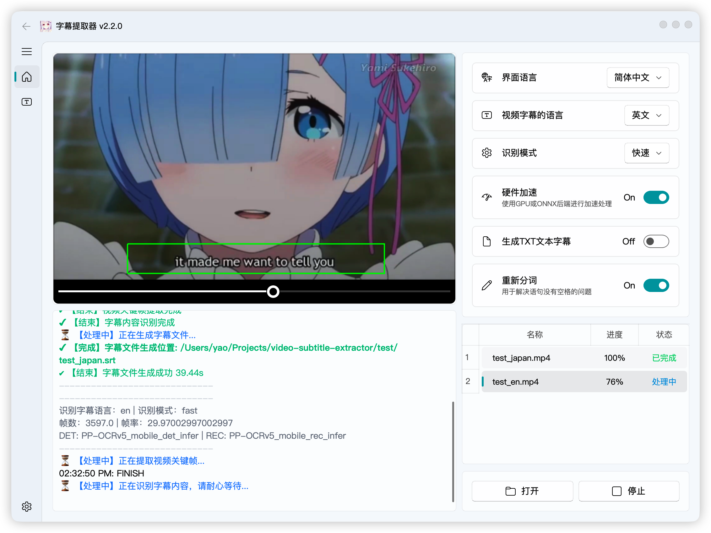

[简体中文](README.md) | English

<p align="center"></p>

## Introduction


Video-subtitle-extractor (VSE) is a software that extracts hard-coded subtitles from videos into external subtitle files (SRT format).

Key features:

- Extract key frames from videos
- Detect text positions in video frames
- Recognize text content in video frames
- Filter out non-subtitle text regions
- [Remove watermarks, channel logos, and original hard-coded subtitles — use with: video-subtitle-remover (VSR)](https://github.com/YaoFANGUK/video-subtitle-remover/tree/main)
- Remove duplicate subtitle lines and generate SRT subtitle files / TXT text files
- Support **batch extraction** of video subtitles
- Multi-language: supports subtitle extraction in **87 languages**, including **Simplified Chinese (Chinese-English bilingual)**, **Traditional Chinese**, **English**, **Japanese**, **Korean**, **Vietnamese**, **Arabic**, **French**, **German**, **Russian**, **Spanish**, **Portuguese**, **Italian**, and more
- Multiple modes:
  - **Fast**: (Recommended) Uses a lightweight model for quick subtitle extraction. May miss a small number of subtitles and have minor typos.
  - **Auto**: (Recommended) Automatically selects the model — uses the lightweight model on CPU and the precise model on GPU. Slower extraction speed, may miss a small number of subtitles, but with almost no typos.
  - **Precise**: (Not recommended) Uses the precise model with frame-by-frame detection on GPU. No missed subtitles and almost no typos, but **very slow**.

> Please use Fast/Auto mode first. Only switch to Precise mode if the first two modes miss too many subtitle lines.

<p style="text-align:center;"></p>

**Highlights**:

- Uses local OCR recognition — no need to configure any API or connect to online OCR services such as Baidu or Alibaba
- Supports GPU acceleration for higher accuracy and faster extraction speed

**Usage Guide**:

- For questions, please join the discussion group (QQ Group): 210150985 (full), 806152575 (full), 816881808 (full), 295894827

- Click [Open] to select video files, adjust the subtitle area, then click [Run]
  - Single file extraction: Select **one** video file when opening
  - **Batch extraction**: Select **multiple** video files when opening. Ensure all videos have the same resolution and subtitle area

- Remove watermark text / Replace specific text:
> If specific text appears in the video that needs to be removed or replaced, edit the ``backend/configs/typoMap.json`` file and add your replacements

```json
{
	"l'm": "I'm",
	"l just": "I just",
	"Let'sqo": "Let's go",
	"Iife": "life",
	"威筋": "威胁",
  	"性感荷官在线发牌": ""
}
```

> This will replace all occurrences of "威筋" with "威胁" and delete all "性感荷官在线发牌" text

- Please **do not use Chinese characters or spaces** in video and program paths, otherwise unexpected errors may occur!!!

  > For example, the following paths are NOT acceptable:
  >
  > D:\下载\vse\运行程序.exe (path contains Chinese characters)
  >
  > E:\study\kaoyan\sanshang youya.mp4 (path contains spaces)

- Download the compressed package, extract it, and run directly. If it doesn't work, try the source code installation with conda environment as described below.

**Download**: <a href="https://github.com/YaoFANGUK/video-subtitle-extractor/releases"> Release </a>

> **Please submit any improvement suggestions in ISSUES and DISCUSSIONS**


**Recognition Mode Selection**:

| Mode | GPU | OCR Model Size | Subtitle Detection Engine | Notes |
|------|-----|----------------|---------------------------|-------|
| Fast | Yes/No | Mini | VideoSubFinder | |
| Auto | Yes | Large | VideoSubFinder | Recommended |
| Auto | No | Mini | VideoSubFinder | Recommended |
| Precise | Yes/No | Large | VSE | Very slow |

> VideoSubFinder is the subtitle detection engine on Windows/Linux/macOS.

## Demo

- GUI version: [Click to view GPU version source code installation tutorial](https://www.bilibili.com/video/bv11L4y1Y7Tj)

<p style="text-align:center;"></p>


## Source Code Usage Guide

#### 1. Install Python

Make sure you have Python 3.12+ installed.

- Windows users can download and install Python from the [Python official website](https://www.python.org/downloads/windows/)
- MacOS users can install via Homebrew:
  ```shell
  brew install python@3.12
  ```
- Linux users can install via package manager, e.g. Ubuntu/Debian:
  ```shell
  sudo apt update && sudo apt install python3.12 python3.12-venv python3.12-dev
  ```

#### 2. Install Dependencies

Use a virtual environment to manage project dependencies and avoid conflicts with the system environment.

(1) Create and activate a virtual environment
```shell
python -m venv videoEnv
```

- Windows:
```shell
videoEnv\\Scripts\\activate
```
- MacOS/Linux:
```shell
source videoEnv/bin/activate
```

#### 3. Navigate to the Project Directory

Switch to the source code directory:
```shell
cd <source-code-directory>
```
> For example: if your source code is in the tools folder on drive D, and the source code folder is named video-subtitle-extractor, enter:
> ```shell
> cd D:/tools/video-subtitle-extractor-main
> ```

#### 4. Install the Appropriate Runtime Environment

This project supports **Windows** only, with two execution backends: **CPU** and
**DirectML (DML)**. OCR uniformly uses ONNX Runtime with official **PP-OCRv6** ONNX
models and does not depend on PaddlePaddle.

##### (1) CPU backend (no GPU or GPU not used)

```shell
pip install -r requirements.txt
```

##### (2) DirectML backend (AMD / Intel / NVIDIA GPU acceleration)

- Uses official PP-OCRv6 ONNX models with ONNX Runtime's `DmlExecutionProvider`.
  NVIDIA GPUs also go through DML — no CUDA/cuDNN installation needed.
- Uninstall the CPU build of onnxruntime first, then install the DirectML build
  (they cannot coexist):
  ```shell
  pip install -r requirements.txt
  pip uninstall -y onnxruntime
  pip install -r requirements_directml.txt
  ```
  > `onnxruntime-directml` 1.24.4+ is required (1.20.1 cannot be installed on Python 3.13).

##### (3) Model download and tiers

- Two model tiers (orthogonal to the frame-extraction mode, freely combinable in the GUI):
  - **Light**: `PP-OCRv6_small_det` + `PP-OCRv6_tiny_rec` — speed first;
  - **Precise**: `PP-OCRv6_small_det` + `PP-OCRv6_small_rec` — accuracy first.
- Models are downloaded on demand from the official Baidu mirror to
  `~/.paddleocr/onnx/` (not bundled), overridable via `VSE_ONNX_MODEL_DIR`.
  On startup the GUI checks model availability: if any are missing it shows which
  ones, the download URL and target directory, plus a "Download Missing Models" button.
- Manual download:
  ```
  https://paddle-model-ecology.bj.bcebos.com/paddlex/official_inference_model/paddle3.0.0/<model>.tar
  ```
  Extract into `~/.paddleocr/onnx/` so each model has `<name>/inference.onnx` and `inference.yml`.

##### (4) Backend and device selection in the GUI

The "Basic Settings" page offers:
- **OCR Backend**: `auto` (DML when available), `cpu`, `dml`;
- **Model Tier**: Light / Precise;
- **DML Device**: pick a detected GPU or auto-select;
- **Hardware Acceleration** master switch: off forces CPU.

#### 5. Run the Program

- Run the GUI version:

```shell
python gui.py
```

- Run the CLI version:

```shell
python ./backend/main.py
```

## FAQ

#### 1. Program not working / no results

Solutions: On the Basic Settings page check the OCR backend and model status. If using
DirectML, ensure `onnxruntime-directml` is installed (not the CPU build of `onnxruntime`)
and use the "Download Missing Models" button if models are missing.

#### 2. 7z file extraction error

Solution: Upgrade 7-Zip to the latest version.

## Sponsor

